Pour changer un peu, je vous propose de voir rapidement un jeu de petits chevaux en briques, en l’occurrence l’ensemble _40198_ intitulé _Le jeu des petits chevaux LEGO®_.

* * *

Sorti en 2018, pour la somme en boutique officielle de 39,99 €, cette boîte contient 398 pièces. Elle propose, comme son intitulé le laisse deviner, de construire en briques LEGO un jeu des petits chevaux, avec lequel on peut vraiment jouer, en plus.

La face avant de la boîte présente le jeu, auquel s’adonnent 4 figurines LEGO, vraisemblablement des enfants. Une petite mention en bas à droite indique que « les règles sont incluses », et en effet la notice décrit, très sommairement, les règles des petits chevaux.

Les chevaux sont comme il se doit des minifigurines LEGO, et il y en a donc 16, j’en reparlerai.

Le jeu reprend les quatre couleurs me semble-t-il habituelles d’un tel jeu, rouge, vert, bleu, jaune. Chaque quadrant du plateau dans lequel sont posées les figurines en attente présente un petit décor sommaire.

[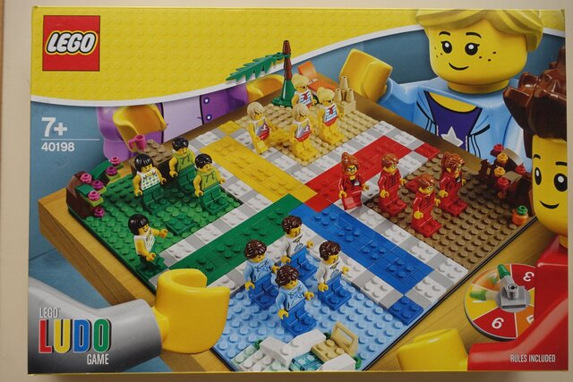](https://www.freelug.org/IMG/jpg/dsc02651.jpg)

Au dos une mise en scène du plateau au milieu d’une partie. Les figurines non dans la course profitent de leur quadrant pour se reposer ou s’amuser, c’est plus rigolo que simplement attendre son tour.

[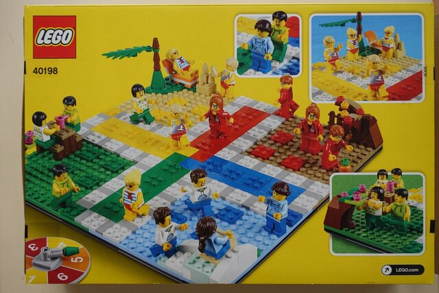](https://www.freelug.org/IMG/jpg/dsc02653.jpg)

* * *

Je ne vais pas en faire des tonnes sur le montage, qui implique 5 sachets (un pour la plaque et un pour chaque quadrant), il n’y a rien de compliqué. À noter que c’est la première fois que je vois dans une notice une indication claire de faire attention à la couleur de plaques : pour les quadrants rouge et jaune, les deux plaques tan et tan foncé sont côte à côte, et l’une est barrée d’un trait rouge. Ceci permet de bien montrer qu’il y a des couleurs similaires et qu’il faut prendre la bonne.

* * *

Voici donc le jeu totalement monté.

Chaque quadrant a quatre plaques 2x2 pour recevoir une figurine au repos. Le plateau ne comporte que 5 cases sur chaque ligne droite, alors que me semble-t-il les petits chevaux habituels en comportent 7, mais je ne vais pas faire la fine bouche.

[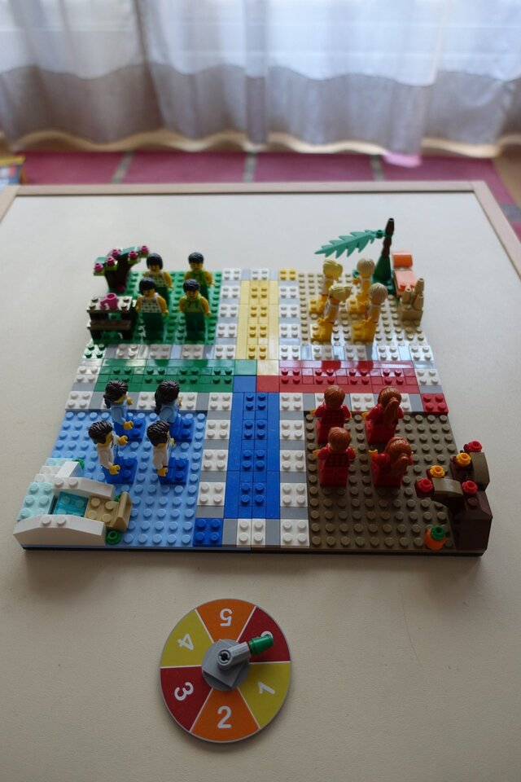](https://www.freelug.org/IMG/jpg/dsc02489-r90.jpg)

[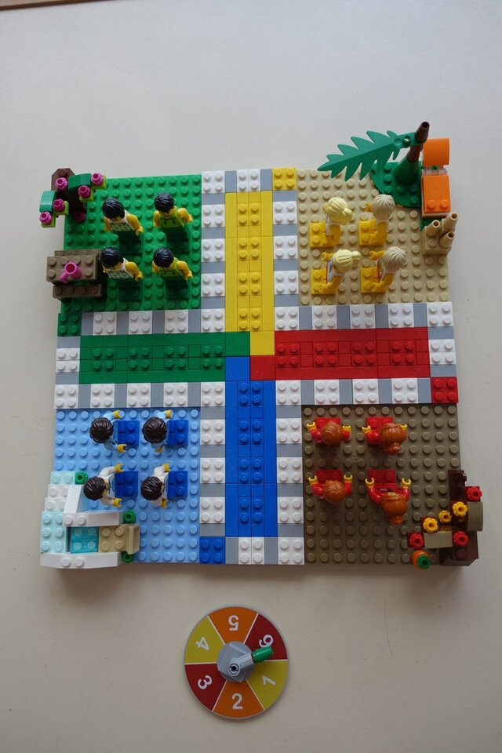](https://www.freelug.org/IMG/jpg/dsc02490-r90.jpg)

Le plateau de jeu se compose d’une plaque de base sur laquelle on monte des pièces lisses et d’autres à quelques tenons, et on pose les quadrants directement dessus. Il est donc facile de les enlever, c’est pratique même si la plaque de base prend toujours la même place elle...

[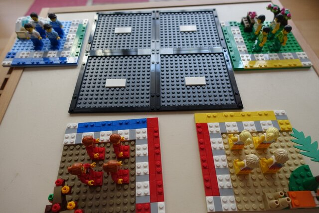](https://www.freelug.org/IMG/jpg/dsc02497.jpg)

[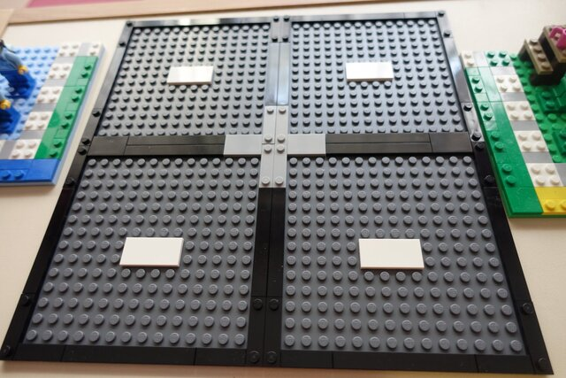](https://www.freelug.org/IMG/jpg/dsc02498.jpg)

Le quadrant vert est sur un thème un peu naturel, avec un arbre fleuri et une table à pique-nique, avec quand même une tasse, il faut bien pouvoir boire un peu de temps en temps.

[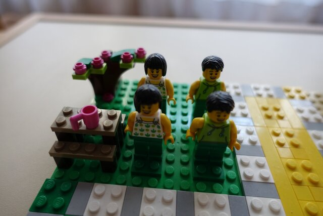](https://www.freelug.org/IMG/jpg/dsc02491.jpg)

[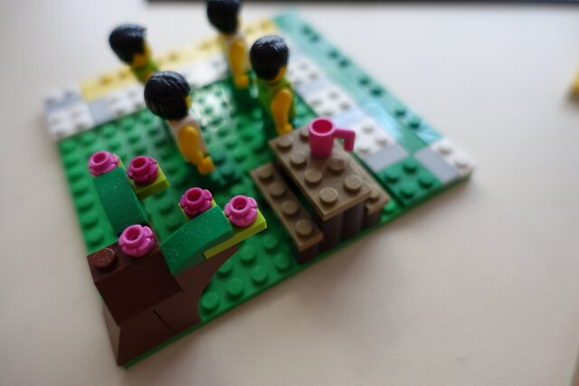](https://www.freelug.org/IMG/jpg/dsc02508.jpg)

Le quadrant jaune est clairement orienté plage, avec un palmier, un transat et un mini château de sable, au fond. Les figurines ont d’ailleurs une tenue de plage et des lunettes de soleil, on sent l’été !

[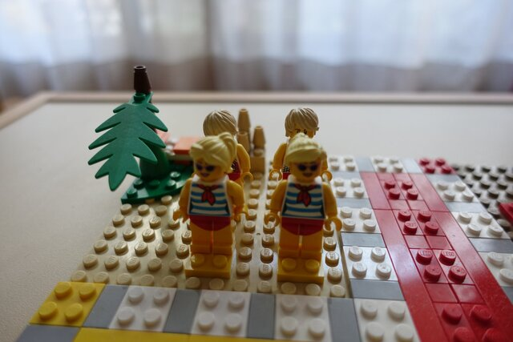](https://www.freelug.org/IMG/jpg/dsc02492.jpg)

[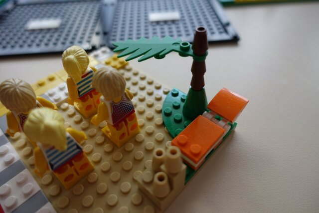](https://www.freelug.org/IMG/jpg/dsc02505.jpg)

Côté rouge c’est plutôt l’automne, avec encore un arbre et une petite citrouille (tête orange plus fleur verte, un grand classique vu dans de nombreux ensembles).

[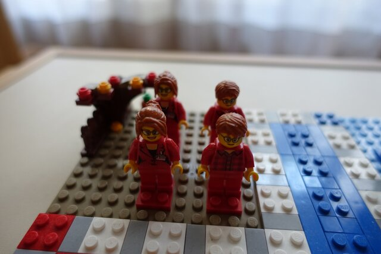](https://www.freelug.org/IMG/jpg/dsc02493.jpg)

[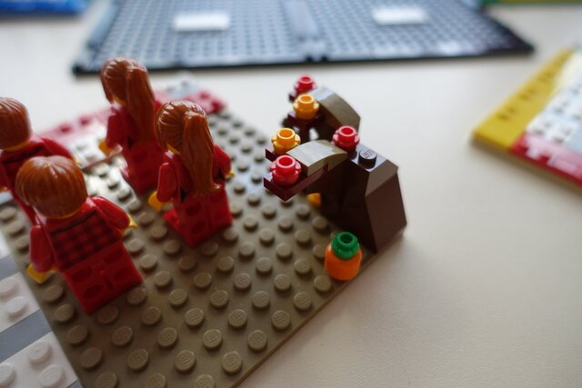](https://www.freelug.org/IMG/jpg/dsc02506.jpg)

Enfin le quadrant bleu est nautique, avec un petit toboggan et un mini flotteur. Par contre les figurines n’ont pas du tout une tenue adaptée à l’eau...

[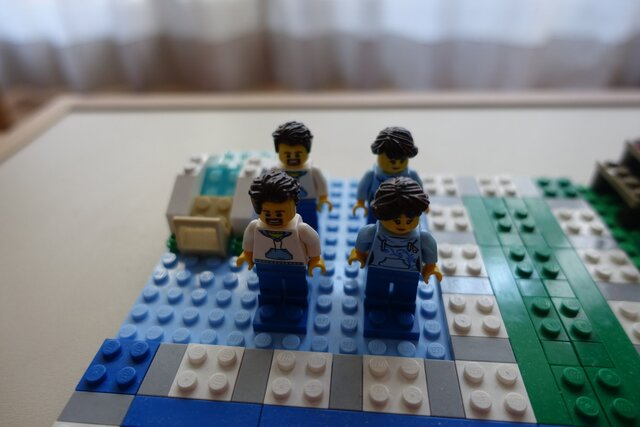](https://www.freelug.org/IMG/jpg/dsc02494.jpg)

[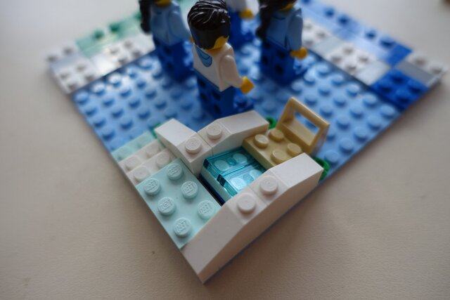](https://www.freelug.org/IMG/jpg/dsc02507.jpg)

Le dé de son côté est un disque 8x8 sérigraphié à six cases numérotées de 1 à 6, sur lequel on assemble une charnière et une petite pointe verte pour indiquer la case choisie.

Le principe est simple : on donne une impulsion à la pièce verte qui tourne et s’arrête sur un chiffre au hasard. En pratique j’ai quelques doutes, si la plaque n’est pas exactement horizontale, le chiffre qui sort n’est pas totalement aléatoire... Je ne sais pas pourquoi LEGO n’a pas fourni un dé comme il en existe, à 6 faces.

[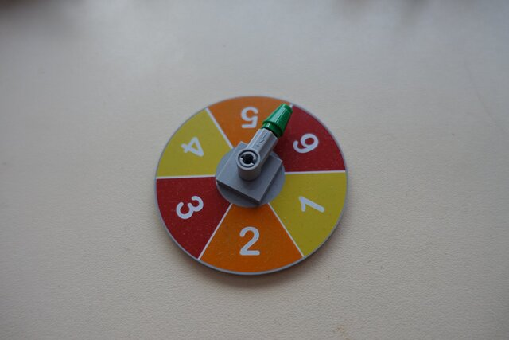](https://www.freelug.org/IMG/jpg/dsc02495.jpg)

* * *

Côté figurines, il y a donc 16 figurines, 4 de chaque couleur. Elles sont en double, il y a donc 8 figurines distinctes, chacune à dominante de la couleur de son quadrant. La parité est bien respectée, il y a deux hommes et deux femmes de chaque couleur.

Seules les jambes jaunes sont sérigraphiées, avec un maillot de bain de face uniquement (plus une bande rouge au dos), les autres sont uniformes. Les torses sont encore spécifiques plage pour le jaune, et moins liés à un thème pour les autres couleurs, mais ils ont tous des motifs au dos.

Toutes les chevelures et têtes sont différentes entre les 8 figurines, et on pourrait donc mélanger sur une même couleur pour avoir 4 figurines distinctes par couleur. 4 têtes ont un visage alternatif.

[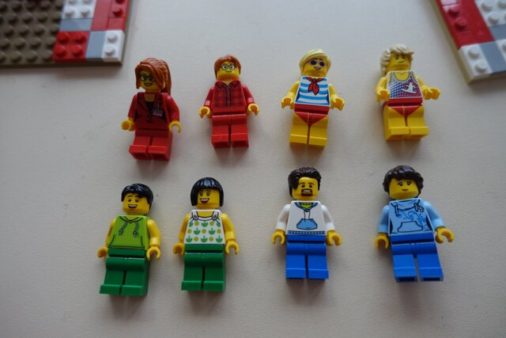](https://www.freelug.org/IMG/jpg/dsc02499.jpg)

[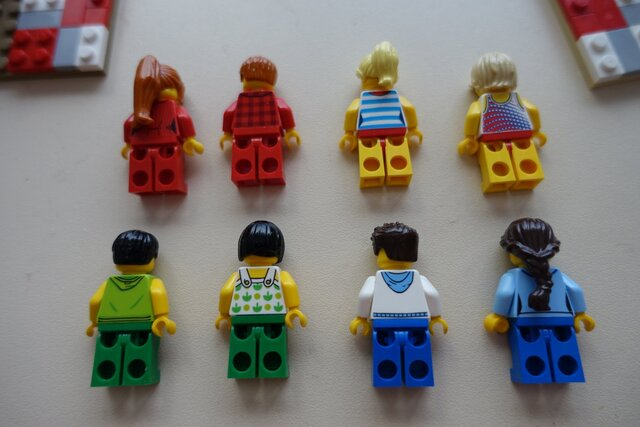](https://www.freelug.org/IMG/jpg/dsc02502.jpg)

[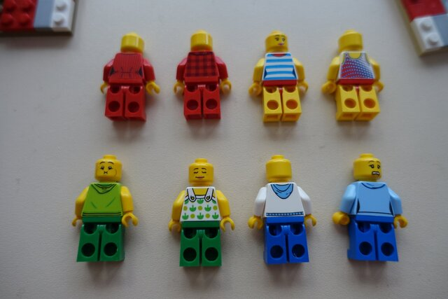](https://www.freelug.org/IMG/jpg/dsc02503.jpg)

* * *

_Avis :_ cet ensemble est bien amusant et vraiment fonctionnel, on peut réellement jouer aux petits chevaux avec. Après, j’admets l’avoir pris plutôt pour sa collection de pièces : une plaque de base, 4 plaques 16x16, et 16 figurines, ça fait un bon ratio pour le prix, je trouve.

Donc un ensemble pas indispensable, mais ça peut permettre d’ajouter quelques figurines et morceaux de décor dans une scène plus grande pour un prix raisonnable.
