Depuis sa naissance, le chemin de fer a toujours connu différents types d’écartements et ce pour des raisons diverses et variées. Au fur et à mesure du temps l’écartement de 1 435 mm s’est imposé comme la référence en Europe, voire aujourd’hui dans le monde. Mais au cours du temps d’autres écartements ont largement été utilisés. On distingue ainsi les voies larges, dont l’écartement est supérieur à 1 435 mm, la voie métrique, dont l’écartement entre chaque rail est de 1m, ainsi que les voies étroites, qui vont nous intéresser aujourd’hui. Je vous propose ici de nous atteler à la fabrication de la voie.

Maintenant que nous avons [quelques solutions pouvant permettre la construction d’un train possédant un écartement de 2 tenons de large](/articles/3038/), il est temps pour nous d’imaginer la voie. Ce deuxième article sera exclusivement consacré à cette étape. Elle a pour but de vous donner toutes les astuces vous permettant de vous constituer un réseau en 2 tenons de large.

[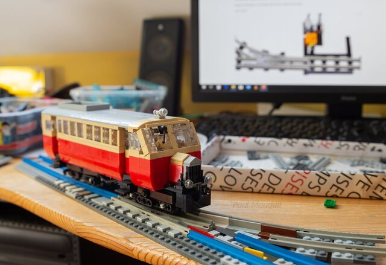](https://www.freelug.org/IMG/jpg/104872096_2627732420826627_7632374189311408723_o.jpg)

## Quel type de voie choisir ?

Le rail tout prêt avec un écartement de 2 tenons existe chez Lego. Les possibilités offerte par celui-ci sont néanmoins très limitées à cause d’une gamme très réduite. En effet seuls deux produits sont commercialisés par Lego : une courbe de rayon R40 ainsi que la ligne droite à plan incliné. Ce dernier élément est d’ailleurs plus adapté à un spacemountain qu’à un chemin de fer un tant soit peu réaliste. Par conséquent pendant plusieurs années, de nombreux MOCeurs ont imaginé leurs propres voies, principalement à partir de la première génération de rails LEGO. Elle a l’avantage d’être relativement économique (malgré l’augmentation du prix des rails droits gris) et d’offrir un certain nombre de libertés au niveau de la construction du rail. En revanche, la géométrie reste imparfaite ce qui rend l’ensemble fragile et peut engendrer des déraillements. Pour éviter ce dernier défaut il est important de faire plusieurs essais après la construction.

En parallèle, avec l’essor des imprimantes 3D et leur démocratisation, plusieurs entreprises se sont lancées dans la production de voies LEGO, d’abord avec des voies de 4 tenons de large puis dans la production de coupons de 2 tenons de large. La société TrixBrix ([https://trixbrix.eu/en\_US/c/Narrow-Gauge/26](https://trixbrix.eu/en_US/c/Narrow-Gauge/26)), propose ainsi une gamme de voie étroite assez large. Néanmoins l’utilisation de l’impression 3D pour la production impose des coûts relativement élevés, qui se répercutent inévitablement dans le prix. A noter que l’entreprise propose également dans son catalogue des raccords entre les deux types de voies.

Enfin, il est important de ne pas se limiter à ces deux solutions qui sont peut-être les plus évidentes. Certains MOCeurs ont ainsi imaginé une voie à l’aide de tiles 1x ?. J’en parlerai brièvement en fin d’article.

## Fabriquons notre voie coupon par coupon

Entrons dans le vif du sujet. Ici nous allons essentiellement nous focaliser sur la fabrication de la voie à partir de rails gris (ou bleus selon les envies/besoins). C’est en effet la solution que j’ai pu très largement expérimenter et mettre au point.  
Je parlerai brièvement en fin de la fabrication de voie à l’aide de tiles 1x ?

[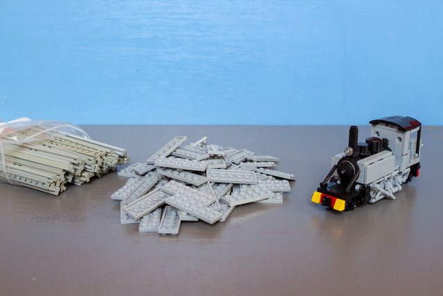](https://www.freelug.org/IMG/jpg/1-13.jpg)

-   Le coupon rail droit :

Le rail droit est probablement l’élément le plus simple à fabriquer. C’est aussi la clef de voute de l’architecture du réseau. Il est donc important de ne pas négliger cet élément.  
La version la plus simple ne requiert l’utilisation que de 4 plates 2x6 (noirs, marrons, gris...), et possède un rendu relativement simple.

[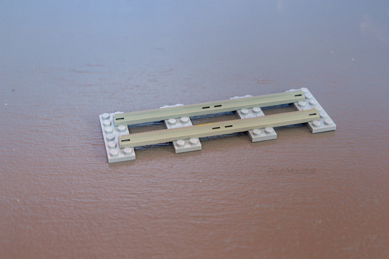](https://www.freelug.org/IMG/jpg/rail_droit_simple.jpg)

Dans un souci du détail, voici une version un peu plus détaillée et ballastée. J’ai opté pour des traverses noires car les tiles 2x1 et 1x1 sont relativement bon marché (à l’inverse des tiles marrons). De plus le noir ne choque pas, les traverses bois étant régulièrement recouvertes de goudron pour éviter de de détériorer avec le temps.

[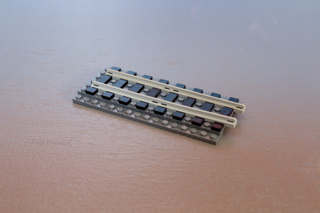](https://www.freelug.org/IMG/jpg/rail_droit_ballaste.jpg)

[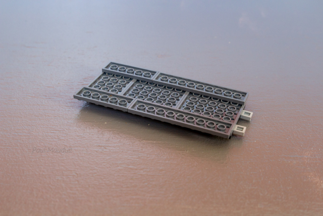](https://www.freelug.org/IMG/jpg/rail_droit_ballaste_2_.jpg)

Pensez bien à fabriquer quelques raccords en plus, de manière à faciliter la fabrication du circuit

[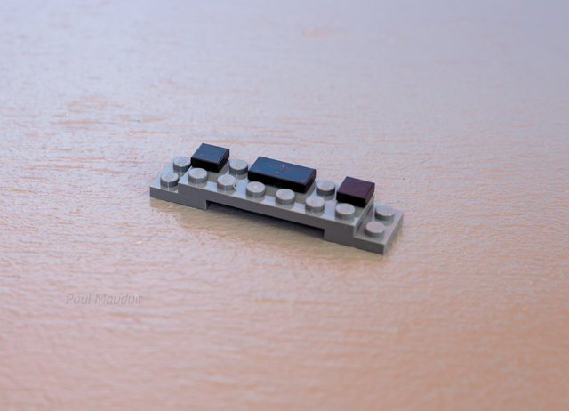](https://www.freelug.org/IMG/jpg/raccord.jpg)

A partir de ce modèle on peut très facilement imaginer d’autres variantes. Par exemple, le rail Decauville est un type de rail léger très utilisé pendant la Première Guerre mondiale. Il a la particularité d’avoir des traverses métalliques aux bords arrondis.

Pour évoquer ce type de voie, on pourra ainsi opter pour des traverses en tiles bluish gray avec des tiles 1x1 arrondies de la même couleur ([https://www.bricklink.com/v2/catalog/catalogitem.page?P=24246#T=C](https://www.bricklink.com/v2/catalog/catalogitem.page?P=24246#T=C)).  
A noter que les deux types de voies ont très largement cohabité. En effet, les tronçons à traverses en bois étaient utilisés pour les sections principales et/ou stratégiques tandis que les voies en traverses métalliques servaient essentiellement pour des voies temporaires ou bien des voies de service.

-   Le coupon rail courbe :

La fabrication du coupon rail courbe est un peu plus complexe que la fabrication du coupon rail droit. Il demande l’utilisation d’un rail courbe extérieur ainsi que de 3 rails courbes intérieurs.

Pour concevoir le coupon, je recommande de commencer par construire la version simplifiée dans un premier temps. Elle permet de bien prendre en compte les tenants et aboutissants de la construction. Le coupon est constitué de 2 morceaux dissociables, mais qui permettent d’éviter tout décalage.

[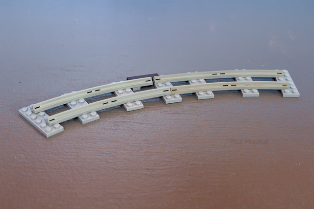](https://www.freelug.org/IMG/jpg/rail_courbe_simple.jpg)

Il est ainsi important de conserver un écart entre les deux morceaux sur l’extérieur afin de garder une géométrie correcte. N’oubliez pas de glisser une plate 1x2 sous le morceau de gauche de manière à pouvoir clipser un tile 1x4 (en marron) qui se rattachera à la première traverse du morceau droit. Cela permet de garder un ensemble modérément plus résistant.

De la même manière les rails doivent être le plus parallèles possible des traverses aux extrémités afin d’éviter un décalage dans le circuit qui sera amplifié lors du montage.  
Pour cela n’hésitez pas à fixer une brick 1x6 sur les tenons qui servira à accueillir le coupon suivant.

[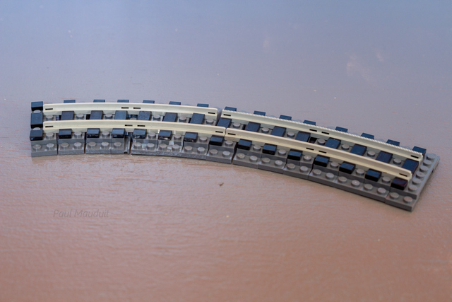](https://www.freelug.org/IMG/jpg/rail_courbe_ballaste.jpg)

La version ballastée demande une rigueur accrue lors de la disposition des plates 2x6 qui modéliseront le ballast.

[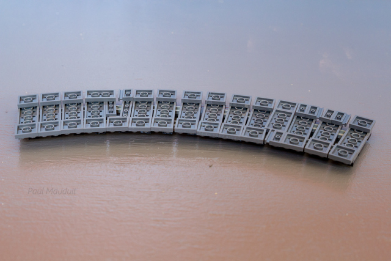](https://www.freelug.org/IMG/jpg/rail_courbe_ballaste_2_.jpg)

Enfin, le coupon est plus fragile que la version simplifiée car les deux morceaux ne sont rattachés qu’en un seul tenon. Ici encore attention à garder un espace suffisant entre les deux rails extérieurs.

[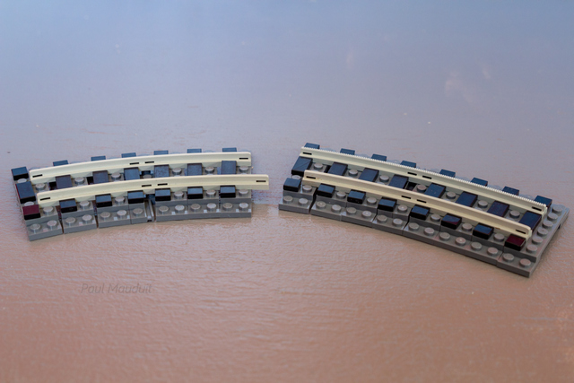](https://www.freelug.org/IMG/jpg/rail_courbe_decoupage.jpg)

-   L’aiguillage :

C’est assurément l’élément qui vous demandera le plus de temps. La conception n’est pas très intuitive et sa mise en place demande une vraie phase de mise au point. Néanmoins c’est un atout clef si l’on veut construire un réseau à cet écartement, fonctionnel.

Je ne propose ici qu’une version ballastée, car la réalisation du coupon demande une surélévation du rail d’un minimum de deux plates (même dans sa version simplifiée), ce qui correspond davantage aux versions ballastées.

[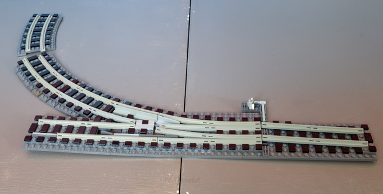](https://www.freelug.org/IMG/jpg/aiguillage.jpg)

Le plus simple est de commencer par la partie mobile, celle qui va guider le train.

[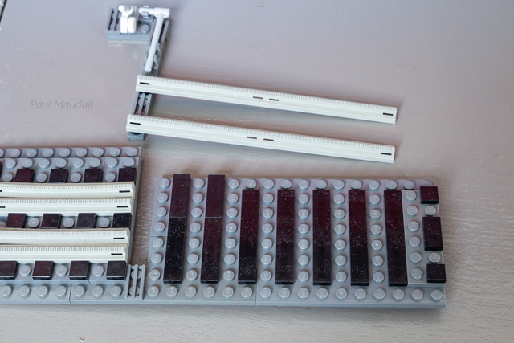](https://www.freelug.org/IMG/jpg/aiguillage_3_.jpg)

Il est important de bien fixer toutes les plates avec les tiles qui représentent ici les traverses.

[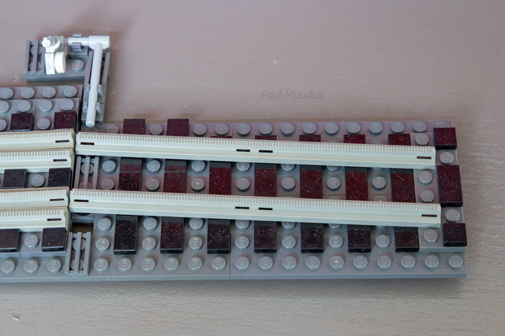](https://www.freelug.org/IMG/jpg/aiguillage_2_.jpg)

Il faut ensuite s’attaquer à la partie la plus délicate qui permettra au train de changer de direction. Les rails courbes sont très contraints et il se peut que vous ayez du mal à les insérer. N’hésitez pas à insister.

[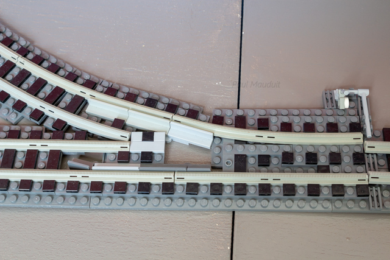](https://www.freelug.org/IMG/jpg/aiguillage_4_.jpg)

[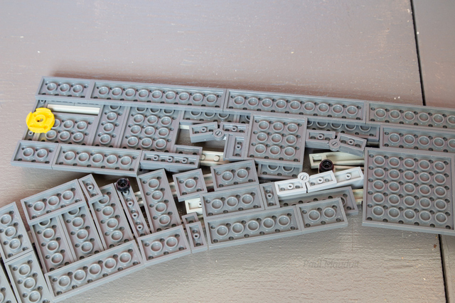](https://www.freelug.org/IMG/jpg/aiguillage_5_.jpg)

Pour vous guider prenez bien le temps de regarder les images et les différents empilements.

Enfin à la fin de la construction vous noterez un léger décalage de 4 tenons. Pour résorber ce décalage, vous pouvez construire ce petit raccord. A l’échelle du réseau il se fond à merveille dans le décor.

[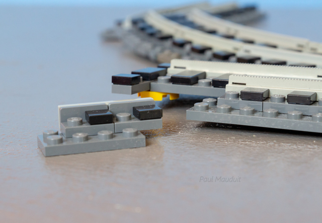](https://www.freelug.org/IMG/jpg/aiguillage_1_.jpg)

Si jamais ce raccord vous gène visuellement vous pouvez sinon opter pour l’achat d’un rail raccourci TrixBrix.

La dernière section en courbe (celle détachée sur la première photo de l’aiguillage) est similaire au morceau gauche de fabrication de la courbe.

## De multiples possibilités

D’autres solutions existent et sont même encore à développer. Ainsi pour construire un dépôt sur une surface réduite, j’envisage une nouvelle approche avec une voie directement fixée aux plaques de bases.

[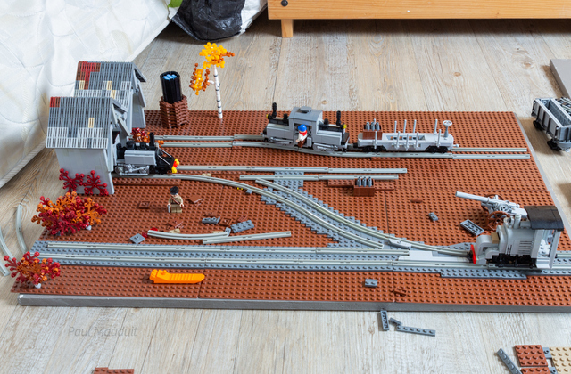](https://www.freelug.org/IMG/jpg/diorama_14-18.jpg)

Seule la voie principale sera ballastée à l’aide de plates et tiles dark bluish grey. Les autres voies seront noyées dans la terre comme c’est souvent le cas pour les voies de service. Pour l’occasion j’ai ainsi imaginé un nouveau type d’aiguille non fonctionnelle.

[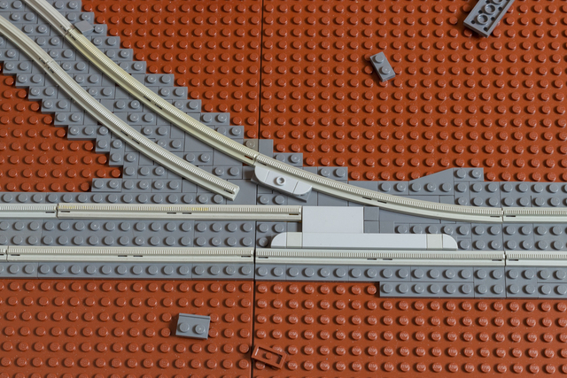](https://www.freelug.org/IMG/jpg/narow_gauge_switch_.jpg)

D’autres MOCeurs ont également imaginé d’autres types de voie, dont une voie construite à l’aide de tiles. La solution parait improbable dite telle quelle, mais pourtant pas tant que ça.

En effet, ce système possède l’avantage de rendre le constructeur totalement libre de son circuit. Les tiles sont fixées à l’horizontale sur des clips ([https://www.bricklink.com/v2/catalog/catalogitem.page?P=15712#T=C](https://www.bricklink.com/v2/catalog/catalogitem.page?P=15712#T=C)) . En revanche, j’imagine qu’il est moins solide que la fabrication des coupons de voies vu précédemment. Cela impliquerait la fabrication de modules plus ou moins encombrants, dont il faut anticiper le déplacement pour ceux qui participent aux expositions.

N’ayant pas testé cette solution, je vous réoriente vers [la galerie Flickr de Steve5010](https://www.flickr.com/photos/the_kirschte/16051333367/in/photostream/) qui montre comment il a mis en œuvre cette technique pour arriver à un circuit de voies intéressant.

## Une nouvelle façon de faire du train Lego

Pour conclure l’objectif de ces 2 articles est simple : sortir des sentiers battus en démocratisant la voie étroite. De manière générale le train à voie étroite est peu représenté car méconnu du grand public. Et pourtant le sujet lui-même invite au voyage, un voyage dans le temps, dans la culture, et qui nous oblige à faire preuve de créativité. C’est un tout nouvel univers dans lequel il y en a pour tous les goûts. Du tramway parisien d’antan à la desserte industrielle des années 60, en passant par la Micheline malgache, ou encore la construction même d’une voie ferrée... Tout est possible et il ne reste plus qu’à tracer votre voie.

Bonne construction à tous.
