Aujourd’hui lançons-nous dans l’espace avec l’ensemble numéro _60225_ intitulé _Le véhicule d’exploration spatiale_, de la gamme City.

Sorti en 2019, cet ensemble coûte 19,99 € sur la boutique officielle et contient 202 pièces, dont deux minifigures.

Sans surprise la face avant de la boîte, qui présente comme il se doit le véhicule, porte la mention « City », avec en haut à droite un astronaute pour indiquer que l’ensemble se range dans la catégorie « espace ».

Le véhicule est présenté en pleine action, en train de ramasser du minerai pendant que les panneaux solaires se font bronzer et que l’astronaute, en combinaison comme il se doit, utilise quelques instruments.

À noter la mention « Inspired by NASA test rovers » avec une photo d’un véhicule de la NASA en bas à gauche. Cette mention est traduite sur le côté par « Inspiré par les véhicules d’exploration de la NASA », ce qui est très légèrement différent comme sens pour moi (il manque le côté « véhicule de test »).

Bon, un indice permet de dire qu’il ne s’agit pas d’un véhicule vraiment dans l’espace : une observatrice prend des notes, avec son ordinateur, et elle n’a pas de combinaison spatiale... À moins qu’il ne s’agisse d’une extra-terrestre évidemment, qui sait ?

[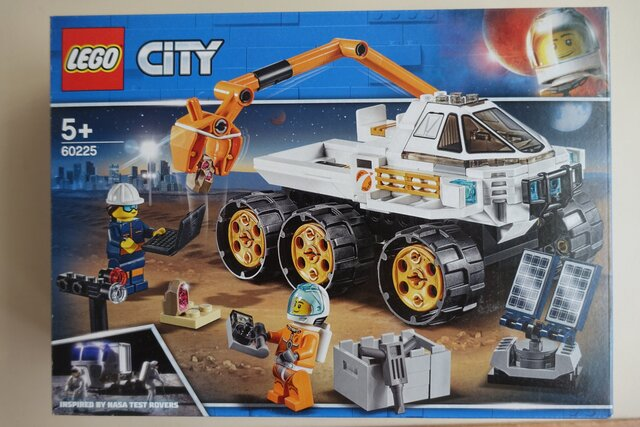](https://www.freelug.org/IMG/jpg/dsc02605.jpg)

Au dos on retrouve les mêmes éléments, un peu mis en scène différemment. Il y a également une photo d’un véhicule de la NASA, tandis qu’un pictogramme précise bien qu’il y a des sachets numérotés dans la boîte.

[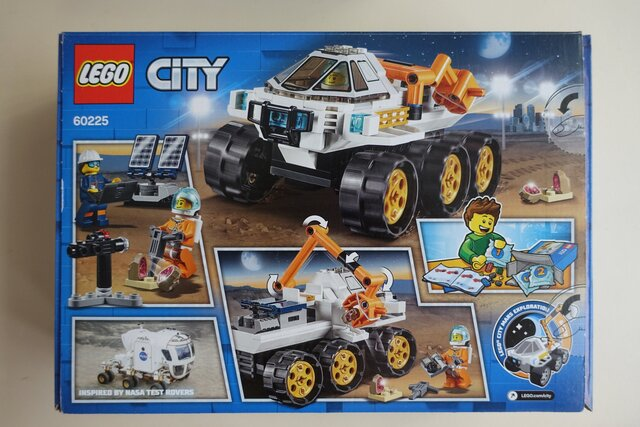](https://www.freelug.org/IMG/jpg/dsc02607.jpg)

* * *

Je ne vais pas détailler le montage, il s’agit d’un ensemble « 5+ », sans technique particulièrement intéressante.

Voici le véhicule assemblé, avec à côté une observatrice et un appareil de mesure sans doute.

Le véhicule comporte une magnifique pince articulée, qui lui permet de ramasser différents objets. À l’arrière sont posés une caisse contenant marteau-piqueur et roche avec cristal, et un bloc de panneaux solaires (je n’ai pas appliqués les autocollants). La pince se range proprement sans trop dépasser, c’est sympa.

[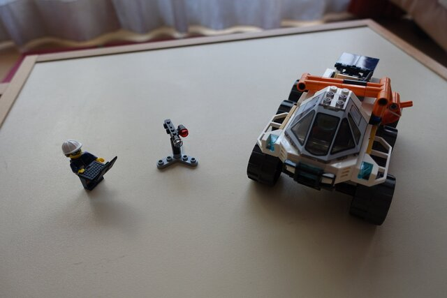](https://www.freelug.org/IMG/jpg/dsc02522.jpg)

[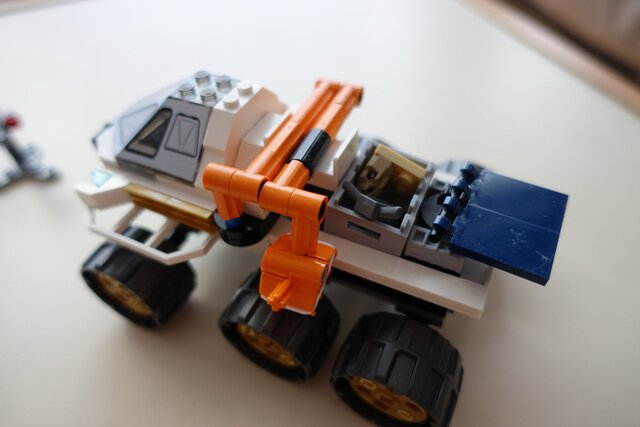](https://www.freelug.org/IMG/jpg/dsc02524.jpg)

C’est une pince formée de deux mâchoires fermées par un élastique, donc elle n’a pas non plus une force extraordinaire. Cependant elle peut soulever la caisse sans problème.

[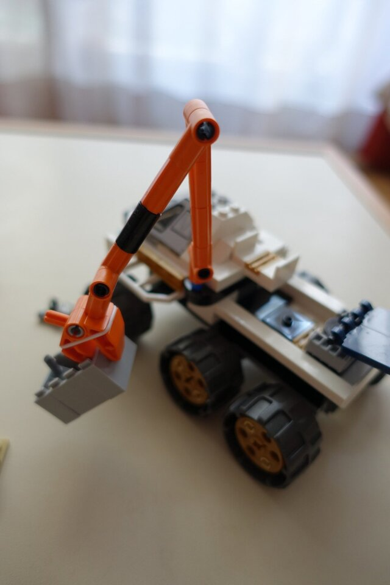](https://www.freelug.org/IMG/jpg/dsc02536-r90.jpg)

Par contre elle est bien articulée, et peut vraiment bouger dans toutes les directions, s’étendre assez loin. Un outil indispensable pour l’exploration spatiale, manifestement !

[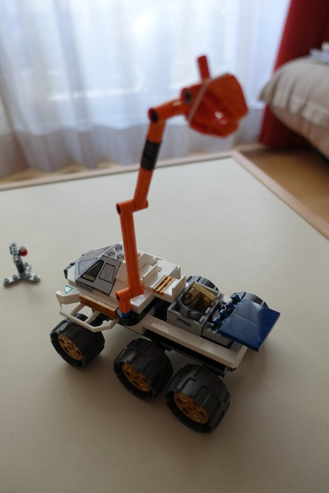](https://www.freelug.org/IMG/jpg/dsc02525-r90.jpg)

Voici la caisse et les panneaux solaires déchargés. La roche est composée de deux pièces de rocher avec un cristal sur un côté, une pièce que je ne connaissais pas. Les deux morceaux côte à côte font que le cristal est caché, mais heureusement l’astronaute peut grâce à son marteau-piqueur les découvrir.

[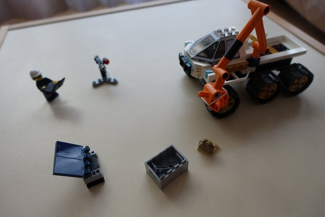](https://www.freelug.org/IMG/jpg/dsc02526.jpg)

[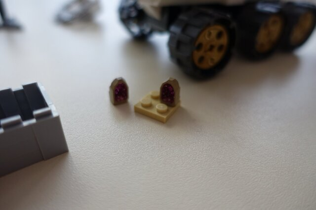](https://www.freelug.org/IMG/jpg/dsc02529.jpg)

Les roues du véhicule ne sont pas particulièrement articulées, mais leur construction donne un peu de jeu, ce qui leur permet de partiellement s’adapter au terrain sur lequel roule le véhicule.

[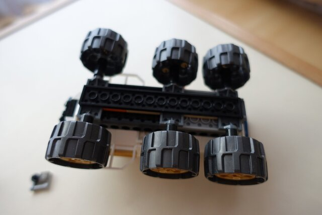](https://www.freelug.org/IMG/jpg/dsc02537.jpg)

Ici il grimpe un bord de cratère, et les roues suivent bien la courbure. Bon, il ne faut pas une trop grosse pente non plus.

[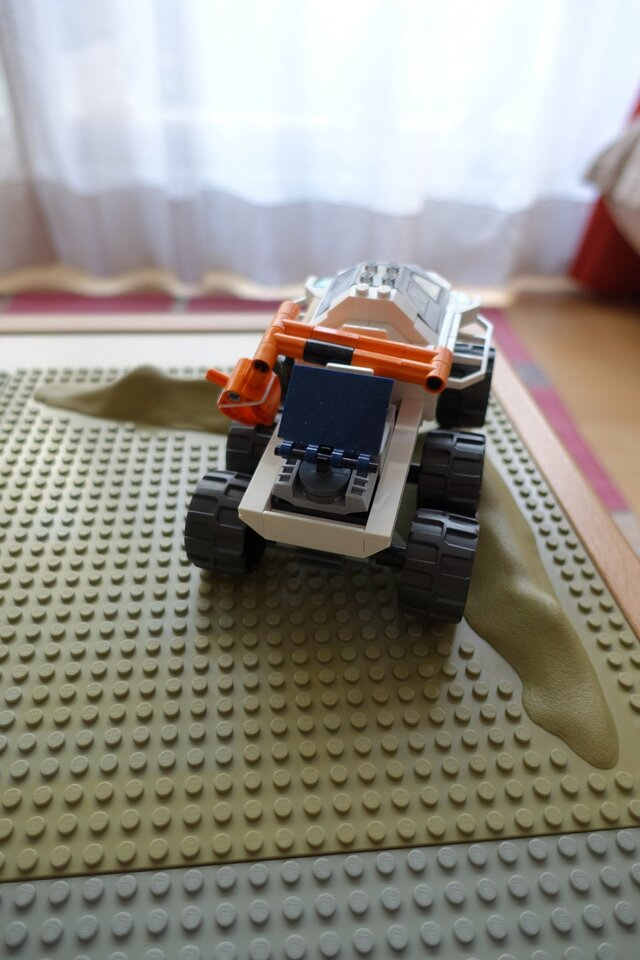](https://www.freelug.org/IMG/jpg/dsc02539-r90.jpg)

La verrière du cockpit est une pièce sérigraphiée accrochée, pas de charnière, il faut la retirer pour mettre l’astronaute au poste de pilotage. Le siège est construit avec diverses pièces, dont des 2x1 courbes, et une pièce 2x1 sérigraphiée avec cadrans. Je trouve amusant de mettre des pièces « lingot » sur les bords, je ne sais pas pourquoi ce ne sont pas des pièces plates...

[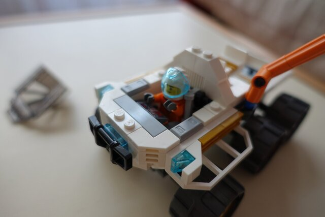](https://www.freelug.org/IMG/jpg/dsc02527.jpg)

[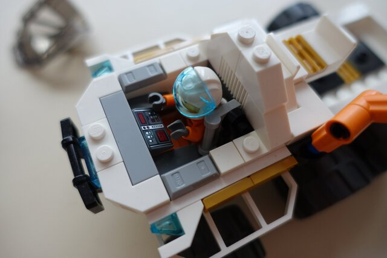](https://www.freelug.org/IMG/jpg/dsc02528.jpg)

[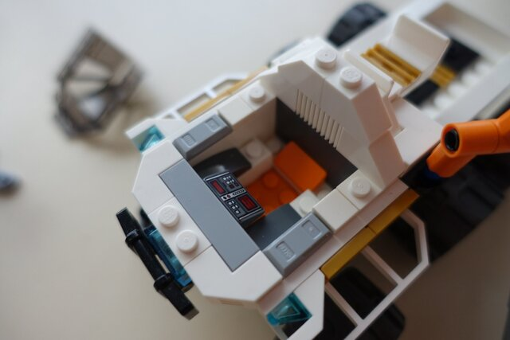](https://www.freelug.org/IMG/jpg/dsc02535.jpg)

Enfin l’observatrice prend des notes sur son portable, pour suivre les résultats du test du véhicule.

[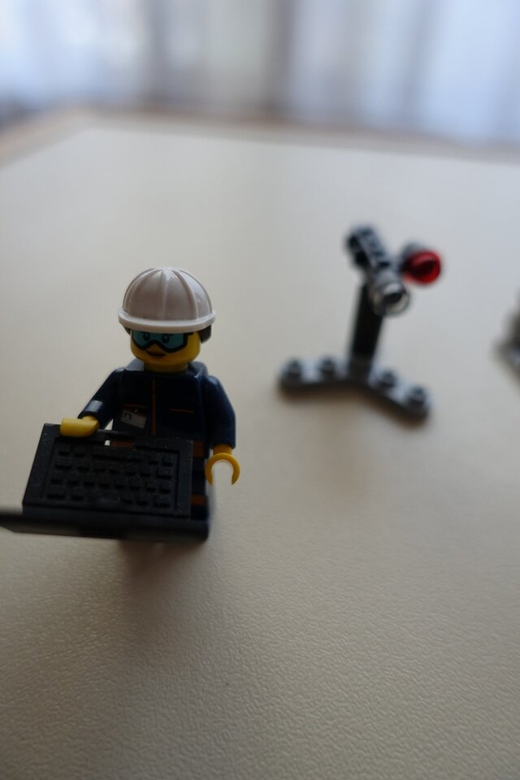](https://www.freelug.org/IMG/jpg/dsc02530-r90.jpg)

Côté figurines justement, l’astronaute a une belle combinaison spatiale sérigraphiée, avec quelques cadrans et joints d’étanchéité. Il a comme il se doit des bouteilles d’oxygène dans le dos. Casque et verrière sont me semble-t-il assez répandus. L’observatrice porte des lunettes et un casque de protection, et son costume a des bandes de couleur sans doute brillantes, afin qu’elle soit bien visible — pas d’accident ! Longue queue de cheval dans le dos et plaque d’identification sur l’avant complètent la tenue.

[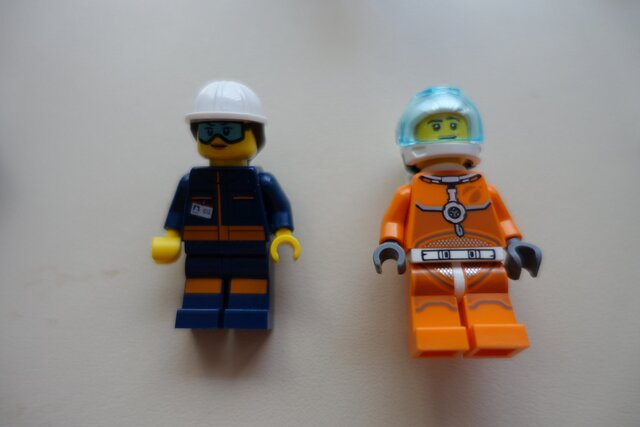](https://www.freelug.org/IMG/jpg/dsc02531.jpg)

[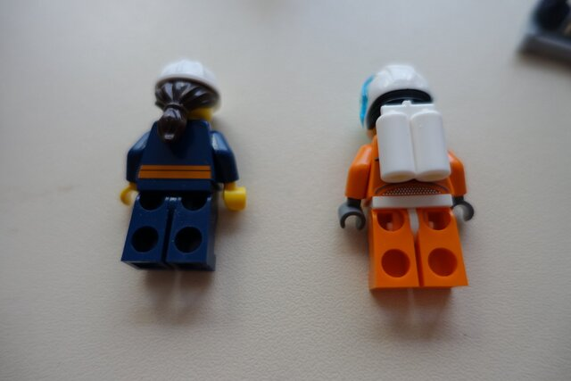](https://www.freelug.org/IMG/jpg/dsc02533.jpg)

* * *

_Avis :_ construction assez basique, avec un rendu sans fioritures mais qui fait bien le travail. Associé à d’autres véhicules liés à l’espace, celui-ci ne détonnera pas trop. J’aurais cependant probablement préféré une seconde figurine d’astronaute à une observatrice, qui gâche un peu l’immersion dans l’espace.

Sans être indispensable, cette petite boîte me plaît au final, et égayera sans souci un diorama, même de ville, il suffirait de mettre des barrières autour, du public, et de laisser imaginer qu’il s’agit d’une démonstration publique du véhicule.
