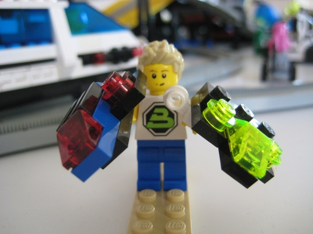
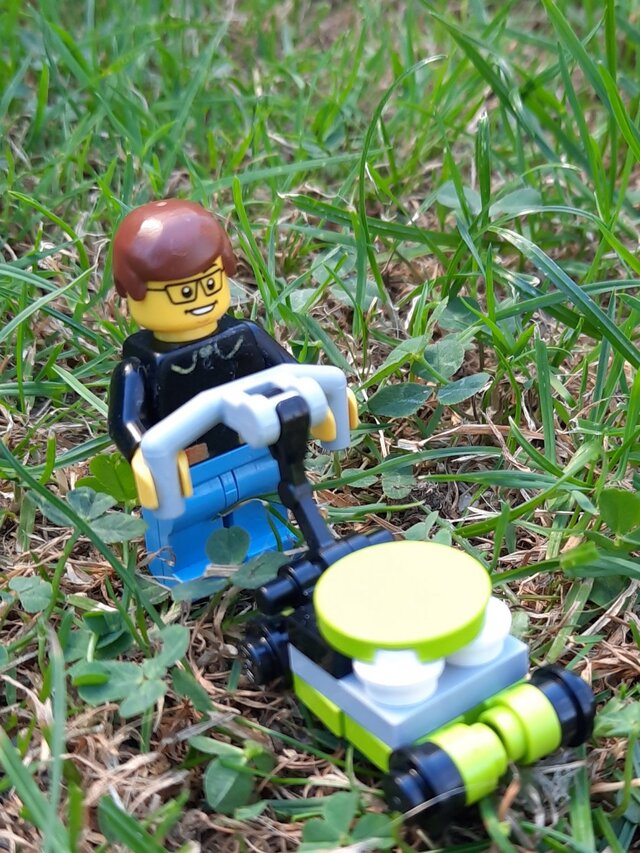
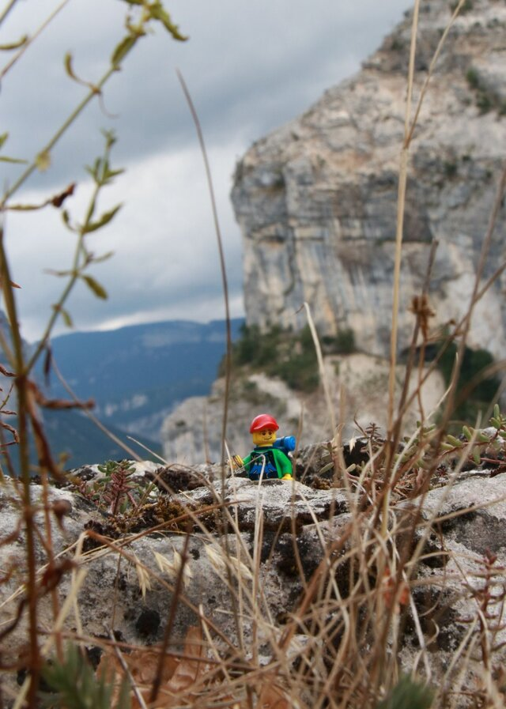
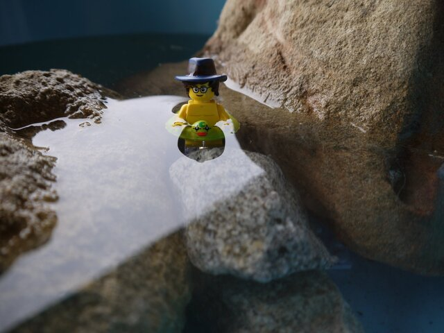
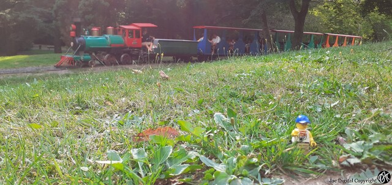
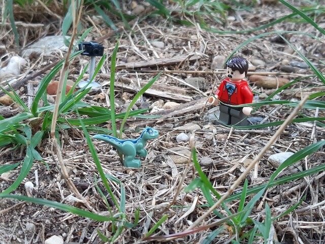
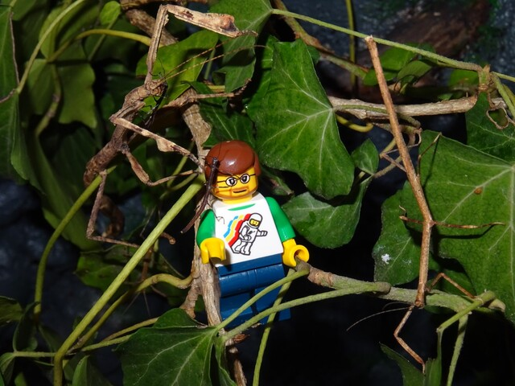
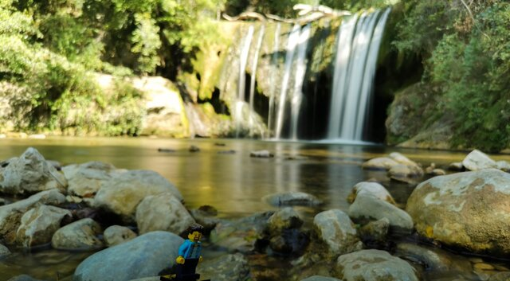

8 photographes, quelle photo obtiendra le plus de suffrage ?

Il est temps de découvrir les participations du concours photo "l’été des Freelugiens"

Tout d’abord, nous tenons à remercier les 8 participants qui nous ont proposé des photos originales.

Les participations sont présentées dans l’ordre de réception.

1\. Nicolas G. : Dans ma pièce LEGO

2\. William V.D. : Dans mon jardin

3\. Stéphane B. : Dans les hauteurs de Pont en Royans

4\. Olivier C. : J’ai pris mon camping-car et zou ! En route pour la mer ! Pour plus de sécurité, je prends ma bouée, bien sûr, et comme d’habitude, je n’oublie pas mon chapeau.

5\. Jérôme T. : Au Parc Fenestre de La Bourboule. Comme d’habitude, j’attends le train qui arrive. Comme d’habitude, je rêve et le train passe derrière moi !

6\. François D. : Je me promène régulièrement en pleine nature avec mes dinosaures sous le bras, et depuis peu, je me met en scène avec eux. Cette photo a été prise en bas de chez moi, le long d’une petite rivière. Un petit coin sauvage qui va très bien avec mon thème de prédilection.  
Le sujet : Moi surpris en croisant un dinosaure pour de "vrai"

7\. Rémi L. : Cet été, élevage de phasmes type bâton "Hermagoras Cultratolobatus". A votre avis, combien il y en a t’il sur la photo ?

8\. Mathieu W. : Au pied de la cascade blanche dans la Drôme  
Une journée au frais pendant l’été où nous avons eu très chaud

Les votes ont pris fin le 30 novembre 2020 et les [résultats de chacun sont consultables sur le forum](https://forum.freelug.org/viewtopic.php?f=8&t=807)

Les heureux gagnants car ils sont 2 ex æquo sont :  
**–** 4. Olivier C. qui remporte le set ref 60117 - City - Van & Caravan  
**–** 3. Stéphane B. qui remporte le set 60150 - City - Pizza Van

Félicitation à eux et merci à toutes et tous pour votre participation

A bientôt pour un nouveau concours !
