Cette très belle locomotive fait partie des incontournables machines de traction du réseau suisse. Je n’ai pas assez de connaissances pour vous faire un exposé complet ici. Mais il ne manque pas d’informations à son sujet sur la toile. Je vais plus me consacrer au montage de ce set, en tant que passionné des briques LEGO.

Dans la gamme des trains Lego, on retrouve d’autres approches de ces anciennes locomotives électriques. Il faut dire que le principe du châssis tout articulé a bien aidé à la conception des machines. Cela lui permet de passer sur des courbes très serrées. Ça lui donne un côté lézard, surtout lors de franchissement des aiguillages. Il y a eu la très belle mais très simplifiée 4551 en 9V. Puis plus récemment le Hobby Train 10183 qui permettait une reproduction plus fidèle.

Avec la 10277, on s’adresse à un public plus adulte, plus exigeant, avec un modèle très réussi esthétiquement.

Commençons d’abord par les présentations habituelles :

-   Année de sortie 2020.
-   Prix 100€, sur le Shop, à l’heure où j’écris ces lignes.
-   Temps de montage environ 4h.
-   Sachets numérotés jusqu’à 4, mais la boîte en contient un peu plus.
-   Un couple de minifigs.

La boite est tout simplement magnifique, de face comme de dos. On sent que l’on ne s’adresse plus aux enfants. La brique passe du mode jouet à celui de l’occupation zen, pour se détendre et construire quelque chose de beau. Il faut avoir plus de 18 ans pour construire ce set, mais ce n’est pas une obligation.

[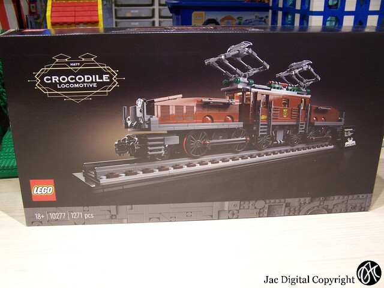](https://www.freelug.org/IMG/jpg/photo_01-3.jpg)

Au dos, quelques photos supplémentaires de la locomotive et la dimension totale de la maquette, 52cm. Il va falloir faire de la place. On sait aussi que l’on aura la possibilité de motoriser cette belle motrice, grâce au nouveau système de commande qui n’est pas compris dans la boite.

[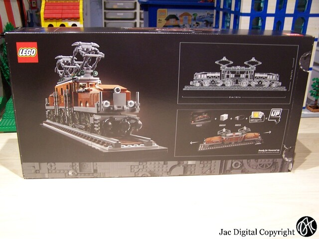](https://www.freelug.org/IMG/jpg/photo_02-4.jpg)

Une fois que l’on a ouvert la boite, on se rend compte du nombre conséquent de sachets, même si la numérotation s’arrête à 4.

[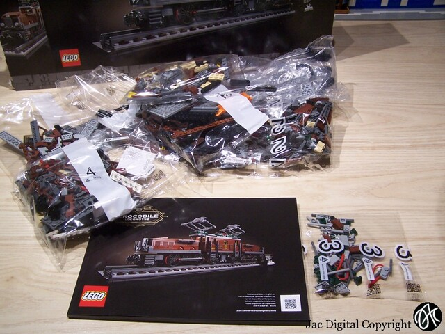](https://www.freelug.org/IMG/jpg/photo_03_.jpg)

Le premier lot de pièces à assembler ne semble pas très diversifié. Mais c’est normal, il faut commencer par le socle, avec les rails et leurs 32 traverses. Le montage est un peu répétitif, forcément. Mais ça va assez vite et tout se passe très bien.  
Une fois fini, on est prêt pour commencer le montage de la locomotive. Et mais l’endroit est réservé là !

[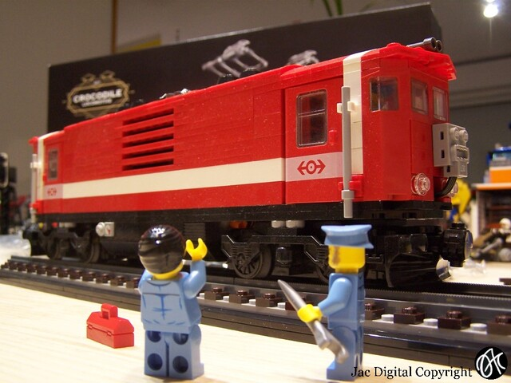](https://www.freelug.org/IMG/jpg/photo_06_.jpg)

Le socle comporte deux briques noire placées entre les rails. Cela va permettre d’enchainer le montage de la locomotive directement dessus. Avec la petite plaque de présentation, c’est très propre. C’est aussi le seul autocollant à poser dans cette boite. Il reste 2 pièces en plus après cette première partie. Comme dit dans la présentation, nous avons droit ici à un couple de minifigs. C’est très plaisant. La petite sacoche me rappelle celle que prenait mon père lorsqu’il partait conduire les trains. Par contre, elle était marron.  
Je rajouterai bien des poteaux avec la caténaire, mais le support n’est pas assez large.

[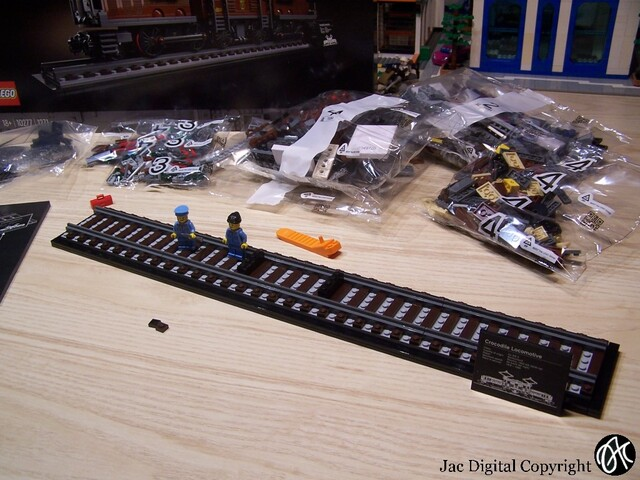](https://www.freelug.org/IMG/jpg/photo_07_.jpg)

Dans cette deuxième partie, nous allons assembler le corps principal de la locomotive avec ses énormes pantographes en forme de parallélogramme. Le fond du châssis nous prépare à la motorisation optionnelle du modèle. Les roues sont commandées par quelques engrenages très discrètement placés. Les couleurs différentes des pièces permettent de ne pas faire d’erreurs.

[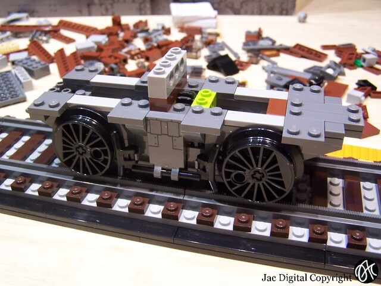](https://www.freelug.org/IMG/jpg/photo_11_-5.jpg)

Certains montages sont à reproduire plusieurs fois. Ici deux pour les flancs bas de la partie centrale de la locomotive. On se rend souvent compte de cette particularité lorsqu’on arrive au bout de l’ensemble. Avec un peu d’intuition, on peut se lancer sur les deux parties en même temps et ainsi éviter de revenir en arrière. Le montage semble un peu moins répétitif de cette manière.

[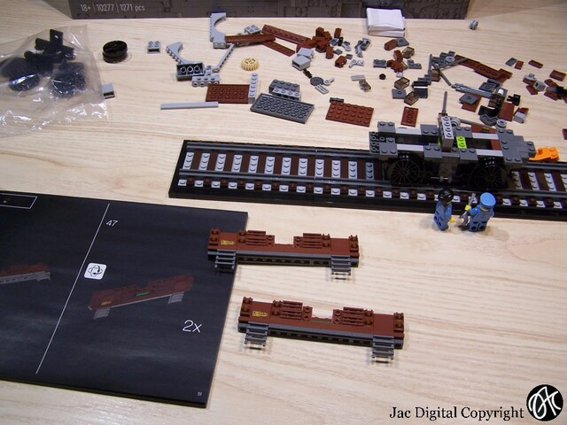](https://www.freelug.org/IMG/jpg/photo_14_-6.jpg)

Voilà la fin de la première partie du montage de la locomotive, avec les pièces supplémentaires. On a droit à de belles pièces sérigraphiées. La locomotive porte le numéro de référence de la boite. C’est un modèle prévu pour être présenté sur un socle. J’ai donc fait le choix de ne pas placer les entourages d’adhérences rouges sur les grandes roues. C’est esthétiquement plus joli.

[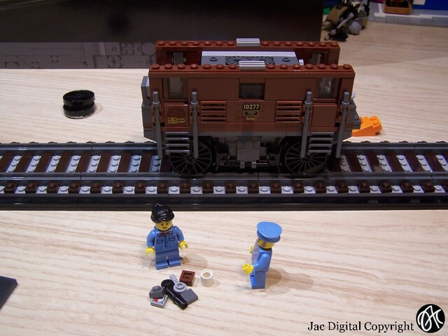](https://www.freelug.org/IMG/jpg/photo_15_-4.jpg)

Avec les sachets numéro 3, on en vient à la construction des façades des cabines de conduite et à la toiture de la locomotive. C’est une partie importante du modèle.

[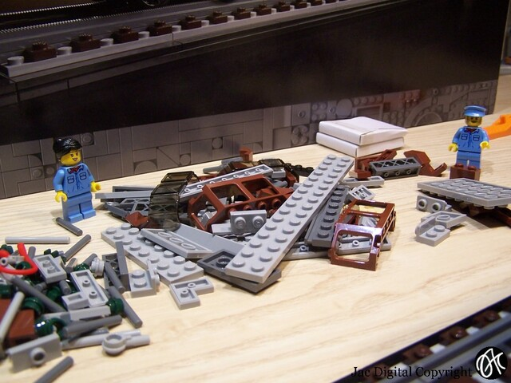](https://www.freelug.org/IMG/jpg/photo_19_-2.jpg)

Certains passages sont vraiment répétitifs, mais il n’est pas facile de faire autrement, comme sur les pantographes par exemple. Heureusement, avec un peu d’aide, ça se passe très bien.

[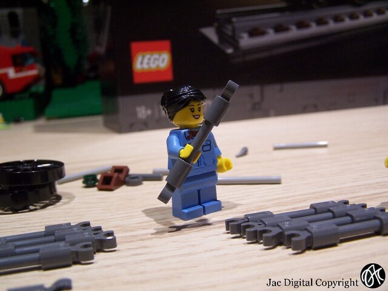](https://www.freelug.org/IMG/jpg/photo_21_-2.jpg)

Lorsque cette partie est terminée, on a déjà une belle impression de ce que sera la locomotive au final.

[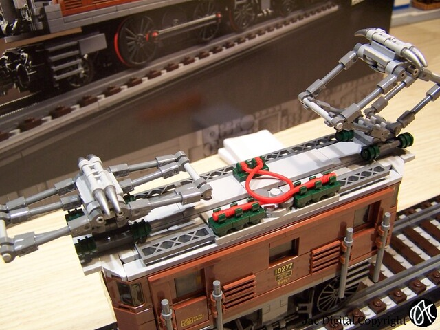](https://www.freelug.org/IMG/jpg/photo_24_.jpg)

Une vue sur ce qui est déjà construit et sur les pièces restantes. Justement, j’ai en plus une pièce d’angle marron de la cabine. Ce n’est pas courant de se retrouver avec ce genre de pièce en plus. Et pourtant, à la construction, je n’ai pas pu en oublier.

[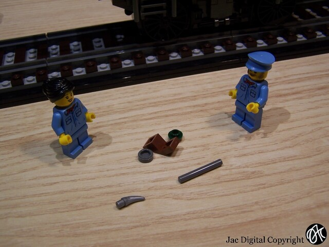](https://www.freelug.org/IMG/jpg/photo_23_-2.jpg)

Les pantographes sont vraiment réussis à mon sens, enfin, tant qu’on ne les bouge pas trop. Ils sont fragiles et les crochets ont un peu tendances à se déplacer sur les barres pour rendre l’ensemble un peu moins symétrique. J’avais même l’impression que ça penchait d’un côté. Mais c’est une maquette, il ne faut pas l’oublier. Dans mes souvenirs, il est rare de voir des locomotives électriques avec tout les pantographes relevés. C’est pour ça que j’en ai laissé un replié. En plus, ça permet de voir que c’est possible. La ligne de toiture et les isolateurs sont très réussis.

Ouverture des derniers sachets. Il reste encore pas mal de pièces à assembler. Mais au vue de ce qui est monté, on s’en doute un peu.

[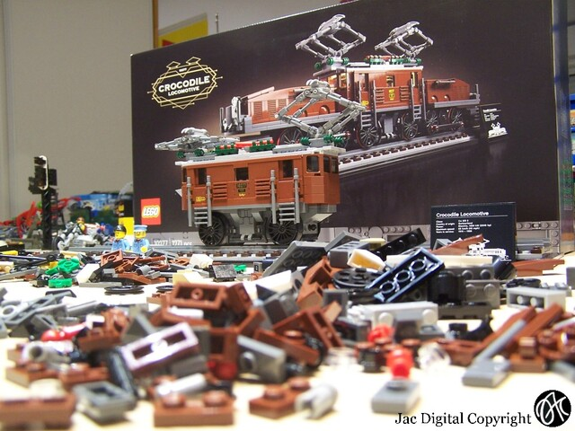](https://www.freelug.org/IMG/jpg/photo_27_-3.jpg)

Comme expliqué plus haut pour la cabine, je monte des parties identiques en parallèle.

[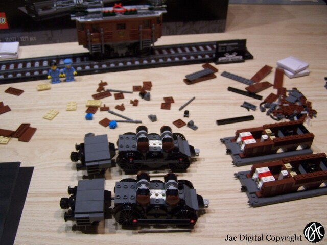](https://www.freelug.org/IMG/jpg/photo_31_-3.jpg)

Certaines parties sont techniques à construire. Mais tout s’assemble bien au final.

[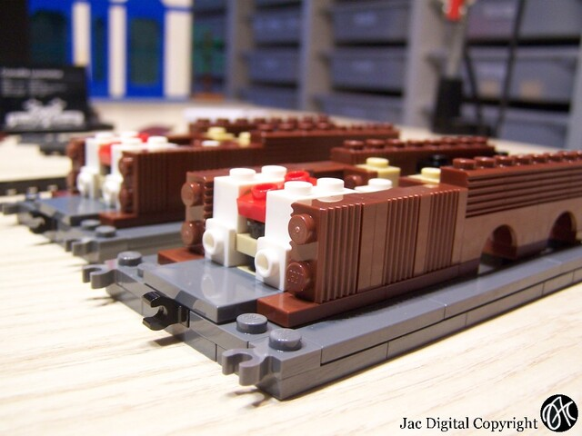](https://www.freelug.org/IMG/jpg/photo_30_-2.jpg)

Et voilà la belle locomotive suisse terminée. En exposition, ça rend vraiment bien. Une superbe maquette. Je ne vous cache pas que une fois les dernières pièces placées, j’ai eu comme une satisfaction. Content de voir le résultat final.

[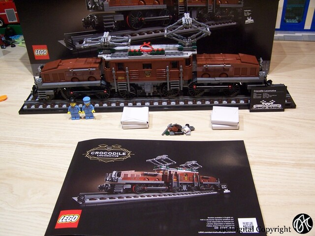](https://www.freelug.org/IMG/jpg/photo_33_-3.jpg)

Puis vient le moment de la contemplation au plus près et ensuite des réflexions. Qu’est-ce que je peux encore améliorer à ce beau modèle. Comme je l’ai annoncé plus haut, je n’ai pas mis les joints toriques rouges sur les roues. Ça améliore déjà beaucoup le modèle. Mais il reste encore les petites sphères rouge qui tiennent les bielles sur les grandes roues. La couleur utilisée permet de rendre la notice plus lisible. Une fois la construction terminée, rien n’empêche de remettre des pièces noire. Quelques toutes petites choses qui changent tout...

[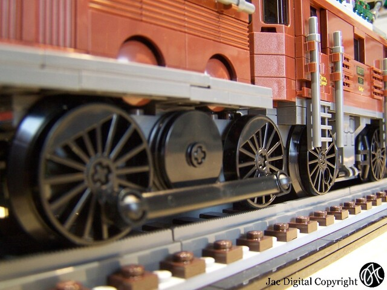](https://www.freelug.org/IMG/jpg/photo_34_.jpg)

Lors de l’assemblage du support de présentation, j’ai trouvé étonnant d’utiliser des petites ailes noires pour faire les extrémités. En fait, cela permet de défaire les bords facilement, pour pouvoir mettre la locomotive sur les rails. J’ai trouvé cette idée excellente et bien pensé. Ce n’est pas seulement une maquette, elle peut aussi rouler.

[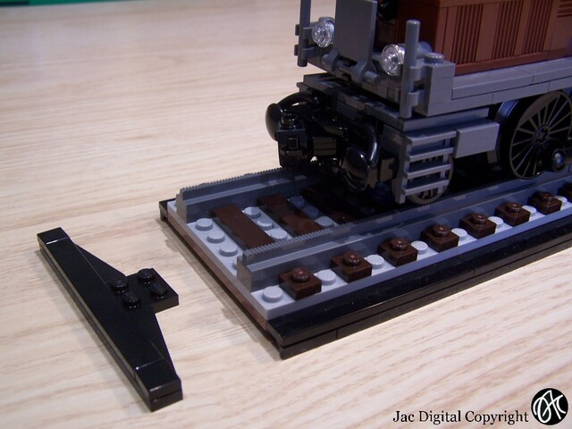](https://www.freelug.org/IMG/jpg/photo_35_.jpg)

[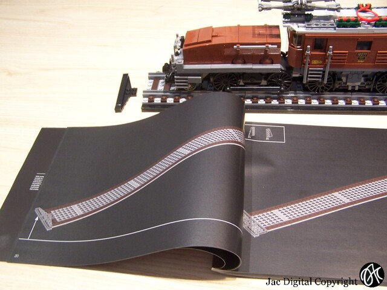](https://www.freelug.org/IMG/jpg/photo_36_.jpg)

Et elle roule même très bien. C’est confirmé après un essai sur le réseau extérieur. Je n’ai pas de moteur, c’est donc poussée par une de mes locomotives que j’ai pu tester son fonctionnement. Même sans les joints sur les roues, je n’ai pas eu de patinage.

[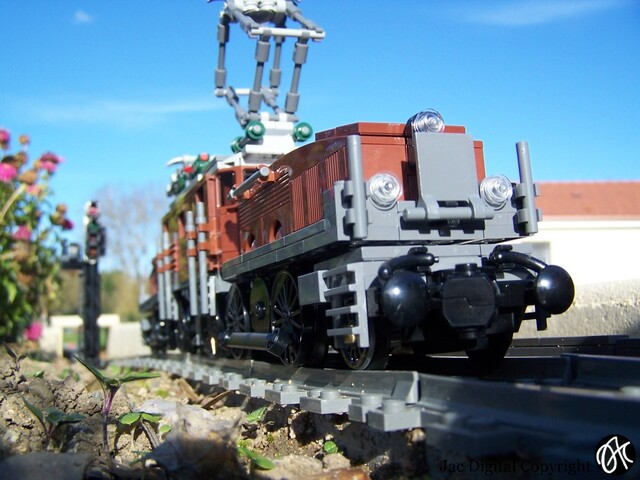](https://www.freelug.org/IMG/jpg/photo_37_.jpg)

Lors de ce montage il y a bien sûr quelques reproches à formuler, comme la notice sur fond noir, très difficile à utiliser à certaines étapes. Le placement du moteur en option, il n’est pas compris dans la boite. Pour le placer aussi, il faudra se passer du conducteur, ou de la conductrice. La reproduction un peu simplifiée de l’embiellage, surtout en sortie des volants moteur.

Au final, cette locomotive est vraiment magnifique et on se prend à rêver d’un prochain modèle dans la même lignée. La firme se tourne en général vers les productions américaines. Mais nous avons aussi en France des trains et des autorails qui ont marqué l’histoire. On a déjà eu le TGV. Alors pourquoi pas un autorail Bugatti ou une Micheline...

Toutes les photos :  
[https://photos.freelug.org/main.php/v/JAC/review/train/10277/](https://photos.freelug.org/main.php/v/JAC/review/train/10277/)\]
