Pour s’amuser un peu, je vous présente ici une petite boîte portant la référence 31095 et intitulée « Le manège de la fête foraine ».

Sortie en 2019 dans la gamme « Creator 3-en-1 », elle comporte 595 pièces et est sur la boutique officielle au prix de 54,99 €.

Comme son nom l’indique, ce set propose de monter différents manèges pouvant s’inscrire dans une fête foraine.

Sans surprise pour la gamme, la face avant de la boîte présente le modèle principal avec sur le côté droit les deux modèles alternatifs. Les mentions « Creator » et « 3-en-1 » sont bien évidemment présentes.

[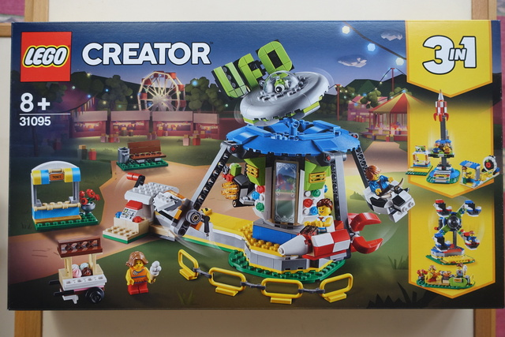](https://www.freelug.org/IMG/jpg/dsc02599.jpg)

L’arrière reprend les trois modèles, avec des indications sur comment ils s’animent — l’un tourne horizontalement, le second est de type « chute libre », le troisième « rotation verticale ».

[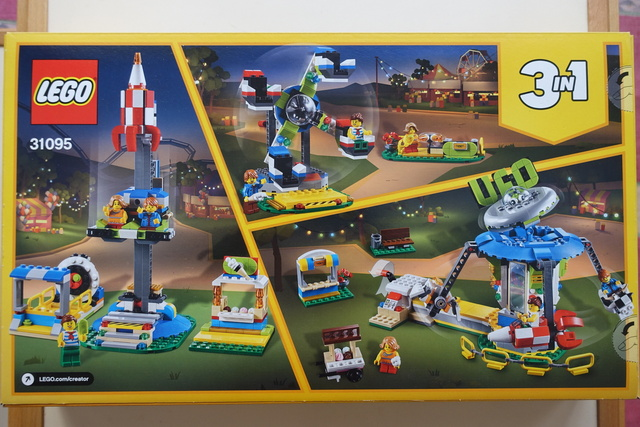](https://www.freelug.org/IMG/jpg/dsc02601.jpg)

* * *

Le modèle principal est donc un carrousel horizontal sur le thème des OVNI, accompagné de petits stands ou éléments de décor. Le manège est surmonté d’un OVNI du plus bel effet, avec un gros écriteau « UFO » (« OVNI » en anglais, évidemment !) pour ceux qui n’auraient pas compris :)

[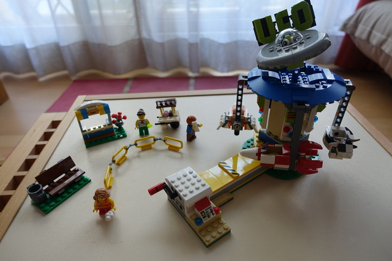](https://www.freelug.org/IMG/jpg/dsc02572.jpg)

Quatre chariots sont présents : une fusée pour aller dans l’espace, qui me rappelle celle de Tintin, ...

[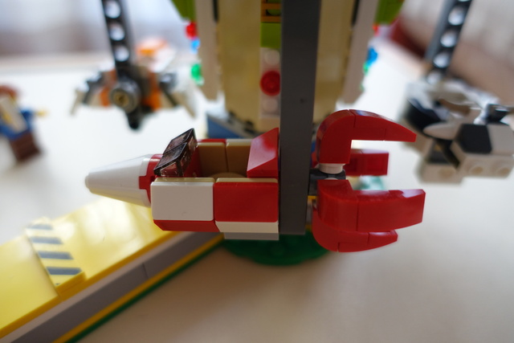](https://www.freelug.org/IMG/jpg/dsc02574.jpg)

[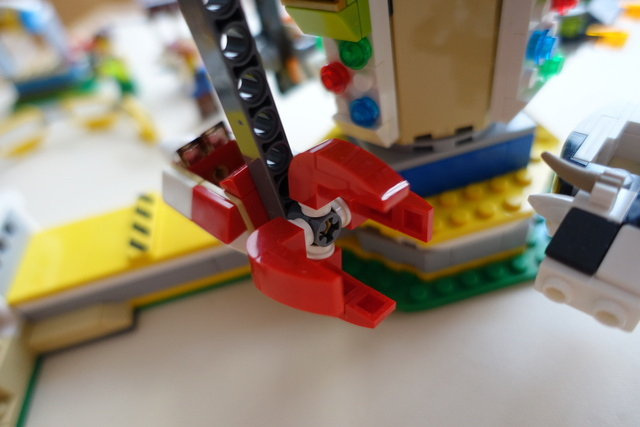](https://www.freelug.org/IMG/jpg/dsc02581.jpg)

... une vache en référence j’imagine aux légendes sur les enlèvements de ces pauvres bêtes par des OVNI, ...

[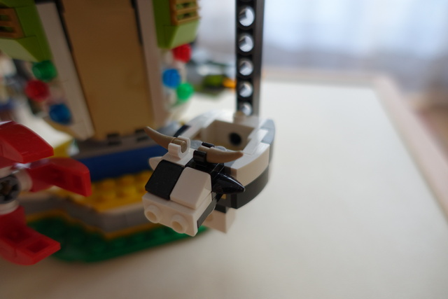](https://www.freelug.org/IMG/jpg/dsc02575.jpg)

[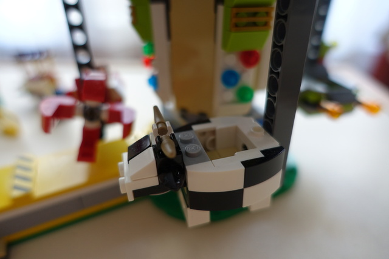](https://www.freelug.org/IMG/jpg/dsc02576.jpg)

un vaisseau genre soucoupe avec un alien tirant au pistolet...

[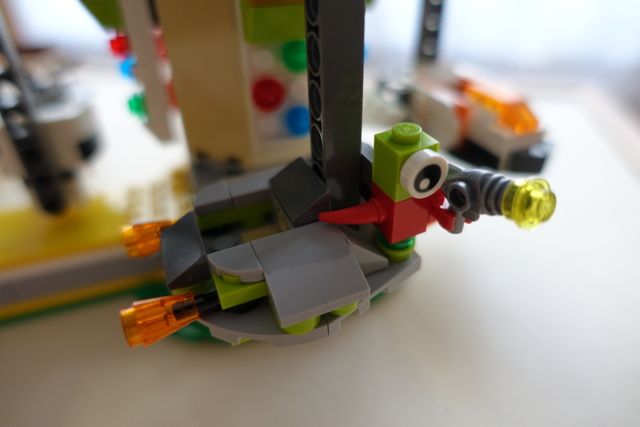](https://www.freelug.org/IMG/jpg/dsc02578.jpg)

... et un vaisseau type navette bien armé, qui probablement poursuit l’OVNI.

[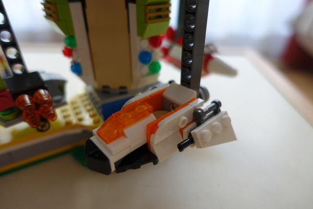](https://www.freelug.org/IMG/jpg/dsc02579.jpg)

Les personnages peuvent bien sûr prendre place dans ces chariots :

[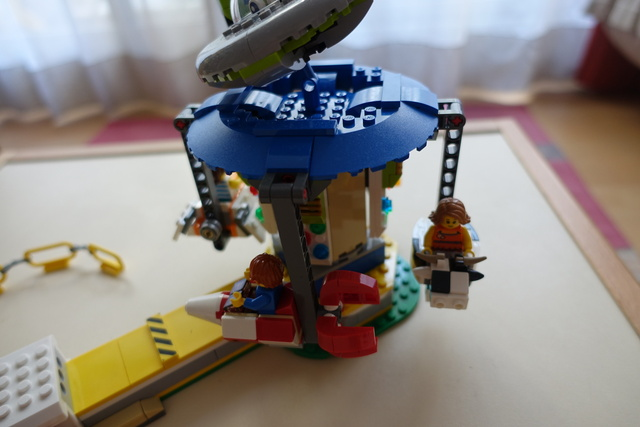](https://www.freelug.org/IMG/jpg/dsc02595.jpg)

[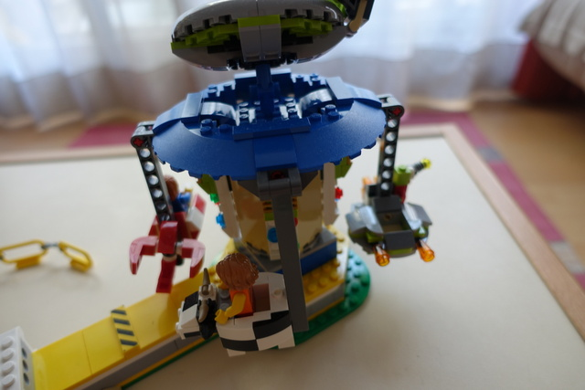](https://www.freelug.org/IMG/jpg/dsc02596.jpg)

[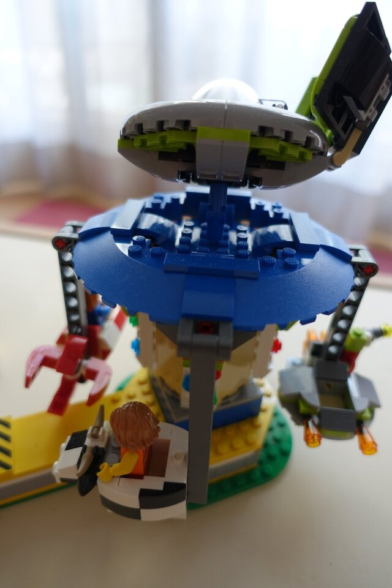](https://www.freelug.org/IMG/jpg/dsc02597-r90.jpg)

Une manivelle permet de faire tourner le carrousel dans un sens ou dans l’autre. Il est bien sûr possible de mettre un moteur pour automatiser la rotation. À noter que le petit bloc avec les leviers peut se décrocher pour se mettre de l’autre côté du bloc manivelle.

[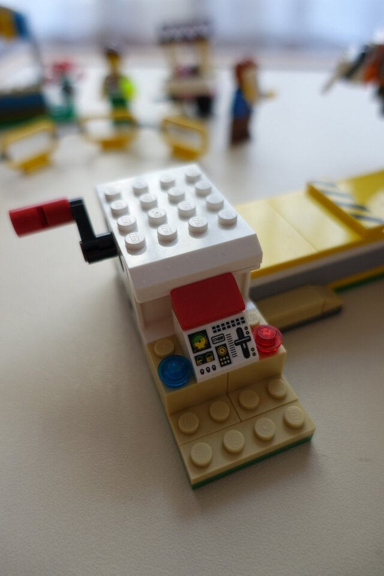](https://www.freelug.org/IMG/jpg/dsc02573-r90.jpg)

Le vaisseau spatial au sommet du carrousel est du plus bel effet, rond avec un cockpit montrant le magnifique extraterrestre aux commandes. Très cliché, mais je trouve que ça fonctionne bien !

[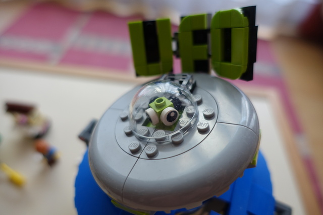](https://www.freelug.org/IMG/jpg/dsc02582.jpg)

Côté décor et stands, on trouve de quoi acheter des tickets, le minimum quand même, tout se paye en ce bas monde ! Très schématisé, mais ça fait le boulot.

[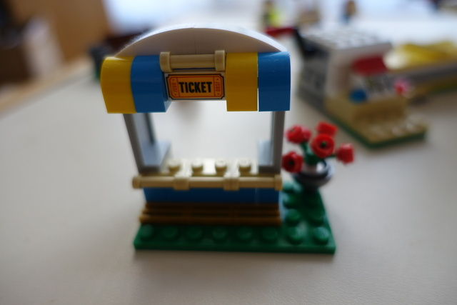](https://www.freelug.org/IMG/jpg/dsc02583.jpg)

[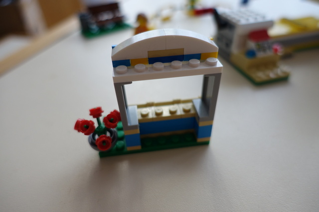](https://www.freelug.org/IMG/jpg/dsc02584.jpg)

Il y a également un chariot de glaces pour pouvoir se rafraîchir après (ou avant ?) un bon tour de manège. Je ne sais pas si on peut faire plus miniature comme construction, mais il y a quand même quatre parfums.

[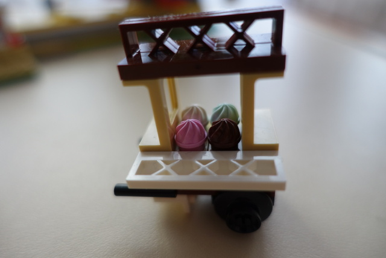](https://www.freelug.org/IMG/jpg/dsc02586.jpg)

[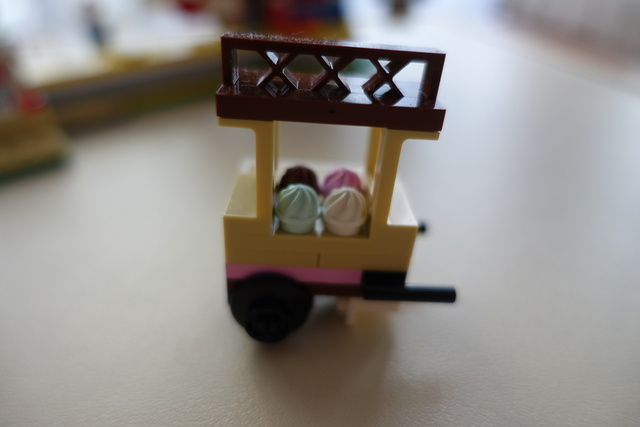](https://www.freelug.org/IMG/jpg/dsc02587.jpg)

Enfin on trouve un banc avec une poubelle, sur lequel les parents pourront attendre les enfants s’ils ne souhaitent pas faire eux aussi de tour de manège. Le banc est une construction classique, déjà vue dans d’autres modèles je pense.

[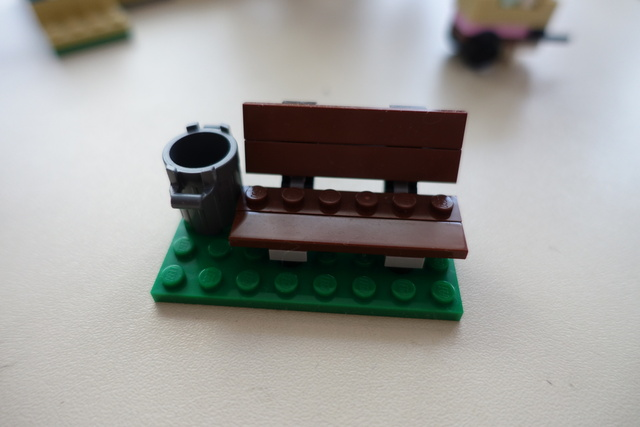](https://www.freelug.org/IMG/jpg/dsc02588.jpg)

Trois personnages sont présents dans la boîte : une petite fille, une femme et un homme. Peut-être forment-ils une famille. Les torses sont sérigraphiés, en revanche les jambes sont unies. Je trouve le choix du pantalon vert pour la femme un peu étrange avec le torse bleu et blanc, mais pourquoi pas. Les trois visages sont souriants. Deux accessoires sont fournis, une glace et un ticket (la même brique plate que sur la caisse).

[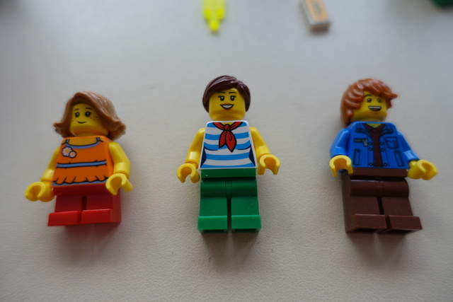](https://www.freelug.org/IMG/jpg/dsc02589.jpg)

Dans le dos les motifs avant se prolongent, avec un simple pli pour l’homme.

[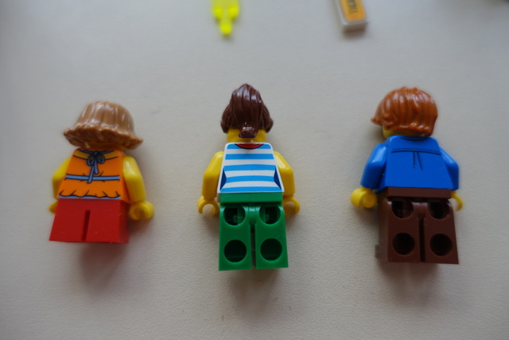](https://www.freelug.org/IMG/jpg/dsc02592.jpg)

Seul l’homme a un visage alternatif, dans lequel il se retient manifestement d’être malade — il n’a pas supporté le tour de manège, sans doute...

[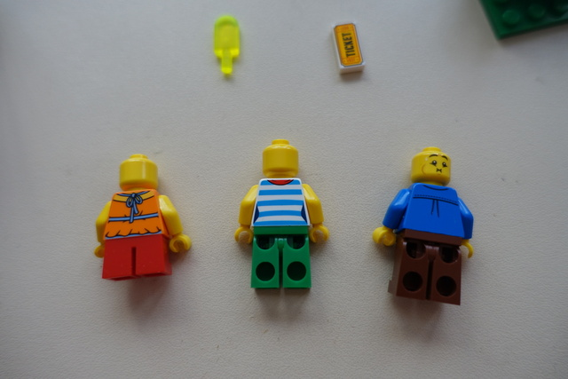](https://www.freelug.org/IMG/jpg/dsc02593.jpg)

À noter que je n’ai pas collé les autocollants fournis, qui donnent un effet miroir à la colonne verticale du carrousel.

* * *

Le second modèle proposé est un manège type « chute libre », où les clients assis subissent une chute durant quelques secondes avant un arrêt plus ou moins brutal. Deux stands complètent le manège, un de vente de glaces et un de tir à la cible. Les personnages sont assemblés comme le modèle principal, pas de changement.

[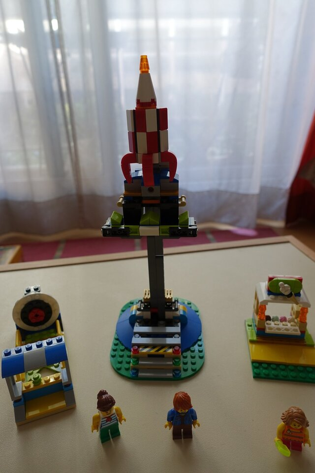](https://www.freelug.org/IMG/jpg/dsc02634-r90.jpg)

Le stand de tir est assez simple, avec une cible au fond et un cadre à l’avant à partir duquel tirer. Deux briques rondes vert simulent les projectiles à lancer sur la cible. Des barrières permettent de s’assurer que personne ne se met dans la ligne de tir.

[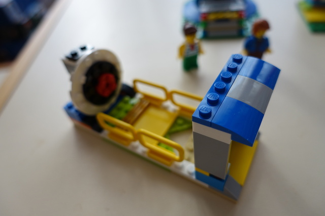](https://www.freelug.org/IMG/jpg/dsc02635.jpg)

[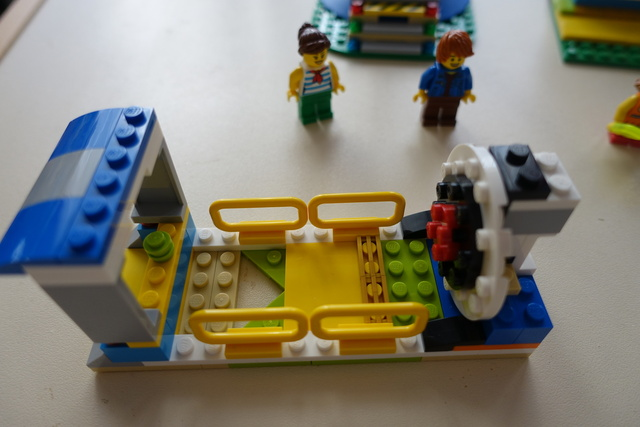](https://www.freelug.org/IMG/jpg/dsc02636.jpg)

Le stand de glaces est fonctionnel, avec une enseigne amusante, et toujours les quatre parfums de glace — on ne change pas quelque chose qui fonctionne. J’aime bien les montants en orange transparent.

[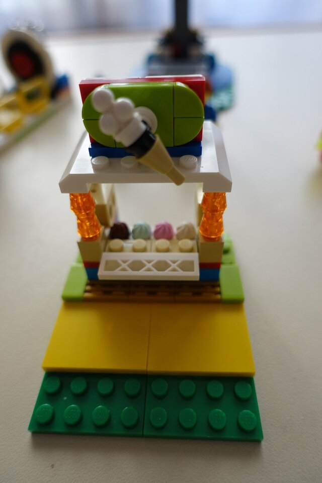](https://www.freelug.org/IMG/jpg/dsc02637-r90.jpg)

[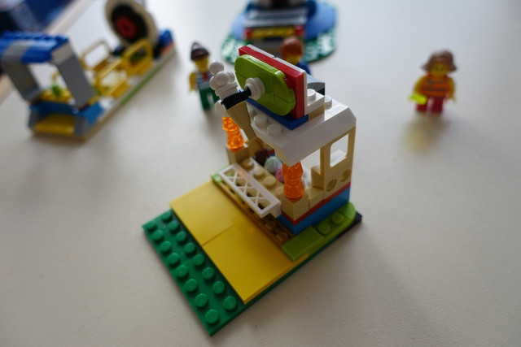](https://www.freelug.org/IMG/jpg/dsc02638.jpg)

Le manège lui-même est en forme de fusée, avec deux sièges qui peuvent monter et bien sûr tomber.

[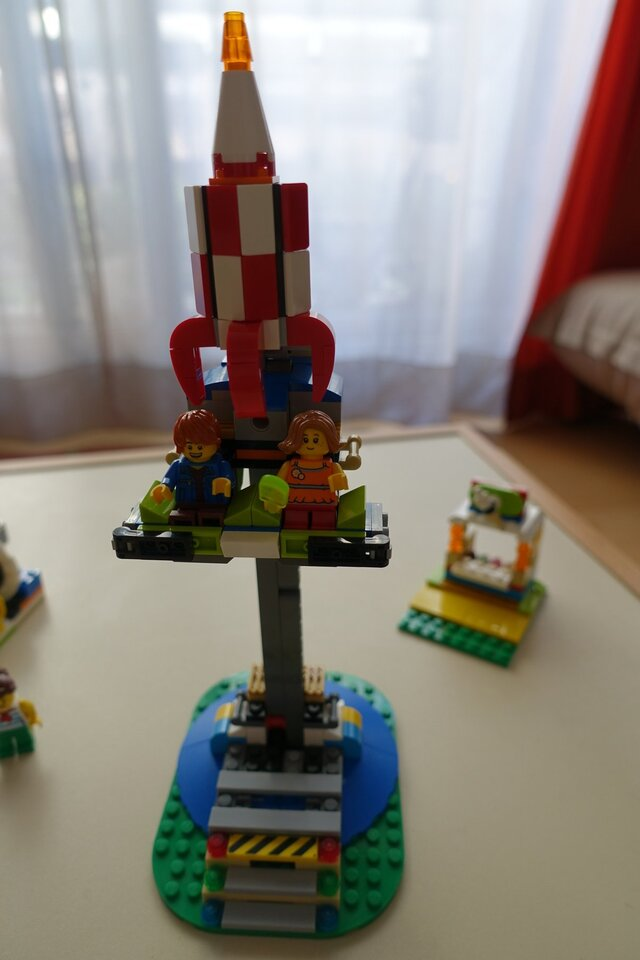](https://www.freelug.org/IMG/jpg/dsc02640-r90.jpg)

[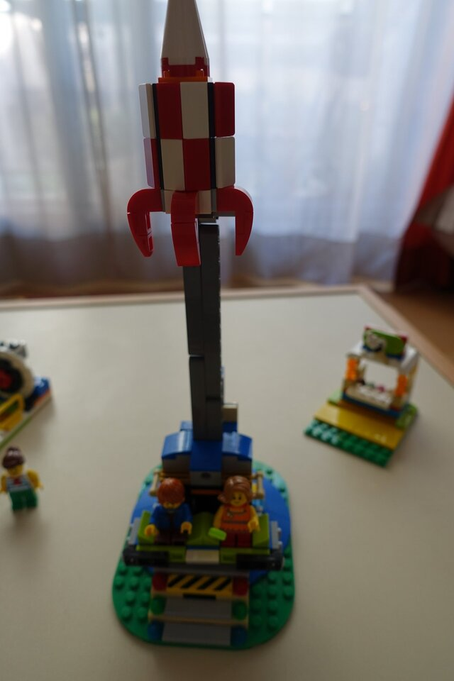](https://www.freelug.org/IMG/jpg/dsc02641-r90.jpg)

Des barres de sécurité retiennent les passagers durant l’attraction, on ne plaisante pas avec ça !

[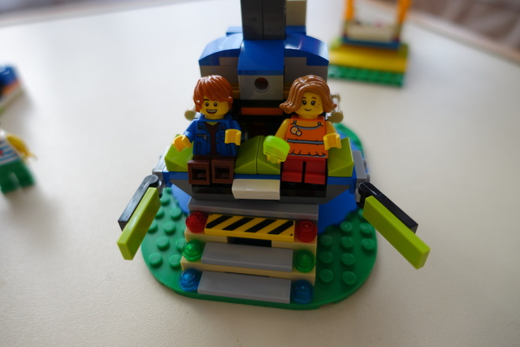](https://www.freelug.org/IMG/jpg/dsc02642.jpg)

Sur l’arrière on voit le mécanisme qui permet au manège de fonctionner. L’aile noire sur le côté droit se coince au-dessus de la mollette sur le bas de la fusée et retient les sièges.

[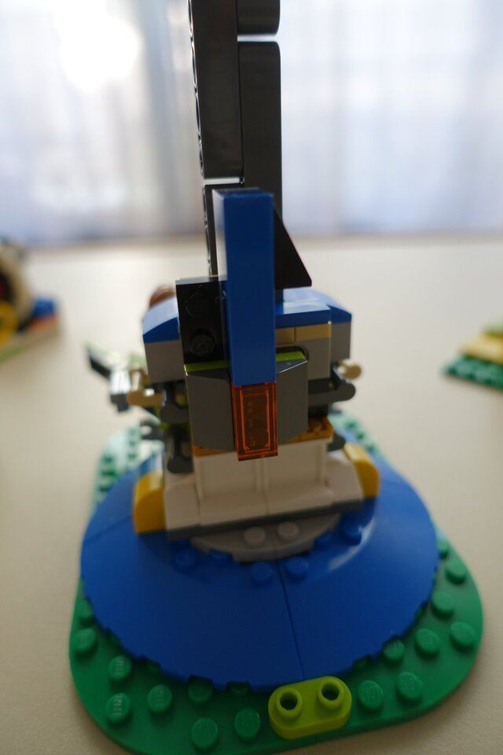](https://www.freelug.org/IMG/jpg/dsc02644-r90.jpg)

[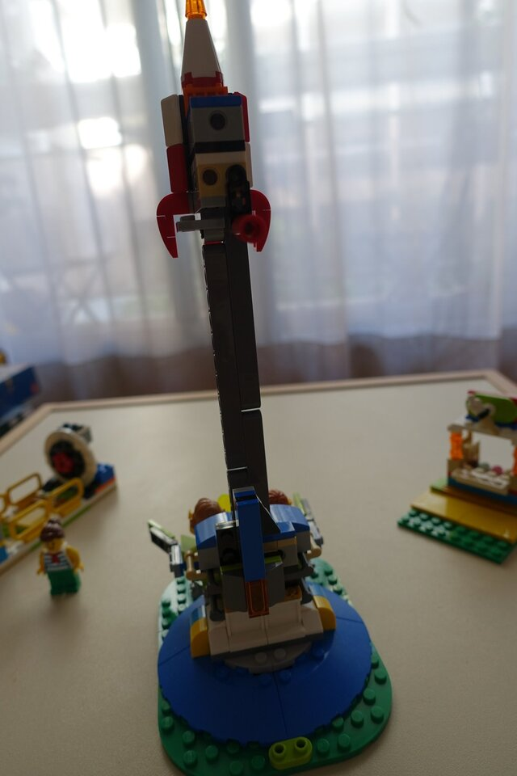](https://www.freelug.org/IMG/jpg/dsc02645-r90.jpg)

Pour les faire tomber, il suffit de tirer la manette sur la droite, et boum ! J’étais un peu sceptique sur la construction, mais ça marche bien, l’aile passe comme il faut et se coince vraiment bien sans besoin de la manipuler, il suffit de remonter les sièges.

[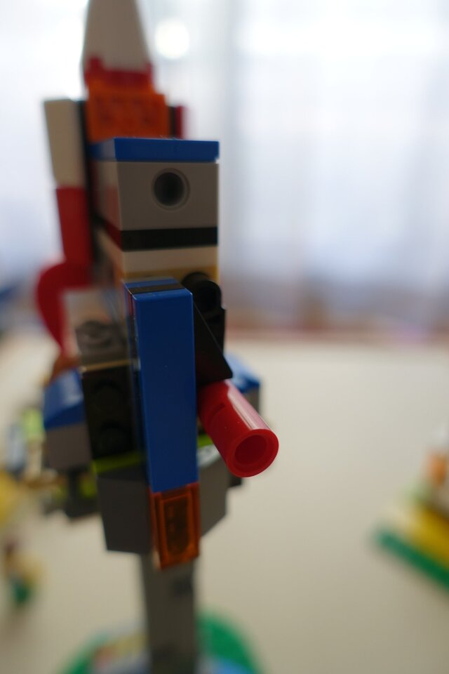](https://www.freelug.org/IMG/jpg/dsc02647-r90.jpg)

Je trouve qu’il manque au modèle des pneus pour amortir la chute des sièges, j’ai peur qu’à l’usure ça marque des pièces...

* * *

Enfin le dernier modèle est un manège vertical, avec quatre sièges (deux modèles). Un stand de caisse à tourniquet complète le décor. Il reste pas mal de pièces, il aurait sans doute été possible de faire quelque chose en plus.

[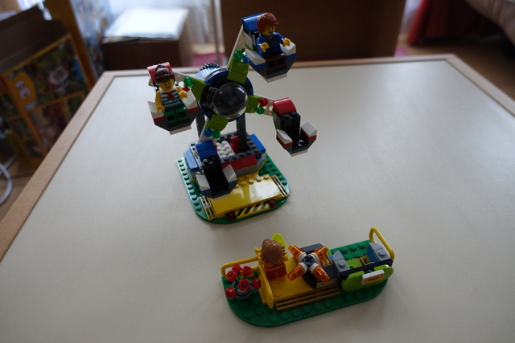](https://www.freelug.org/IMG/jpg/dsc02692.jpg)

[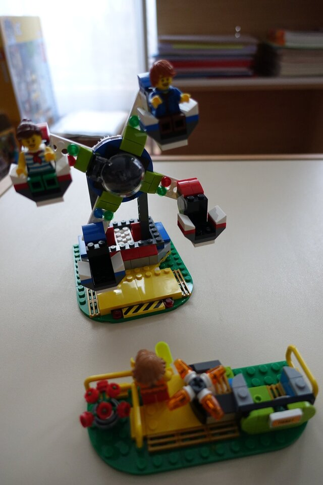](https://www.freelug.org/IMG/jpg/dsc02693-r90.jpg)

Le stand de caisse est simple, avec la pièce « ticket » récupérée, et un tourniquet qui reprend les quatre cônes orange transparent. Ça rend pas mal, j’admets, et un personnage passe sans problème en plus. Bon, il manque une figurine pour avoir un employé...

[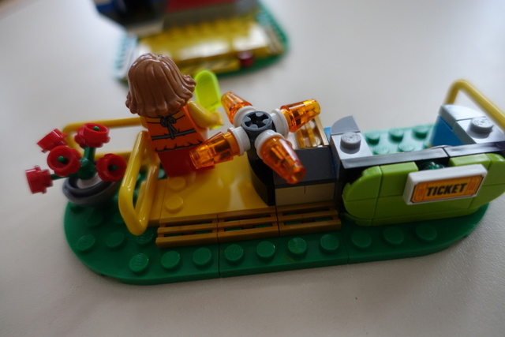](https://www.freelug.org/IMG/jpg/dsc02694.jpg)

[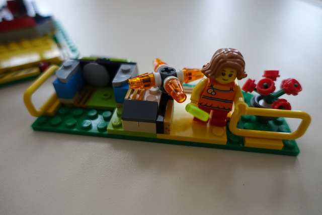](https://www.freelug.org/IMG/jpg/dsc02695.jpg)

Sans surprise le manège tourne avec une manivelle située sur l’arrière, qu’il doit être possible de motoriser simplement.

[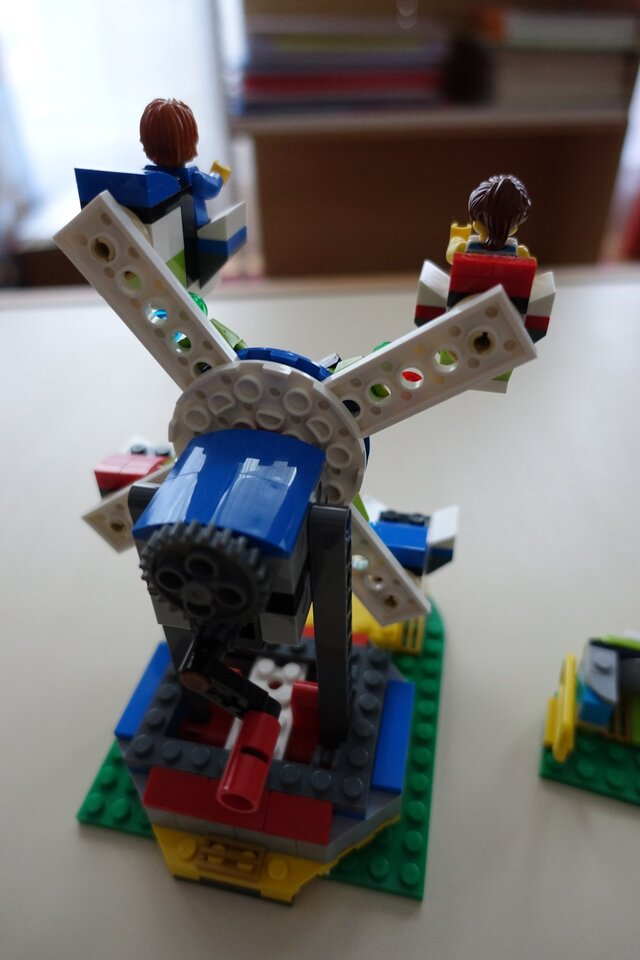](https://www.freelug.org/IMG/jpg/dsc02696-r90.jpg)

Pas de garde-fou sur les sièges par contre, comment ce manège a-t-il pu avoir l’autorisation d’ouvrir sans cela ? Quelques marches donnent accès aux sièges à l’arrêt.

[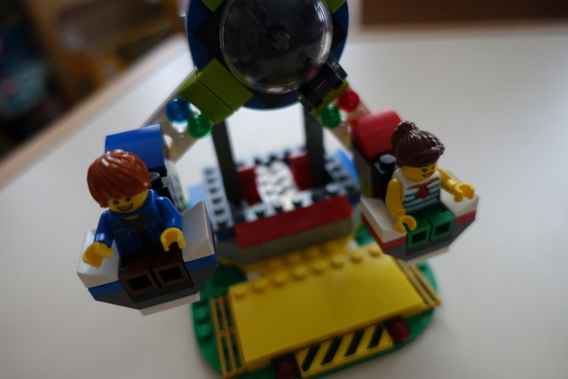](https://www.freelug.org/IMG/jpg/dsc02697.jpg)

* * *

**Avis :** je trouve ces manèges réussis dans l’ensemble, et les petits éléments de décor pourront sans souci être disposés dans une scène de fête foraine. Il faudra à mon avis rajouter des pneus sur le second modèle pour faire propre, on veut protéger nos pièces non mais !

Au final pas de déception de mon côté, la boîte répond très bien à ce que j’attendais :)
