FreeLUG propose à l’ensemble de ses adhérents de nous partager leurs décorations LEGO pour les fêtes de fin d’année.

[Règlement du concours](https://www.freelug.org/spip.php?article3072)

**Découvrez sans plus attendre les décorations de nos adhérents.**

_La liste sera enrichie des participations au fur et à mesure qu’elles arrivent._

**1\. Caroline G.**

[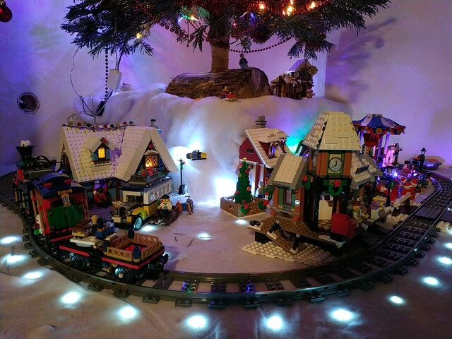](https://www.freelug.org/IMG/jpg/cg-01_grand_.jpg)

[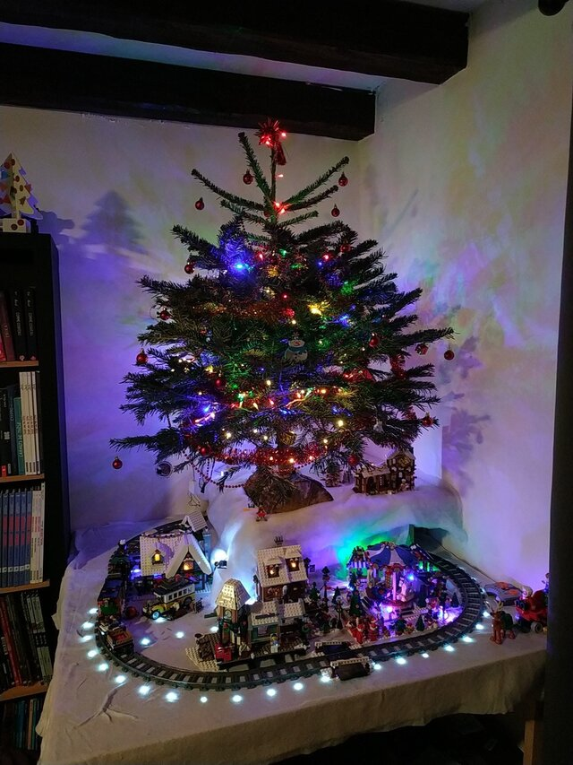](https://www.freelug.org/IMG/jpg/cg-02_grand_-r90.jpg)

[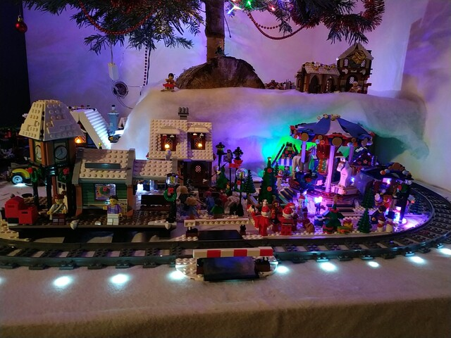](https://www.freelug.org/IMG/jpg/cg-03_grand_.jpg)

**2\. Sergio D.**

[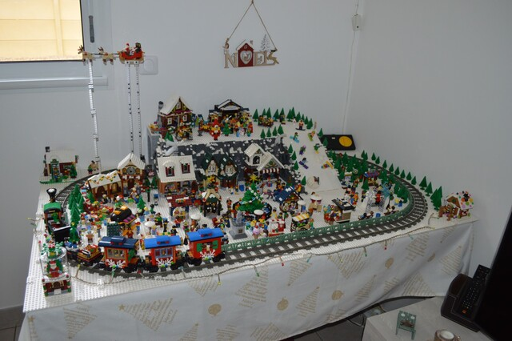](https://www.freelug.org/IMG/jpg/sd_-_01_grand_.jpg)

[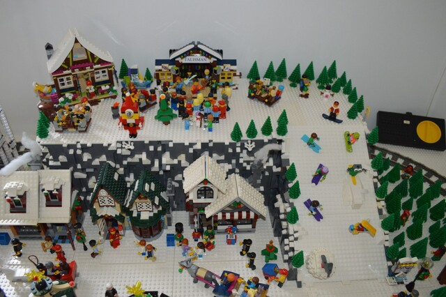](https://www.freelug.org/IMG/jpg/sd_-_02_grand_.jpg)

[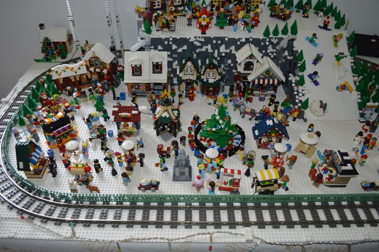](https://www.freelug.org/IMG/jpg/sd_-_03_grand_.jpg)

**3\. Christophe M.**

[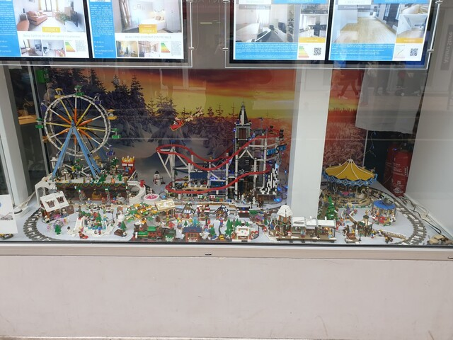](https://www.freelug.org/IMG/jpg/cm_-_01_grand_.jpg)

[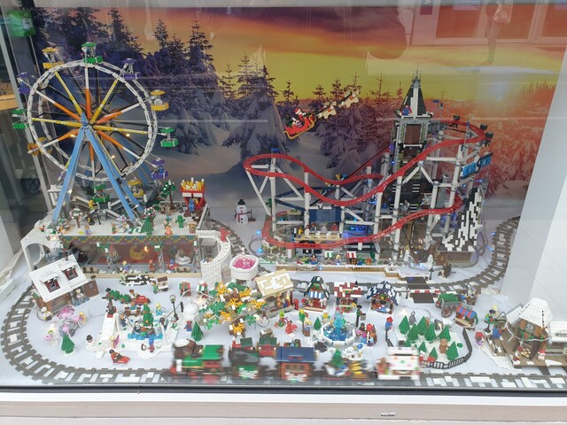](https://www.freelug.org/IMG/jpg/cm_-_02_grand_.jpg)

[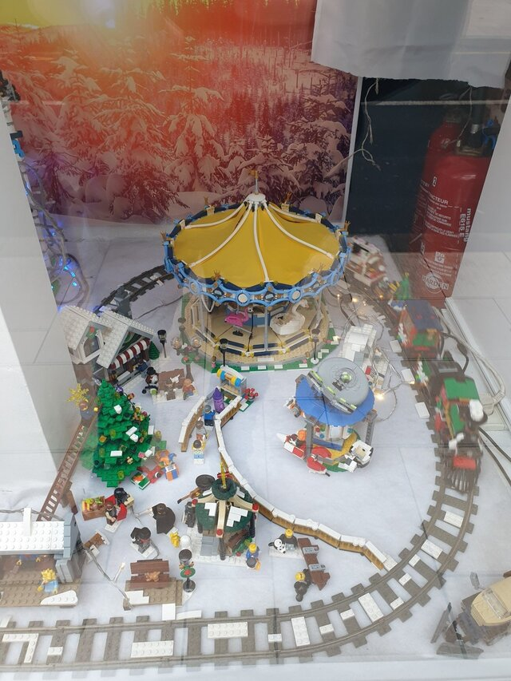](https://www.freelug.org/IMG/jpg/cm_-_03_grand_-r90.jpg)

**4\. Yves M.**

[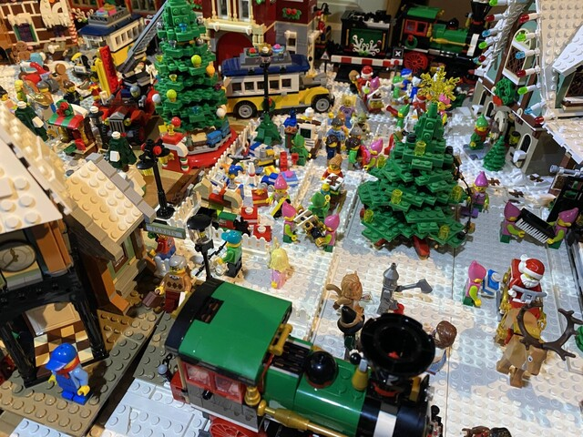](https://www.freelug.org/IMG/jpg/ym-01_grand_.jpg)

[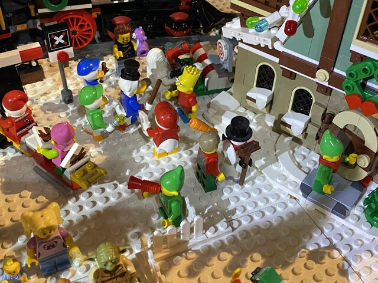](https://www.freelug.org/IMG/jpg/ym-02_grand_.jpg)

[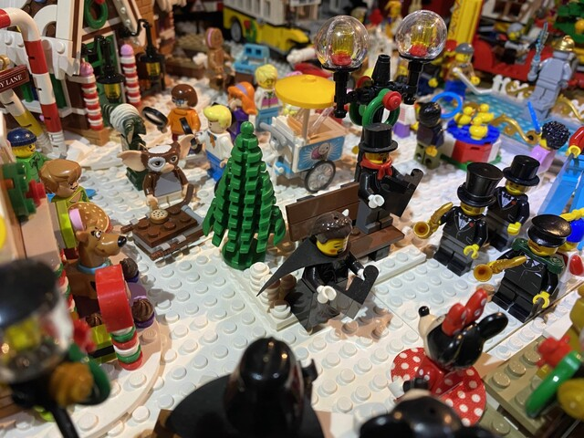](https://www.freelug.org/IMG/jpg/ym-03_grand_.jpg)

**5\. Xavier D.**

[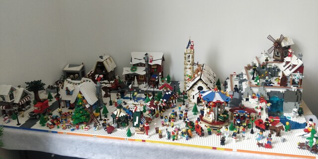](https://www.freelug.org/IMG/jpg/xd-01_grand_.jpg)

[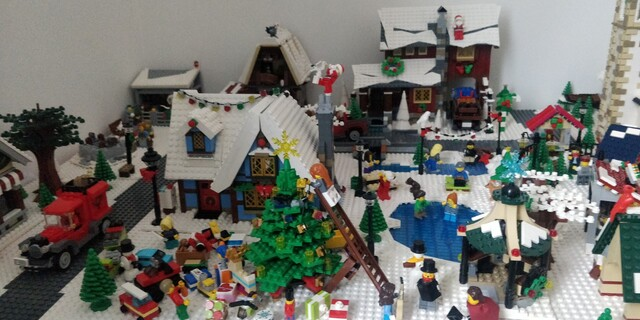](https://www.freelug.org/IMG/jpg/xd-02_grand_.jpg)

[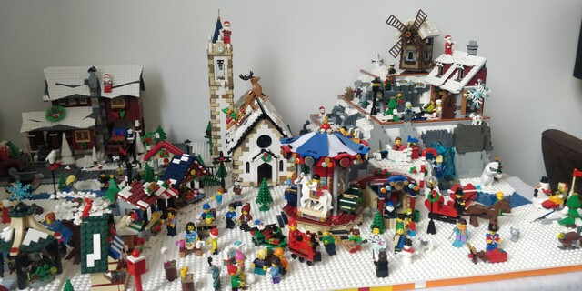](https://www.freelug.org/IMG/jpg/xd-03_grand_.jpg)

**6\. Caty et Pierre (Ecrou Papillon)**

[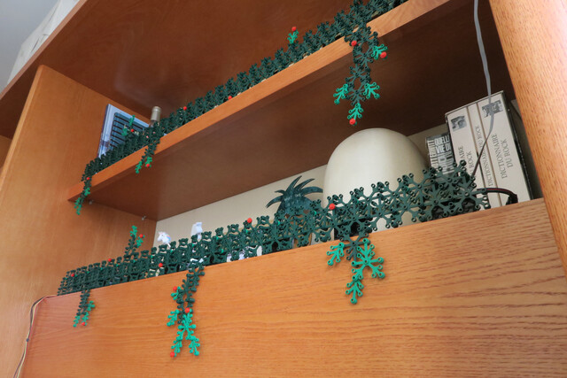](https://www.freelug.org/IMG/jpg/cp-01.jpg)

image gif ci-dessous, cliquez dessus

[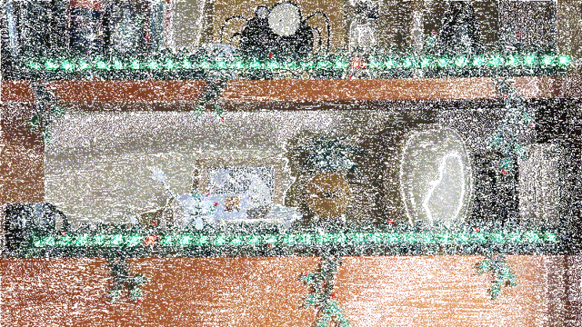](https://www.freelug.org/IMG/gif/cp-02.gif)

[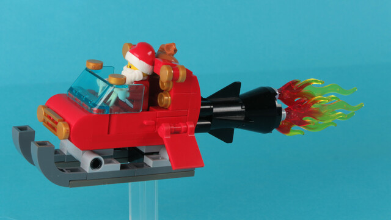](https://www.freelug.org/IMG/jpg/cp-03.jpg)

**7\. Jean Alain T.**

[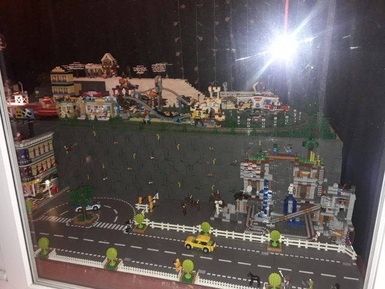](https://www.freelug.org/IMG/jpg/ja-01.jpg)

[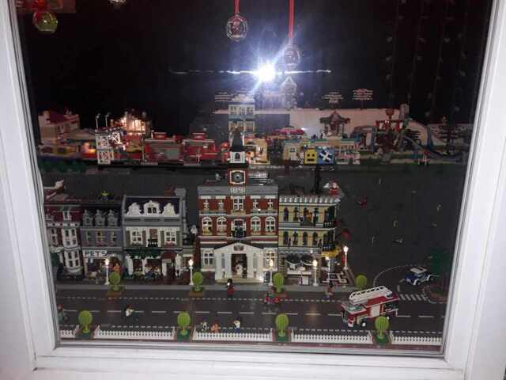](https://www.freelug.org/IMG/jpg/ja-02.jpg)

[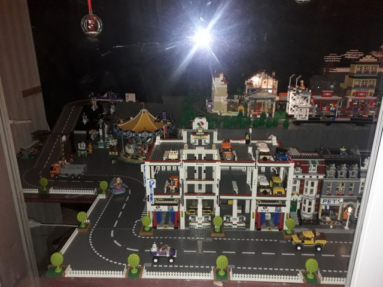](https://www.freelug.org/IMG/jpg/ja-03.jpg)

**8\. Aurélien B.**

[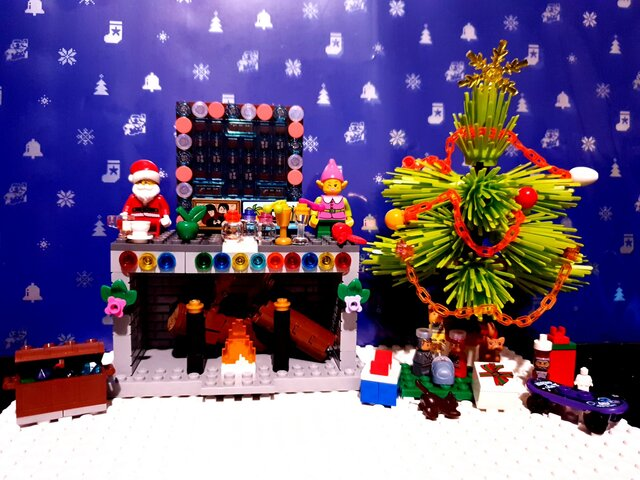](https://www.freelug.org/IMG/jpg/ab-01.jpg)

**9\. Sylvain J.**

[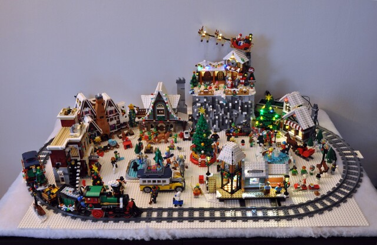](https://www.freelug.org/IMG/jpg/sj-01_grand_.jpg)

[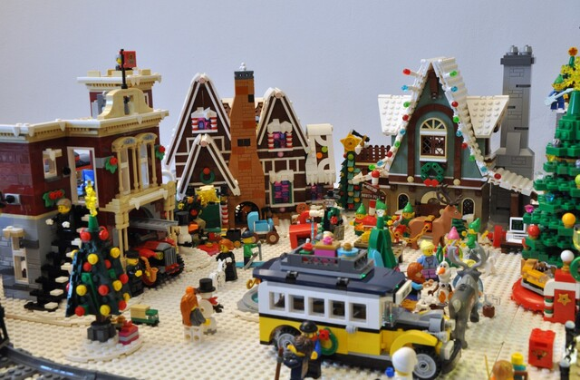](https://www.freelug.org/IMG/jpg/sj-02_grand_.jpg)

[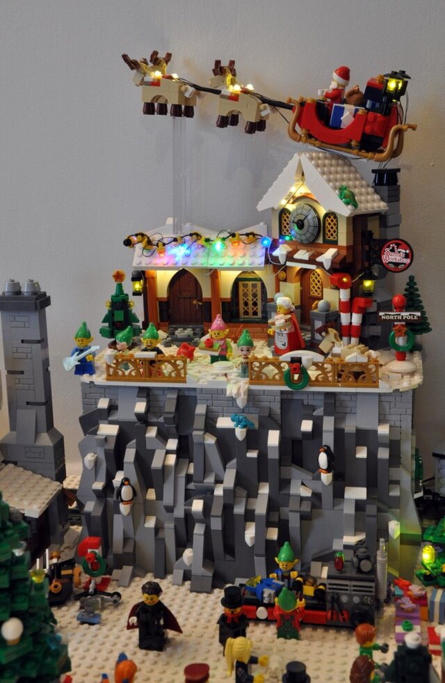](https://www.freelug.org/IMG/jpg/sj-03_grand_.jpg)

**10\. Virginie L.D.**

[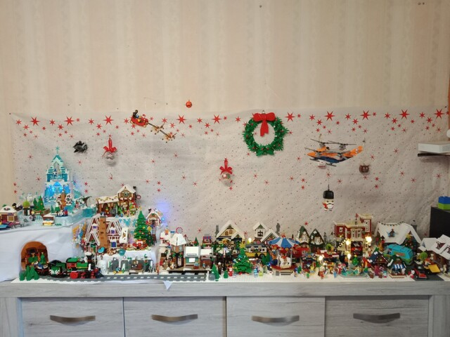](https://www.freelug.org/IMG/jpg/vld-01_grand_.jpg)

[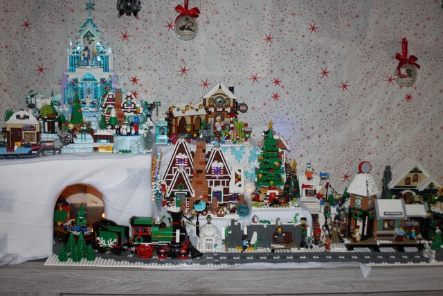](https://www.freelug.org/IMG/jpg/vld-02_grand_.jpg)

**11\. Rémi L.**

[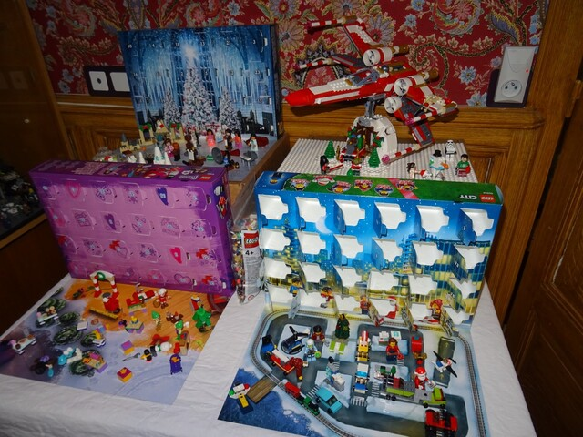](https://www.freelug.org/IMG/jpg/rl-01_grand_-2.jpg)

[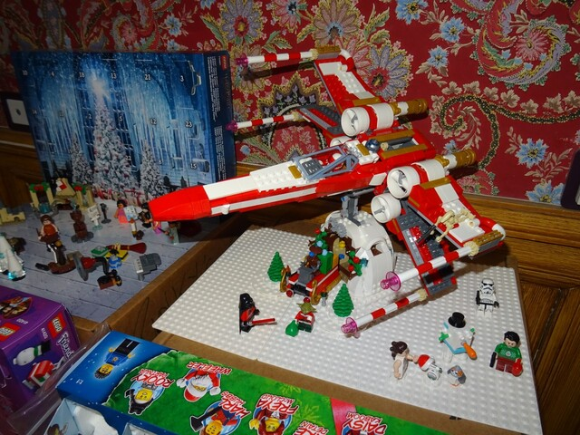](https://www.freelug.org/IMG/jpg/rl-02_grand_.jpg)

**12\. Charles F.**

[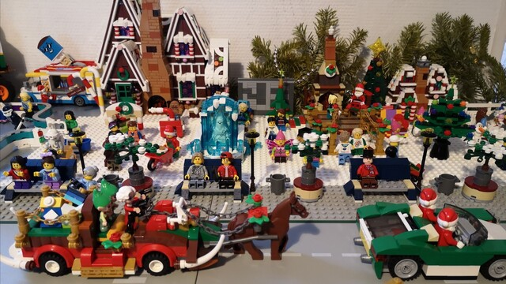](https://www.freelug.org/IMG/jpg/cf-01_grand_-2.jpg)

[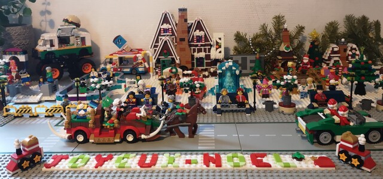](https://www.freelug.org/IMG/jpg/cf-02_grand_-2.jpg)

[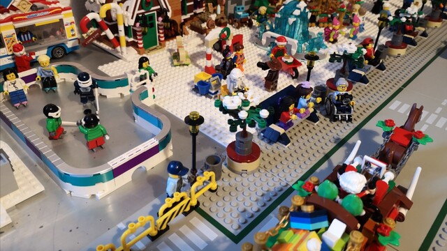](https://www.freelug.org/IMG/jpg/cf-03_grand_-2.jpg)

**Joyeux Noël !**

* * *

**Mis à jour du 15/01/2021**

Nous espérons que vous avez passé de bonnes fêtes. Il est temps de faire le tirage au sort pour le concours des Décorations festives des Freelugiens. Pour être le plus juste possible et le plus transparent, nous allons prendre les résultats du Loto du 20 janvier 2021 pour choisir les gagnants.  
Chaque participant s’est vu attribuer 4 numéros de la grille du loto :

Caroline G. : 1 13 25 37  
Sergio D. : 2 14 26 38  
Christophe M. : 3 15 27 39  
Yves M. : 4 16 28 40  
Xavier D. : 5 17 29 41  
Caty et Pierre : 6 18 30 42  
Jean Alain T. : 7 19 31 43  
Aurélien B. : 8 20 32 44  
Sylvain J. : 9 21 33 45  
Virginie L.D. : 10 22 34 46  
Rémi L. : 11 23 35 47  
Charles F. : 12 24 36 48

Le premier numéro qui sera annoncé sera le gagnant du 1er lot, le 2e sera pour le 2e lot et ainsi de suite. Si le 1er et le 2e numéro sont à la même personne alors le lot est remis en jeu pour le 3e numéro qui sort etc.  
Les 3 premiers seront récompensés.

* * *

**Mis à jour du 20/01/2021**  
Résultat du tirage : 21 - 11 - 22 - 40 - 32 - 09

1\. Sylvain J. remporte le set ref 75945 - Harry Potter - Expecto Patronum  
2\. Rémi L. remet son lot en jeu  
3\. Virginie L.D. remporte le set ref 850777 - Legends of Chima Accessory Set  
4\. Yves M. remporte le set ref 850777 - Legends of Chima Accessory Set

**Un grand merci à tous ceux qui ont participé et à bientôt pour un nouveau concours**
