10 participants toutes catégories confondues, 11 créations, qui va convaincre le jury ?  
Il est temps de découvrir les participations du concours de fin d’année 2020.

Vous pouvez retrouver le [règlement de ce concours ici](https://www.freelug.org/spip.php?article3068)

Tout d’abord, nous tenons à remercier les 10 participants qui nous ont proposé de très belles réalisations.

Les participations sont présentées dans l’ordre de réception.

Au vu du nombre de participations, le GFC a décidé de récompenser les 2 premiers dans la catégorie "Réel". Chaque votant devait donner 2 votes par ordre de préférence, le premier vote valait 2 points et le second 1 point.

## Concours catégorie "Réelle"

**01 Chris T - Back to the Christmas**  
Modèle de base : Réf 21103  
Année : 2013  
Nombre de pièces du set d’origine : 401

[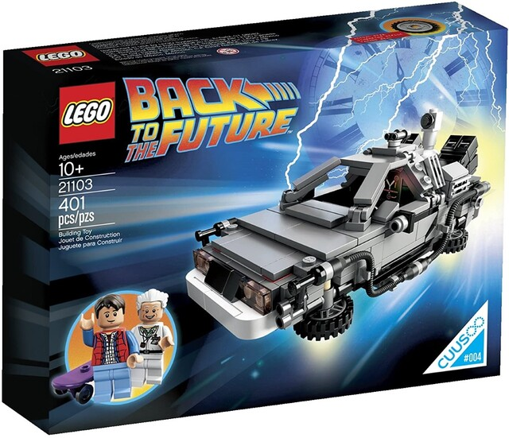](https://www.freelug.org/IMG/jpg/ct-00_grand_.jpg)

**_Description :_**  
Construit une magnifique réplique détaillée de la Delorean de Retour vers le futur en briques LEGO version traîneau de Noël. Réécrit les différents Noël passés et futurs en voyageant dans le temps avec le père Brown et son acolyte Marty Mac Ylf. Ce set contient de nombreux rennes qui t’aideront à trouver le chemin des différentes maisons.

Tu retrouveras dans la Delorean le convecteur temporel qui te fera voyager à travers le temps et l’espace et le très mythique tableau de bord.  
Inclus dans le set 3 références aux 3 films de la trilogie que tu pourras mettre au pied du sapin de petits veinards.  
Retour vers le futur 1 : une magnifique réplique de la Gibson avec laquelle Marty à pu faire s’embrasser ses parents au bal de la promo  
Retour vers le futur 2 : la fameuse bouteille de Pepsi de 2015 que l’on voit lorsque Marty entre dans le café 80  
Retour vers le futur 3 : le chapeau de Cow-boy de Marty  
Inclus 2 personnages : Père Brown et Marty Mac Ylf  
Ouvre la porte de la Delorean et rentre l’année où tu veux te rendre.  
Expose le set grâce à des briques transparentes.  
Le cadeau idéal pour tous les fans de retour vers le futur et de Noël.  
La voiture roule également !

Accroche les rennes, incline les roues et envole-toi vers de nouvelles aventures.

[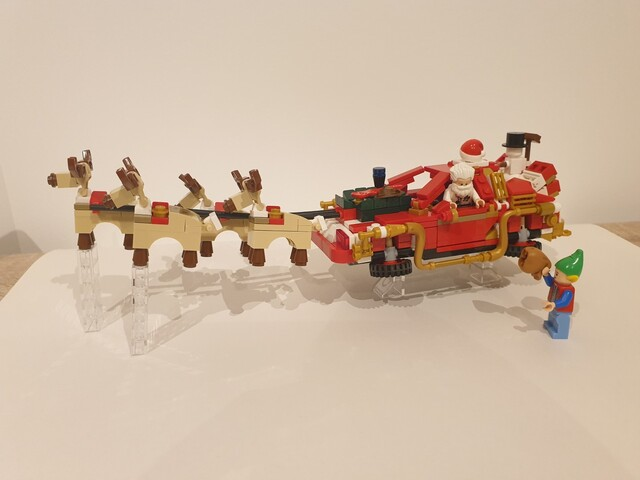](https://www.freelug.org/IMG/jpg/ct-01_grand_-2.jpg)

[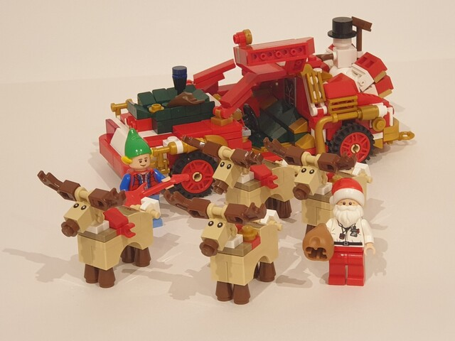](https://www.freelug.org/IMG/jpg/ct-02_grand_-2.jpg)

[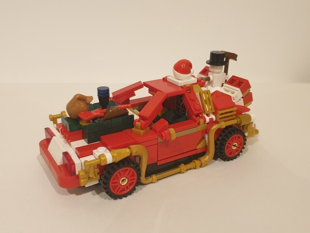](https://www.freelug.org/IMG/jpg/ct-03_grand_-2.jpg)

[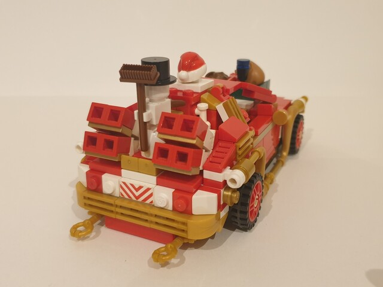](https://www.freelug.org/IMG/jpg/ct-04_grand_-2.jpg)

[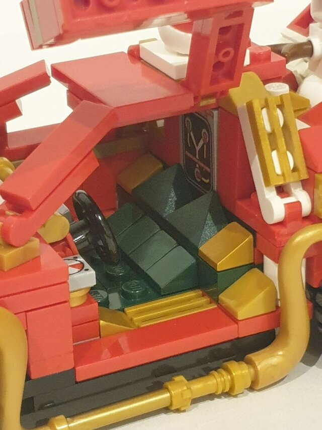](https://www.freelug.org/IMG/jpg/ct-06_grand_-r90.jpg)

[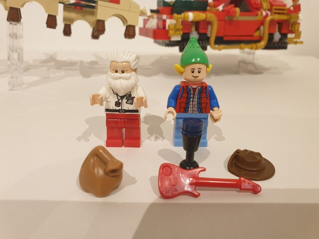](https://www.freelug.org/IMG/jpg/ct-07_grand_.jpg)

**02 - Caty et Pierre (Ecrou Papillon) - Le ranch des petits rennes au nez rouge**  
Modèle de base : Réf 6419  
Année : 1992  
Nombre de pièces du set d’origine : 352

[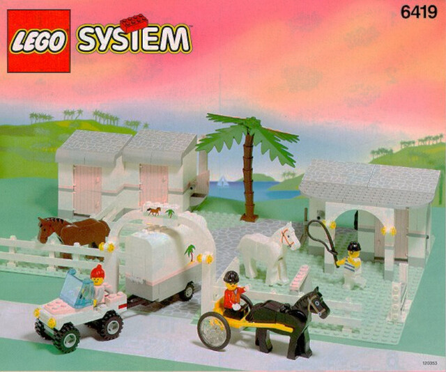](https://www.freelug.org/IMG/jpg/cp_-_00-2.jpg)

**_Description :_**  
Quelques jours avant Noël, c’est l’effervescence dans le ranch. Le père Noël s’active pour préparer sa tournée. Son traîneau est prêt mais il veut s’assurer que ses rennes sont en pleine forme.  
L’ensemble Lego Paradisa 6419b "Le ranch des petits rennes au nez rouge" réserve une expérience de construction et de jeu festive.  
Les bâtiments sont confortables et fonctionnels. Pour l’arrivée du Père Noël, ils se sont parés de tous les décors de la fête. Un magnifique sapin de Noël entièrement décoré trône sur l’ensemble.  
Les enfants peuvent nourrir les chevaux et les rennes avec d’appétissantes carottes, conduire le sulky, la voiture 4x4 et sa remorque et même le traîneau du Père Noël lui-même !  
Ce set inclut  
**–** 3 figurines LEGO avec leurs habits d’hiver  
**–** la figurine du Père Noël lui-même  
**–** 3 véhicules décorés  
**–** 1 sapin de Noël décoré  
**–** des guirlandes électriques  
et bien, sûr, des toits enneigés et des plaques de neige

Les enfants vont adorer imaginer toutes sortes de jeux avec la famille des rennes et leurs soigneurs, sans oublier le Père Noël lui-même !  
Les plus grands pourront s’immerger dans un projet créatif pour évacuer le stress accumulé lors des différents confinements. La [bande-son incluse](https://www.youtube.com/watch?v=VJDPeQSqICM), à écouter à plein tube, permettra de compléter la féerie de Noël.

[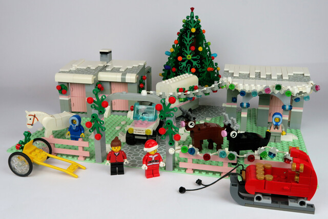](https://www.freelug.org/IMG/jpg/cp_-_01-2.jpg)

[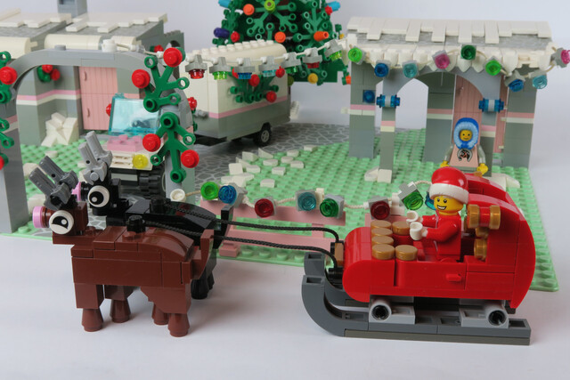](https://www.freelug.org/IMG/jpg/cp_-_02-2.jpg)

[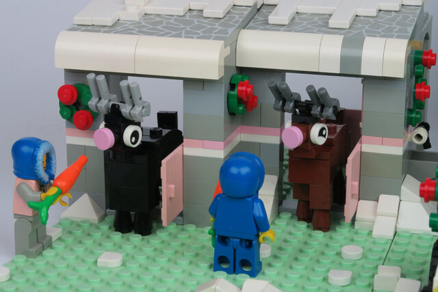](https://www.freelug.org/IMG/jpg/cp_-_03-2.jpg)

[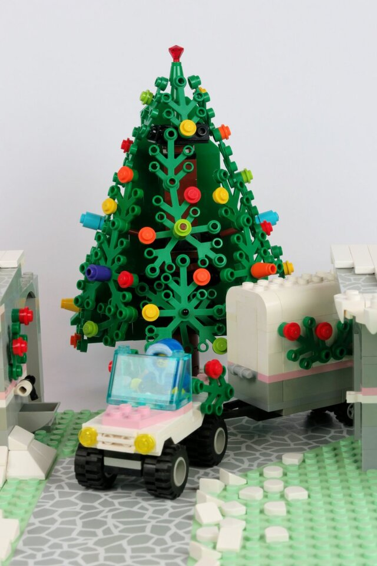](https://www.freelug.org/IMG/jpg/cp_-_04-2.jpg)

**03 - Nicolas G. - Monorail Traîneau Système**  
Modèle de base : Ref 6990  
Année : 1987  
Nombre de pièces du set d’origine : 691

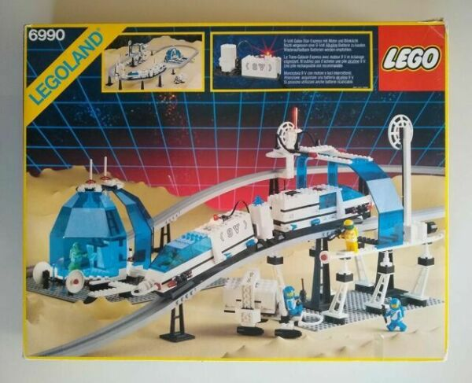

**_Description :_**  
Retrouve le père Noël de l’espace dans son traîneau monorail avec un coffre rempli de cadeaux à déposer au pied du sapin. N’oublie pas de mettre le petit Jésus dans la crèche aux grandes vitres bleues avec le Roboeuf et Robâne pour veiller sur lui.

[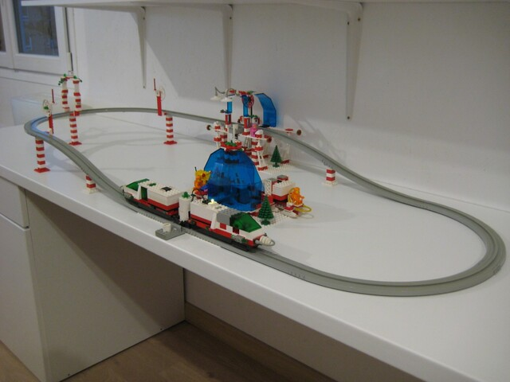](https://www.freelug.org/IMG/jpg/ng_-_01_grand_-2.jpg)

[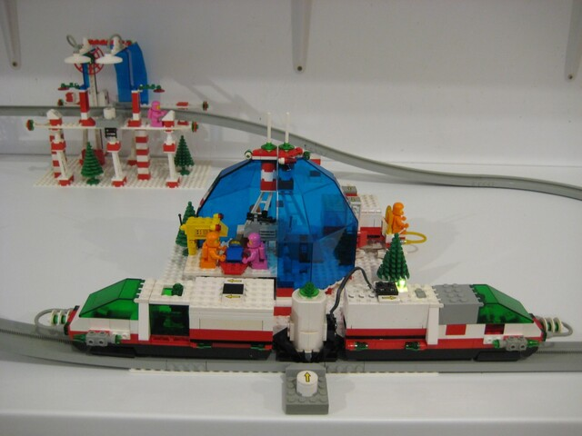](https://www.freelug.org/IMG/jpg/ng_-_02_grand_-2.jpg)

[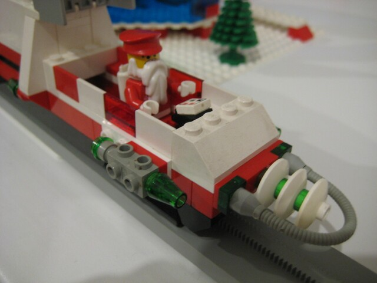](https://www.freelug.org/IMG/jpg/ng_-_03_grand_-2.jpg)

[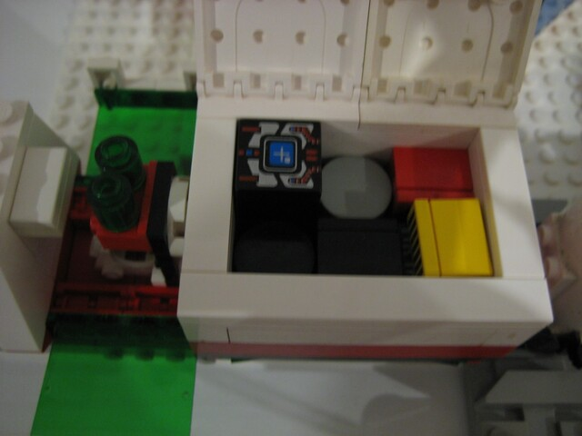](https://www.freelug.org/IMG/jpg/ng_-_04_grand_-2.jpg)

[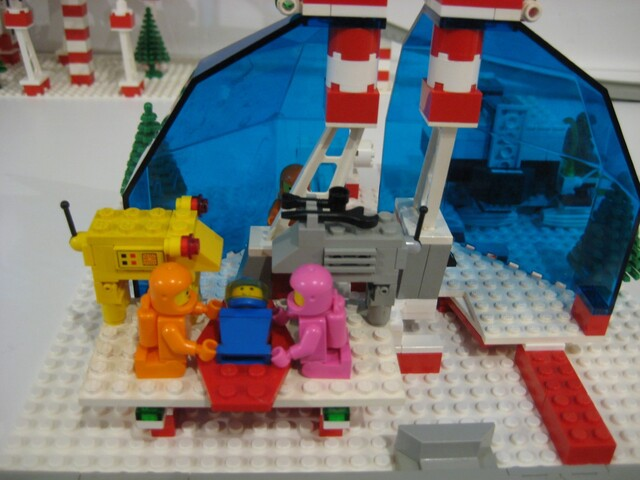](https://www.freelug.org/IMG/jpg/ng_-_05_grand_-2.jpg)

[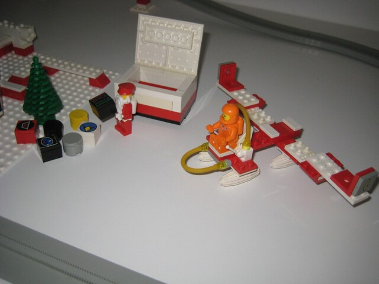](https://www.freelug.org/IMG/jpg/ng_-_06_grand_.jpg)

[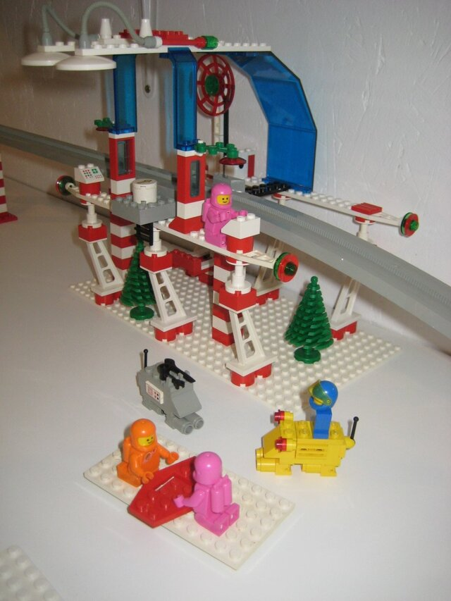](https://www.freelug.org/IMG/jpg/ng_-_07_grand_-r90.jpg)

**04 - Elisabeth L. - Boutique de Noël**  
Modèle de base : Réf 41344  
Année : 2018  
Nombre de pièces du set d’origine : 294

[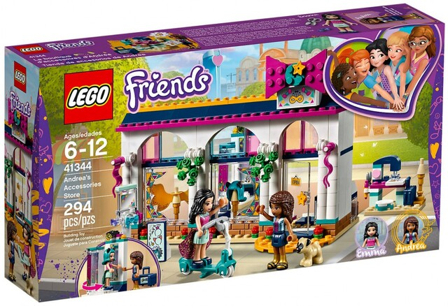](https://www.freelug.org/IMG/jpg/el-00.jpg)

**_Description :_**  
La boutique parfaite ou Madame Noël a décidé d’amener le Père Noël pour changer son bonnet : Celui-ci n’ayant plus beaucoup de magie, il est important de le changer ! Madame Pain d’Épices les a accompagnés et a trouvé de bien jolies barrettes pour ses cheveux.

[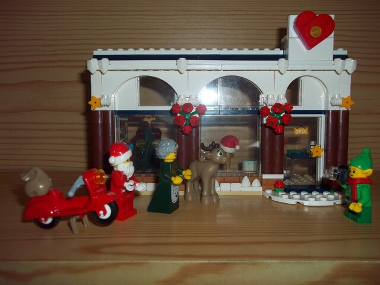](https://www.freelug.org/IMG/jpg/el-01_grand_.jpg)

[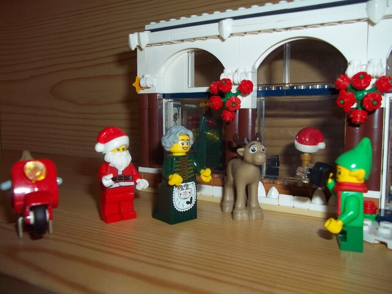](https://www.freelug.org/IMG/jpg/el-02_grand_.jpg)

[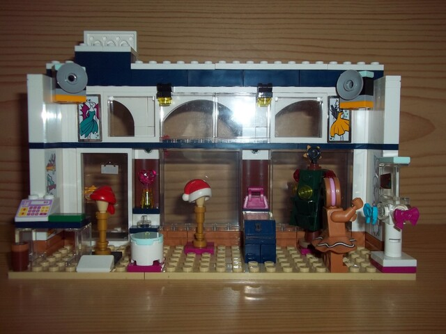](https://www.freelug.org/IMG/jpg/el-03_grand_.jpg)

[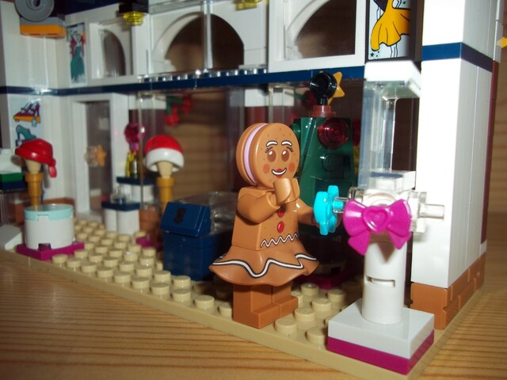](https://www.freelug.org/IMG/jpg/el-04_grand_.jpg)

[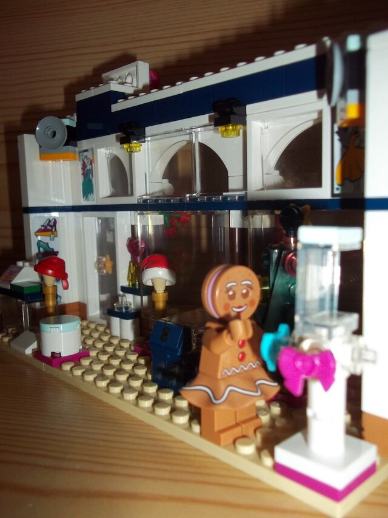](https://www.freelug.org/IMG/jpg/el-05_grand_-r90.jpg)

[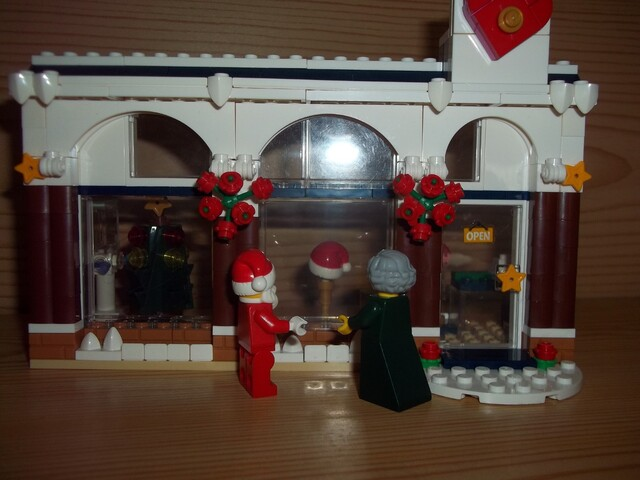](https://www.freelug.org/IMG/jpg/el-06_grand_.jpg)

[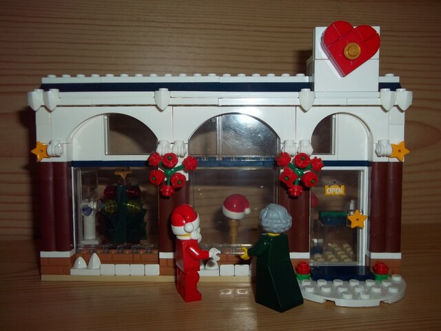](https://www.freelug.org/IMG/jpg/el-07_grand_.jpg)

**05 - Rémi L. - 1989 Batmobile "Rudolphe"**  
Modèle de base : Réf 40433  
Année : 2020  
Nombre de pièces du set d’origine : 366

[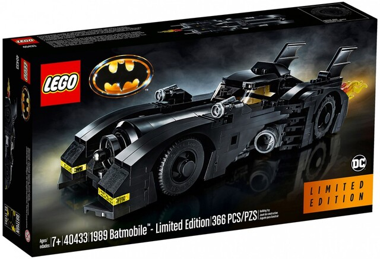](https://www.freelug.org/IMG/jpg/rl_-_00.jpg)

**_Description :_**  
Batman aime le noir ce n’est plus un secret, mais il aime également Noël. Pour défendre Gotham City des attaques du Joker sur son char de carnaval gâteau de Noël, il n’hésite pas à camoufler sa légendaire Batmobile aux couleurs festives des fêtes de fin d’année.  
Cette version hivernale de la Batmobile est surnommée affectueusement "Rudolphe" à cause de son nez rouge lumineux qui cache en réalité un radar pour repérer les ennemis.  
En plus de l’armement habituel, cette Batmobile est équipée de 2 mini sapins à lame rotative en forme d’étoile sur les roues arrière (idée piquée à un célèbre espion Anglais mais chut…).  
Batman n’est pas en reste avec sa superbe tenue rouge et sa cape verte qui lui permettent de passer inaperçu en cette période de l’année. Il est armé d’un tout nouveau modèle de Batarang doré en forme de bois de rennes.  
Le Joker lui reste fidèle à lui-même, dynamite et pistolet mitrailleur. On ne change pas une recette qui fonctionne… ou pas.  
La Batmobile mesure plus de 28 cm de long, 8 cm de large et 7 cm de haut.  
Le char du Joker mesure plus de 14 cm de long , 8 cm de large et 15 cm de haut.  
Fournit avec une figurine de Batman exclusive à ce set, la figurine du Joker 1989 avec un bonnet de Noël et un homme de main « lutin de Noël ».  
Un set a exposé fièrement sous le sapin pour tous les fans du justicier masqué.

[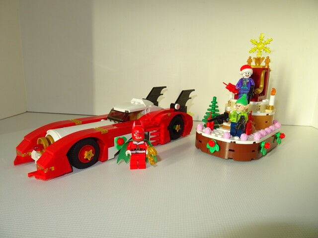](https://www.freelug.org/IMG/jpg/rl_-_01.jpg)

[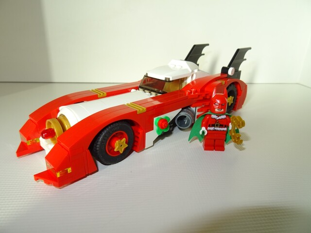](https://www.freelug.org/IMG/jpg/rl_-_02.jpg)

[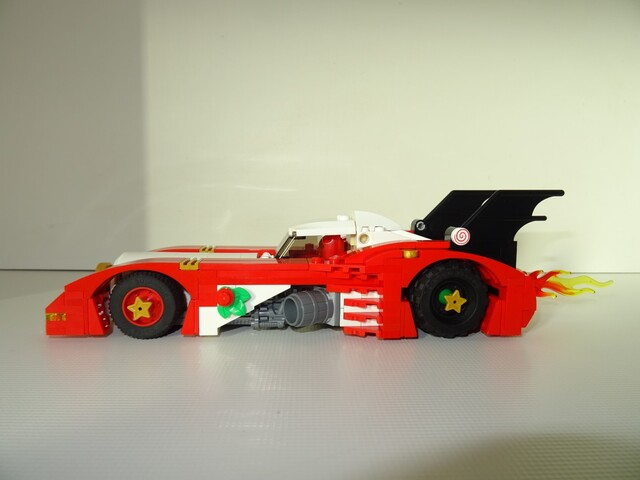](https://www.freelug.org/IMG/jpg/rl_-_03.jpg)

[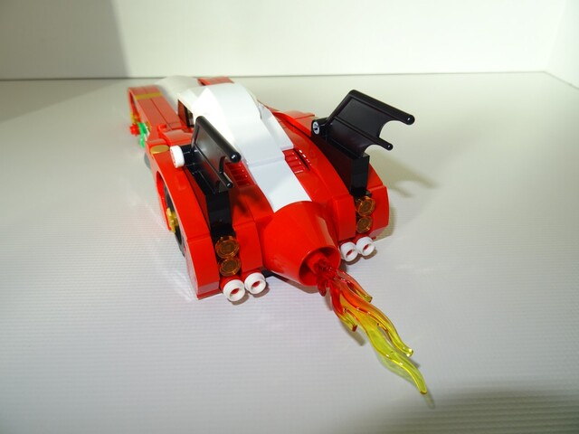](https://www.freelug.org/IMG/jpg/rl_-_04.jpg)

[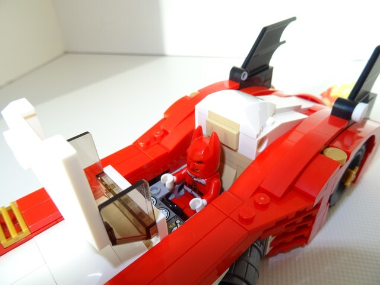](https://www.freelug.org/IMG/jpg/rl_-_05.jpg)

[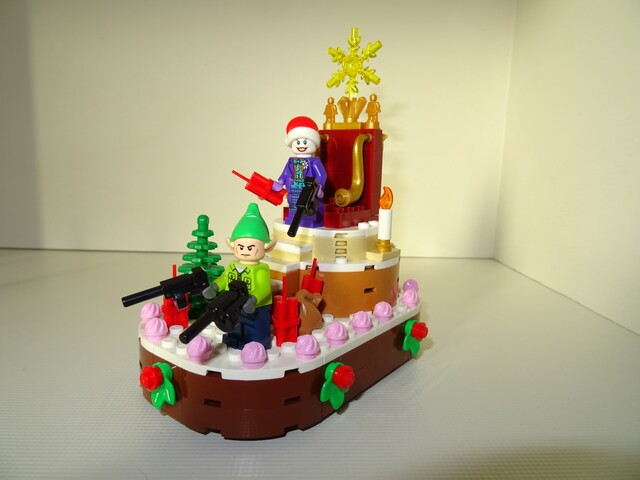](https://www.freelug.org/IMG/jpg/rl_-_06.jpg)

[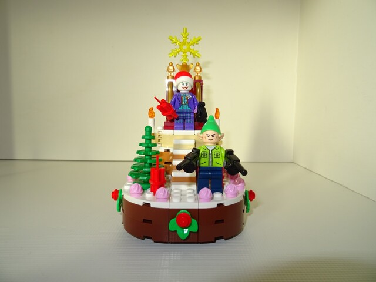](https://www.freelug.org/IMG/jpg/rl_-_07.jpg)

[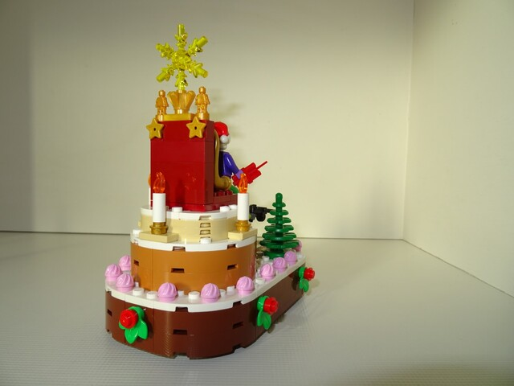](https://www.freelug.org/IMG/jpg/rl_-_08.jpg)

**06 - Laurent T - La cabane dans la neige**  
Modèle de base : Réf 5766  
Année : 2011  
Nombre de pièces du set d’origine : 355

[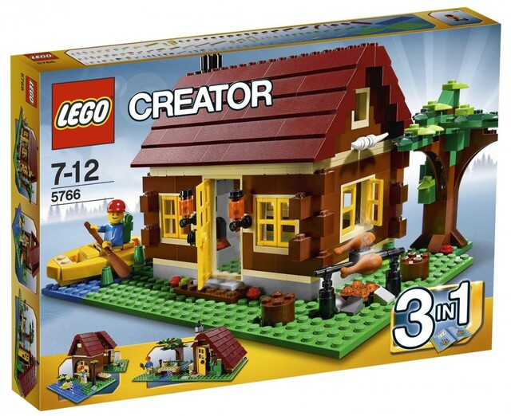](https://www.freelug.org/IMG/jpg/lt_-_00.jpg)

**_Description :_**  
Rejoins la cabane dans la neige et ouvre le coffre pour découvrir les super activités :  
Chausses les skis ou les raquettes pour de superbes balades aux alentours  
Prends les patins à glace et fonce sur le lac gelé  
Décore l’extérieur de la maison avec des couronnes, mais attention aux stalactites !  
Ouvre ensuite l’arrière de la maison grâce au mur à charnières pour profiter de l’intérieur.  
Prépare un bon chocolat chaud dans la cheminée et décore le sapin, c’est bientôt Noël !  
Ce set contient 470 pièces et un personnage

[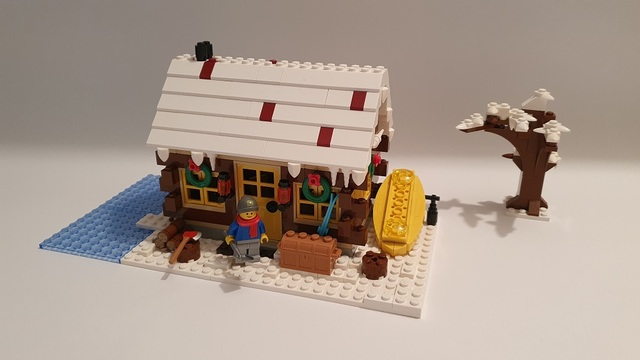](https://www.freelug.org/IMG/jpg/lt_-_01.jpg)

[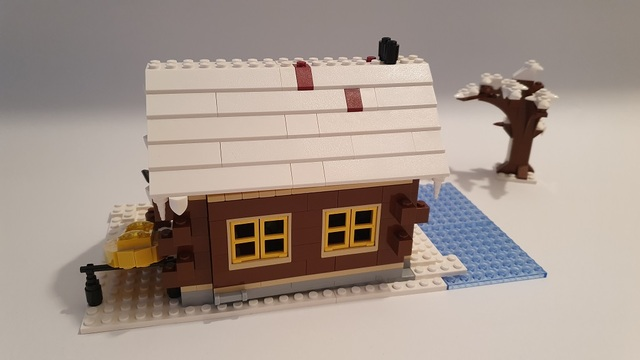](https://www.freelug.org/IMG/jpg/lt_-_02.jpg)

[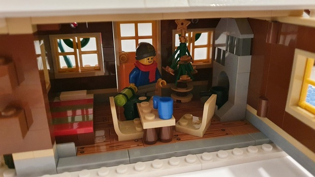](https://www.freelug.org/IMG/jpg/lt_-_03.jpg)

[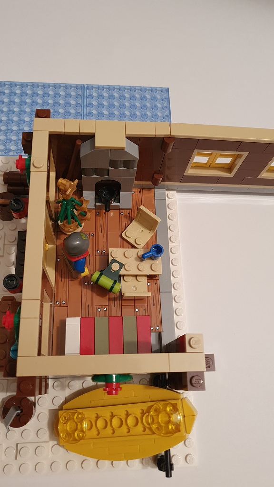](https://www.freelug.org/IMG/jpg/lt_-_04.jpg)

[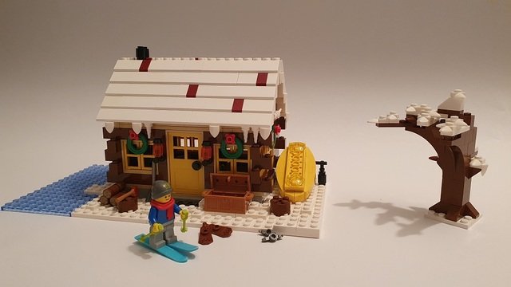](https://www.freelug.org/IMG/jpg/lt_-_05.jpg)

**07 - Julien F. - Noël dans la chambre secrète**  
Modèle de base : Réf 6054  
Année : 1988  
Nombre de pièces du set d’origine : 201

[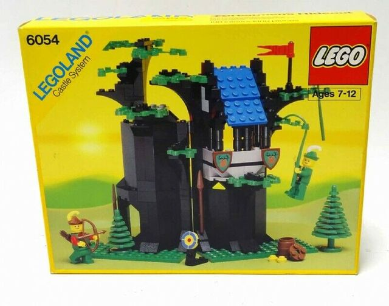](https://www.freelug.org/IMG/jpg/jf_-_00.jpg)

**_Description :_**  
L’iconique set 6054 « Forestmen’s hideout » sorti en 1988 se met à l’heure d’Hiver. Pour célébrer Noël, voici une joyeuse réinterprétation de cet arbre.  
Fini le bois noir et le feuillage vert des origines, l’arbre se présente comme une délicate pâtisserie en chocolat, nappée d’un glaçage généreux. Ou bien est-ce juste un bois brun et de la neige blanche, à vous de décider.  
Nos amis de la forêt se sont équipés pour cette période de fêtes. Ils n’ont pas oublié les écharpes et les capuches protectrices. Et bien sûr, ils ont troqué carquois, flèches et arcs contre des paquets cadeaux qu’ils distribueront aux villageois  
Une splendide chouette des neiges et un lièvre arctique se mêlent à cette petite troupe.  
Il n’y a plus besoin de lances, un sucre d’orge géant orne désormais l’entrée dissimulée de l’arbre, et les torches apportent une chaleureuse lumière.  
Le bonhomme de neige porte, lui aussi un chapeau digne de Robin Des Bois.  
Ce set comprend :  
**–** 1 arbre cachette, couvert de neige, de plus de 24cm de haut, il s’ouvre et dévoile un intérieur douillet  
**–** 2 compagnons de la forêt chaudement habillés  
**–** 1 chouette  
**–** 1 lièvre  
**–** 3 paquets cadeaux  
**–** 1 bonhomme de neige constitué de 7 pièces  
**–** L’arbre inclut 10 éléments de feuillage en une rare couleur blanche

[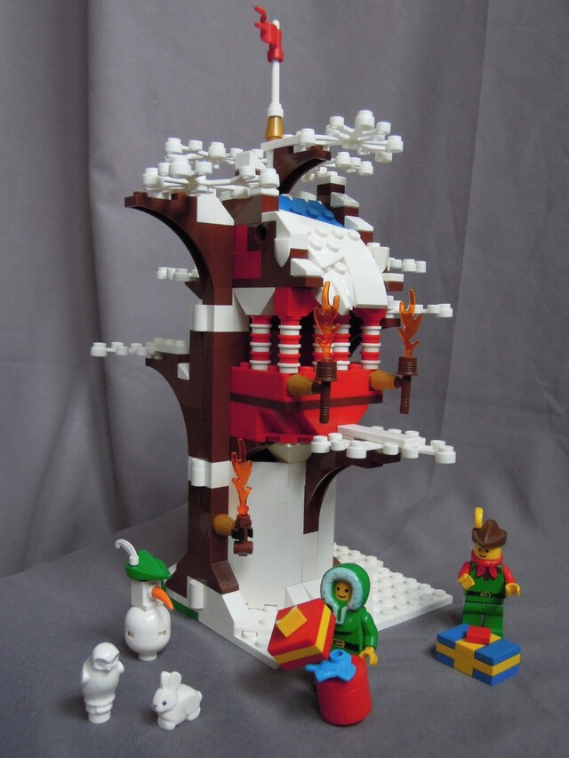](https://www.freelug.org/IMG/jpg/jf_-_01_grand_.jpg)

[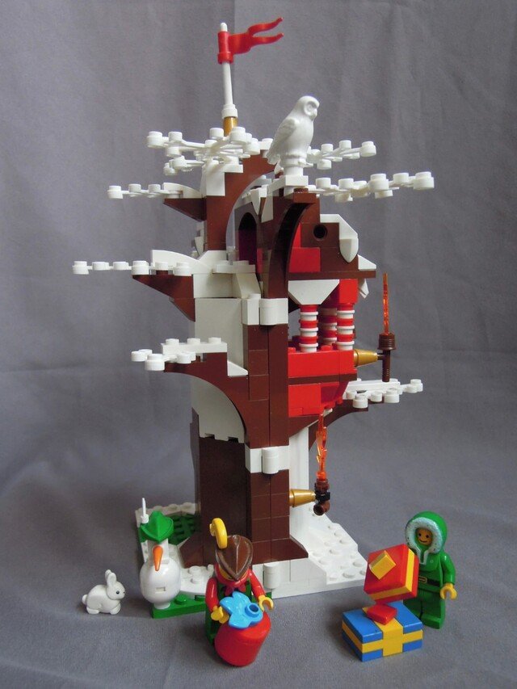](https://www.freelug.org/IMG/jpg/jf_-_02_grand_.jpg)

[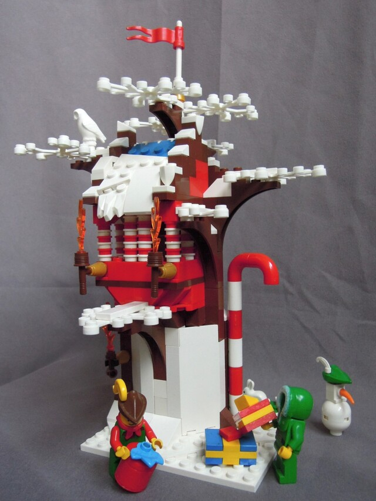](https://www.freelug.org/IMG/jpg/jf_-_03_grand_.jpg)

[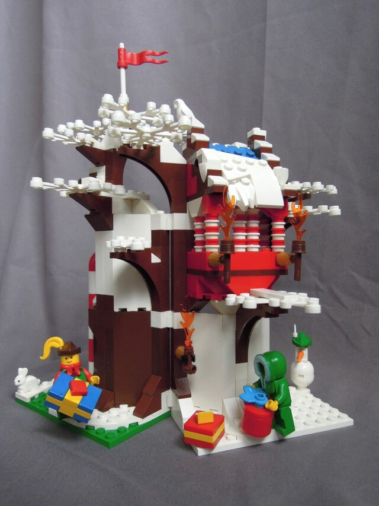](https://www.freelug.org/IMG/jpg/jf_-_04_grand_.jpg)

[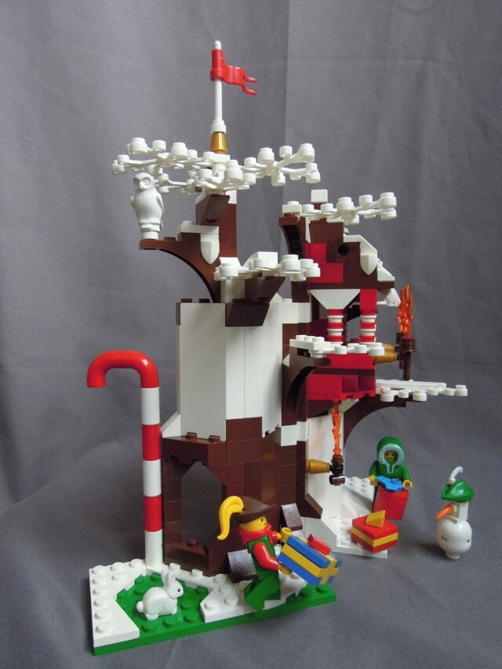](https://www.freelug.org/IMG/jpg/jf_-_05_grand_.jpg)

[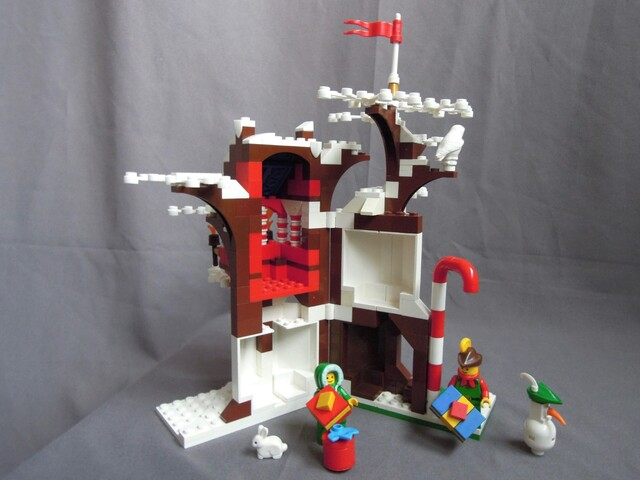](https://www.freelug.org/IMG/jpg/jf_-_06_grand_.jpg)

**Les heureux gagnants de ce concours sont :**  
**1\. Rémi L. avec sa 1989 Batmobile "Rudolphe"** qui remporte le set Lego **Ref 10263 - Creator Expert - Winter Village Fire Stations**  
**2\. Chris T. avec son Back to the Christmas** qui remporte le set Lego **Ref 75262- Star Wars Imperial Dropship – 20th Anniversary Edition**

Classement :  
1\. Rémi L. (13 points)  
2\. Chris T. (10 points)  
3\. Julien F. (7 points)  
4\. Caty et Pierre (Ecrou Papillon) (2 points)  
5\. Nicolas G. (1 point)  
6\. Elisabeth L. et Laurent T. (0 point)

* * *

## Concours catégorie "Virtuelle" :

**01 - Rémi L. - Model Team « Red Fury »**  
Modèle de base : Réf 5541  
Année : 1995  
Nombre de pièces du set d’origine : 421

**_Description :_**  
Le Père noël a toujours rêvé de posséder le Hot Rod "Blue Fury" de 1995. 25 ans après, son rêve est enfin réalisé. Après quelques modifications par rapport au modèle d’origine, il devient le véhicule idéal pour transporter les jouets de l’usine à l’entrepôt.  
Prenez du plaisir à construire ce superbe modèle collector pour fêter les 25 ans du "Blue Fury" rebaptisé pour l’occasion "Red Fury". Cet extraordinaire modèle possède pleins de pièces dorées, des skis et des chenilles ainsi que 2 minis sapins sur les roues avant. Les roues avant tournent avec le volant. Des cadeaux réalistes complètent l’ensemble.  
Cet ensemble mesure plus de 30 cm de long, plus de 12,5 cm de large et plus de 9.5 cm de haut.  
La construction de ce véhicule du Père Noël aux multiples détails ravira petits et grands pour décorer la maison pour les fêtes de fin d’années.

**02 - Wilfried R - La Cadillac MRY-XMAS du Père Noël**  
Modèle de base : Réf 21108  
Année : 2014  
Nombre de pièces du set d’origine : 508

**_Description :_**  
Suis le Père Noël dans sa tournée nocturne de distribution des cadeaux, alors qu’il parcourt le ciel au volant de sa Cadillac Laponia 1959 intérieur cuir vegan. Eh oui, il a mis des rennes dans le moteur de son bolide MRY-XMAS qui fend les airs, le froid, et la neige !  
Comprend 4 figurines de l’équipage :  
**–** le Père Noël est doté de son sac-à-"K"dos tendance (mais de grande contenance), de sa lampe torche, et de son thermos de tchaï latte bio.  
**–** la Mère Noël prépare des gâteaux à la cannelle (meilleurs que ceux du géant suédois) grâce au four mobile afin d’encourager l’équipage et d’en offrir aux enfants.  
**–** le lutin Sifflemug (toujours assoiffé) est en liaison radio avec la base polaire pour organiser la tournée.  
**–** le lutin Chipebretzel (toujours affamé) est bien outillé pour réparer les soucis mécaniques de la Cadillac.  
Le véhicule MRY-XMAS est équipé d’appareils de communication radio et satellite pour ne rater aucune cheminée, et de rangements de toit pour la réserve à cadeaux. Le sucre d’orge producteur de froid fait tomber la neige à la demande pour un 24 décembre très gla-glamour. En cas d’embouteillage, les gyrophares et les sirènes hypnotisent les noctambules pour faire place au Père Noël. Pour passer encore plus inaperçu, un feuillage couvrant furtif peut faire passer la Cadillac pour un sapin (sans abus de vin chaud)."

**3 - Jean-Michel R - Santa Claus’s Boat**  
Modèle de base : Réf 21317  
Année : 2019  
Nombre de pièces du set d’origine : 751

**_Description :_**  
Noël 2020, le père noël refuse de livrer les cadeaux et file au pays des fées, mais les elfes le cherchent sans relâche !  
D’après ce que l’on en sait, il serait parti pour éviter le confinement.  
Tom (un elfe), en profite pour fabriquer encore quelques jouets dans l’atelier du bateau, pendant que Pouce scrute l’horizon.  
Sur le toit, nous avons Spike, qui emballe les paquets qu’il faudra distribuer aux enfants de 40 ans et plus.  
Comme tous les cadeaux sont stockés à l’arrière du bateau, les elfes ont eu la bonne idée de mettre des lingots d’or à l’avant du bateau pour faire du contrepoids ! c’est des petits futés...

**4 - Laurent C. - Santa’s Hot Christmas Rod**  
Modèle de base : Réf 70434  
Année : 2020  
Nombre de pièces du set d’origine : 244

**_Description :_**  
Les enfants, jeunes et moins jeunes, vont découvrir l’univers méconnu du Père Noël grâce à cet ensemble Lego constitué de 231 pièces. Ce Hot Rod futuriste lui permet d’effectuer les tournées de Noël à une vitesse supérieure à celle de la lumière afin que chacun d’entre nous puisse avoir ses cadeaux.  
Ce véhicule high-tech a été fabriqué par le Père Noël et ses lutins à partir du bolide à bord duquel, étant plus jeune, le Père Noël surfait sur les plages de Californie. Il est maintenant devenu un engin capable de faire le tour de la terre en une nuit. Il est équipé de nombreux équipements et accessoires :

-   Des réacteurs latéraux surdimensionnés qui lui permettent d’atteindre des vitesses folles.
-   Un balai magique et une pelle automatique sont intégrés afin de pouvoir déneiger les toits pour ne pas glisser lors des tournées.
-   Avec les roues rétractables automatiquement, cet engin est capable de flotter dans les airs dans un grand confort, mais également de rouler sur Terre comme une belle voiture ancienne grâce à son moteur surpuissant.
-   Le bouclier avant aérodynamique lui permet de fendre les airs pour ne pas ralentir les tournées. Il donne également l’aspect d’un traîneau afin de ne pas être trop vite démasqué.
-   Un coffre géant en forme de cadeau permet de stocker les présents de tous, que vous ayez été sage ou pas.
-   Un énorme volant Bretzel, salé ou sucré, permet de reprendre des forces pour les petits creux lors des tournées.
    
    
    
    
    
    
    
    
    
    
    
    
    
    
    
    
    

**L’heureux gagnant de ce concours est Rémi L. avec son Model Team « Red Fury »** mais comme il n’est pas possible de gagner le concours du réel et du virtuel comme stipulé dans le règlement, c’est donc **Jean Michel R. avec son Santa Claus’s Boat** qui remporte le set Lego **Ref 75259 - Snowspeeder – 20th Anniversary Edition**

Classement :  
1\. Rémi L. (6 points)  
2\. Jean Michel R. (3 points)  
3\. Wilfried R. et Laurent C. (1 point)

* * *

Composition du jury :  
Pierre C. (GFC)  
Loïc T. (GFC)  
Mathieu W. (GFC)  
Xavier D. (GFC)

Duy Hai D.  
Jérôme V.  
Nicolas W.  
Denis L.  
Jean B.  
Sébastien M.  
Edward K.

**Merci à toutes et tous et à bientôt pour un nouveau concours !**
