La gamme "Speed Champions" évolue en 2020 en passant à 8 tenons de large. Lamborghini reste, pour moi, ma marque de voiture de sport préférée. C’est pour cela que j’ai choisi cette boite pour vous présenter l’évolution de la gamme.

Dans les nouveautés en 8 tenons de large nous avons eu en 2020 une Ferrari, une Audi 80’ Quattro, une Nissan Skyline et deux plus grosses boites qui contiennent deux voitures, une Jaguar et celle que je vous présente dans cette revue.

Le Père Noël m’a apporté 3 belles boites "Speed Champion" cette année. J’ai commencé par le montage de la Skyline puis par celui de la Ferrari. J’ai trouvé quelques parties compliquées à assembler, surtout sur la Ferrari qui est un peu fragile. J’ai au moins modifié les roues que je trouve pas assez larges par rapport à la voiture. Par contre, sans les jantes c’est un peu moins beau. Je vais les garder en fond sur cette revue, car malgré quelques défauts que je citerai plus bas, elles me plaisent beaucoup.

Passons donc au montage du set Lamborghini en débutant par les présentations habituelles :  
**–** Année de sortie 2020.  
**–** Prix 64,99 €, sur le Shop, à l’heure où j’écris ces lignes.  
**–** Temps de montage environ 2h.  
**–** Sachets numérotés jusqu’à 5.  
**–** Une minifig par voiture.

La boite nous présente les deux voitures que nous allons assembler, en pleine action. Mais l’une étant de course et l’autre tout terrain, chacune se retrouve sur son circuit correspondant. Même si la ligne de départ est la même, ce ne sont pas les mêmes bolides.

[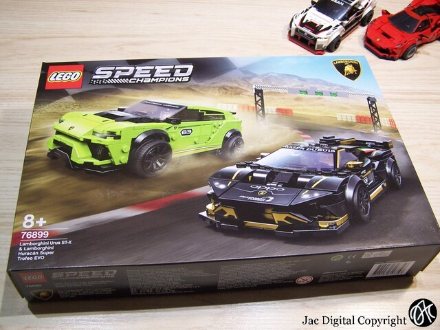](https://www.freelug.org/IMG/jpg/photo_1-3.jpg)

Au dos de la boite nous retrouvons les voitures, sous d’autres angles de vue. Il y a aussi de belles photos des vraies. Ca permet de comparer les reproductions en gardant à l’esprit que ce ne sont pas des maquettes fidèles, mais des jouets qui se rapprochent du vrai.

[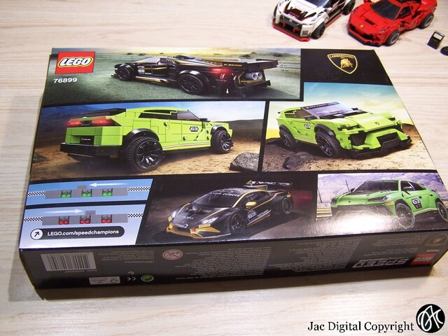](https://www.freelug.org/IMG/jpg/photo_2-3.jpg)

Allez, ouvrons cette belle boite. Comme pour la Skyline, on peut ici se munir d’un couteau et couper délicatement les deux bandes de scotch qui maintiennent les rabats en carton. Ca permet de conserver la boite en meilleur état. Pour celle de la Ferrari, par contre, il faut pousser sur les deux ergots, comme avant.

[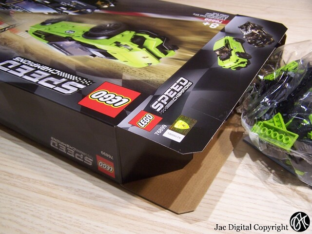](https://www.freelug.org/IMG/jpg/photo_3-2.jpg)

A l’intérieur de la boite on a deux sachets par voiture et un pour le portique, deux notices et deux planches d’autocollants. Ces dernières ne sont pas protégées. L’une d’entre elle est un peu pliée, mais ça ne gène pas l’utilisation.

[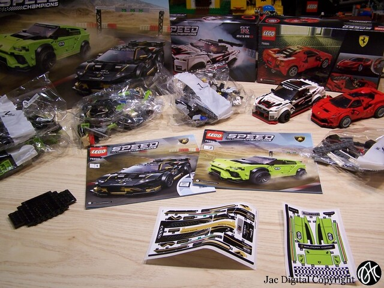](https://www.freelug.org/IMG/jpg/photo_4-2.jpg)

On commence par le montage de la Hurucan super. A l’ouverture du premier sachet on découvre les nouvelles pièces. Tout d’abord le châssis qui permet le montage des voitures de sport de cette taille. Il n’y en a qu’un dans cette boite. La Urus est un assemblage de pièces.

Il faut d’abord construire le pilote, très joli avec son uniforme au logo Lamborghini. Il a deux têtes possibles et une coiffure un peu éparpillée. C’est sûrement à cause du casque !

[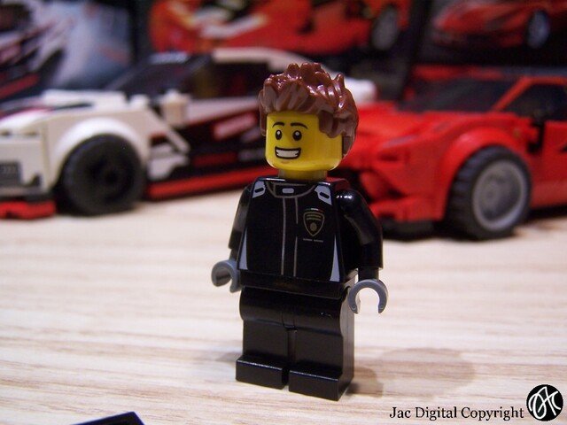](https://www.freelug.org/IMG/jpg/photo_5-2.jpg)

[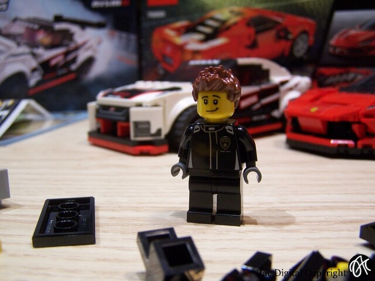](https://www.freelug.org/IMG/jpg/photo_6-3.jpg)

On remarque ici le châssis cité plus haut et les nouvelles pièces qui servent de support aux roues. Avec celles-ci, on fixe l’axe cruciforme dans la pièce. Ce qui veut dire que les roues de ces voitures en 8 tenons de large sont différentes de celles en 6. Je ne comprends pas la raison de ce changement, mais ça modifie les jantes.

[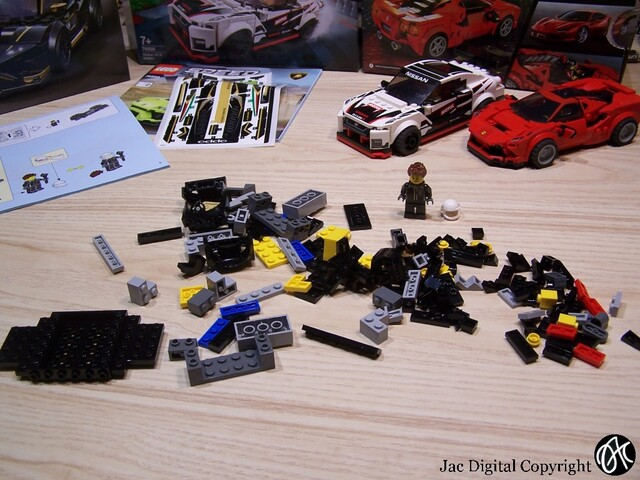](https://www.freelug.org/IMG/jpg/photo_7-2.jpg)

Un bon lot de pièces jaunes, pour représenter les amortisseurs, mais aussi pour aider à l’assemblage. Voilà une belle photo de l’arrière avant le montage de la carrosserie.

[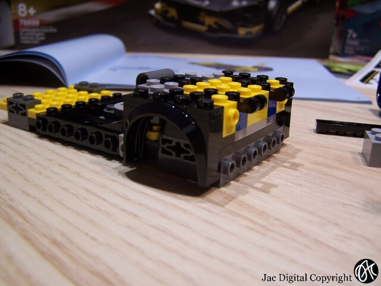](https://www.freelug.org/IMG/jpg/photo_8-2.jpg)

La pose des autocollants commence avec les premières pièces de carrosserie et le tableau de bord central. Il faut bien faire attention à les ajuster pour que la bande de couleur or se rejoigne sur toutes les pièces. J’avoue ce n’est pas évident. Si on ne les met pas, il manquera quelque chose. Les pièces lisses 2X2 en triangle affinent bien l’allure. On ne voit déjà presque plus les pièces jaunes.

[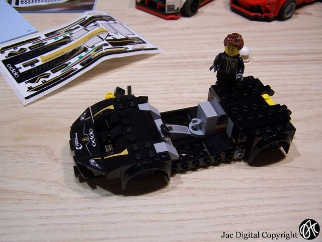](https://www.freelug.org/IMG/jpg/photo_9-2.jpg)

Une fois cette première partie terminée, nous avons déjà un petit lot de pièces supplémentaires.

[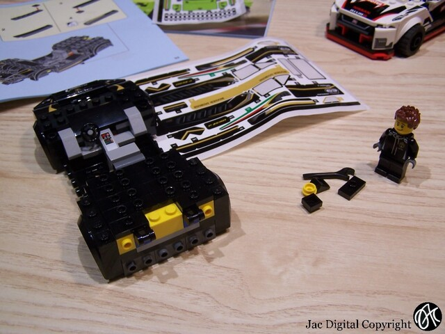](https://www.freelug.org/IMG/jpg/photo_11.jpg)

Voilà le lot de pièces qui permettra de terminer cette superbe voiture. On remarque qu’il reste encore pas mal d’autocollants à placer.

[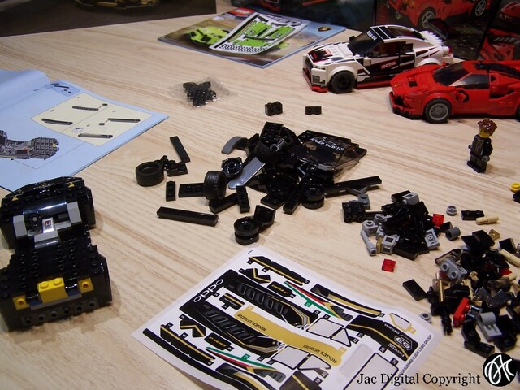](https://www.freelug.org/IMG/jpg/photo_12.jpg)

A cette étape on peut déjà placer les roues. C’est indiqué dans la notice. C’est pas courant. On les place en général dans les dernières étapes.

[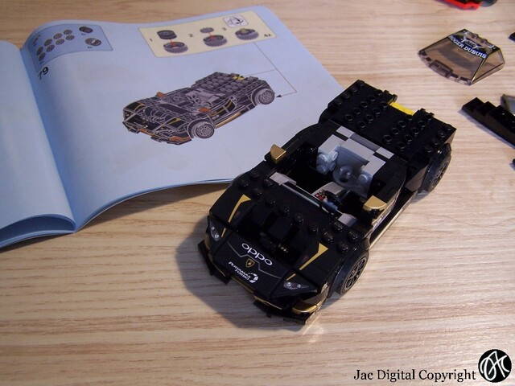](https://www.freelug.org/IMG/jpg/photo_13-2.jpg)

Du coup le pilote s’installe au volant. Mais eh oh, il est pas un peu pressé lui, j’ai pas fini là ! Le cockpit est un peu exigu. Certains éléments ont leurs fixations très près du pilote. Le placement des flancs est très particulier et ça donne un super effet.

[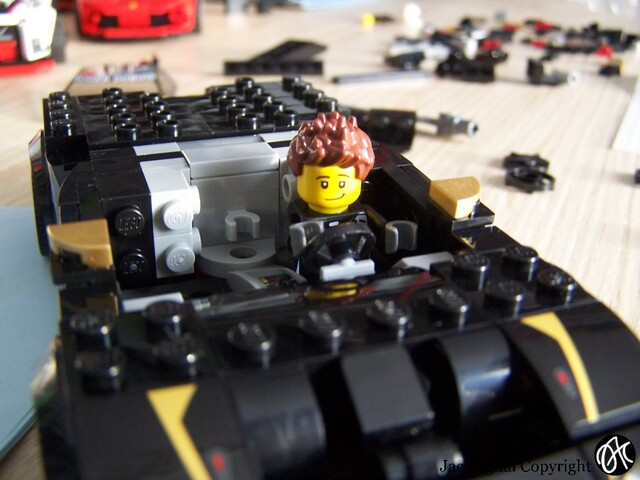](https://www.freelug.org/IMG/jpg/photo_14-2.jpg)

Enfin, la pose des autocollants est terminée. Heureusement, pour l’Hurucan le pare-brise est tampographié.

[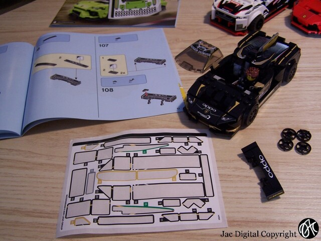](https://www.freelug.org/IMG/jpg/photo_15.jpg)

L’Hurucan terminé, il nous reste quelques pièces en "extra parts". Je trouve le véhicule magnifique mais avec quelques défauts gênants. On ne peut mettre le pilote dans la voiture qu’avec le casque ou tête nue. C’est dommage, j’aurais bien aimé qu’il conduise avec ses cheveux en l’air. Le volant n’est pas en face du conducteur. Avec une métapièce pour le châssis, ça aurait été bien de faire aussi attention à ça. Je trouve que c’est un raté. Mais je ne pense pas que ça gêne les enfants pour jouer.

[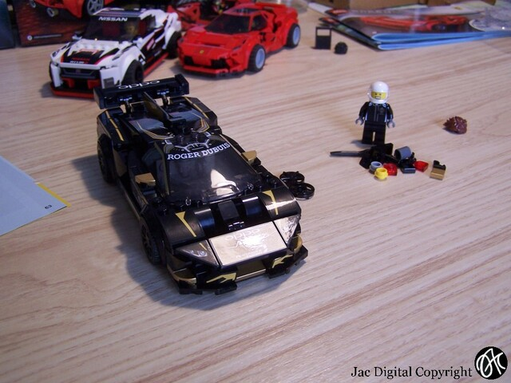](https://www.freelug.org/IMG/jpg/photo_16.jpg)

[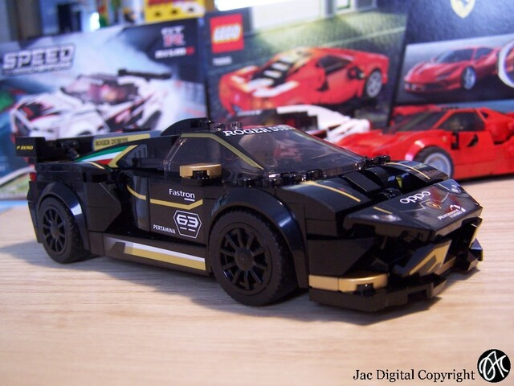](https://www.freelug.org/IMG/jpg/photo_18.jpg)

Dans les trucs bien, on peut mettre deux minifigs dans la voiture. Mais elles auront toutes les deux le casque... Je ne l’ai pas fait dans toutes les voitures. Mais puisqu’elles sont construites sur le même châssis, il n’y a pas de raison que ça ne soit pas possible.

[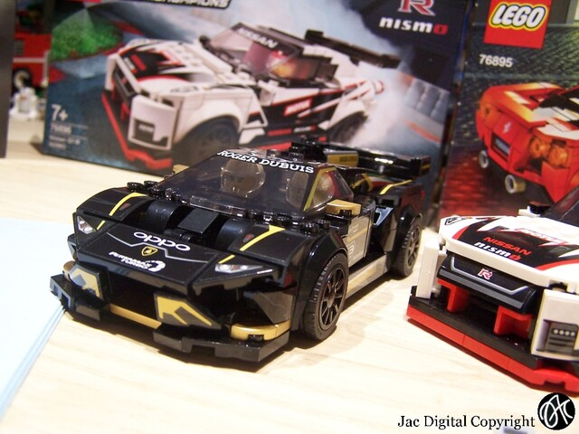](https://www.freelug.org/IMG/jpg/photo_23.jpg)

Ouverture du sachet numéro trois pour le montage de l’Urus. Comme je vous l’avais dit, il n’y a pas de châssis en métapièce pour ce deuxième véhicule. Il va falloir l’assembler de toutes pièces.

[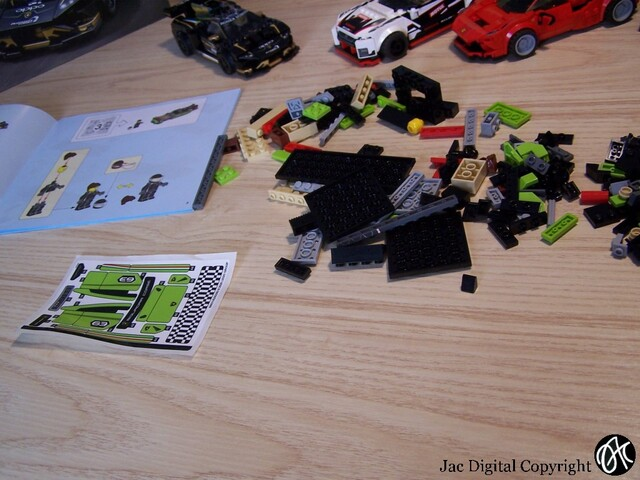](https://www.freelug.org/IMG/jpg/photo_19.jpg)

On découvre une pilote, avec les mêmes vêtements que pour l’Hurucan. Elle a une belle coupe de cheveux que l’on peut lui laisser sur la tête, même devant son volant. Je ne connaissais pas cette pièce.

[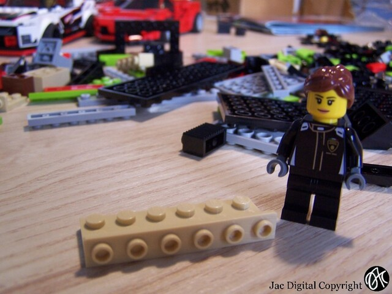](https://www.freelug.org/IMG/jpg/photo_20.jpg)

Le montage se poursuit sans encombre. La pose des bandes du bas de caisse n’est pas facile à aligner. Il reste quelques pièces à la fin de cette première partie.

[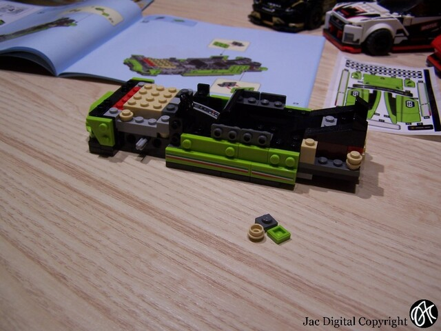](https://www.freelug.org/IMG/jpg/photo_26.jpg)

Contenue du sachet numéro 4. Encore pas mal de pièces à placer sur cette voiture.

[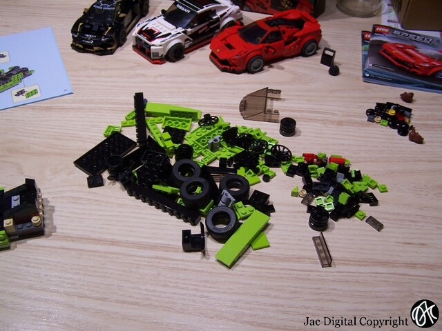](https://www.freelug.org/IMG/jpg/photo_27.jpg)

Après quelques assemblages de briques et collage de stickers supplémentaires, nous pouvons joindre l’Urus à l’équipe. Il fait gros à coté des autres. C’est un 4X4 bien sûr, mais la taille en impose quand même. Les minifigs sont un peu ridicules à côté.

[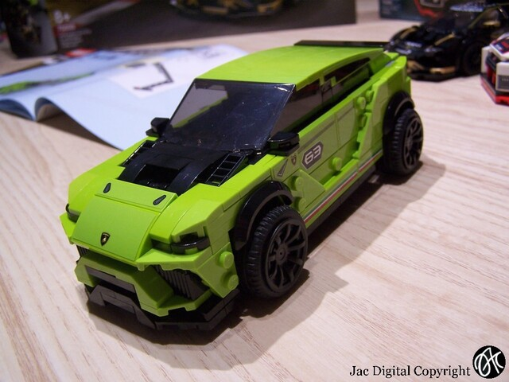](https://www.freelug.org/IMG/jpg/photo_31-2.jpg)

[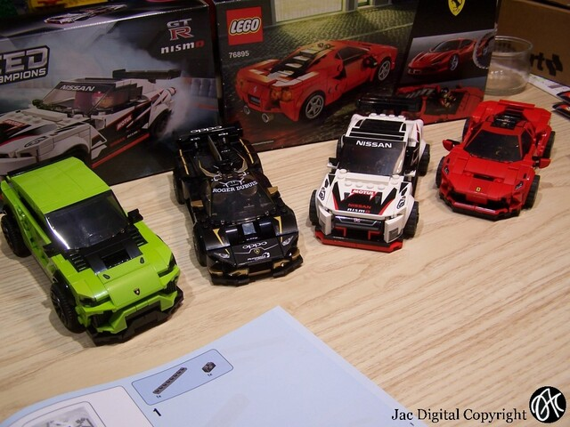](https://www.freelug.org/IMG/jpg/photo_33.jpg)

Le dernier sachet concerne le montage du portique de départ. Ce n’est pas d’un grand intérêt pour moi même si je conçois que ça apporte un petit plus pour le jeu. Je trouve par contre bien fait les systèmes à chaque fois nouveau pour afficher les feux vert. Ici j’ai opposé la Lamborghini à la Ferrari car comme je vous l’ai dit, la Urus ne court pas sur le même terrain. Après, bon, peu importe...

A part les autocollants à poser et les quelques défauts que j’ai signalés, ce set est vraiment un régal à construire. J’ai pris plaisir à contempler les voitures terminées, surtout la Hurucan, avec ses flans particuliers. Cette dernière est justement très bien reproduite. D’ailleurs, je ne l’ai même pas modifiée.

[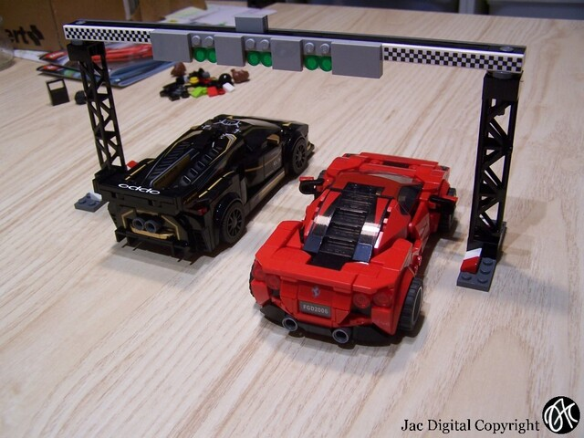](https://www.freelug.org/IMG/jpg/photo_44.jpg)

[Toutes les photos du montage](https://photos.freelug.org/main.php/v/JAC/review/SpeedChampion/76899/)
