Bien qu’il s’agisse d’un produit de 2018 retiré de la vente, je vous propose une petite présentation de l’ensemble **Les trésors de la cabane dans l’arbre**, portant la référence _31078_.

Sorti dans la gamme Creator 3-en-1, cet ensemble de 260 pièces était vendu 29,99 € sur la boutique officielle.

Il propose d’assembler trois constructions liées aux jeux d’enfants : une cabane dans les arbres, un bateau et une île (pirate !) au trésor.

Classiquement pour la gamme l’avant propose les trois constructions possibles, avec la principale, utilisant le plus de pièces, mise en valeur, et sur le côté droit les deux constructions alternatives. La boîte comporte deux minifigurines d’enfants, ce qui est logique par rapport au thème. Bon, on se rend bien compte sur l’image que l’arbre dans lequel se trouve la cabane est suggéré plus que vraiment représenté, mais peu importe.

[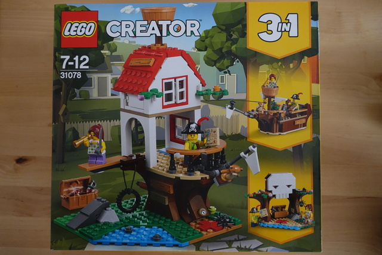](https://www.freelug.org/IMG/jpg/dsc02727.jpg)

L’arrière reprend les mêmes constructions sur des angles différents, et montre l’élément principal de jouabilité, une tige qui permet de faire sortir un trésor de sous l’arbre, ainsi que quelques détails comme le fait que le toit de la cabane s’ouvre.

[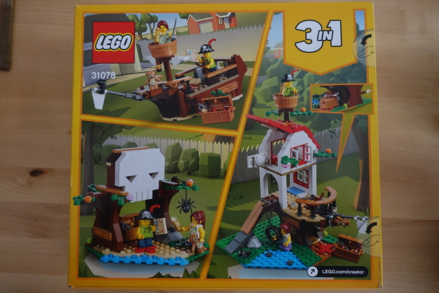](https://www.freelug.org/IMG/jpg/dsc02729.jpg)

* * *

Les constructions n’ont pas de technique particulière, aussi je ne vais pas m’étendre dessus.

Le troisième modèle proposé à la construction est une magnifique tête de mort sous laquelle se trouve un trésor, dont l’emplacement est indiqué par un magnifique « X » rouge. Le petit garçon tient un sabre et une carte au trésor, tandis que la petite fille tient un ourson à la main. Le crâne est plutôt réussi avec peu de pièces.

[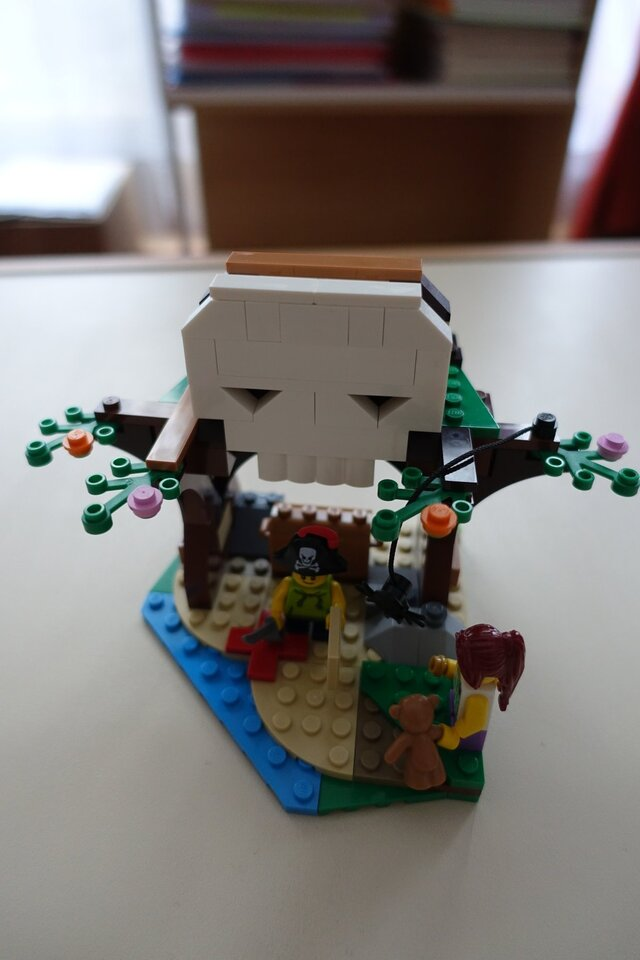](https://www.freelug.org/IMG/jpg/dsc02698-r90.jpg)

[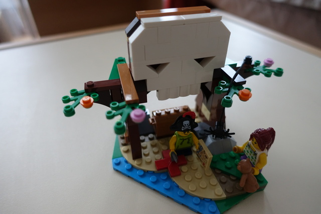](https://www.freelug.org/IMG/jpg/dsc02699.jpg)

De dos c’est un peu moins recherché, pas de décor particulier, rien pour cacher les pins Technic bleus.

[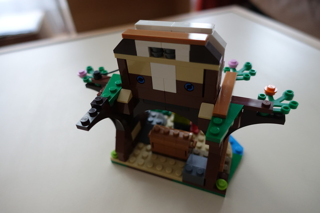](https://www.freelug.org/IMG/jpg/dsc02700.jpg)

Vu de côté, on se rend bien compte que la tête de mort est accrochée sur une façade marron via deux crochets, et qu’elle est donc amovible.

[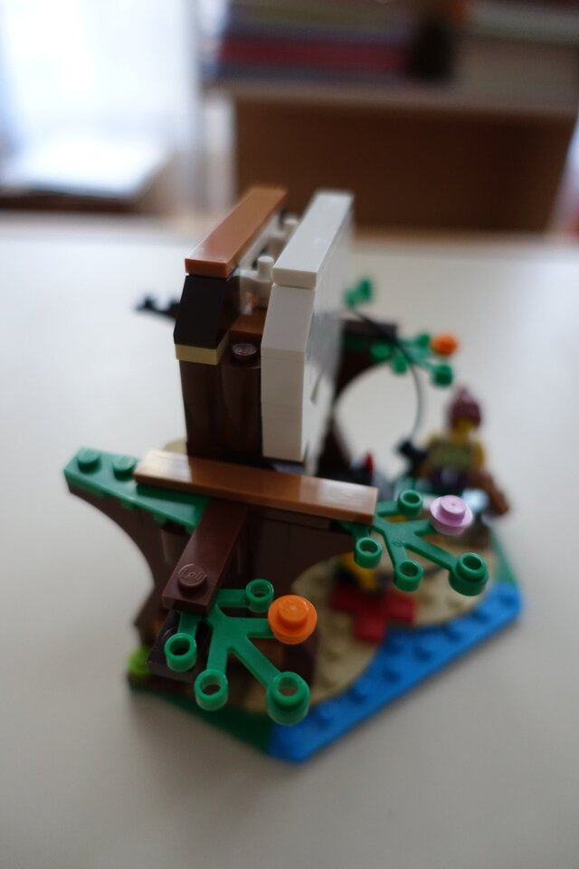](https://www.freelug.org/IMG/jpg/dsc02701-r90.jpg)

Retirée, la tête de mort laisse apparaître deux rubis (malheureusement pas très visibles sur la photo), simplement insérés dans les pins Technic. Une araignée de son côté se promène en bout de fil, symbolisé par une corde — efficace et simple.

[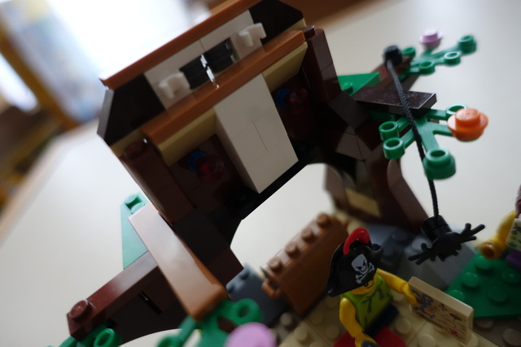](https://www.freelug.org/IMG/jpg/dsc02702.jpg)

* * *

Autre construction possible, un bateau (certainement pirate même s’il ne bat pas pavillon noir). La construction est assez simple mais reprend toutes les caractéristiques requises, avec notamment le mât au sommet duquel est placée la petite fille, qui tient une longue-vue et un sabre. L’ourson est cette fois-ci installé sur le côté de la proue.

[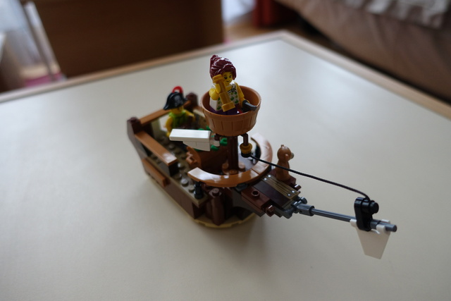](https://www.freelug.org/IMG/jpg/dsc02707.jpg)

[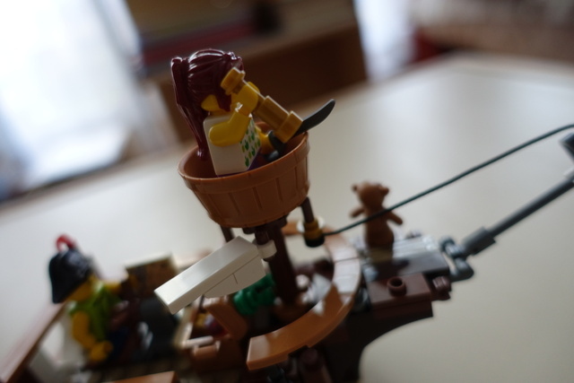](https://www.freelug.org/IMG/jpg/dsc02711.jpg)

De côté on voit quelques détails comme la rambarde, simplement constituée de plaques lisses. Le petit garçon tient toujours la carte et pilote le bateau, mais comme il a le trésor devant lui, j’imagine qu’il se sert de la carte pour revenir à son point de départ.

[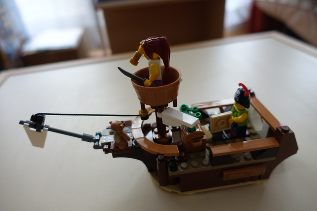](https://www.freelug.org/IMG/jpg/dsc02708.jpg)

L’arrière du bateau est assez simple mais a quand même un gouvernail, pour pouvoir se diriger

[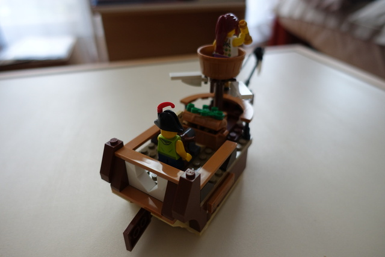](https://www.freelug.org/IMG/jpg/dsc02709.jpg)

Le trésor de son côté contient quelques rubis et un sabre.

[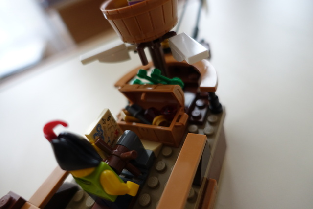](https://www.freelug.org/IMG/jpg/dsc02710.jpg)

* * *

Le modèle principal, qui est donc une cabane dans un arbre, est comme classique pour la gamme le seul à utiliser toutes les pièces. Le sommet est tout de même à une vingtaine de centimètres. L’aspect « dans l’arbre » est symbolisé par le tronc sur lequel est posée la cabane, et les quelques feuilles posées sur celle-ci.

[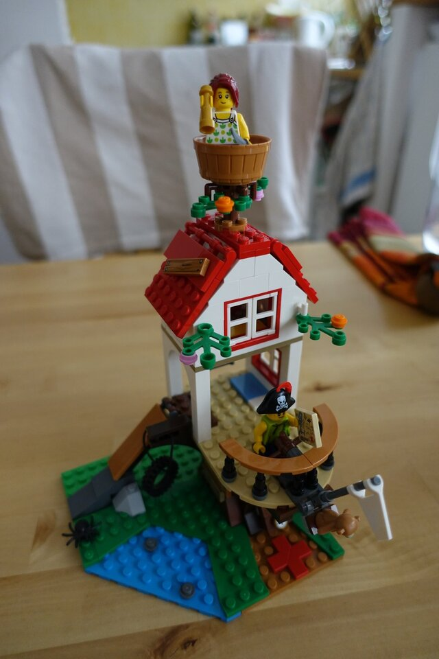](https://www.freelug.org/IMG/jpg/dsc02712-r90.jpg)

Sur le côte se trouvent un toboggan (avec à son extrémité une belle araignée !) et une balançoire simplement constituée d’un pneu et d’une corde.

[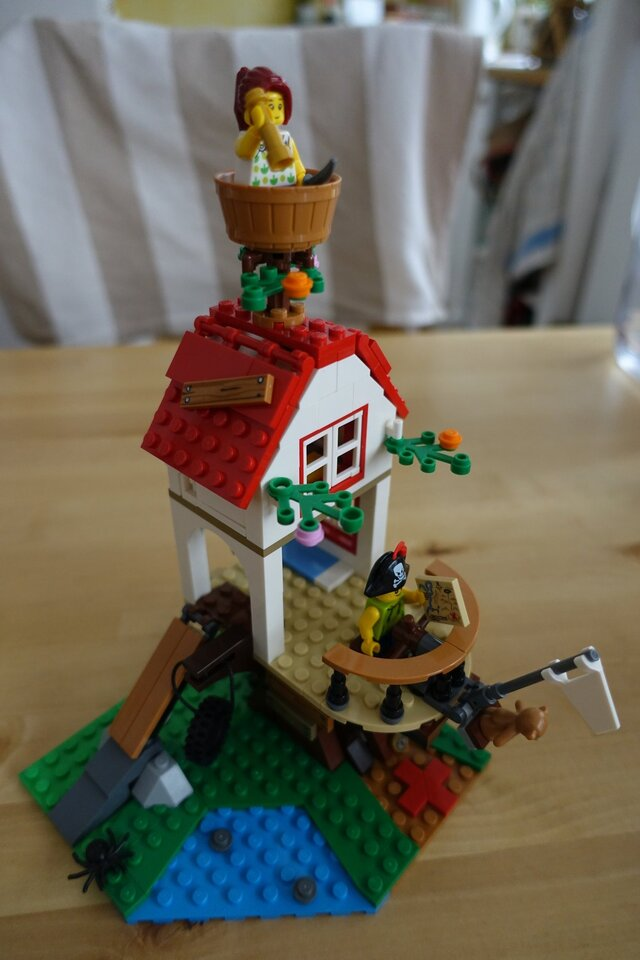](https://www.freelug.org/IMG/jpg/dsc02713-r90.jpg)

Un lit est suggéré, avec simplement deux pièces lisses — peut-être un sac de couchage ?

[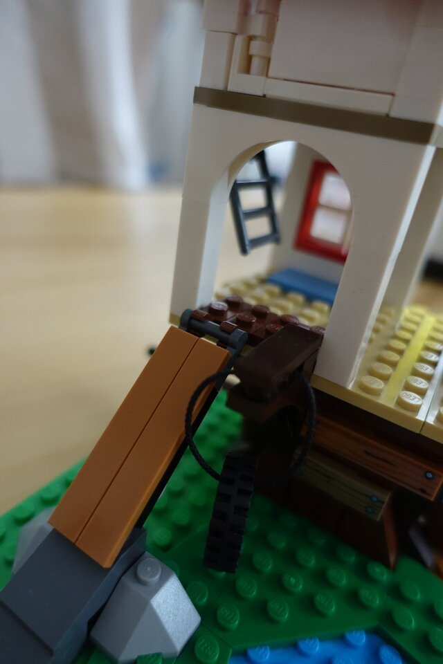](https://www.freelug.org/IMG/jpg/dsc02717-r90.jpg)

La petite fille est toujours en haut du mat avec sa longue-vue et son sabre, ...

[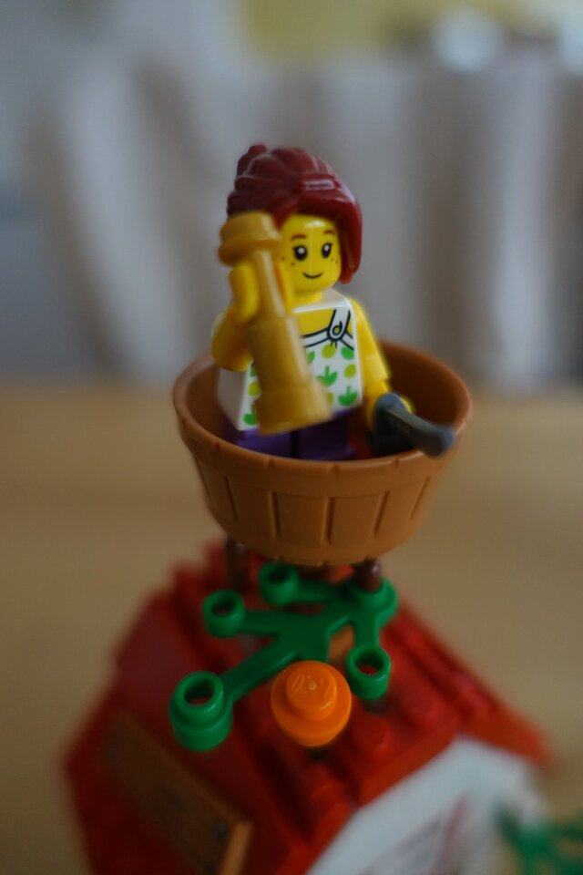](https://www.freelug.org/IMG/jpg/dsc02714-r90.jpg)

le petit garçon toujours aux commandes avec sa carte, ...

[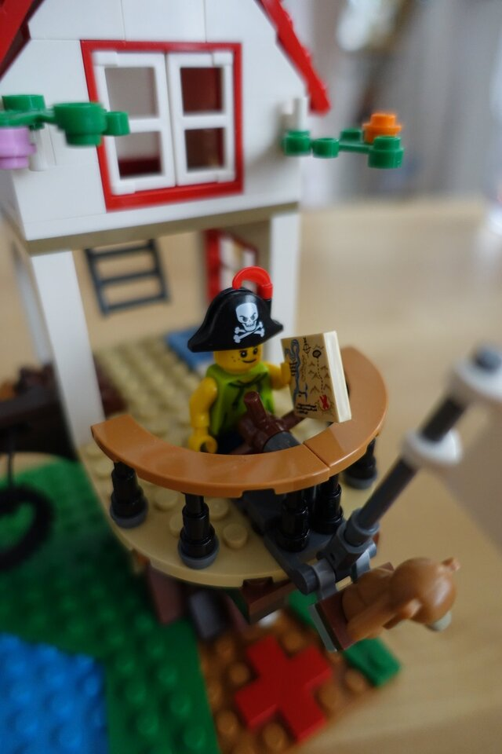](https://www.freelug.org/IMG/jpg/dsc02715-r90.jpg)

en revanche l’ourson est cette fois-ci dans le rôle de la figure de proue — et j’avoue que j’ai trouvé cela très drôle !

[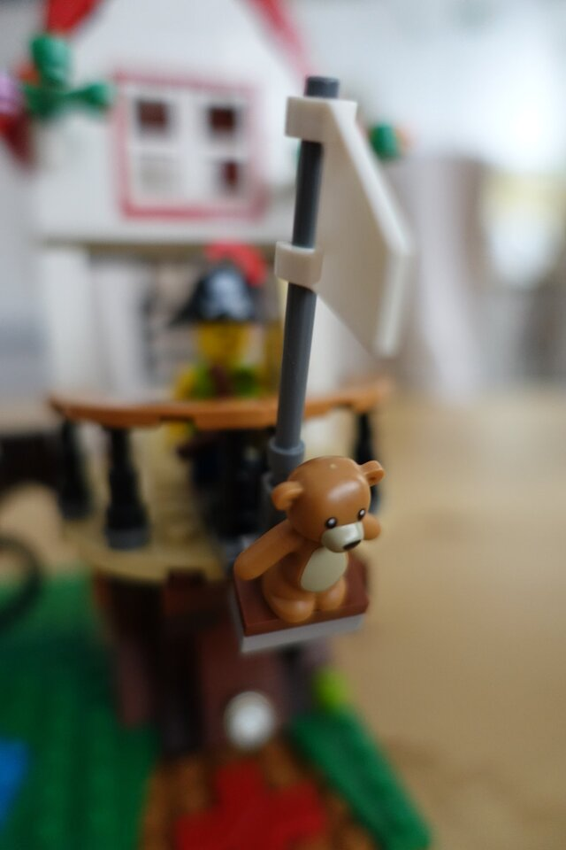](https://www.freelug.org/IMG/jpg/dsc02716-r90.jpg)

À l’arrière il y a une échelle donnant accès à la partie supérieure de la cabane.

[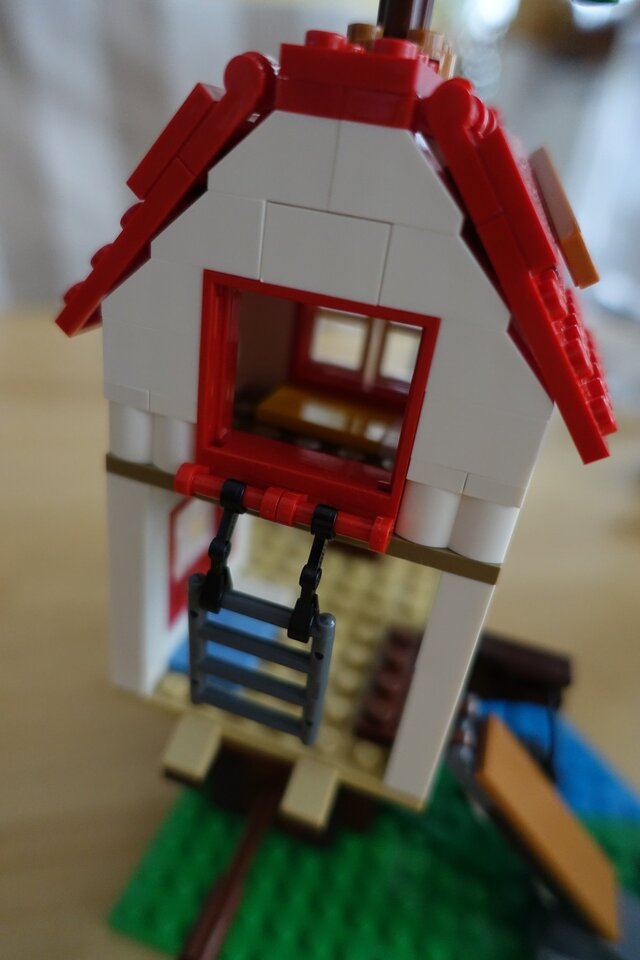](https://www.freelug.org/IMG/jpg/dsc02718-r90.jpg)

Cette partie supérieure a un toit qui peut s’ouvrir, ainsi que les côtés amovibles, pour donner accès à l’intérieur — il y a également un lit suggéré, avec une couverture jaune cette fois-ci.

[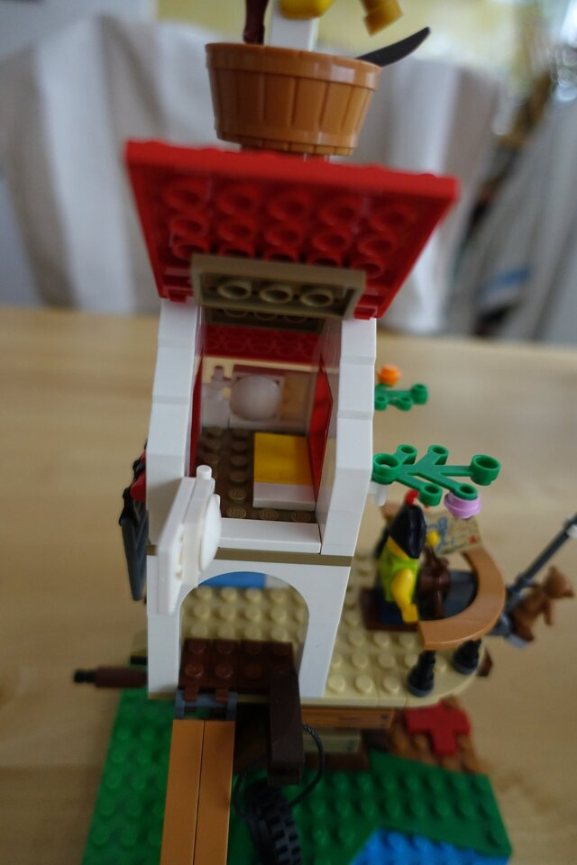](https://www.freelug.org/IMG/jpg/dsc02719-r90.jpg)

Sur l’avant sont fixées deux feuilles, sans doute pour l’aspect « cabane dans l’arbre ».

[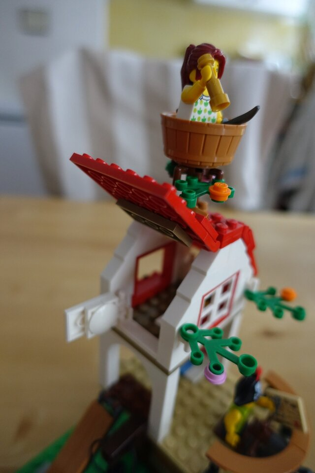](https://www.freelug.org/IMG/jpg/dsc02720-r90.jpg)

Gros plan enfin sur la fonction principale de jouabilité, le poussoir à l’arrière...

[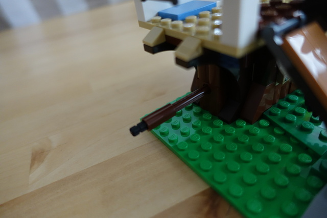](https://www.freelug.org/IMG/jpg/dsc02721.jpg)

qui permet de faire apparaître le coffre caché dans l’arbre — heureusement, un joli X rouge indique son emplacement.

[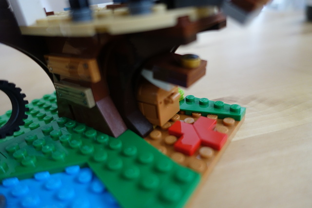](https://www.freelug.org/IMG/jpg/dsc02723.jpg)

La trappe cachant le trésor comporte un cadenas (pièce tampographiée classique), peut-être qu’il y a une clé quelque part...

[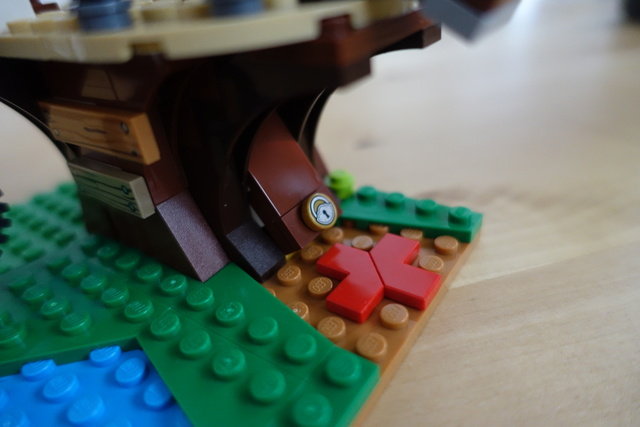](https://www.freelug.org/IMG/jpg/dsc02722.jpg)

Le trésor est toujours constitué de deux rubis montés sur un châssis et d’un sabre, qui tiennent dans le coffre une fois correctement placés.

[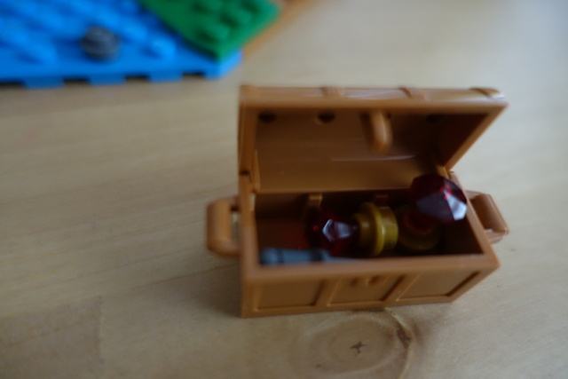](https://www.freelug.org/IMG/jpg/dsc02724.jpg)

* * *

**Avis :** j’ai acheté cette boîte pour le second modèle (le bateau) qui m’a fait un beau clin d’œil, mais à la construction j’ai également apprécié la cabane (modèle principal), du coup j’ai investi dans une seconde boîte pour pouvoir monter les deux en même temps.

Je trouve que la cabane aurait gagné à avoir des couleurs plus proches du marron, pour donner encore plus l’impression d’être vraiment intégrée à un arbre, mais le blanc peut passer si l’on se dit que la cabane est posée sur une souche.

Sans être exceptionnel, ce petit ensemble est vraiment sympathique à mon avis, et la cabane d’expérience s’intègre très bien à côté de Modular plus complexes pour faire un terrain de jeux d’enfants.
