9 participants ont tenté d’éteindre la flamme, il est temps de découvrir leurs créations toutes plus enflammées les unes que les autres.

Vous pouvez retrouver le [règlement de ce concours ici](https://www.freelug.org/spip.php?article3078).

Tout d’abord, nous tenons à remercier les 9 participants qui nous ont proposé de très belles réalisations.

Les participations sont présentées dans l’ordre de réception.

**01 - Xavier D. - Couvre feux : Forêt ou Société : même combat !**

Cette mise en scène, bien que comique, est une image sociétale de ce qui se passe actuellement… l’arbre qui commence à s’enflammer représente la société (Entreprise, Monde de la culture, Étudiants etc.) qui meurent peu à peu, l’oiseau asphyxié est un Homme touché par le covid, qu’un soignant tente de sauver. Superman couvrant le feu avec sa cape, représente les forces de l’ordre qui font appliquer un couvre-feu pour contrôler comme ils peuvent le virus avec les moyens du bord et ainsi éviter l’embrasement des services de soins… Mais le sous-sol montre notre impuissance face à un problème bien plus dur à gérer que ce que l’on pourrait penser, quant au squelette c’est un inconscient ayant pris le problème trop à la légère.

[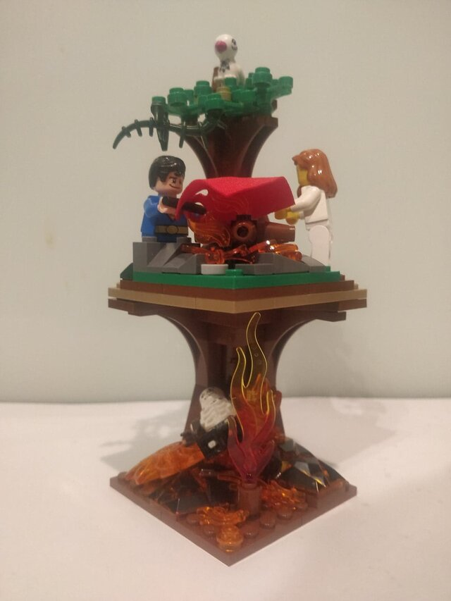](https://www.freelug.org/IMG/jpg/xd-01-r270.jpg)

[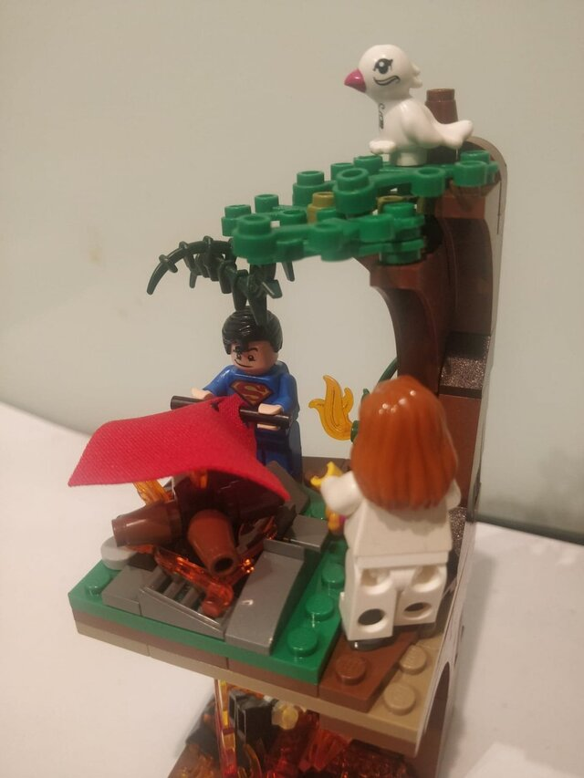](https://www.freelug.org/IMG/jpg/xd-02.jpg)

[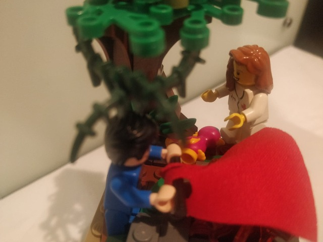](https://www.freelug.org/IMG/jpg/xd-03.jpg)

[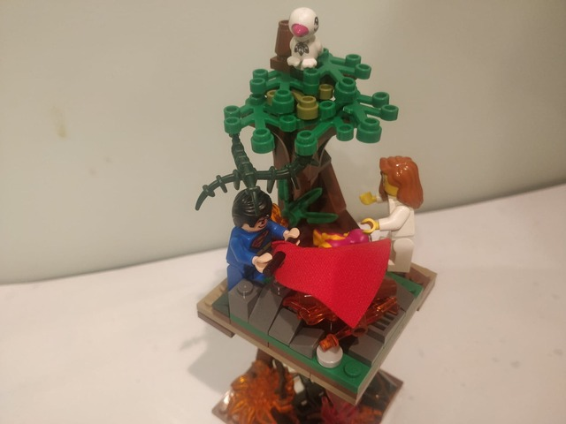](https://www.freelug.org/IMG/jpg/xd-04.jpg)

[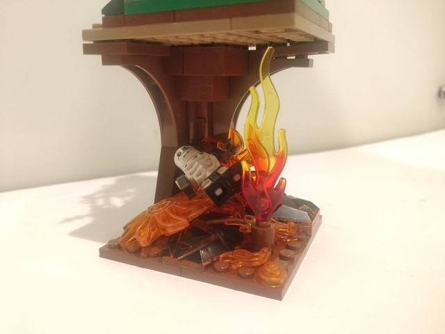](https://www.freelug.org/IMG/jpg/xd-05.jpg)

**02 - Christophe M. - Un barbecue bien arrosé.**

Alex aime se faire griller sa petite saucisse sur la plage mais ce jour là, mère nature en décida autrement.

[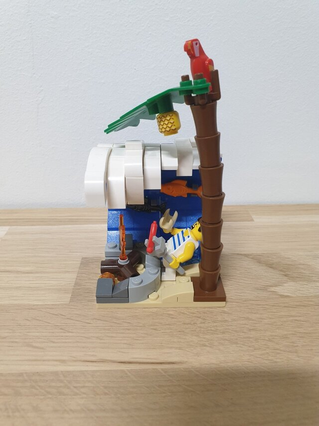](https://www.freelug.org/IMG/jpg/ct-01_grand_-3-r90.jpg)

[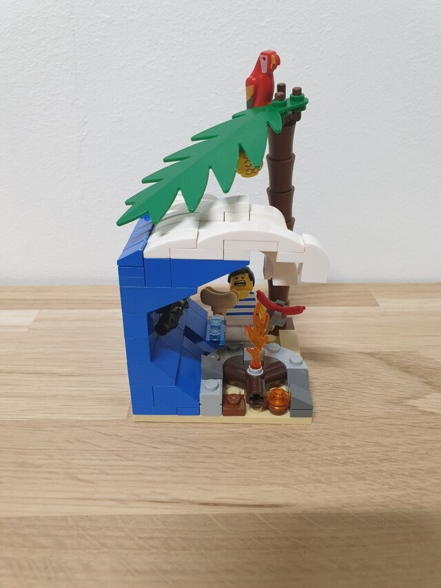](https://www.freelug.org/IMG/jpg/ct-02_grand_-3-r90.jpg)

[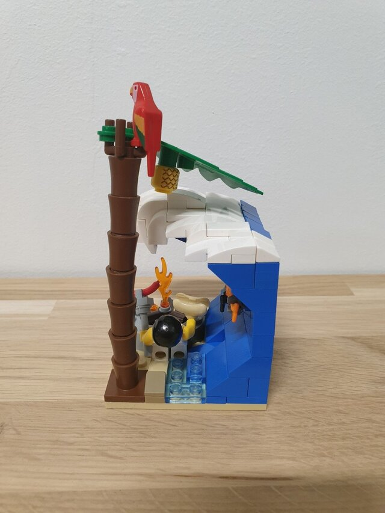](https://www.freelug.org/IMG/jpg/ct-03_grand_-3-r90.jpg)

[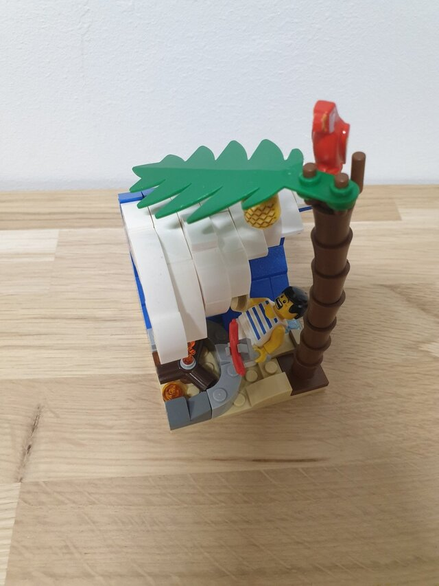](https://www.freelug.org/IMG/jpg/ct-04_grand_-3-r90.jpg)

[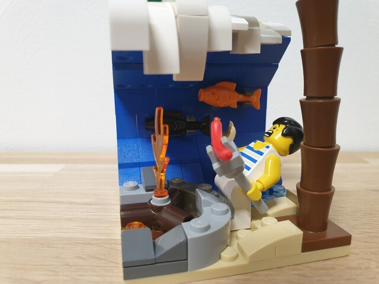](https://www.freelug.org/IMG/jpg/ct-05_grand_-3.jpg)

**03 - Wilfried R. - Les strates du confinement**

Ce fan d’ Elvis sera-t-il la prochaine victime du couvre-feu retrouvée par les archéologues ?

[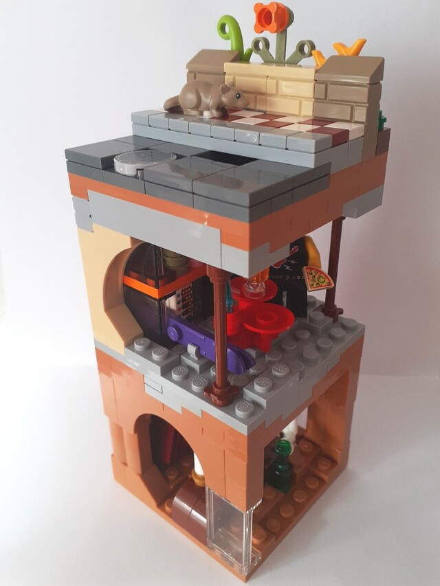](https://www.freelug.org/IMG/jpg/wr-01_grand_.jpg)

[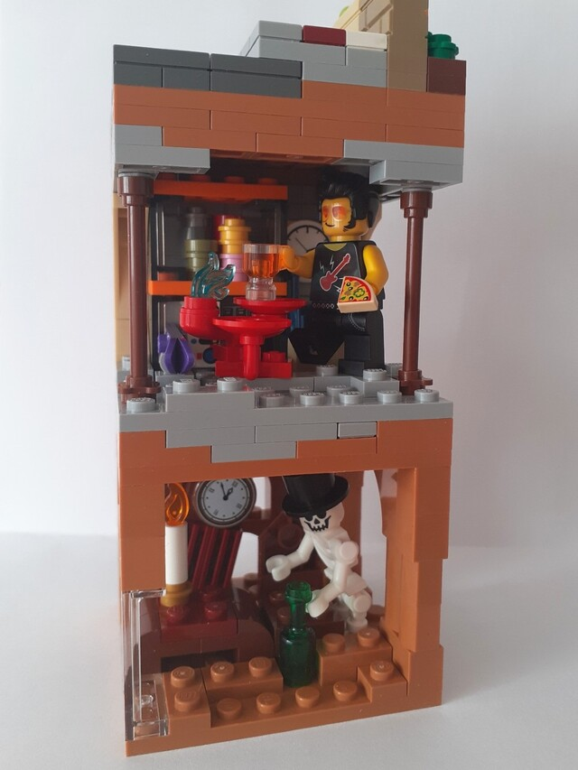](https://www.freelug.org/IMG/jpg/wr-02_grand_.jpg)

[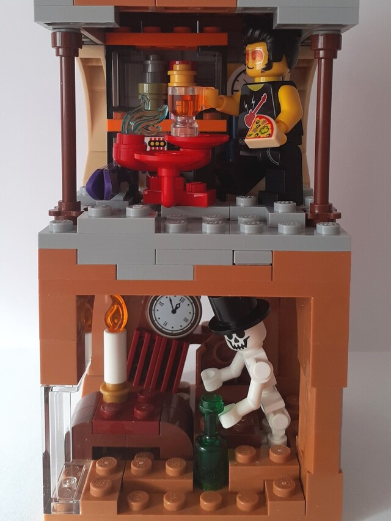](https://www.freelug.org/IMG/jpg/wr-03_grand_.jpg)

[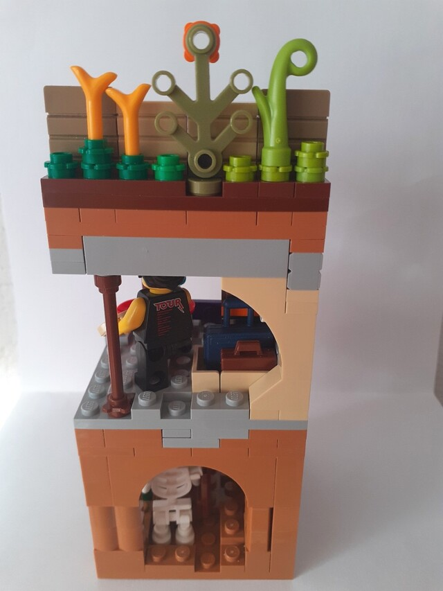](https://www.freelug.org/IMG/jpg/wr-04_grand_.jpg)

**04 - Julia R. - Dolorès Ombrage vs. Ragoutator**

Le professeur Ombrage invoque le sort "Ignitegium" (couvre-feu) pour apprivoiser le caractère enflammé de son ragoût du dimanche.

[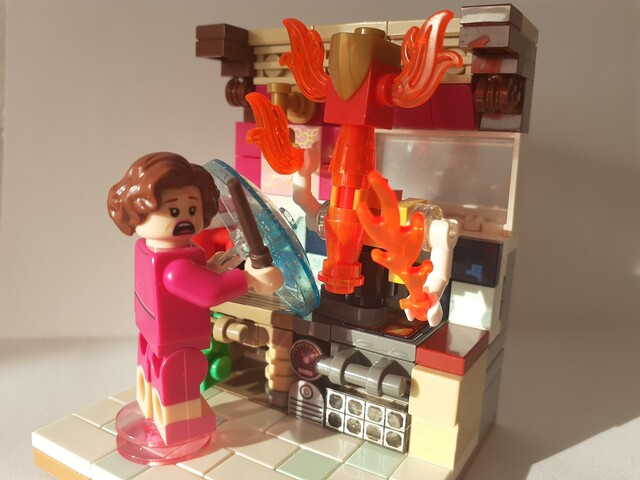](https://www.freelug.org/IMG/jpg/jr-01.jpg)

[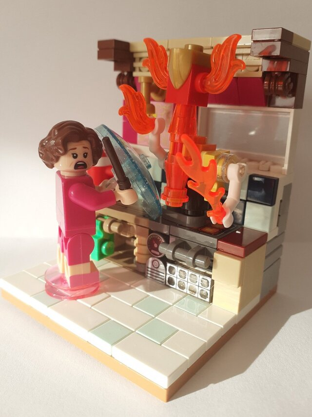](https://www.freelug.org/IMG/jpg/jr-02.jpg)

[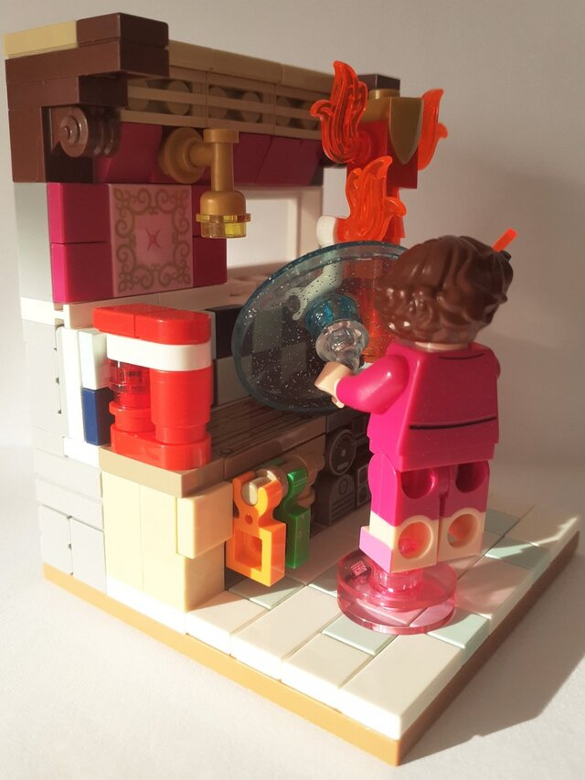](https://www.freelug.org/IMG/jpg/jr-03.jpg)

[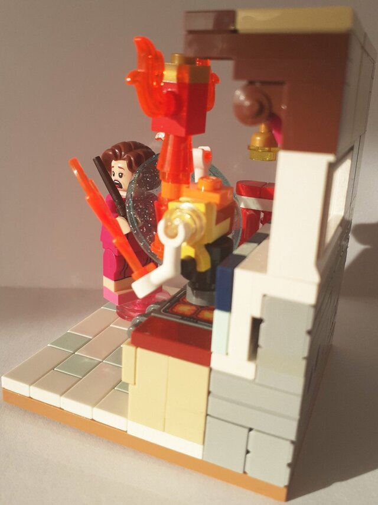](https://www.freelug.org/IMG/jpg/jr-04.jpg)

**05 - Jean-Michel R. - Pour vivre heureux, vivons cachés, pas masqués !**

Le couvre-feu a été déclaré et la loi martiale est à l’étude ! Nous sommes en 2023 et la pandémie ne s’est pas tassée, pire, c’est un paysage de désolation qui règne dans nos rues. De nombreux restaurants ont fini par fermer définitivement, à l’instar ce restaurant chinois (nous allons y revenir) qui ne laisse comme seule dernière table, qu’une vieille poubelle "fraîchement" remplie de poisson, que le chat à bien l’intention de mettre dans son estomac. Mais c’est sans compter sur "Méchant flic", qui tient à faire respecter la loi pour TOUS, y compris les mignons chatons, en n’hésitant pas à se mettre entre cette petite boule de poils et son manger, avec un air menaçant !  
Ce restaurant chinois donc, ahah, une rumeur dit que la cette crise pandémique de la CANIDE-19 viendra d’un chien qui aurait été drogué, découpé, cuit puis congelé, puis laissé à l’abandon au fond de la cuisine, puis remis au congélateur, puis servit à des clients qui ne l’ont pas mangé, et du coup, remis dans l’arrière cuisine, où se promène des rats. Ces derniers, auraient passé une sale nuit et auraient contaminé cette viande de petit chien (je vous passe le détails :p), et les clients du jour suivant seraient tous rentrés chez eux mal-en-point. On ne les aurait jamais revus...

On le sait désormais, les rues ne sont plus sûres, il est interdit de sortir après 14h (oui oui, c’est tôt, mais c’est MON récit :p), et il est impossible de voir ses amis. Les fêtes clandestines s’intensifient au nez et à la barbe de la police (et surtout, sous ses pieds !). Les gens n’hésitent plus à aller dans les égouts de la ville pour se retrouver, prendre un verre, écouter de la musique, et comme il fait froid dans les égouts, on n’hésite vraiment plus à faire un petit feu, en plus, ça permet de se faire griller un hot dog ! Les bobos de la ville se retrouvent donc dans de salles égouts

[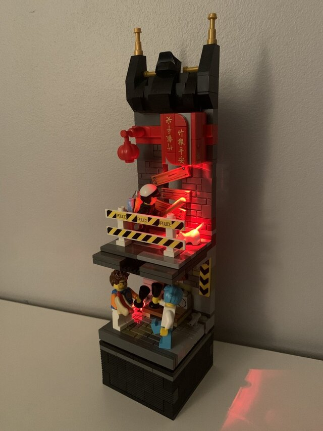](https://www.freelug.org/IMG/jpg/jmr-01_grand_-r90.jpg)

[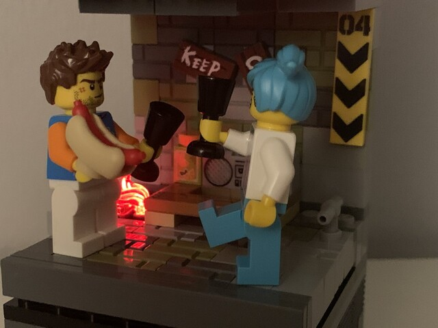](https://www.freelug.org/IMG/jpg/jmr-02_grand_.jpg)

[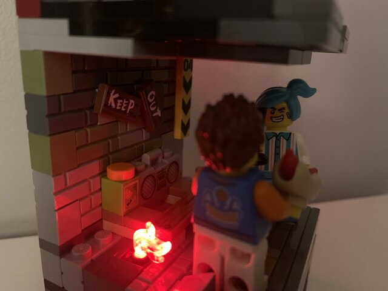](https://www.freelug.org/IMG/jpg/jmr-03_grand_.jpg)

[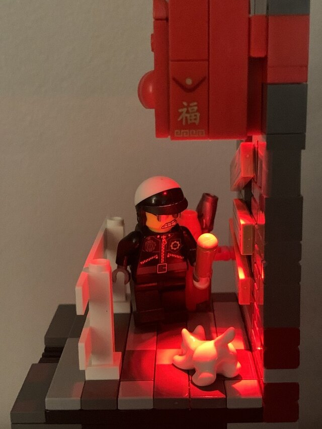](https://www.freelug.org/IMG/jpg/jmr-04_grand_-r90.jpg)

**6 - Stéphane B. - Bien gérer son couvre-feu / Méthode n° 6731**

En retard pour rentrer avant 18 heure ? Pas de problème,… avec l’ Overboard Volny 2.21 , survolez les interdits ! … Disponible dans tous les Volny-Shop !

[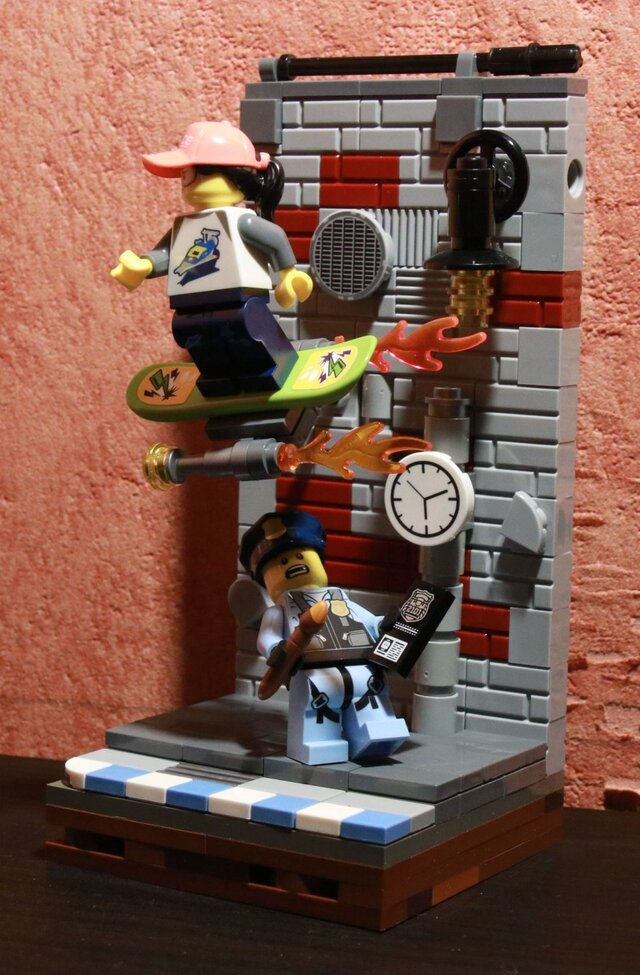](https://www.freelug.org/IMG/jpg/sb-01-2.jpg)

[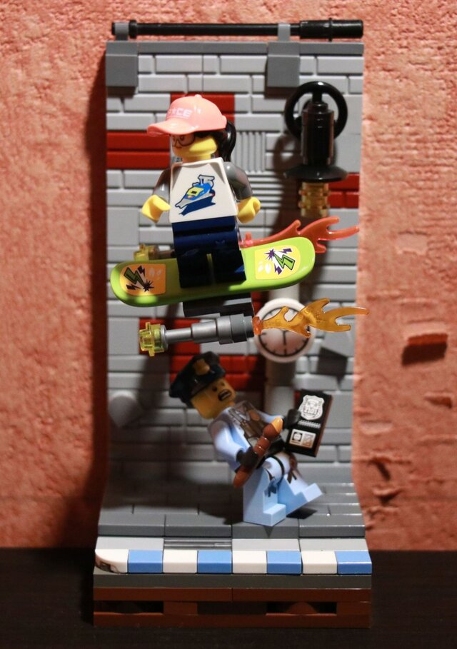](https://www.freelug.org/IMG/jpg/sb-02.jpg)

[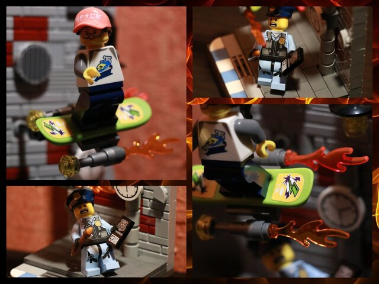](https://www.freelug.org/IMG/jpg/sb-03.jpg)

**7 - Charles F. - Restaurant « à la banane flambée »**

La Cheffe du restaurant, spécialisé dans les bananes flambées, est légèrement maladroite. Suite à plusieurs incidents et incendies, une officier des Pompiers, une très bonne amie de la Cheffe du restaurant, est assignée à Restaurant. Équipée de son matériel, elle dispose aussi d’un couvercle afin de servir de …. COUVRE-FEU

[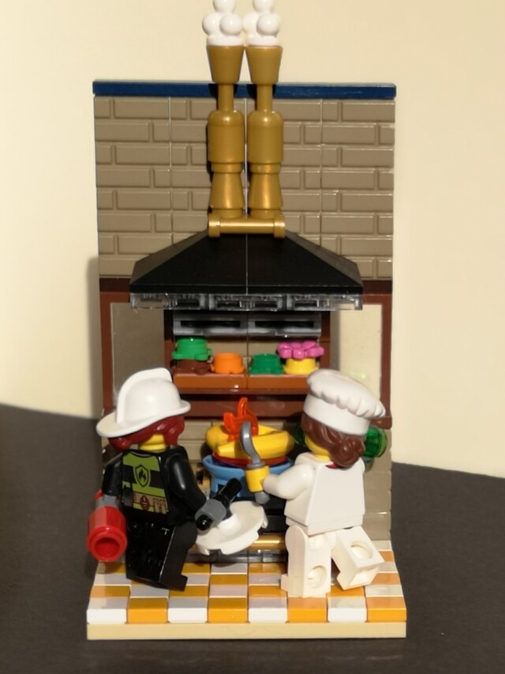](https://www.freelug.org/IMG/jpg/cf-01_grand_-3.jpg)

[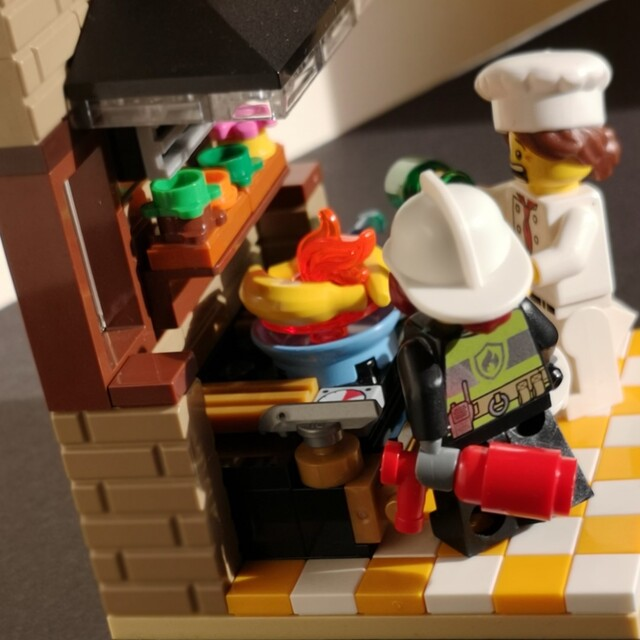](https://www.freelug.org/IMG/jpg/cf-02_grand_-3.jpg)

[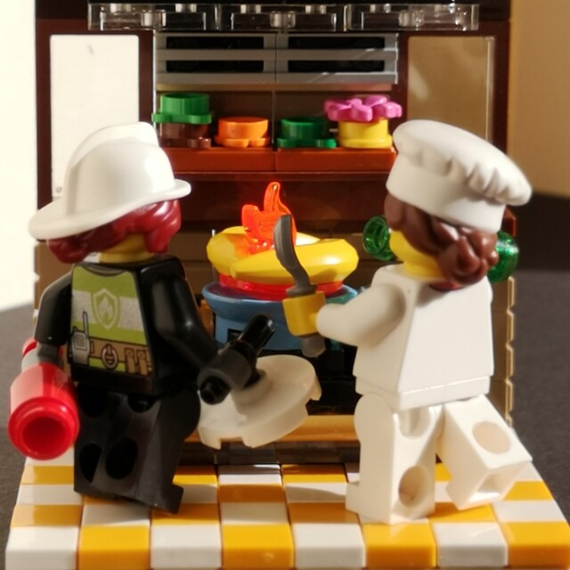](https://www.freelug.org/IMG/jpg/cf-03_grand_-3.jpg)

[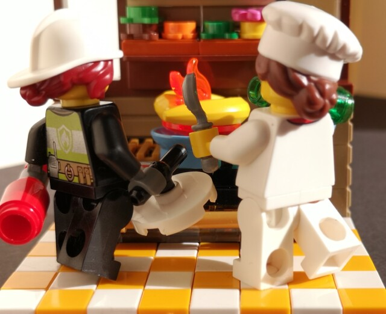](https://www.freelug.org/IMG/jpg/cf-04_grand_-2.jpg)

[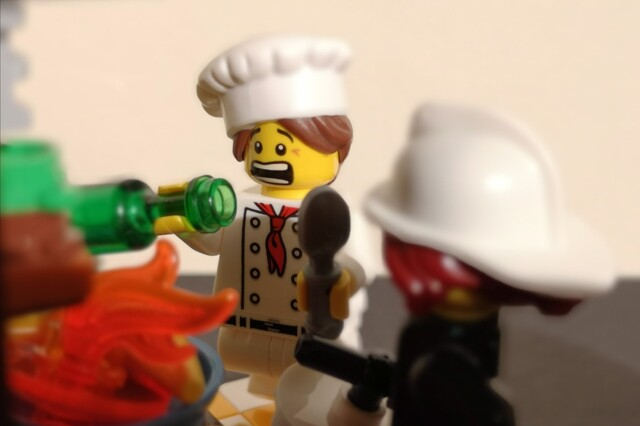](https://www.freelug.org/IMG/jpg/cf-05_grand_-2.jpg)

**8 - Olivier C. (enfant) - Lord Couvre-Feu**

Il est 18h, le terrible Lord Couvre-Feu apparait pour bloquer chez lui ce pauvre télétravailleur Legolandais.

[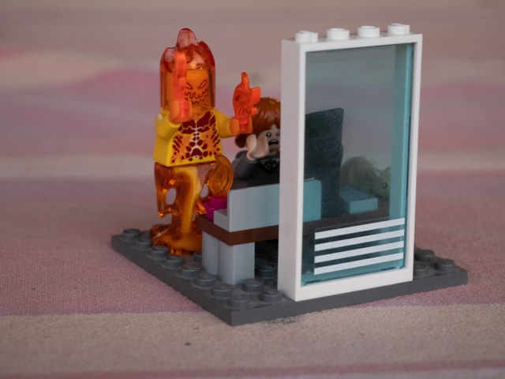](https://www.freelug.org/IMG/jpg/oc-01-2.jpg)

[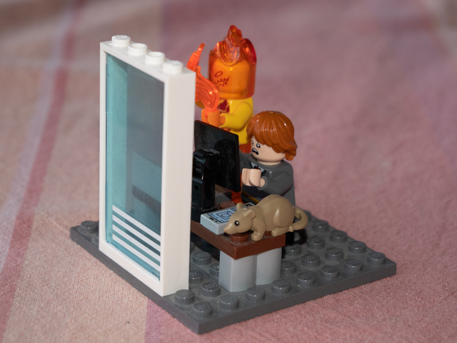](https://www.freelug.org/IMG/jpg/oc-02.jpg)

[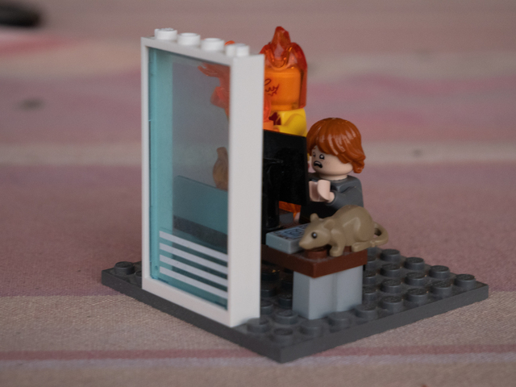](https://www.freelug.org/IMG/jpg/oc-03.jpg)

[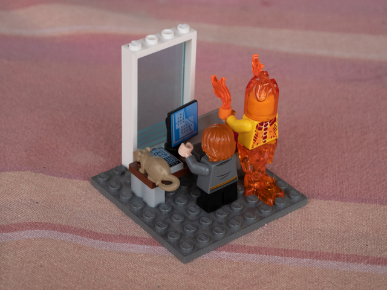](https://www.freelug.org/IMG/jpg/oc-04.jpg)

[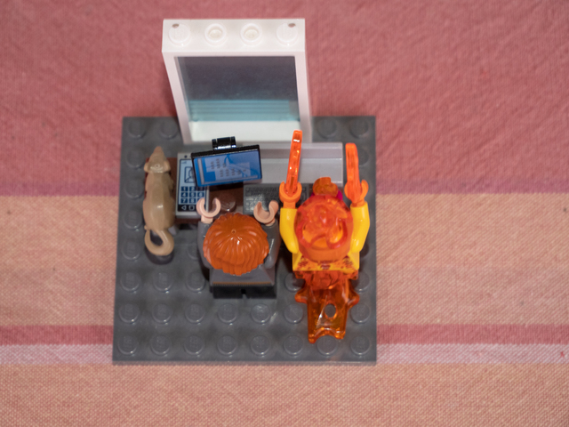](https://www.freelug.org/IMG/jpg/oc-05.jpg)

**9 - Mathieu C. - Couvre-Feu**

Cette jeune Friends a eu le bon réflexe en couvrant un départ de feu.

[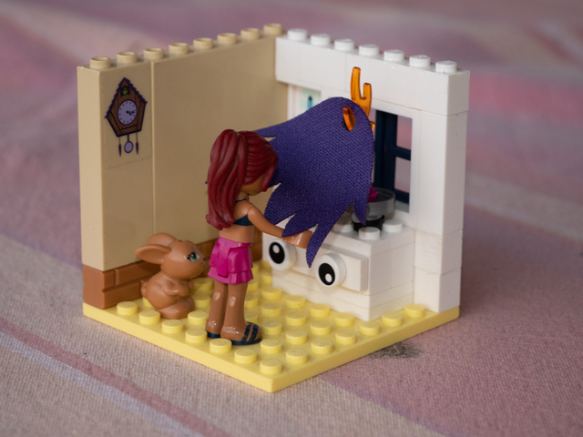](https://www.freelug.org/IMG/jpg/mc-01.jpg)

[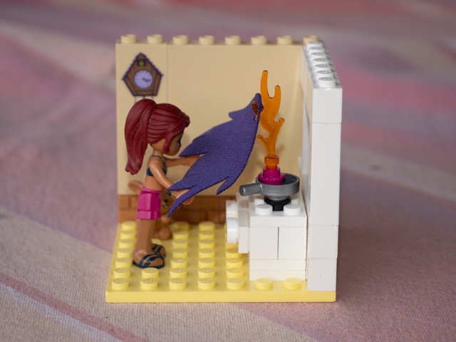](https://www.freelug.org/IMG/jpg/mc-02.jpg)

[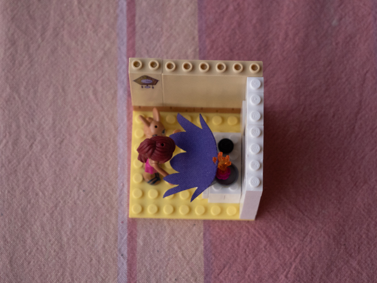](https://www.freelug.org/IMG/jpg/mc-03.jpg)

**L’heureux gagnant de ce concours est :  
Jean-Michel R. - Pour vivre heureux, vivons cachés, pas masqués !** qui remporte le set Lego Ref 60137 – Tow Truck Trouble

* * *

**Composition du jury :**  
Loïc T. (GFC)  
Mathieu W. (GFC)  
Pierre C. (GFC)  
Rémi L. (GFC)  
Sébastien M.  
Jérôme V.  
Denis H.  
Nadége B.  
Nathan B.  
Sylvain J.  
Valérie D.  
DuyHai D.  
Cyriac F.  
Stephane P.  
Jérôme T.

**Classement :**  
1\. Jean-Michel R. (4 points)  
2\. Christophe M. - Stéphane B. (3 points)  
3\. Wilfried R. (2 points)  
4\. Julia R. - Charles F. - Olivier C. (1 point)  
4\. Xavier D. - Mathieu C. (0 point)
