Aujourd’hui, je vous propose d’aller explorer un peu l’espace avec l’ensemble **L’explorateur spatial**, de numéro 31107.

Sortie en 2020, cette boîte au prix officiel de 54,99 € comporte 510 pièces, dont une minifigurine.

Elle permet, comme il se doit dans la gamme _Creator 3-en-1_, d’assembler trois constructions différentes.

Pas de surprise, l’avant de la boîte, classique pour la gamme, montre la construction principale, l’explorateur spatial donc, en gros plan, avec sur le côté droit les deux autres constructions, une base spatiale et un vaisseau spatial — tout dans le thème de l’espace, c’est cohérent.

[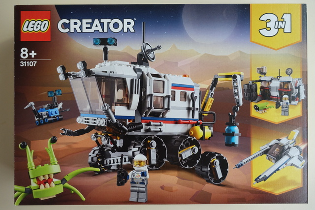](https://www.freelug.org/IMG/jpg/dsc02611.jpg)

L’arrière reprend les trois constructions sous un autre angle, avec une porte ouverte pour l’explorateur et une vue sur l’arrière de la base spatiale.

[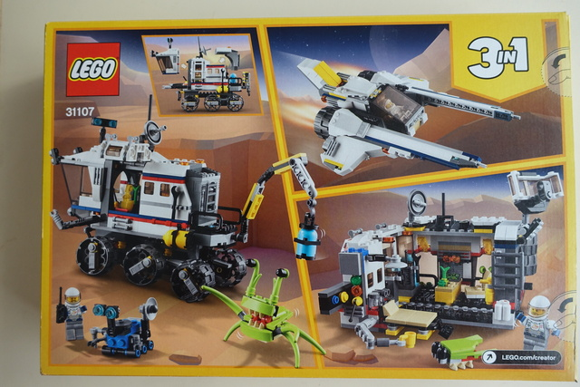](https://www.freelug.org/IMG/jpg/dsc02613.jpg)

* * *

Je n’ai pas de photos de la construction, donc passons directement aux modèles montés.

Voici donc une vue complète de l’explorateur spatial, avec une sonde mobile, et un magnifique extra-terrestre vert — d’après les visuels de la boîte, celui-ci est natif de la planète où se trouve l’explorateur spatial, et non un partenaire de l’explorateur, c’est presque dommage.

[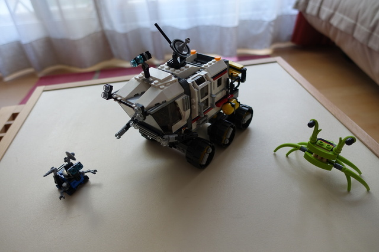](https://www.freelug.org/IMG/jpg/dsc02540.jpg)

L’explorateur une antenne (ou radar ?) sur le dessus, et un sas sur le côté. Sur l’avant, deux pinces, et un gros projecteur mobile pour illuminer, plus deux autres blanc.

[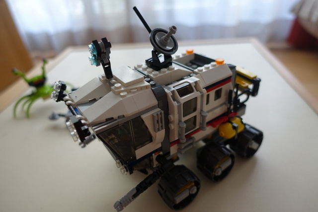](https://www.freelug.org/IMG/jpg/dsc02550.jpg)

[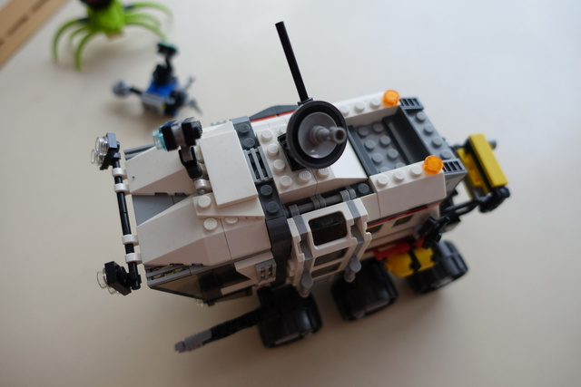](https://www.freelug.org/IMG/jpg/dsc02551.jpg)

Vu de l’avant, on dirait presque un insecte...

[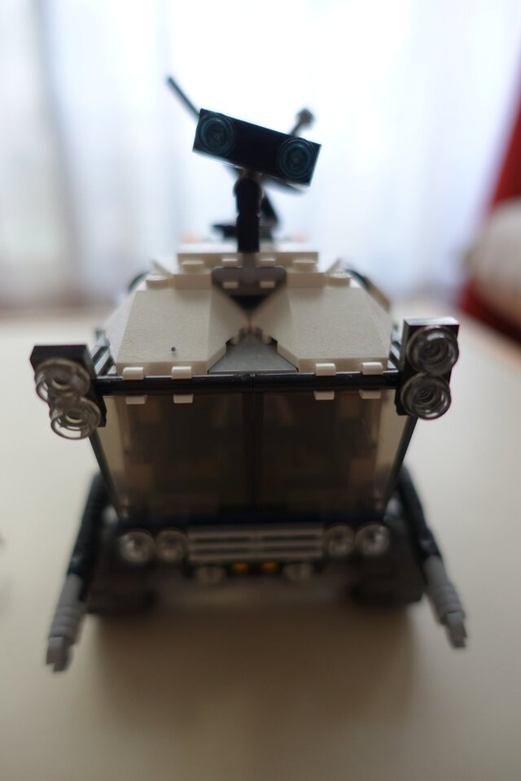](https://www.freelug.org/IMG/jpg/dsc02552-r90.jpg)

Les pinces sont symétriques, et peuvent pas mal s’articuler, ce qui permet de saisir différents objets, pour ensuite les analyser certainement.

[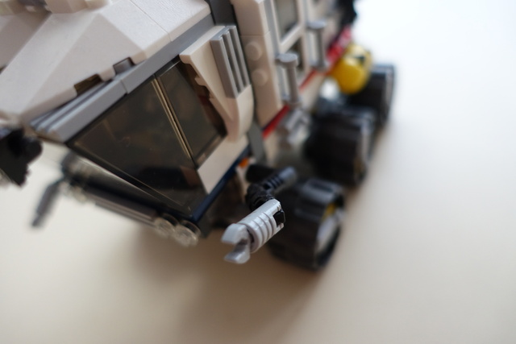](https://www.freelug.org/IMG/jpg/dsc02553.jpg)

Sur l’arrière se trouve une magnifique pince mobile, ici rangée, et un conteneur bleu — de quoi, je l’ignore. À noter que ce conteneur peut aussi s’accrocher sur le côté, comme le jaune à gauche.

[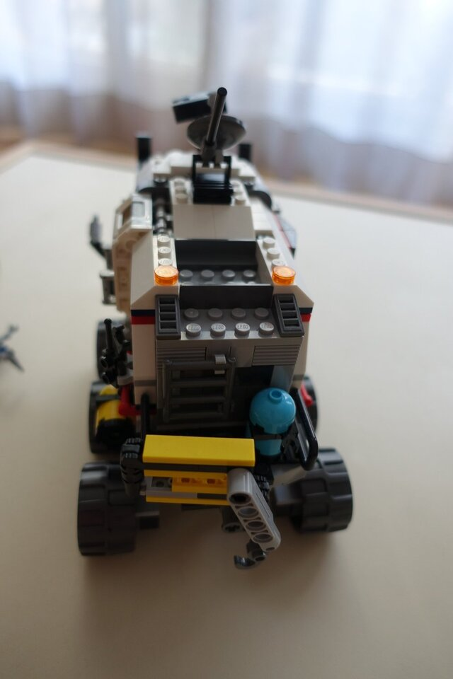](https://www.freelug.org/IMG/jpg/dsc02554-r90.jpg)

La pince dépliée permet de hisser certains objets, notamment les conteneurs, afin de les ranger, ou au contraire de les déposer au sol.

[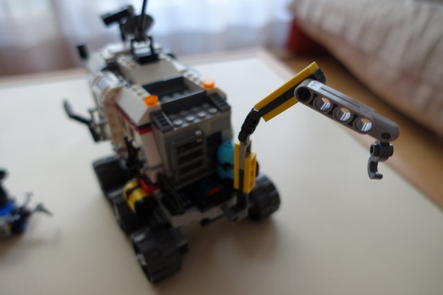](https://www.freelug.org/IMG/jpg/dsc02555.jpg)

Au hasard la sonde mobile...

[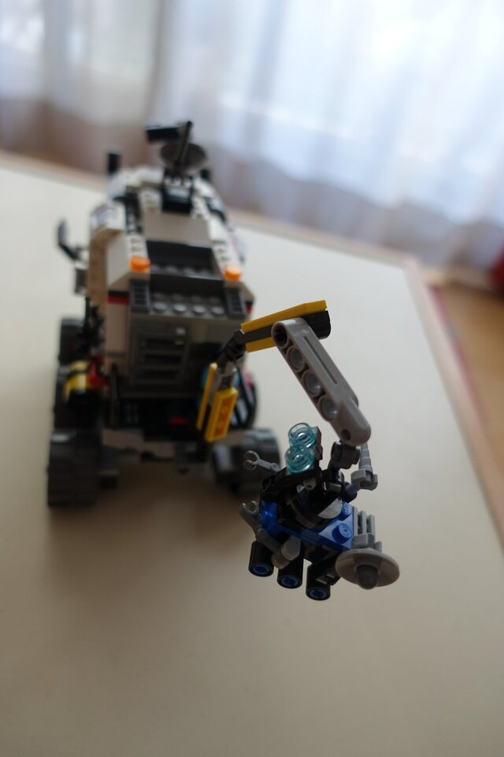](https://www.freelug.org/IMG/jpg/dsc02556-r90.jpg)

...ou le conteneur jaune.

[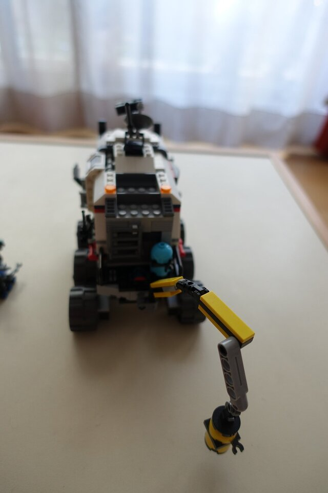](https://www.freelug.org/IMG/jpg/dsc02558-r90.jpg)

L’avant peut facilement se retirer, afin d’installer l’astronaute.

[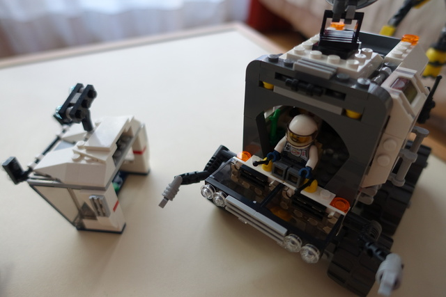](https://www.freelug.org/IMG/jpg/dsc02559.jpg)

Gros plan sur l’astronaute, justement. Il a un sourire ravi, il est manifestement heureux d’être aux commandes de son véhicule. Sa combinaison reprend le symbole de l’espace qui existe depuis (presque ?) toujours chez LEGO, la lune avec un vaisseau.

[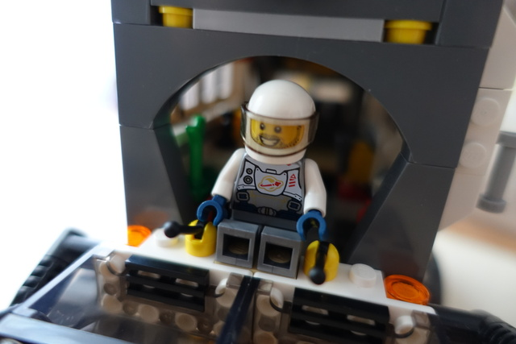](https://www.freelug.org/IMG/jpg/dsc02560.jpg)

Sur le côté, la porte s’ouvre vers le haut, donnant également accès à l’intérieur. Les poignées permettent à une figurine de s’accrocher, un peu comme une échelle.

[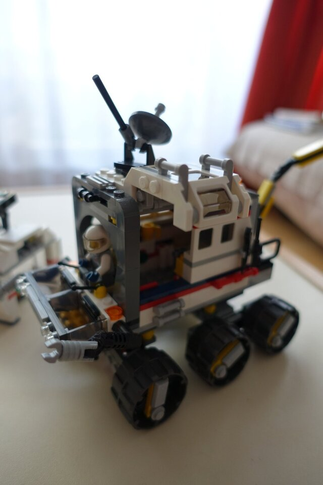](https://www.freelug.org/IMG/jpg/dsc02561-r90.jpg)

Enfin l’arrière se retire également, afin de permettre un accès à l’intérieur, pour y installer la figurine. L’intérieur est aménagé de façon simple, avec un magnifique lit pour se reposer. À noter la pièce bleue transparente qui n’est là que pour le décor, je ne sais pas ce qu’elle représente.

[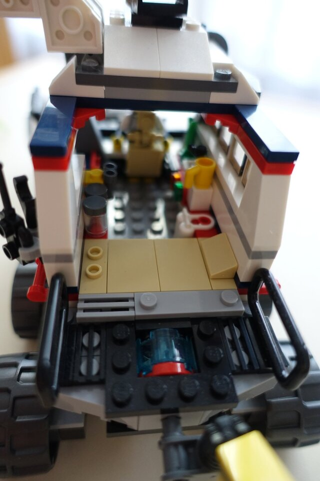](https://www.freelug.org/IMG/jpg/dsc02562-r90.jpg)

L’explorateur a à sa disposition un mini-évier, avec deux boutons, et a posé une tasse. Ses bouteilles d’oxygène sont accrochées, impossible de les enfiler quand il est sur son siège de pilote.

[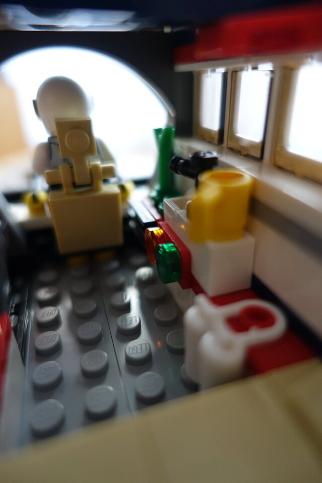](https://www.freelug.org/IMG/jpg/dsc02564-r90.jpg)

Bon, avec l’avant et l’arrière retirés, le véhicule fait piètre figure, j’admets...

[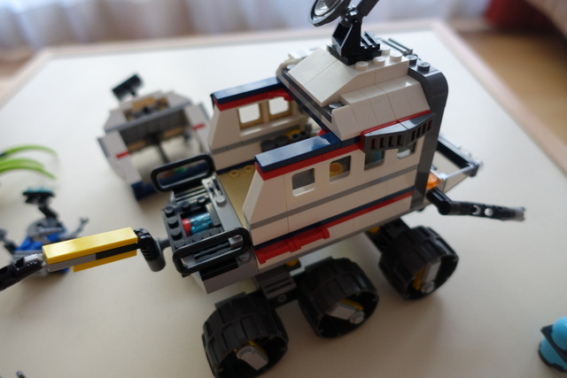](https://www.freelug.org/IMG/jpg/dsc02565.jpg)

Le dessous du châssis est assez simple, les deux roues avant sont solidaires et peuvent pivoter, tandis que les roues arrière sont groupées deux de chaque côté, pour monter les côtes plus facilement.

[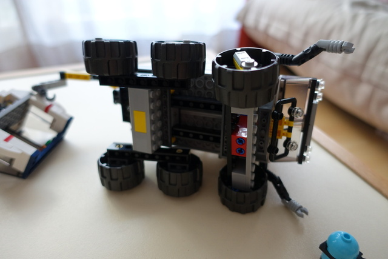](https://www.freelug.org/IMG/jpg/dsc02567.jpg)

Gros plan sur la sonde, qui est bien équipée : projecteur sur l’avant, une pince de chaque côté, une perceuse...

[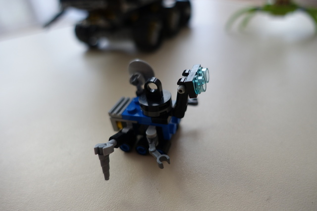](https://www.freelug.org/IMG/jpg/dsc02543.jpg)

... et une sorte de radar, peut-être un détecteur qui peut fouiller le sol ?

[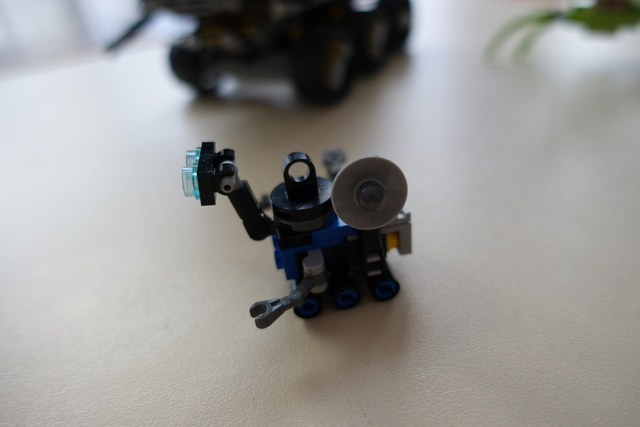](https://www.freelug.org/IMG/jpg/dsc02544.jpg)

Le crochet sur le dessus permet de l’attraper avec la pince de l’explorateur lui-même.

[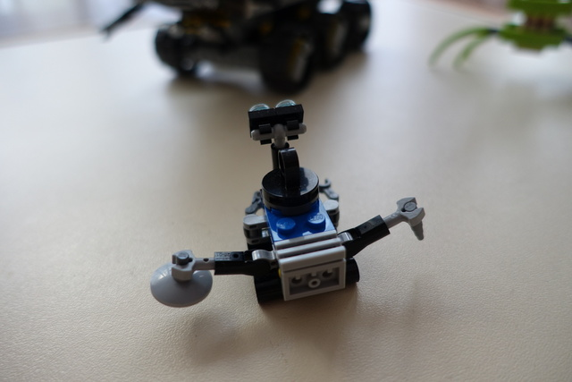](https://www.freelug.org/IMG/jpg/dsc02545.jpg)

Pour terminer, petit aperçu de l’extra-terrestre. Il est tout vert, pas de doute, ce n’est pas un humain ! J’admets être un peu déçu, il fait très crabe, j’aurais aimé quelque chose de plus étrange...

[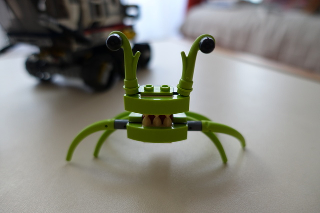](https://www.freelug.org/IMG/jpg/dsc02546.jpg)

Il peut évidemment ouvrir la bouche, pour révéler une belle dentition, et bouger les pattes avant. Par contre les autres ne bougent pas vraiment... Cela manque d’articulations...

[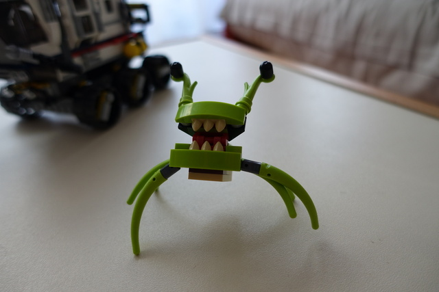](https://www.freelug.org/IMG/jpg/dsc02547.jpg)

De dos rien de spécial à signaler, à part peut-être l’utilisation d’une pièce biseautée pour donner un aspect de carapace.

[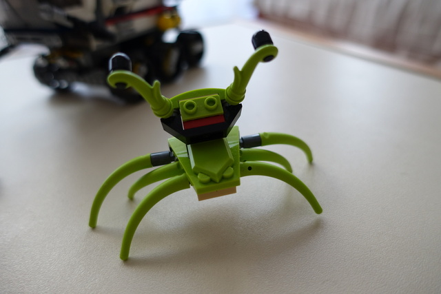](https://www.freelug.org/IMG/jpg/dsc02548.jpg)

[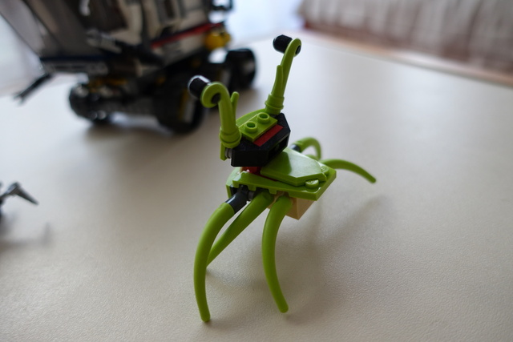](https://www.freelug.org/IMG/jpg/dsc02549.jpg)

Pour terminer, voici une petite mise en scène de l’explorateur sur des cratères. Pas de doute, les roues articulées aident à gravir les pentes !

[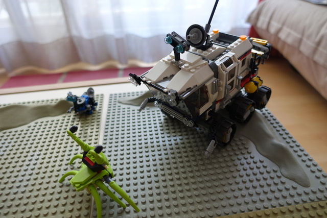](https://www.freelug.org/IMG/jpg/dsc02569.jpg)

* * *

Passons maintenant à la seconde construction proposée, une base spatiale. Seulement deux côtés sont fermés, le reste est ouvert pour permettre d’accéder à l’intérieur.

[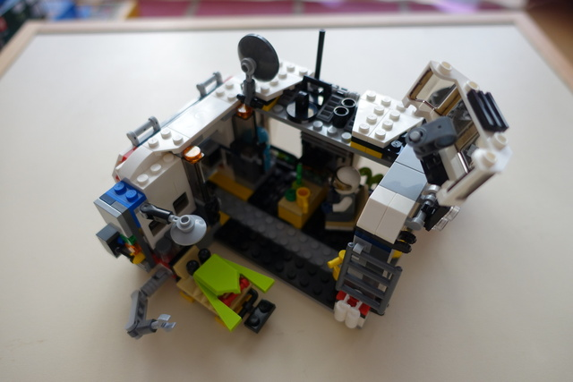](https://www.freelug.org/IMG/jpg/dsc02615.jpg)

L’astronaute est bien installé sur un siège, en dégustant une tasse de quelque chose. Bon, il a son casque, ça ne doit pas être simple... Une petite plante est posée sur la table, peut-être qu’il fait des tentatives de culture.

[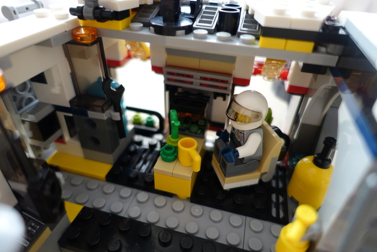](https://www.freelug.org/IMG/jpg/dsc02616.jpg)

On trouve également un petit alien, toujours vert. Il est présenté allongé (?) sur un lit, par contre comme il y a un bras articulé à côté et une lumière au-dessus je me demande s’il habite la base, ou s’il est cobaye d’expériences de l’explorateur...

[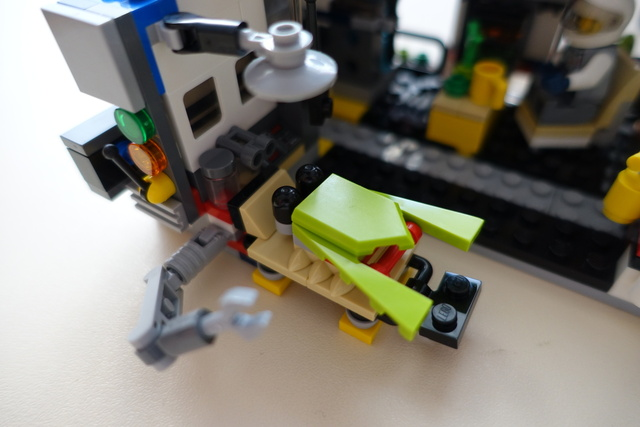](https://www.freelug.org/IMG/jpg/dsc02618.jpg)

Un des côtés de la base est un magnifique sas, donnant sans doute accès à l’extérieur. La construction est intéressante, avec deux pièces tête-bêche, et les barres Technic qui coulissent. Peut-être que je réutiliserai cela à l’occasion.

[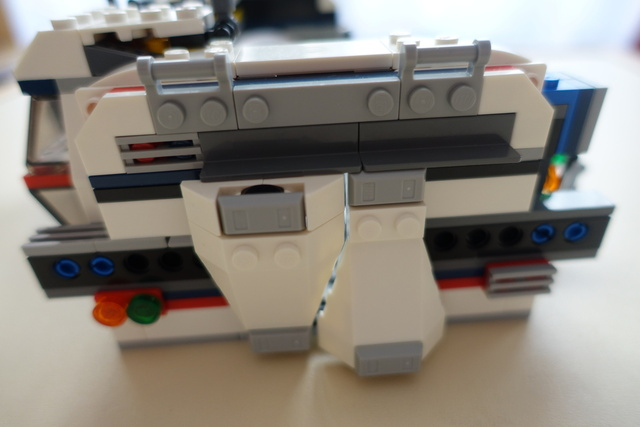](https://www.freelug.org/IMG/jpg/dsc02619.jpg)

[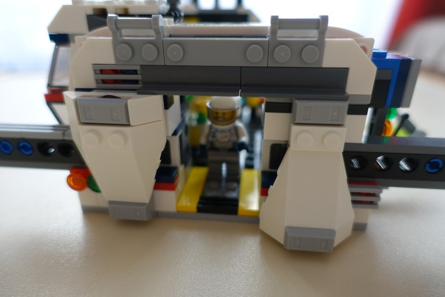](https://www.freelug.org/IMG/jpg/dsc02624.jpg)

Voici quelques photos de la base sous différents angles. On aperçoit une antenne orientable, et une espèce de gros radar — je ne sais pas si c’est pour communiquer ou chercher quelque chose. Il y a également quelques lumières sur l’extérieur.

[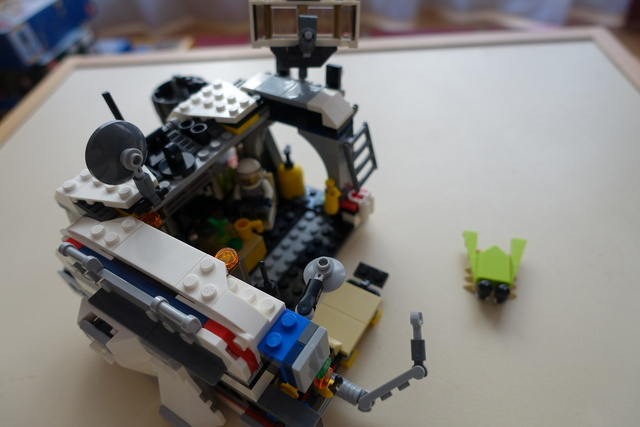](https://www.freelug.org/IMG/jpg/dsc02622.jpg)

Quelques baies vitrées, pour contempler le paysage.

[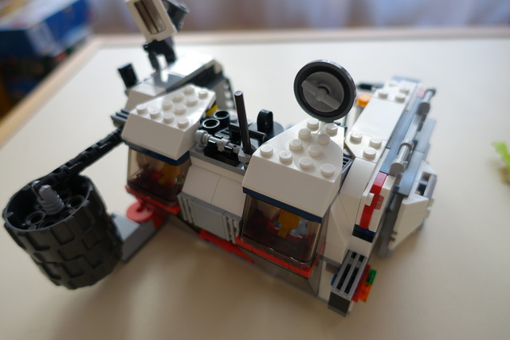](https://www.freelug.org/IMG/jpg/dsc02625.jpg)

[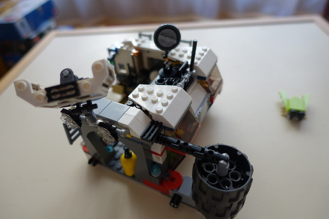](https://www.freelug.org/IMG/jpg/dsc02628.jpg)

Il y a une bonbonne jaune, d’oxygène ou autre chose, sur un côté.

[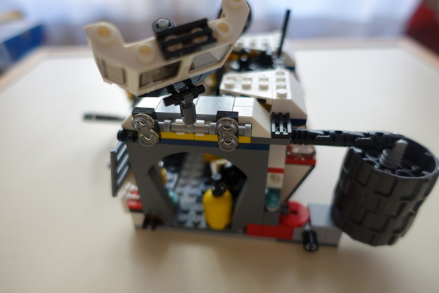](https://www.freelug.org/IMG/jpg/dsc02631.jpg)

[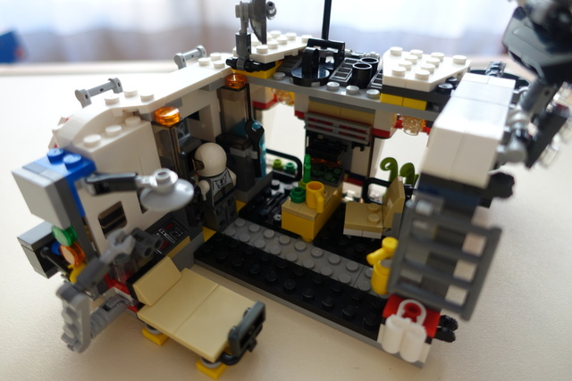](https://www.freelug.org/IMG/jpg/dsc02632.jpg)

Gros plan sur l’alien, qui fait vraiment insectoïde. Aucune articulation, c’est un peu décevant...

[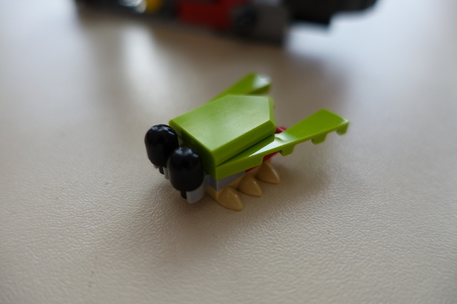](https://www.freelug.org/IMG/jpg/dsc02629.jpg)

[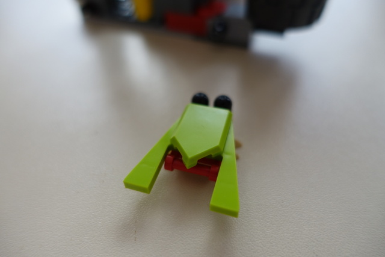](https://www.freelug.org/IMG/jpg/dsc02630.jpg)

* * *

Dernier modèle proposé, un vaisseau spatial. Le profil me rappelle des vaisseaux de la gamme Star Wars, comme l’intercepteur d’Obi-Wan Kenobi par exemple. En tout cas il n’y a pas d’armes apparentes, c’est déjà ça, espérons qu’il vienne en paix.

[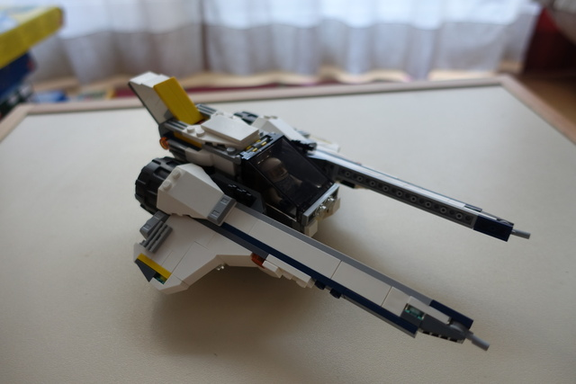](https://www.freelug.org/IMG/jpg/dsc02655.jpg)

[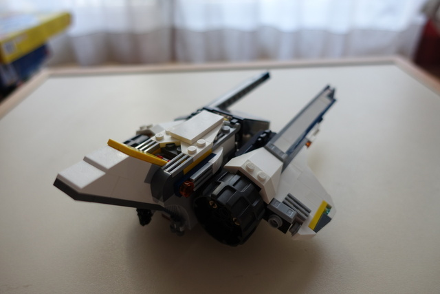](https://www.freelug.org/IMG/jpg/dsc02657.jpg)

[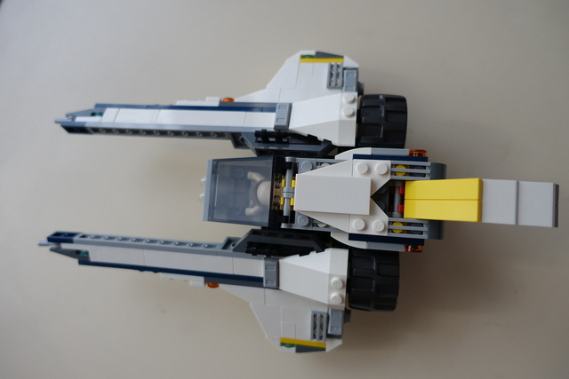](https://www.freelug.org/IMG/jpg/dsc02658.jpg)

À noter que la queue arrière est accrochée à deux endroits, belle technique de construction pour positionner correctement même en diagonale.

[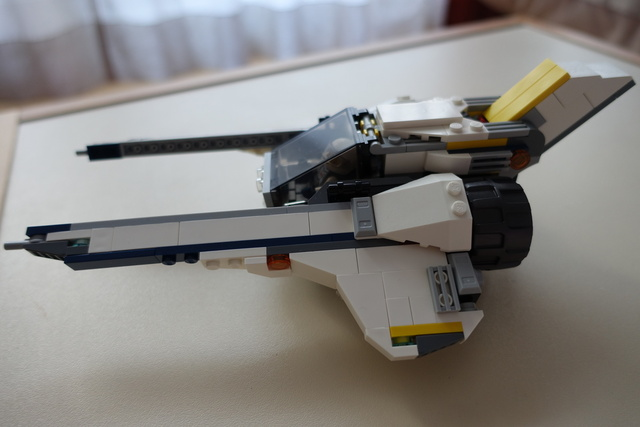](https://www.freelug.org/IMG/jpg/dsc02659.jpg)

[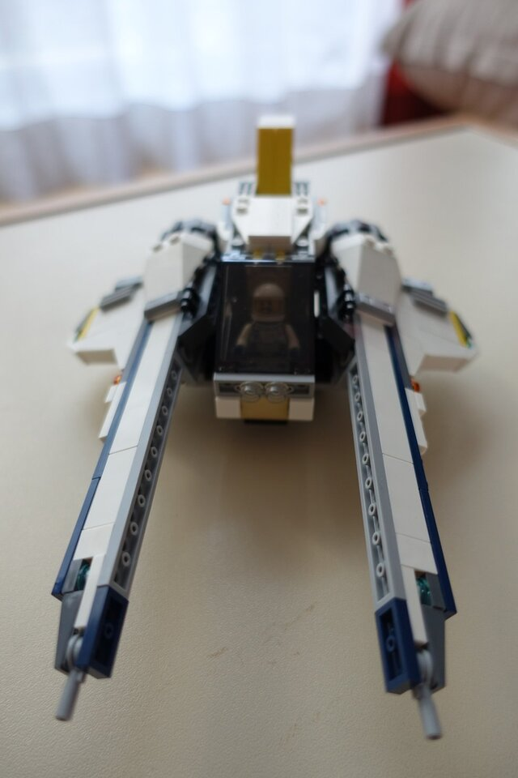](https://www.freelug.org/IMG/jpg/dsc02660-r90.jpg)

Sur l’arrière, une paire de jumelles et un talkie-walkie. Espérons qu’il soit à très longue portée, la base la plus proche est probablement à des années-lumières !

[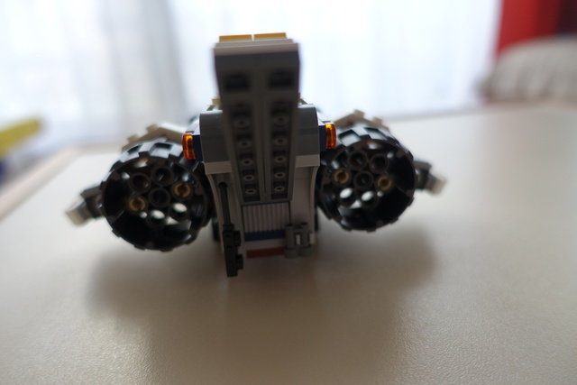](https://www.freelug.org/IMG/jpg/dsc02664.jpg)

Sur le dessous, le vaisseau est tenu par deux sortes de pattes, petites mais suffisantes pour assurer un bon équilibre. Elles peuvent pivoter, mais pas certain qu’elles représentent des tuyères, je pense que c’est plutôt à cause de la construction.

[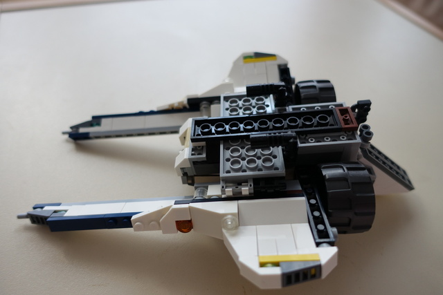](https://www.freelug.org/IMG/jpg/dsc02665.jpg)

[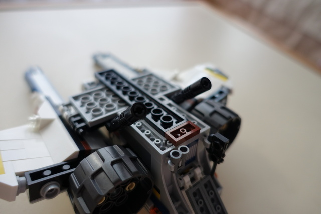](https://www.freelug.org/IMG/jpg/dsc02667.jpg)

Gros plan sur la verrière avant, l’astronaute est bien installé aux commandes.

[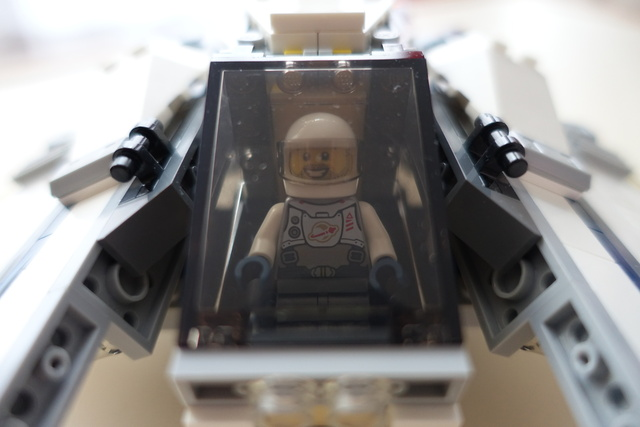](https://www.freelug.org/IMG/jpg/dsc02661.jpg)

Le siège est correctement construit, avec l’appui arrière, c’est joli.

[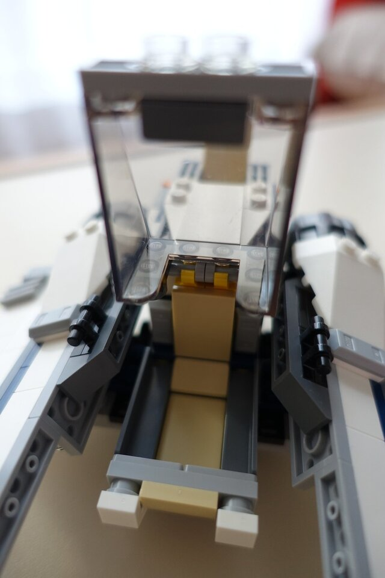](https://www.freelug.org/IMG/jpg/dsc02662-r90.jpg)

* * *

_Avis :_ les trois modèles sont dans la gamme de l’espace, et ont une certaine cohérence : on peut très bien imaginer que l’astronaute vienne en vaisseau, installe une base, et explore ensuite dans le véhicule.

Je suis un peu déçu des deux modèles d’extra-terrestre, qui me semblent vraiment basiques et aux formes habituelles. Quelque chose d’un peu plus hors du commun aurait été appréciable.

La base spatiale est un peu austère, et mériterait d’être élargie avec son propre stock de briques je trouve, pour lui donner plus de consistance, notamment en fermant les côtés ouverts.

Au final, c’est une boîte appréciable, sans être indispensable à mon avis.
