En 2018, LEGO innove avec une nouvelle gamme voyageurs et un nouveau système de commande en Bluetooth.

Commençons tout d’abord par les données principales :

-   Année de sortie 2018.
-   Prix 139,99 €, sur le Shop, à l’heure où j’écris ces lignes.
-   Temps de montage environ 1h30.
-   Sachets numérotés jusqu’à 7.
-   4 minifigs : un conducteur, la vendeuse de sucrerie et deux voyageurs.

Le devant de cette grande boite présente le train sur toute sa longueur. Il est arrêté devant le quai. Les passagers et personnel du train sont prêt à embarquer.

[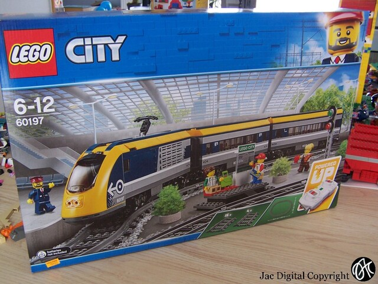](https://www.freelug.org/IMG/jpg/photo_1_-8.jpg)

Au dos de la boite, le train est présenté en ligne. Les autres photos nous présentent quelques aménagements. On nous vante aussi le fonctionnement du nouveau système de commande. J’ai testé la télécommande Bluetooth avec le [train marchandises référence 60198](/articles/2924/). Mon avis est le même avec ce train.

[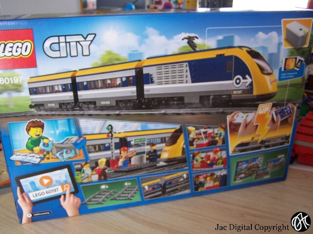](https://www.freelug.org/IMG/jpg/photo_2_-8.jpg)

On peut ouvrir la boite en découpant simplement les scotches. Ca permet de la conserver en bon état si on le souhaite. La firme LEGO est revenue à des emballages plus faciles à ouvrir et refermer. Après être passé par des techniques vraiment compliquées, ce n’est pas un mal.

A l’intérieur, on découvre 8 sachets, quelques rails pas emballés, le moteur, le boitier de piles et une notice en 5 livrets dans une pochette à part avec les autocollants. C’est une bonne chose, ça permet de ne pas chercher les livrets dans toute la boite.

[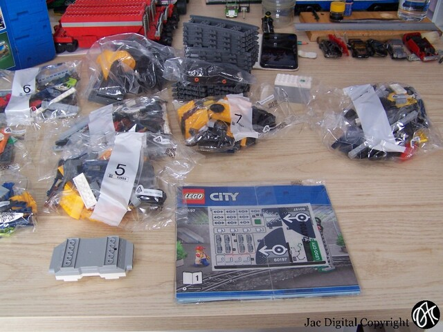](https://www.freelug.org/IMG/jpg/photo_4_-6.jpg)

C’est parti, on ouvre le livret numéro 1 et on découvre les premières étapes, en commençant tout d’abord par l’assemblage de la minifig. On remarquera que les minifigs sont dispersées dans les sachets, suivant leur fonction et ce que l’on a à construire. Ici, il s’agit d’un passager qui attend le train sur le quai. Il est tout seul, mais le quai n’est pas très grand non plus.

Cette boite importante et compliquée à construire comporte un démonte briques. Il sera très utile en cas d’erreurs.

[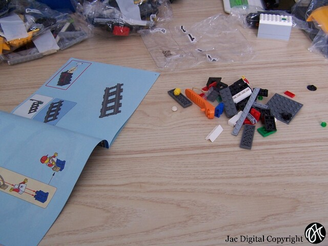](https://www.freelug.org/IMG/jpg/photo_6_-6.jpg)

La minifig correspond à un geek, d’après le logo sur le t-shirt qui est un savant mélange de Benny et du logo Space tant connu, j’adore ce genre de clin d’œil.

[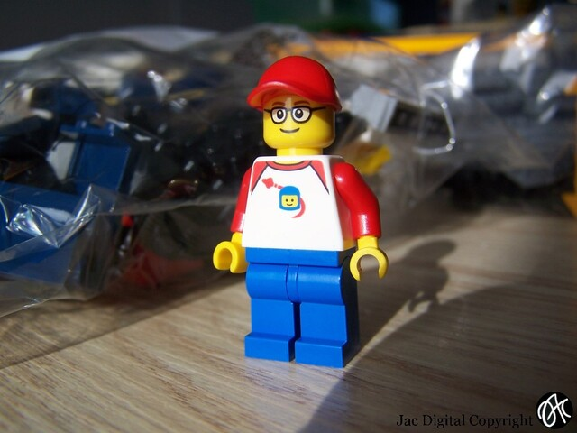](https://www.freelug.org/IMG/jpg/photo_8_-5.jpg)

La notice nous propose de commencer par assembler le réseau. Mais je ferai les essais sur mon réseau extérieur. Je passe donc sur cette étape. Il faut remarquer tout de même l’effort fait par LEGO avec la présence de quelques rails droits pour éviter le traditionnel cercle monotone. Je m’occupe donc du signal à deux feux, très éloigné de ceux que l’on a le long des voies ferrées en France, mais qui suffira pour s’amuser à s’arrêter ou redémarrer en gare.

[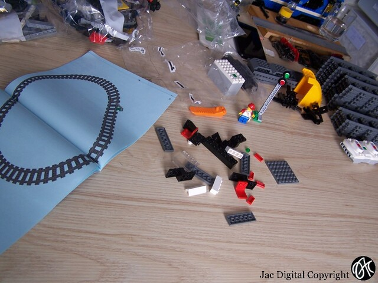](https://www.freelug.org/IMG/jpg/photo_9_-7.jpg)

On passe au montage du quai qui ne pose aucun problème. Il faut s’appliquer à la pose des premiers autocollants. C’est très bien de faire des stickers transparents, pas de problème de raccord avec les couleurs. Par contre, les traces de doigts sont très visibles. Avec les empreintes on peut savoir qui les a collés ! 3 pièces en extra après cette étape.

[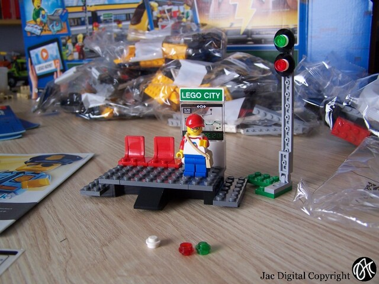](https://www.freelug.org/IMG/jpg/photo_10_-8.jpg)

Pour le deuxième sachet et le livret numéro deux, on commence les choses sérieuses, avec la motrice de tête, ou de queue, suivant si c’est votre premier ou deuxième train que vous montez.

[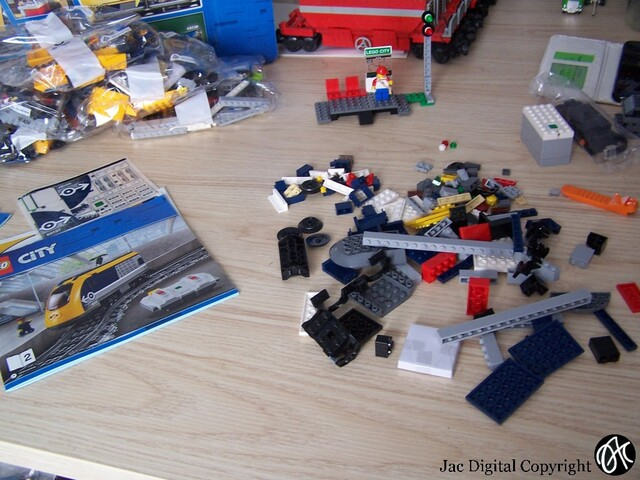](https://www.freelug.org/IMG/jpg/photo_11_-6.jpg)

Dans les premières pages du livret il est expliqué le fonctionnement du nouveau système de commande. La prise en main est très facile et la portée du système suffisamment efficace pour une chambre d’enfant.

Je ne pourrai pas tester la commande par téléphone et c’est bien dommage. Mon portable n’est pas compatible avec les programmes. Je verrai avec les prochains si c’est encore disponible. Mais de ce que j’en ai lu, ça n’apporte pas grand-chose de plus, à part le klaxon qui fonctionne avec le haut-parleur du téléphone. Il n’y a rien dans le train à part le moteur et les lumières en option.

[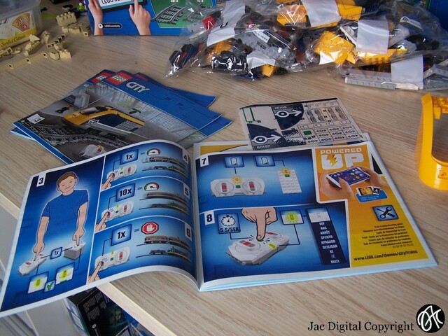](https://www.freelug.org/IMG/jpg/photo_13_-6.jpg)

J’ai prévu de monter deux rames, vous le verrez plus loin. Du coup, je me suis dis qu’il fallait que je mette les éclairages. Tout est prévu pour sur la locomotive. On trouve les leds à rajouter sur le shop pour 9,99€. Les fils passent de chaque côté du poste de pilotage. Des pièces sont aussi prévues pour enficher les lumières. On se demande si ça va bien éclairer là-dedans mais c’est assez puissant. Il faudra peut-être rajouter juste une pièce sur le dessus pour cacher un peu l’éclairage. Ca sera fait plus tard.

Ce sera tout pour ce que l’on peut rajouter. Il n’y a que deux branchements possibles sur le boitier fourni dans la boite.

[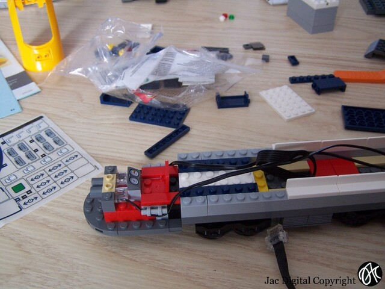](https://www.freelug.org/IMG/jpg/photo_15_-5.jpg)

Voilà les pièces restantes après cette première partie. Chaque élément est à monter avec deux sachets au moins.

[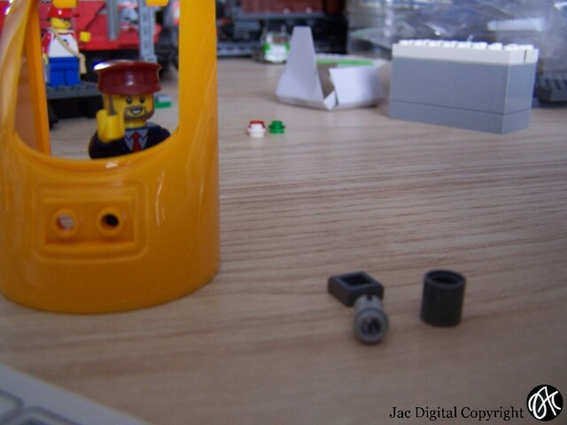](https://www.freelug.org/IMG/jpg/photo_17_-2.jpg)

Sachet numéro 3 pour la deuxième partie de la motrice.

[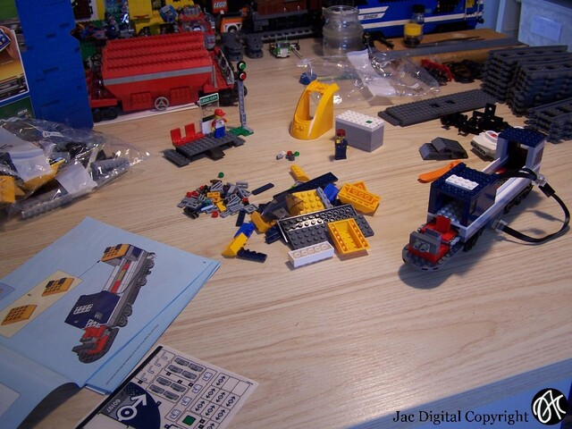](https://www.freelug.org/IMG/jpg/photo_18_-3.jpg)

Pas de soucis particulier au montage final. Je vous conseillerai juste de placer la métapièce de l’avant avant de mettre l’autocollant. Ca vous permettra de bien l’ajuster par rapport à la bande grise. Ca fait toujours plus joli quand même.

Il reste 5 pièces en extra à la fin et on a une très belle motrice que l’on est impatient de mettre sur les rails en tête du train. Le pantographe est un peu fragile je trouve et vraiment réduit à sa plus simple expression. Je ne demande pas ceux de la crocodile mais quand même...

Pour l’anecdote, avec la motrice de la deuxième boite, j’avais une slope arrondi bleu foncée 3X1 en plus. Mais il me manquait une plate "Dark Blue Wedge, Plate 4 x 2", comme si c’était pour compenser. J’ai immédiatement contacter le service après vente LEGO qui me l’a envoyée. Ce type d’erreur est vraiment rare, mais ça arrive.

[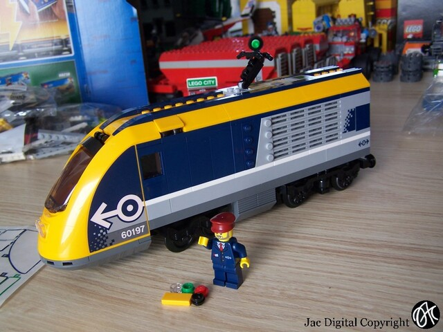](https://www.freelug.org/IMG/jpg/photo_19_-3.jpg)

On passe au montage de la voiture bar. En commençant pour l’ouverture du sachet 4, comme demandé dans la notice numéro 3. La minifig est assemblée en premier. Comme je vous l’ai expliqué précédemment, il s’agit du personnel de train qui s’occupe de la vente des sandwiches et des boissons. Cette minifig est très jolie avec son logo sur le tablier. Il s’agit d’une dame. Dans cette boite nous avons équité entre homme et femme.

[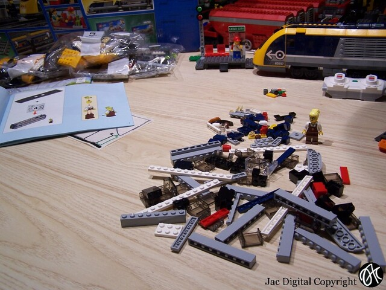](https://www.freelug.org/IMG/jpg/photo_20_.jpg)

Fin de la première partie, le bar est aménagé et il nous reste une saucisse et un muffin en extra parts, miam ! Je trouve l’aménagement du bar bien fait, avec les petites tablettes insérées dans les cloisons de la voiture. Bon par contre, notre vendeuse est condamnée à rester derrière le comptoir. On sait que c’est la voiture bar, grâce aux pictogramme à coller sur les côtés.

[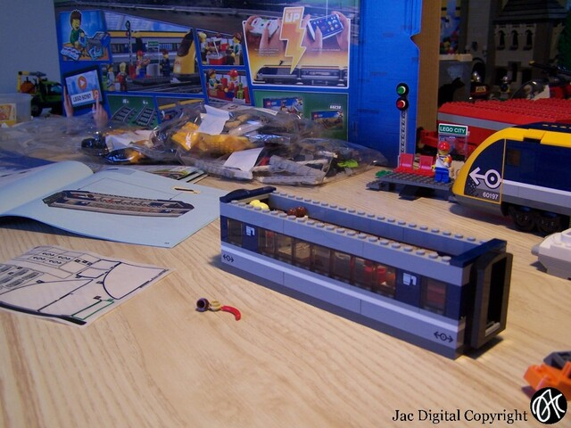](https://www.freelug.org/IMG/jpg/photo_24_-2.jpg)

Contenu du sachet numéro 5 qui permettra de finir le montage de la voiture bar.

[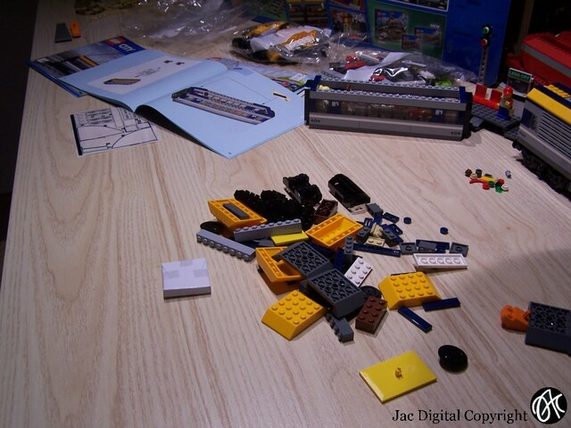](https://www.freelug.org/IMG/jpg/photo_25_-3.jpg)

La voilà terminée et déjà attelée à la motrice.

[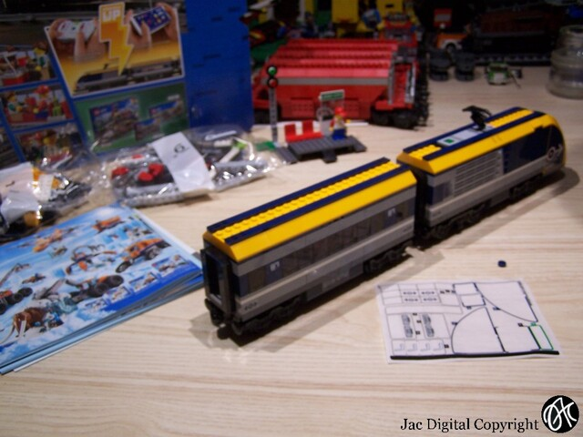](https://www.freelug.org/IMG/jpg/photo_27_-4.jpg)

Passons au contenu du sachet numéro 6 pour la première partie de l’assemblage de la voiture voyageurs. Nous avons ici une belle minifig, avec une boite LEGO à la main. C’est la seule pièce tampographiée de la boite. C’est une très belle pièce.

Ma première valise de ce type. Elle est très jolie et correspond bien à un départ pour grandes vacances. Disponible en lime et bleu foncé pour l’instant.

[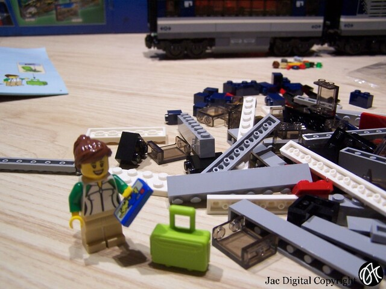](https://www.freelug.org/IMG/jpg/photo_28_-2.jpg)

Une double page pour placer 2 pièces. Franchement, je veux bien que LEGO fasse en sorte que de jeunes enfants puissent assembler les sets, ici 6 ans. Mais là, par rapport à la réduction de la quantité de papier, je trouve que c’est un peu exagéré.

[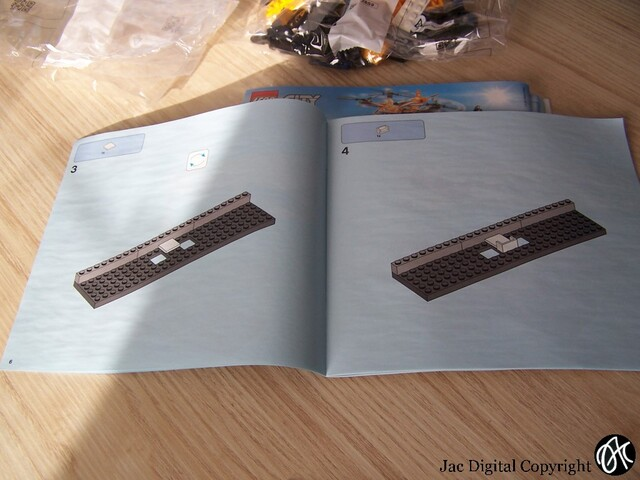](https://www.freelug.org/IMG/jpg/photo_30_-3.jpg)

Une grande motrice, une voiture bar, tout ça pour 4 voyageurs, ça fait pas bien chargé pour une telle rame. Même pire, puisque l’on trouve que seulement 2 voyageurs dans la boite. Là aussi, je trouve que la marque pourrait augmenter un peu la capacité de transport.

[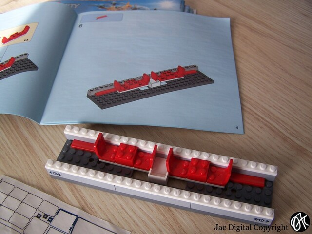](https://www.freelug.org/IMG/jpg/photo_31_-4.jpg)

Fin de cette première partie. On sait que l’on monte dans la voiture voyageurs, grâce aux pictogrammes qui représentent un siège. D’ailleurs, pour une petite remarque, je suis sûr que chez LEGO, tout le monde sait que les passionnés vont forcément acheter deux trains. Bin oui, la rame est beaucoup mieux finie avec une motrice en tête et une en queue. C’est ce que je fais, comme je vous l’ai déjà écrit. Ce n’est d’ailleurs pas une première et cela se fait souvent maintenant pour rallonger le train. Alors pourquoi ne pas prévoir sur la planche d’autocollants de pouvoir assembler 2 voitures voyageurs ? Il y a juste 4 pictogrammes à rajouter et peut-être quelques pièces.

[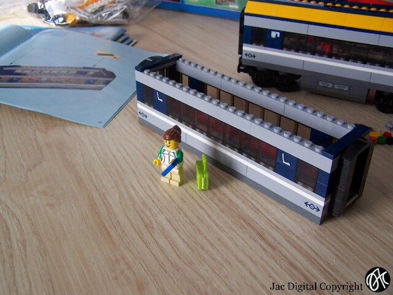](https://www.freelug.org/IMG/jpg/photo_32_-2.jpg)

Le dernier sachet nous permet de terminer cette belle rame. Avec la deuxième voiture attelée, on a un train bien coloré et assorti entre les éléments. Mais on a l’impression qu’il n’est pas complet.

[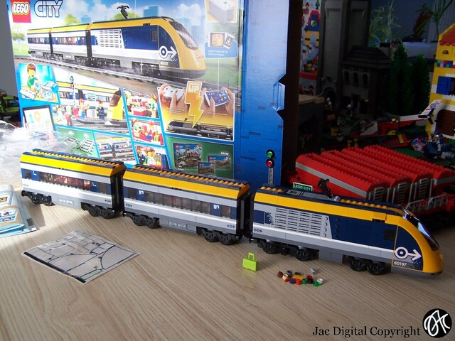](https://www.freelug.org/IMG/jpg/photo_34_-2.jpg)

Voilà une photo prise sur mon réseau, avec les fanaux avant éclairés. En plein soleil, ça ne se voit pas très bien.

[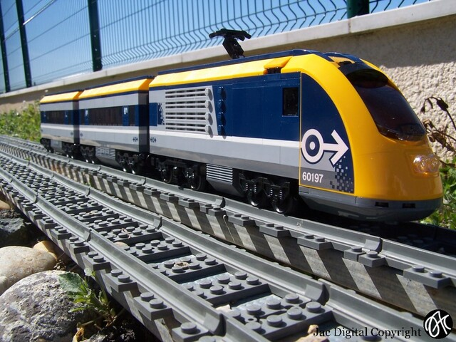](https://www.freelug.org/IMG/jpg/photo_37_-2.jpg)

En assemblant la deuxième rame j’ai aussi essayé de faire une modification pour que les lumières éclairent un peu mieux. Mais à part une tile de 2X4, je n’ai rien pu mettre d’autre. La métapièce empêche de placer des briques au plus près des orifices.

[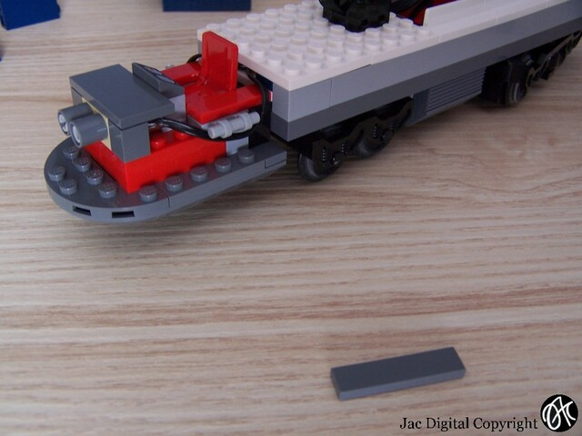](https://www.freelug.org/IMG/jpg/photo_40_-2.jpg)

Avec une rame double et la motrice de queue le train est beaucoup plus joli. Le problème c’est que le train est bien alourdi. Il fatigue vite sur le réseau. Il est absolument nécessaire de motoriser la motrice arrière, mais se pose un problème pour commander en même temps ce deuxième moteur. Il sera forcément monté dans l’autre sens que le premier. Avec ce nouveau système, il n’est pas possible d’inverser le sens de fonctionnement, enfin, ça sera peut-être pour plus tard. Il faut placer les deux télécommandes en inversé et permuter les boutons. Pensez aussi à placer des feux rouges à l’arrière.

[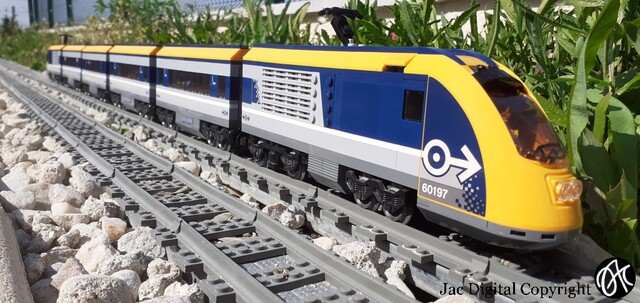](https://www.freelug.org/IMG/jpg/photo_41_-2.jpg)

[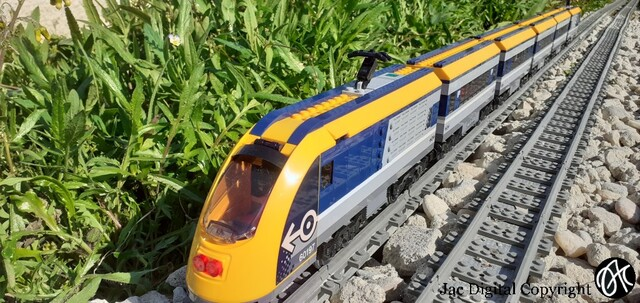](https://www.freelug.org/IMG/jpg/photo_44_.jpg)

Vraiment, c’est une très belle rame. Les passagers sont assis en face des fenêtres, ça n’a pas toujours été le cas. Le train est assez vite construit. Les rails fournis dans la boite permettent de faire un beau réseau. Même si ça reste un ovale. Mais avec une seule boite, le train n’est pas fini... C’est ce que je conseille depuis le début, mais je suis conscient que ça double le budget.

[Autre revue du set écrite par Erik en 2018](/articles/2899/)

[Liens vers toutes les photos](https://photos.freelug.org/main.php/v/JAC/review/train/60197/)
