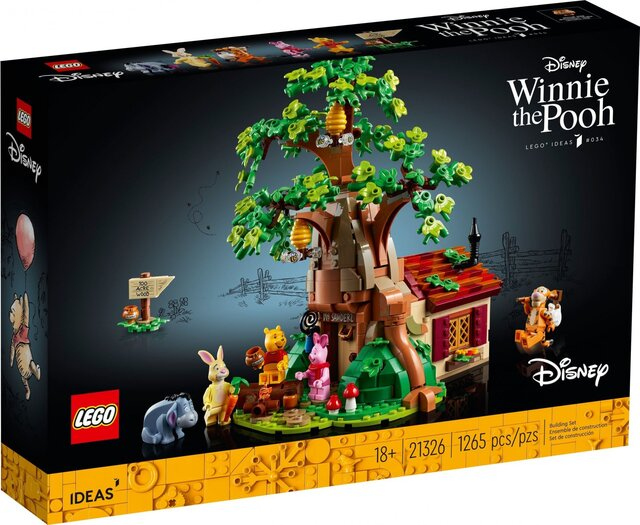
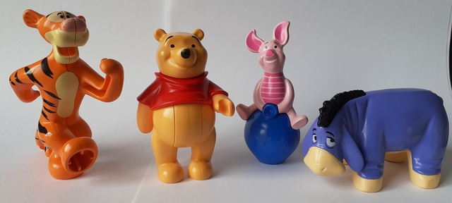
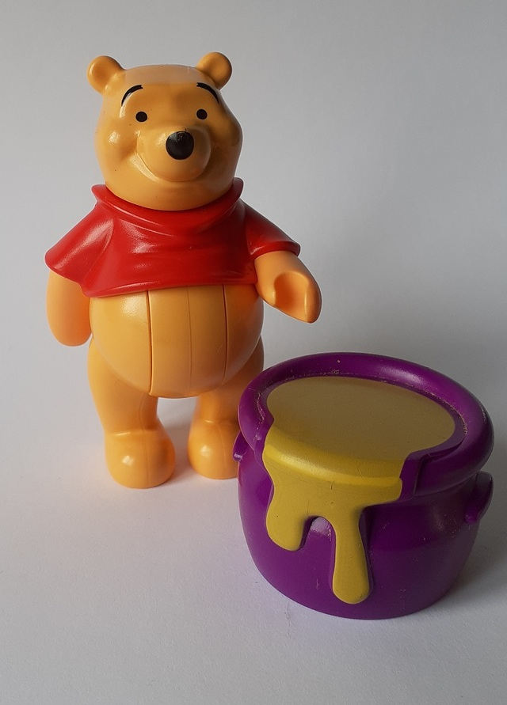
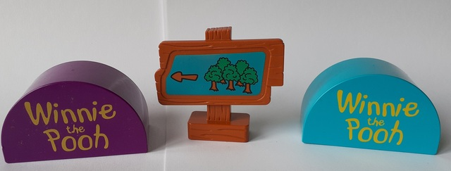

Winnie the Pooh, ou Winnie l’Ourson en français, est un personnage de la littérature d’enfance, repris par Disney dans plusieurs dessins animés.

Suite à un projet Ideas, LEGO commercialise sa version de ce personnage et de quelques-uns de ses amis dans l’univers de nos briques. Petite revue rapide ici des éléments spécifiques à la boite.

Résumé de la boite :  
**–** Référence : 21326  
**–** Nombre de pièces : 1265  
**–** Prix à sa commercialisation : 109,99€

## Les minifigs

Quatre minifigs accompagnent ce set : Winnie, bien sûr, mais également Bourriquet, Porcinet et Tigrou. LEGO a malheureusement ou heureusement, selon les goûts, opté pour des métapièces. Les personnages sont constitués d’une seule pièce, non articulée, sauf Winnie qui peut s’asseoir. Seule la main gauche de Winnie peut tenir un objet.

On regrettera la pose imposée, et l’impossibilité de séparer Porcinet (le petit cochon rose) de son ballon bleu.

## Les accessoires

Que serait Winnie l’Ourson sans son inséparable pot de miel ? Cette nouvelle pièce ne propose pas de système d’attache pour être fixé à la main, dommage. Seul le dessous lui permet de tenir sur un tenon.

## Les pièces décorées

On trouve quelques pièces décorées dans la boite. Un panneau indiquant la forêt où vit Winnie, mais aussi des [Brick 2 x 4 x 2 Curved Top](https://www.bricklink.com/v2/catalog/catalogitem.page?P=31213px01&idColor=24) avec marqué "Winnie the Pooh". Dommage qu’il n’existe pas de version française.  
Par contre, il devait y avoir un problème avec ma boite, je n’ai pas trouvé la brique [1x2x2 avec les abeilles](https://www.bricklink.com/v2/catalog/catalogitem.page?P=4066pb031&idColor=3#T=C&C=3) qui causent tant d’histoires à notre héros !

## Conclusion

Pour une sortie non VIP fixée au premier avril, je trouve que le set manque cruellement de poisson.
