Partons à la découverte de cette boite qui sent bon la campagne !

[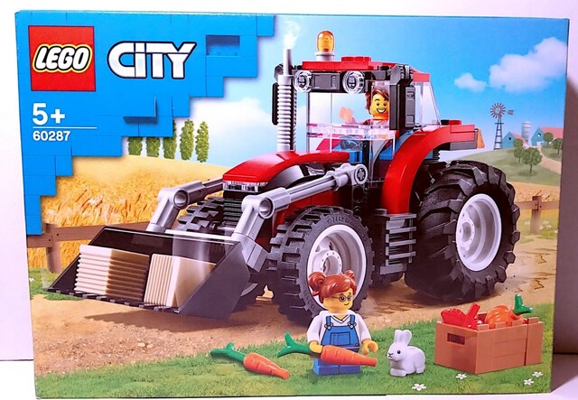](https://www.freelug.org/IMG/jpg/dsc_2346.jpg)

Le set comprend 148 pièces avec deux personnages et un lapin. Pour un prix de 19,99 € soit un rapport prix/pièces de 0,135 euros, c’est un peu cher pour un set avec un véhicule et un tout petit animal.  
Une petite vue arrière donne une idée de la jouabilité du set :

[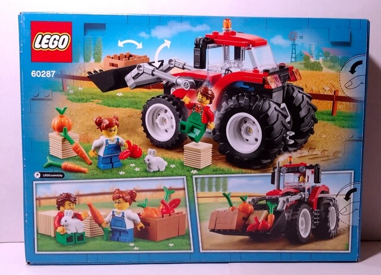](https://www.freelug.org/IMG/jpg/dsc_2347.jpg)

Notons au passage l’absence de sticker (remarque, je ne sais pas où on aurait pu en mettre...).

Pour commencer, nous avons la petite fille avec son lapin :

[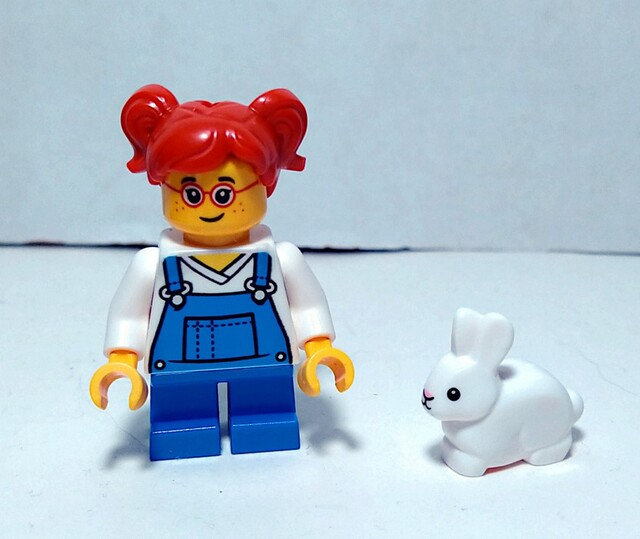](https://www.freelug.org/IMG/jpg/dsc_2372.jpg)

[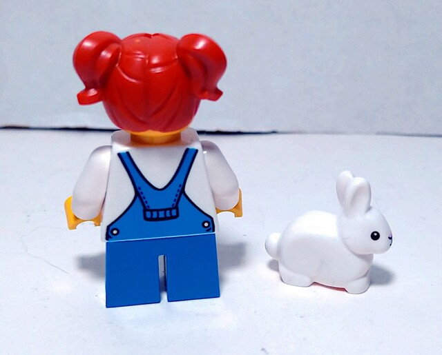](https://www.freelug.org/IMG/jpg/dsc_2373.jpg)

Puis le conducteur :

[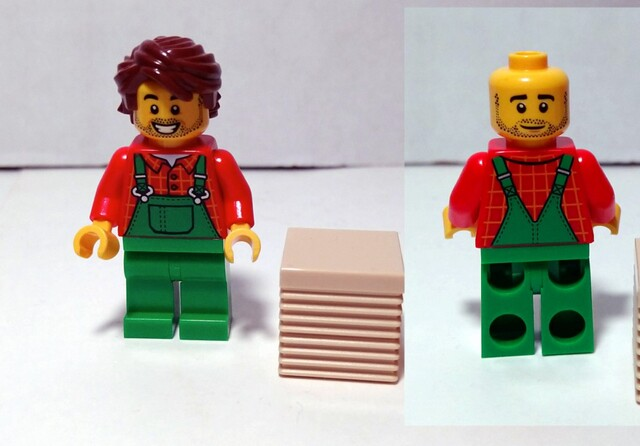](https://www.freelug.org/IMG/jpg/dsc_2378.jpg)

Nous passons à la caisse aux fruits et légumes :

[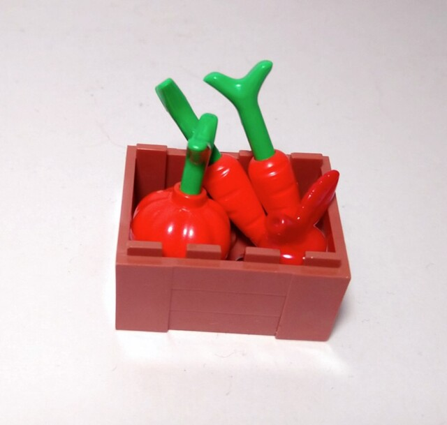](https://www.freelug.org/IMG/jpg/dsc_2374.jpg)

Passons à la bête : le tracteur !  
On commence avec le chassis :

[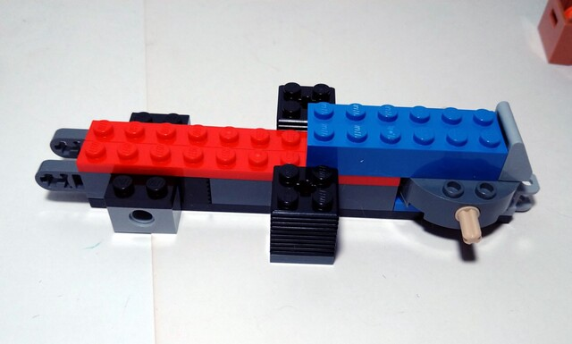](https://www.freelug.org/IMG/jpg/dsc_2375.jpg)

[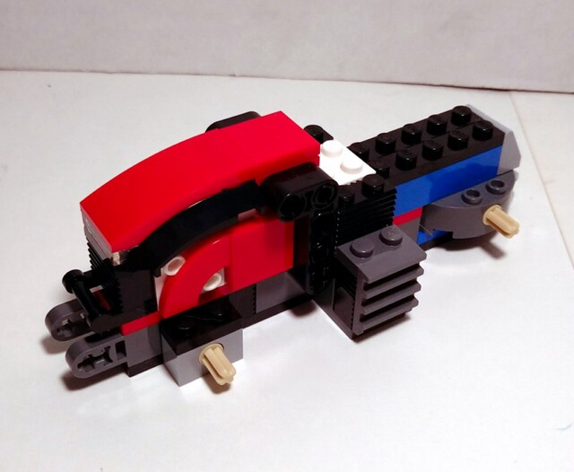](https://www.freelug.org/IMG/jpg/dsc_2376.jpg)

La structure avance assez vite :

[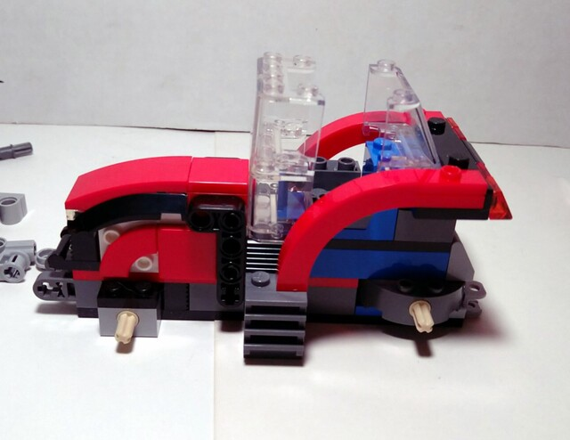](https://www.freelug.org/IMG/jpg/dsc_2380.jpg)

[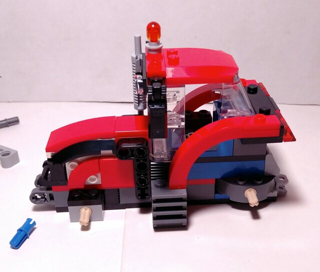](https://www.freelug.org/IMG/jpg/dsc_2381.jpg)

Et voilà fini :

[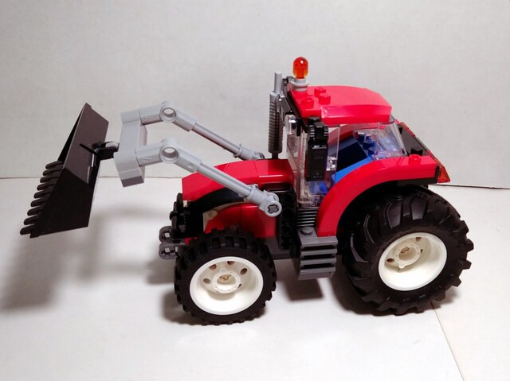](https://www.freelug.org/IMG/jpg/dsc_2382.jpg)

Voilà fini, une petite photo de famille !

[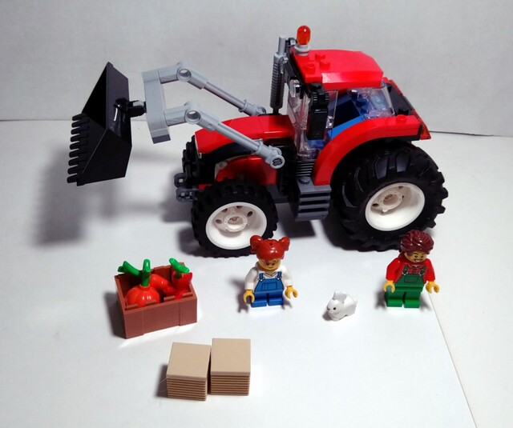](https://www.freelug.org/IMG/jpg/dsc_2383.jpg)

Et pour terminer les extra parts :

[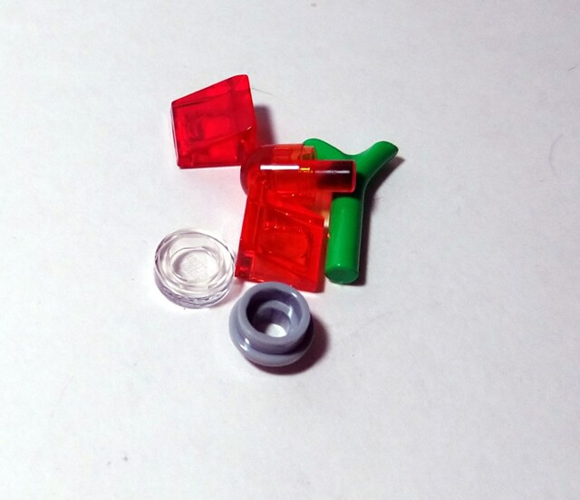](https://www.freelug.org/IMG/jpg/dsc_2384.jpg)

**Conclusion**  
Que dire : nous trouvons dans ce set les nouvelles briques 2\*2 ajourées en Tan et en Noir. Le petit lapin fait passer la pilule du prix, car franchement, je le trouve un poil trop cher… Moi j’aurais ajouté une petite remorque, vu qu’il y a l’accroche...

Donc un petit set un peu cher qui mérite mieux.
