Neuf participants toutes catégories confondues, 9 créations, qui va nous convaincre de poser notre fusée sur sa base ?

Il est temps de découvrir les participations du concours "Construis-moi un décor... On va marcher dans l’espace".

Bonjour à toutes et à tous,

Vous pouvez retrouver le [règlement de ce concours ici](https://www.freelug.org/spip.php?article3079)

Tout d’abord, nous tenons à remercier les 9 participants qui nous ont proposé un très joli voyage dans les étoiles.

Les participations sont présentées dans l’ordre de réception.

## Concours catégorie "Réelle"

**01 - Christophe L. - Bulkania, la planète aux 1000 canyons**

Bienvenue sur la planète Bulkania. Découverte il y a peu, cette petite planète de la taille de Mercure, est située entre Mars et Jupiter, à proximité de la ceinture d’astéroïdes.  
Sa particularité, offrir une végétation luxuriante dans ses canyons, à l’inverse de sa surface qui est un vaste désert.  
Fort de cette découverte, une équipe composée de 2 scientifiques, 1 médecin et 1 mécanicienne a été envoyée sur la base Bulka-001 il y a déjà quelques mois. Une nouvelle équipe est en route et prendra la relève prochainement.  
Il reste encore beaucoup de choses à découvrir sur cette planète...

[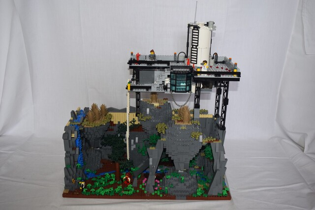](https://www.freelug.org/IMG/jpg/cl_-_01_grand_.jpg)

[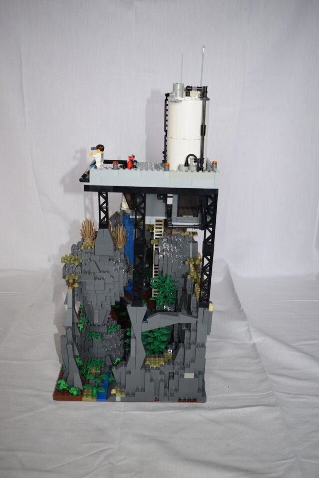](https://www.freelug.org/IMG/jpg/cl_-_02_grand_.jpg)

[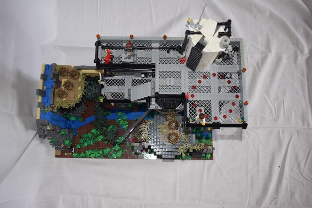](https://www.freelug.org/IMG/jpg/cl_-_03_grand_.jpg)

[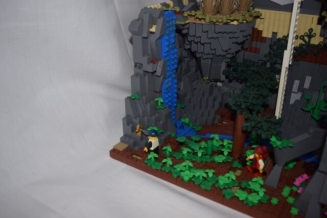](https://www.freelug.org/IMG/jpg/cl_-_04_grand_.jpg)

[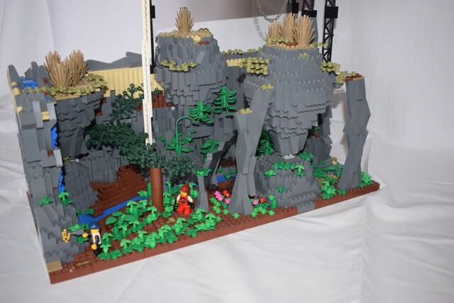](https://www.freelug.org/IMG/jpg/cl_-_05_grand_.jpg)

[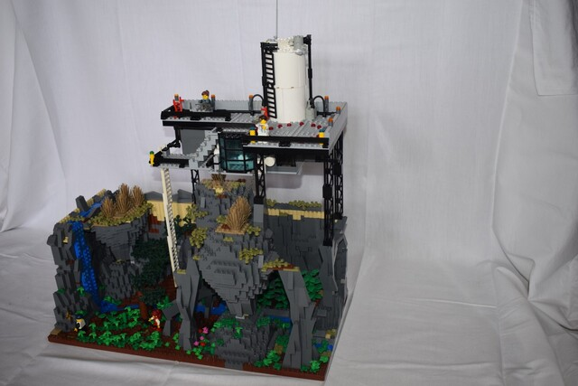](https://www.freelug.org/IMG/jpg/cl_-_06_grand_.jpg)

[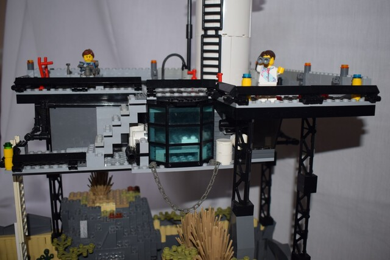](https://www.freelug.org/IMG/jpg/cl_-_07_grand_.jpg)

[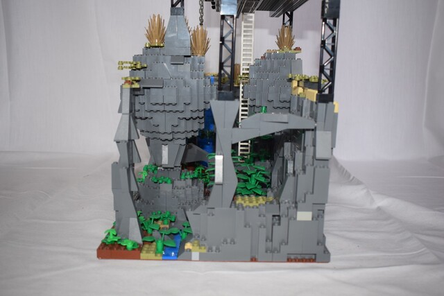](https://www.freelug.org/IMG/jpg/cl_-_08_grand_.jpg)

**02 - Jérôme T. - Sous la base le sable et sous le sable....**

L’équipe d’explorateurs est en excursion avec son vaisseau. Elle s’est posée à côté du poste avancé Alpha-33 de la planète Xian-A023, dans le système "Carei". Une fleur a poussé juste devant le laboratoire d’analyse. Il faut absolument prendre quelques photos. C’est vraiment étrange de trouver cela sur cette partie de la planète recouverte de sable très dur et balayée par des vents puissants. Heureusement, aujourd’hui c’est calme, on peut s’amuser avec les Segway, sans faire de dégâts bien sûr. Personne ne se doute de toute la vie qui se trouve dans la grotte, juste en dessous et surtout du puissant arbre qui se permet de traverser la couche de sable...

[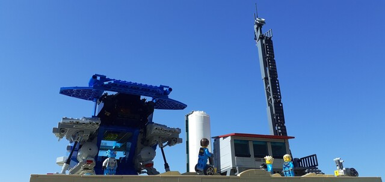](https://www.freelug.org/IMG/jpg/jt-01-2.jpg)

[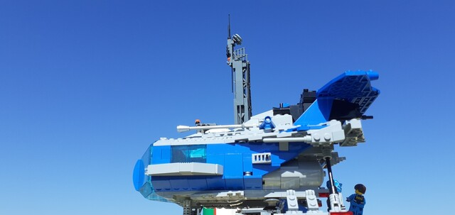](https://www.freelug.org/IMG/jpg/jt-02.jpg)

[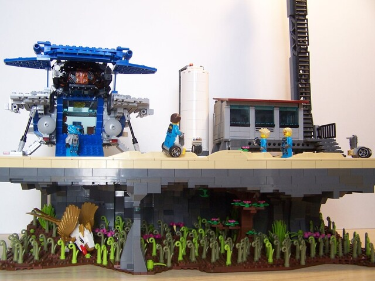](https://www.freelug.org/IMG/jpg/jt-03.jpg)

[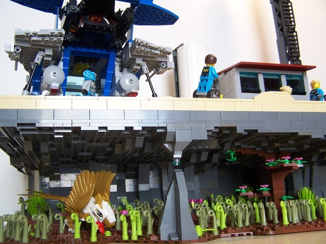](https://www.freelug.org/IMG/jpg/jt-04.jpg)

[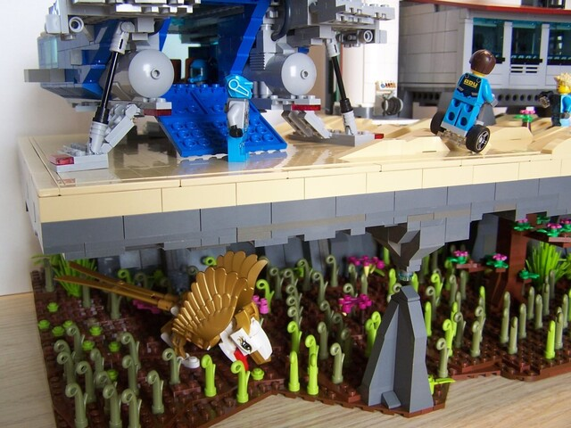](https://www.freelug.org/IMG/jpg/jt-05.jpg)

[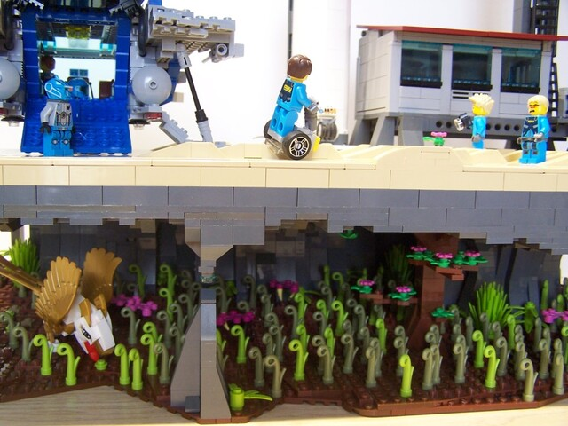](https://www.freelug.org/IMG/jpg/jt-06.jpg)

[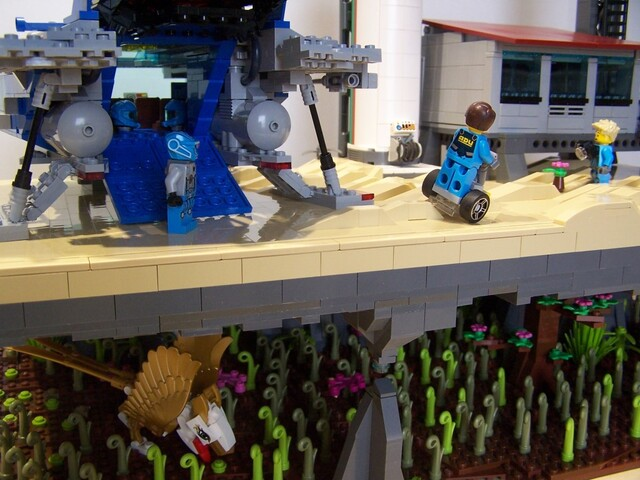](https://www.freelug.org/IMG/jpg/jt-07.jpg)

**03 - Nicolas G. - Space Station-Service**

Bienvenue dans ma Space Station-Service !  
Vous pourrez y faire le plein grâce aux 2 pompes et réparer votre véhicule sur le pont élévateur.  
Le train monorail peut s’arrêter et, à l’aide du pont roulant et son bras articulé, décharger sa marchandise pour la contrôler.  
N’oubliez pas d’arroser les fleurs dans le bureau... Mais attention, l’accès y est sécurisé par une grande barrière laser et sous surveillance vidéo.  
Vous ne viendrez plus chez nous par hasard.

[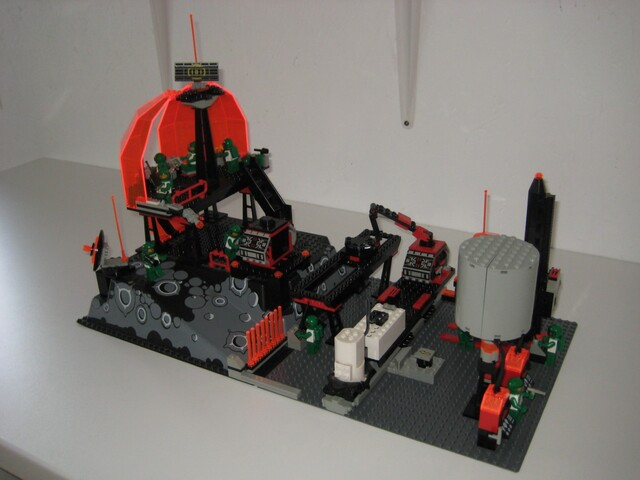](https://www.freelug.org/IMG/jpg/ng-01_grand_.jpg)

[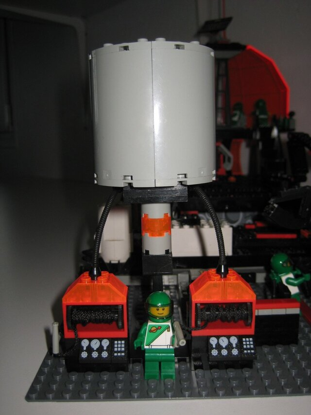](https://www.freelug.org/IMG/jpg/ng-02_grand_-r90.jpg)

[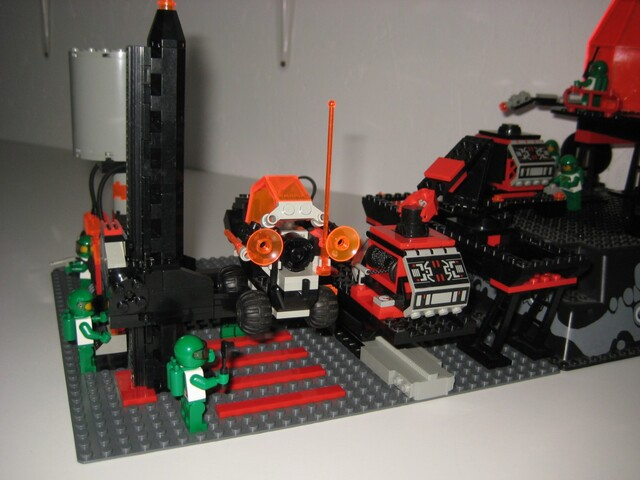](https://www.freelug.org/IMG/jpg/ng-03_grand_.jpg)

[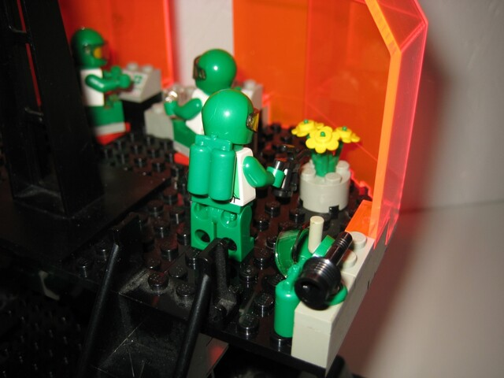](https://www.freelug.org/IMG/jpg/ng-04_grand_.jpg)

[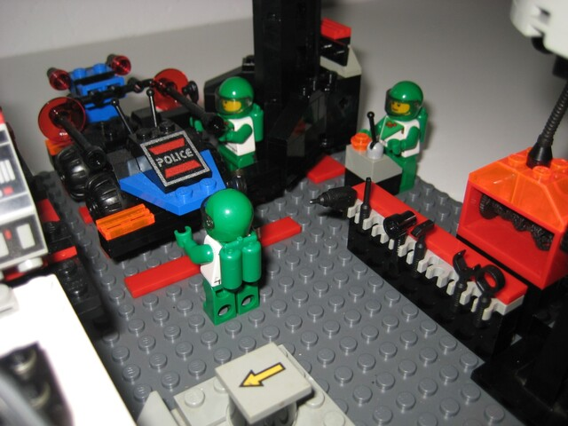](https://www.freelug.org/IMG/jpg/ng-05_grand_.jpg)

[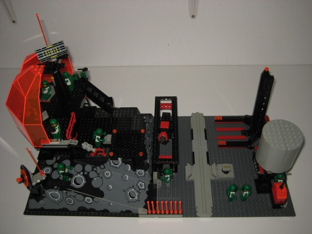](https://www.freelug.org/IMG/jpg/ng-06_grand_.jpg)

[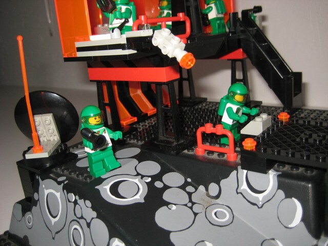](https://www.freelug.org/IMG/jpg/ng-07_grand_.jpg)

[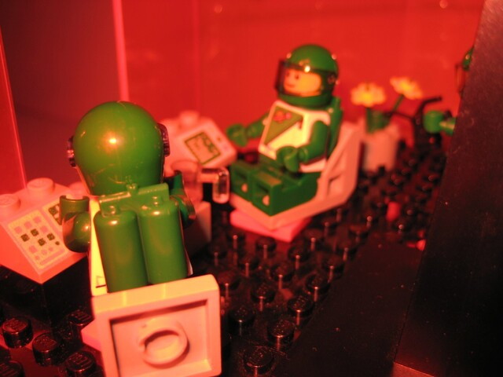](https://www.freelug.org/IMG/jpg/ng-8_grand_.jpg)

**04 - Olivier C. (enfant) - Le laboratoire de la Planète Verte**

Sur la Planète Verte les plantes poussent trèèès vite et une base y a été installée pour étudier la croissance des plantes sur cette planète afin de lutter contre la déforestation sur terre.

[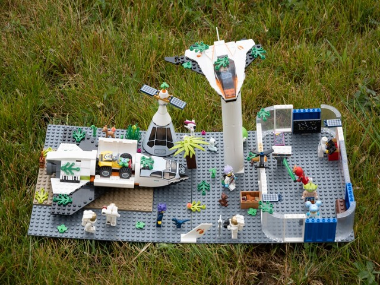](https://www.freelug.org/IMG/jpg/oc-01_grand_.jpg)

[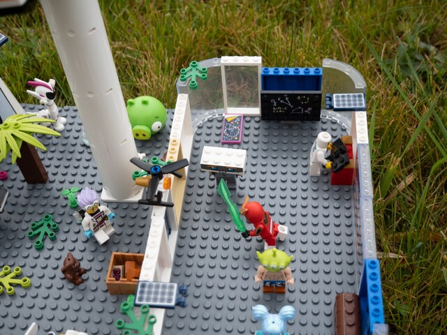](https://www.freelug.org/IMG/jpg/oc-02_grand_.jpg)

[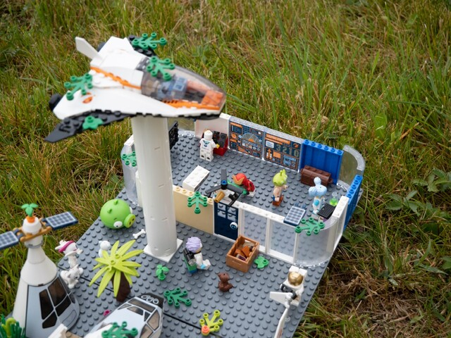](https://www.freelug.org/IMG/jpg/oc-03_grand_.jpg)

[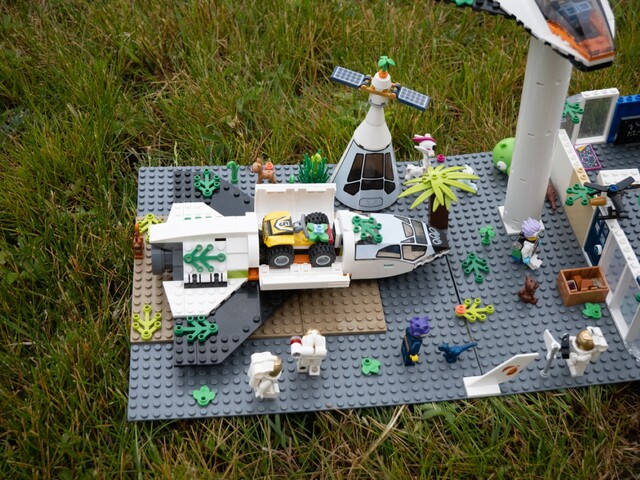](https://www.freelug.org/IMG/jpg/oc-04_grand_.jpg)

[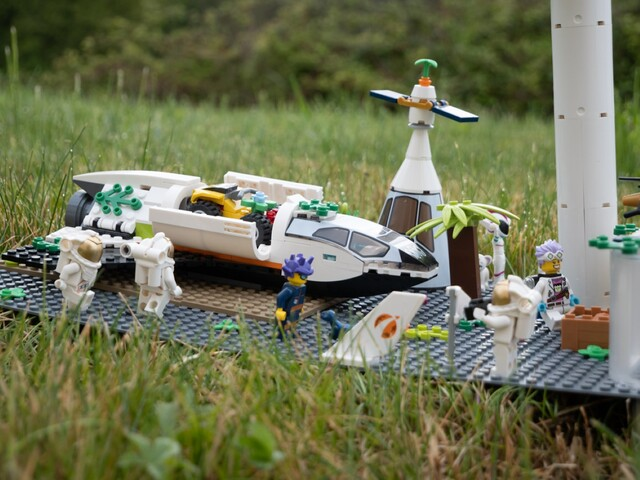](https://www.freelug.org/IMG/jpg/oc-05_grand_.jpg)

[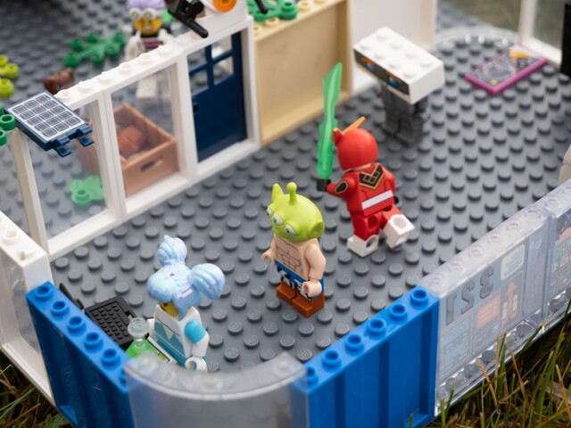](https://www.freelug.org/IMG/jpg/oc-06_grand_.jpg)

[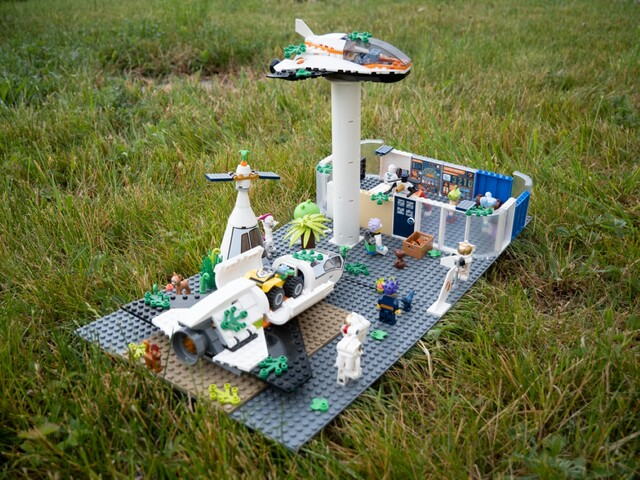](https://www.freelug.org/IMG/jpg/oc-07_grand_.jpg)

[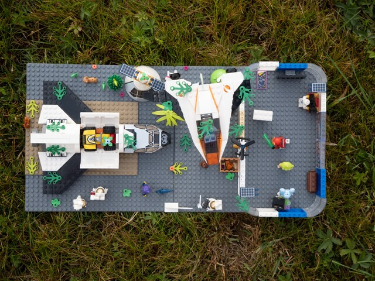](https://www.freelug.org/IMG/jpg/oc-08_grand_.jpg)

**05 - Mathieu C. - Green Hope**

Pendant son voyage à travers la galaxie, la fusée du GFC a croisé le Daisy Star Ship (Daisy = Marguerite) atterrissant sur le spatioport végétal de la planète Green Hope.  
Les habitants de cette planète ont toujours vécu en hauteur dans la joie, la bonne humeur et l’opulence sans se soucier de l’environnement à la base de la planète : La Forêt Oublié du Passé, une forêt vierge à l’écosystème particulièrement riche.  
Les habitants de cette planète, peu scrupuleux de la nature environnante ont provoqué différents cataclysmes, généré des gaz toxiques et c’est ainsi que le Désert Sulfurique du Présent s’est mis à recouvrir cette planète : Les plantes se sont raréfiées et sont devenues carbonisées, les autochtones sont devenus des hommes robots et des ponts de pierres ont remplacé les ponts de verdure.  
Le pont de pierre se dirige vers le Futur, les habitants de cette planète ont leur destin en main…  
Toute ressemblance avec une planète ayant existé est totalement fortuite…

[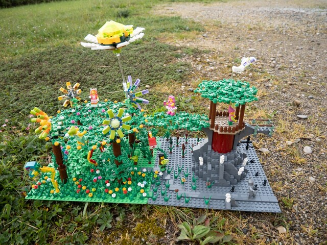](https://www.freelug.org/IMG/jpg/mc-01_grand_.jpg)

[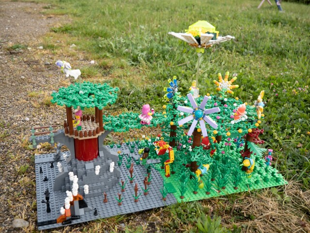](https://www.freelug.org/IMG/jpg/mc-02_grand_.jpg)

[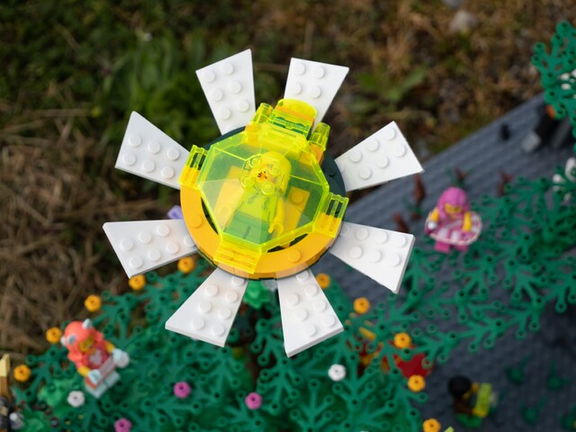](https://www.freelug.org/IMG/jpg/mc-03_grand_.jpg)

[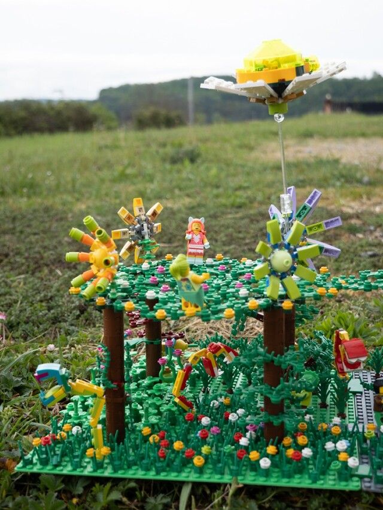](https://www.freelug.org/IMG/jpg/mc-04_grand_.jpg)

[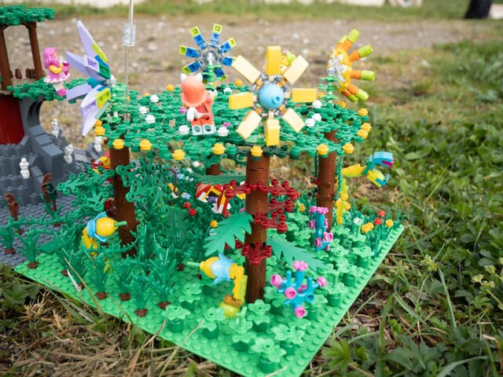](https://www.freelug.org/IMG/jpg/mc-05_grand_.jpg)

[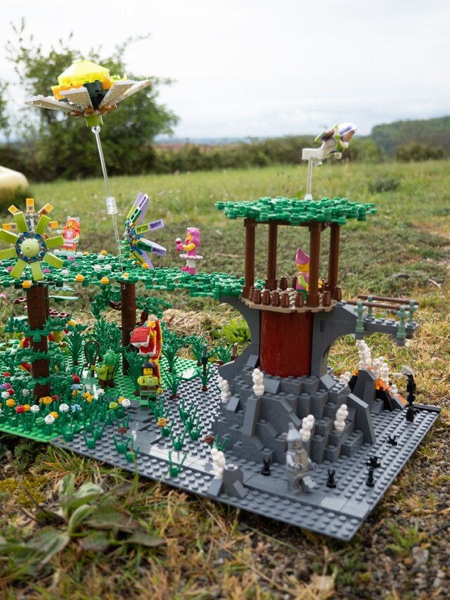](https://www.freelug.org/IMG/jpg/mc-06_grand_.jpg)

[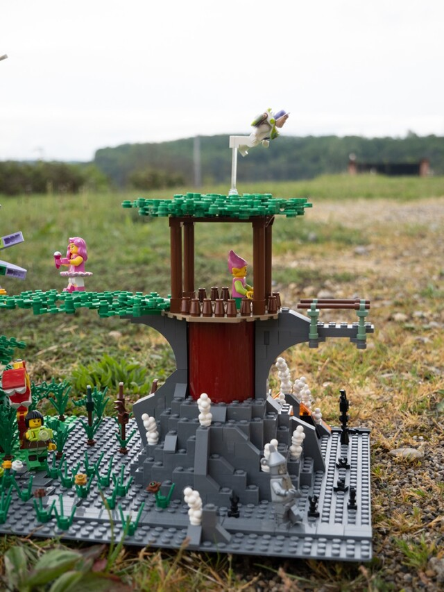](https://www.freelug.org/IMG/jpg/mc-07_grand_.jpg)

[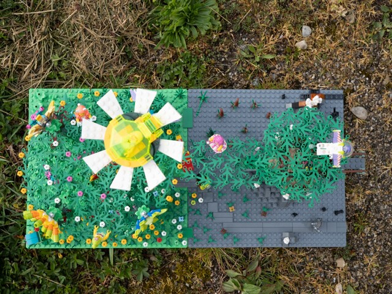](https://www.freelug.org/IMG/jpg/mc-08_grand_.jpg)

**06 - Nicolas W. - Planète Océanique Alpison**

Bienvenue sur la planète océanique Alpison. Cette planète de type terrestre présente une étrange fleur produisant des pétales en or pur, ce qui justifie son intérêt commercial.  
Une base y a donc été installée depuis quelques années, capable d’accueillir six personnes dans de bonnes conditions. Construite sur le modèle d’une plate-forme pétrolière, avec des poids sous-marins pour la lester, elle comporte, de bas en haut : un étage technique servant de sas sur l’extérieur, un laboratoire, une salle à manger ou de réunion, et un dortoir (qui est également un refuge en cas de tempête exceptionnelle, d’où l’absence de fenêtres).  
La base est équipée de deux systèmes ultra-avancés.  
Tout d’abord les coffres de stockage de la Capsule Corp (tm) permettent de stocker d’impressionnantes quantités de nourriture ou de matériel dans un volume minimal. Ce qui explique l’absence de zone de stockage conséquente dans la base ! Les fleurs récoltées ne prendront également que peu de volume lors de leur rapatriement.  
Ensuite les matériaux de construction de la base peuvent changer de couleur.  
Ils sont équipés de capteurs reliés à une intelligence artificielle très avancée qui, analysant en temps réel les conditions extérieures, ajuste la couleur des différents éléments afin que la base soit la plus discrète possible (\*toux gênée\* il y a actuellement un dysfonctionnement, ce qui explique les couleurs extravagantes... Le fabricant nous promet une mise à jour rapidement...).  
Nous espérons, chers investisseurs, vous avoir convaincus de l’intérêt de cette base.

[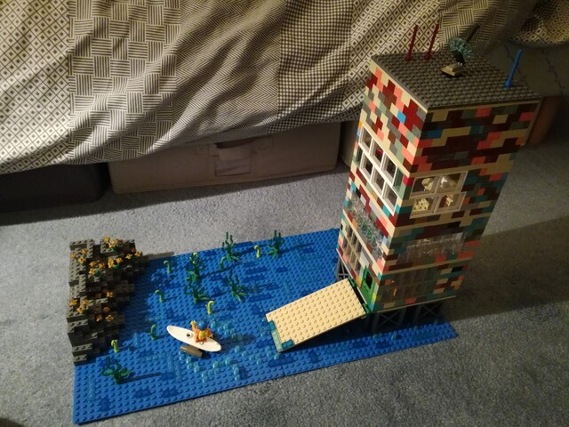](https://www.freelug.org/IMG/jpg/nw-01_grand_.jpg)

[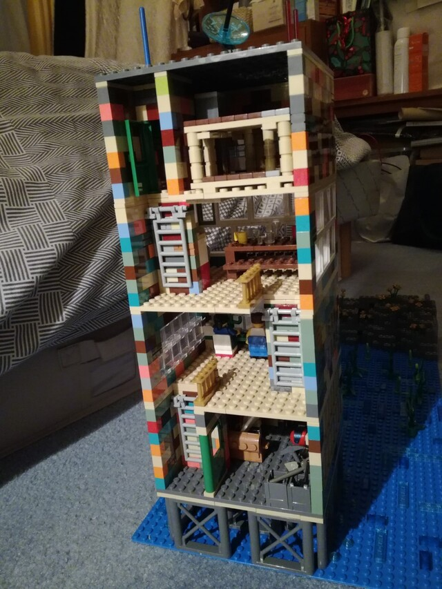](https://www.freelug.org/IMG/jpg/nw-02_grand_.jpg)

[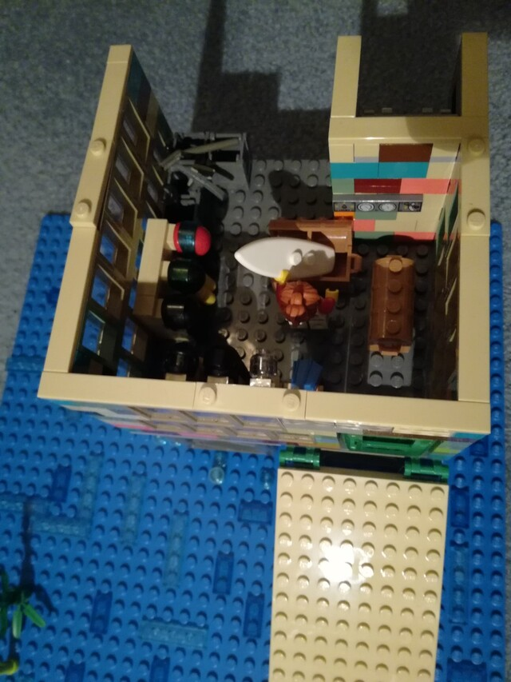](https://www.freelug.org/IMG/jpg/nw-03_grand_.jpg)

[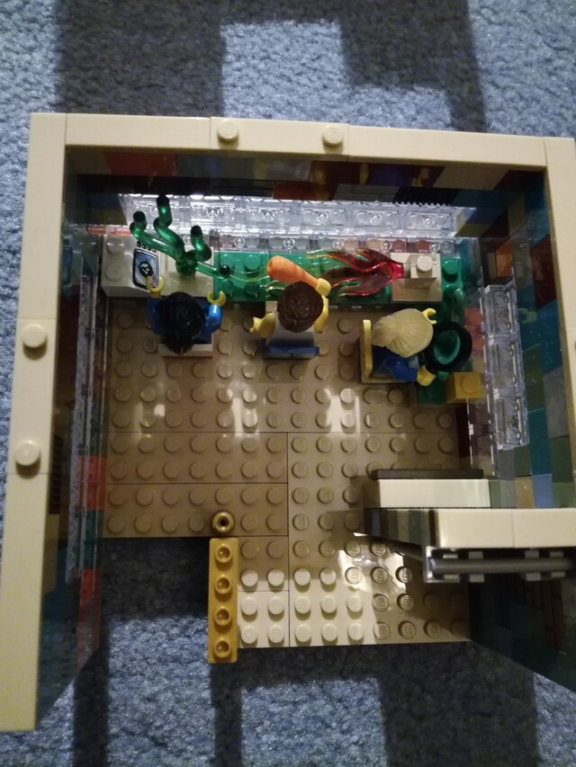](https://www.freelug.org/IMG/jpg/nw-04_grand_.jpg)

[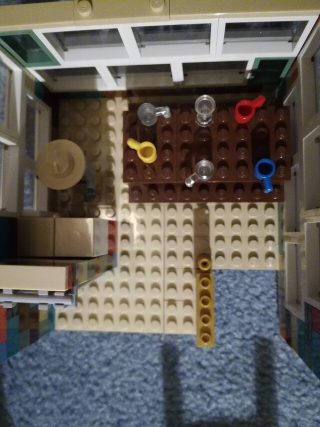](https://www.freelug.org/IMG/jpg/nw-05_grand_.jpg)

[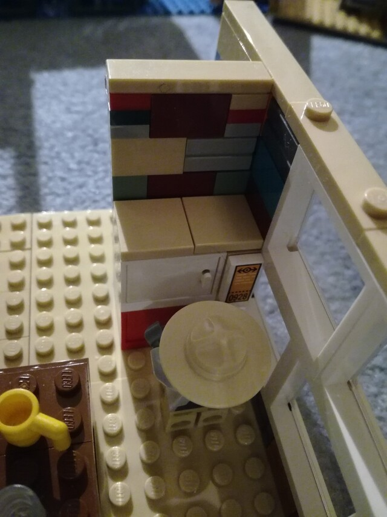](https://www.freelug.org/IMG/jpg/nw-06_grand_.jpg)

[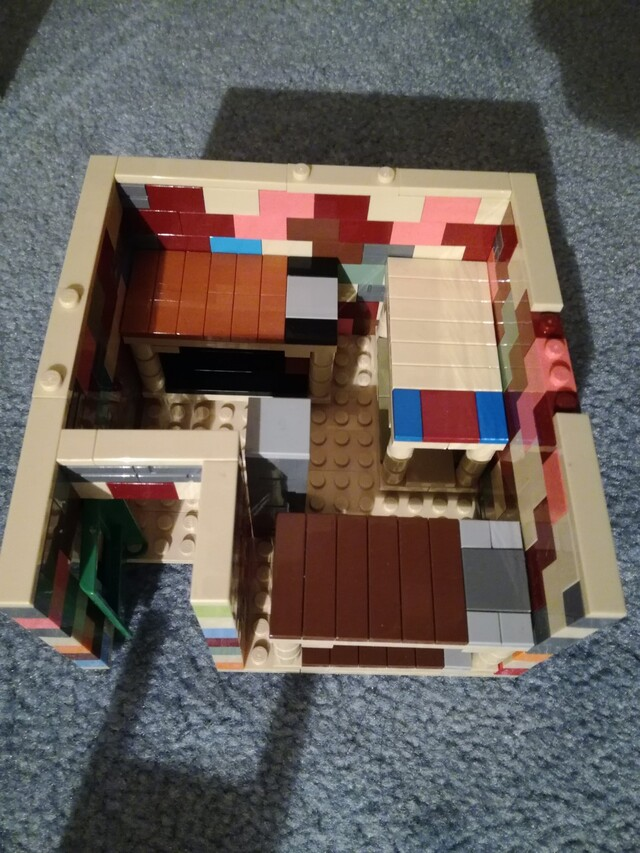](https://www.freelug.org/IMG/jpg/nw-07_grand_.jpg)

[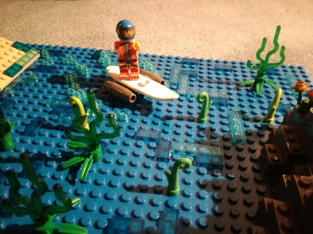](https://www.freelug.org/IMG/jpg/nw-08_grand_.jpg)

**07 - Ninon & Ludovic R. - Base ARAMIS - Planète GUILLO 58**

La base de recherche n°2 nommée ARAMIS est implantée sur la planète GUILLO 58.  
Planète volcanique où quelquefois les coulées de lave viennent lécher les pieds de la base !

[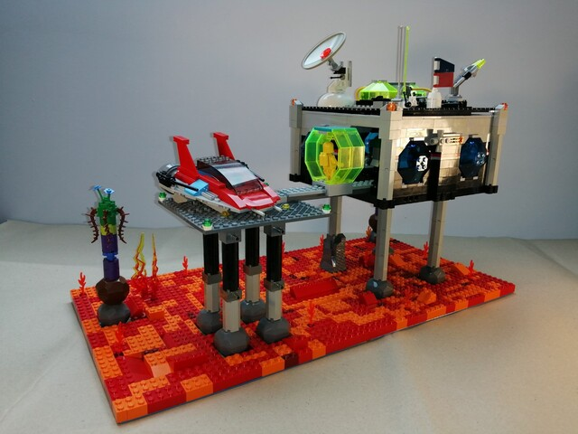](https://www.freelug.org/IMG/jpg/nlr-01_grand_.jpg)

[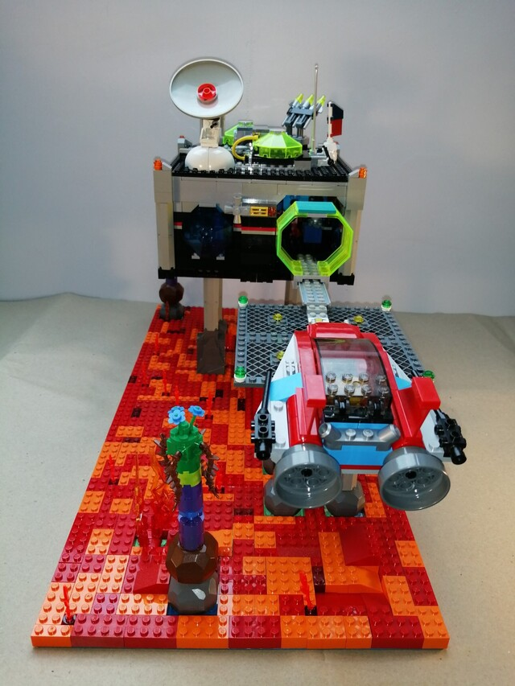](https://www.freelug.org/IMG/jpg/nlr-02_grand_.jpg)

[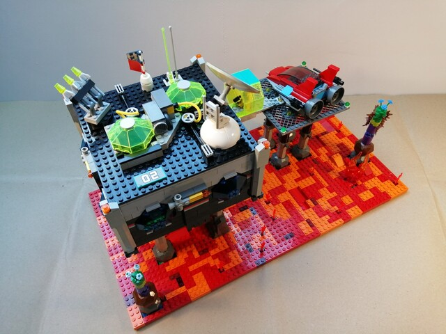](https://www.freelug.org/IMG/jpg/nlr-03_grand_.jpg)

**Devant la qualité des réalisations proposés, le GFC a décidé également de faire gagner sa navette en plus de sa fusée.**

Les heureux gagnants de ce concours sont :  
**–** **02 - Jérôme T. - Sous la base le sable et sous le sable....** qui remporte le set LEGO **Ref 60228 - Deep Space Rocket and Launch Control**  
**–** **01 - Christophe L. - Bulkania, la planète aux 1000 canyons** qui remporte le set LEGO **Ref 60226 - Mars Research Shuttle**

Classement :  
1\. Jérôme T. (14 pts)  
2\. Christophe L. (9 pts)  
3\. Mathieu C. (8 pts)  
4\. Ninon & Ludovic R. (4 pts)  
5\. Nicolas G. et Olivier C. (2 pts)  
6\. Nicolas W. (0 pt)

Composition du jury catégorie réelle :

**–** Mathieu W. (GFC)  
**–** Pierre C. (Tribolego) (GFC)  
**–** Xavier D. (GFC)  
**–** Rémi L. (GFC)  
**–** Christophe M.  
**–** Sébastien M.  
**–** Jérôme V.  
**–** Stéphane P.  
**–** Ève-Elise J.  
**–** Duy Hai D.  
**–** Julien B.  
**–** Sylvain J.  
**–** Stéphane M.

* * *

## Concours catégorie "Virtuelle"

**01 - Rémi L - Classix XXI Exploration Base**

Bienvenue sur la planète Classix XXI. Cette petite planète bien cachée entre les constellations Hyère et Ojourduy a gardé son charme d’antan. Idéale pour se reposer loin des soucis quotidiens et pour un retour aux sources.  
Vous trouverez sur notre complexe :  
**–**  Un grand espace de vie qui fait Cuisine/Buanderie et Salle à Manger avec à l’étage un ensemble chambre et salle de bain (Accès extérieur uniquement)  
**–**  Une tour de contrôle afin de surveiller le ciel ou faire la sieste tranquillement  
**–**  Une serre pour vous adonner au jardinage avec son cabanon à outil  
**–**  Pour ceux qui n’aiment pas le jardinage, un véhicule est à votre disposition pour la chasse aux cristaux  
**–**  2 Robots s’occupent des réparations et des taches ménagères  
**–**  1 superbe bouquet de fleurs de la Terre pour vous souhaiter la bienvenu qui se trouve sur la table de la salle à manger  
Ce complexe peut accueillir 6 personnes maximum afin de garantir le calme à ses occupants. Chacun aura un lit et 1 tasse assorti à la couleur de son costume.  
Nous vous souhaitons un excellent séjour !

**02 - Julien F - La vie en rose**

Rapport 2085-01  
La base d’exploration avancée a été installée dans une plaine humide de la planète tellurique Gliese 486 b .  
Le terrain est constellé d’un réseau de mares à l’eau étrangement orange. C’est d’autant plus étrange que le terrain est plutôt d’une teinte rosée.  
Des organismes fixes se concentrent dans ces puits de vie, déployant des formes tentaculaires, d’un bleu profond. Il pourrait s’agir d’une végétation locale. Par endroits, ce qui ressemble a des branches semble même porter un équivalent de nos fleurs terriennes.

La base posée sur pilotis est prévue pour deux agents. Elle se divise en trois unités.  
**–** une plateforme d’atterrissage pour des petits véhicules volants  
**–** un module central avec les installations scientifiques : ordinateurs, microscope, compartiments de stockage des échantillons  
**–** un module de vie avec zones pour dormir, manger, cuisiner

Bien évidemment, la sortie se fait par un sas, à côté duquel sont rangés les scaphandres.  
Sur la structure sont disposés les panneaux solaires et les systèmes de télécommunication.

L’heureux gagnant de ce concours est **01 - Rémi L - Classix XXI Exploration Base** qui remporte le set LEGO **Ref 60230 - People Pack - Space Research and Development**

Classement :  
1\. Rémi L. (8 pts)  
2\. Julien F (4 pts)

Composition du jury catégorie virtuelle :  
**–** Mathieu W. (GFC)  
**–** Pierre C. (Tribolego) (GFC)  
**–** Xavier D. (GFC)  
**–** Christophe M.  
**–** Sébastien M.  
**–** Jérôme V.  
**–** Stéphane P.  
**–** Ève-Elise J.  
**–** Duy Hai D.  
**–** Julien B.  
**–** Sylvain J.  
**–** Stéphane M.

* * *

**Merci à toutes et tous et à bientôt pour un nouveau concours !**
