Vous pouvez retrouver le [règlement de ce concours ici](https://www.freelug.org/spip.php?article3093).

Tout d’abord, nous tenons à remercier les 15 participants dont 4 enfants qui nous ont proposé de très belles photos de Trooper dans des situations plus ou moins pittoresques.

Au vu du nombre de participations junior, le GFC a décidé de créer une catégorie enfant pour ce concours. Les photos sont présentées dans l’ordre de réception.

**E01 - Maxence L. - Lego poster**

[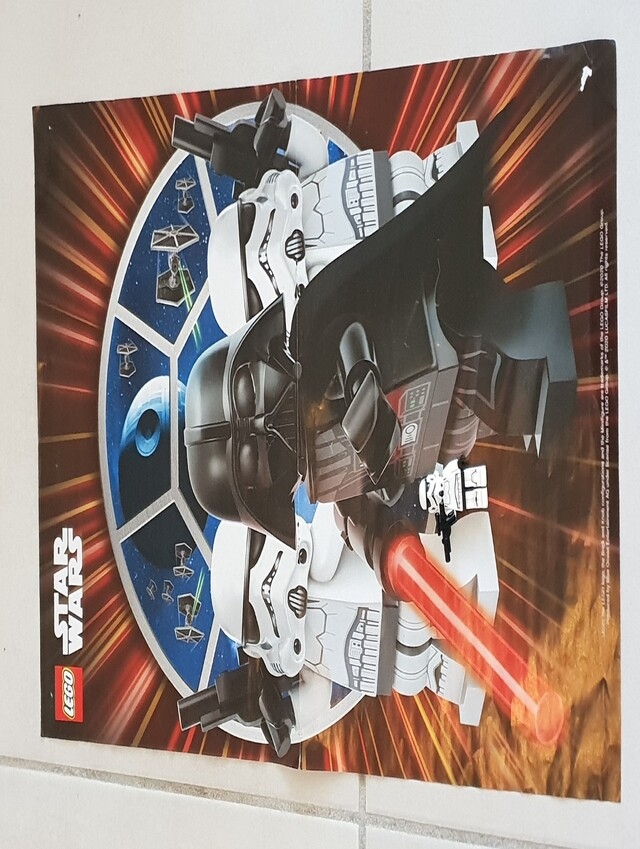](https://www.freelug.org/IMG/jpg/ml-01_grand_.jpg)

* * *

**E02 - Aurélien L. - L’attaque du Falcon**

[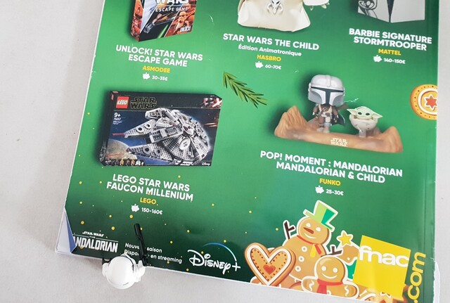](https://www.freelug.org/IMG/jpg/al-01_grand_.jpg)

* * *

**E03 - Issac C. - Stormtrooper dans la ciboulette**

[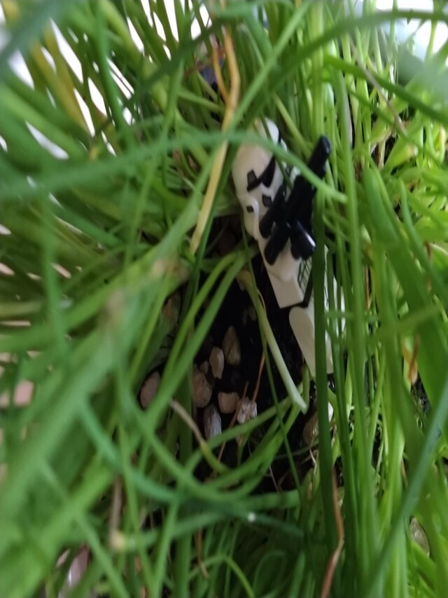](https://www.freelug.org/IMG/jpg/ic-01_grand_.jpg)

* * *

**E04 - Élie C. - Stormtrooper faisant du toboggan**

[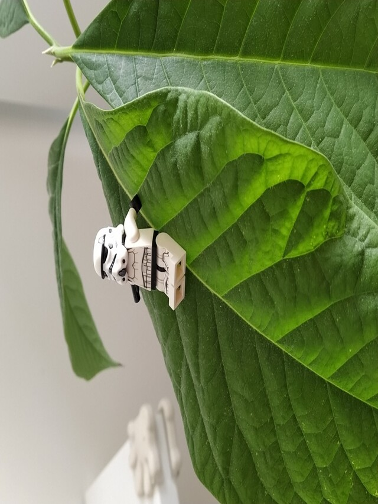](https://www.freelug.org/IMG/jpg/ec-01_grand_.jpg)

* * *

L’heureux gagnant de ce concours catégorie enfant est **Élie C. qui remporte un lot de 3 toupies Ninjago (Ref 70685 - 70686 - 70687)**.  
Vu que c’était une première participation pour tous les enfants , le GFC a décidé d’offrir un lot d’encouragement à chaque participants. Maxence L., Aurélien L, Issac C. remportent chacun 1 toupie Ninjago parmi les références citées précédemment.

Classement :  
1\. Élie C. (9 pts)  
2\. Maxence L. - Aurélien L. - Issac C. (1 pt)

* * *

Maintenant place aux adultes. Les 11 photos sont présentées dans l’ordre de réception.

**A-01 - Xavier D - Le Denrée passe du côté obscur de la force !**  
Paroles dans la bulle : « Dans la soupe aux Choux le Jet d’Ail tu balanceras ! »

[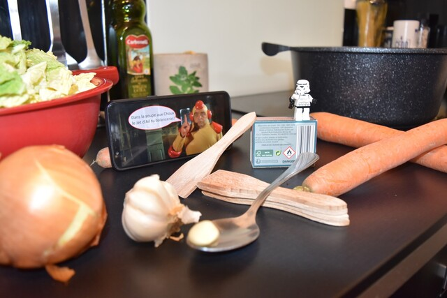](https://www.freelug.org/IMG/jpg/xd-01_grand_-2.jpg)

* * *

**A-02 - Stéphane B. - Trooper lost on Mars**

[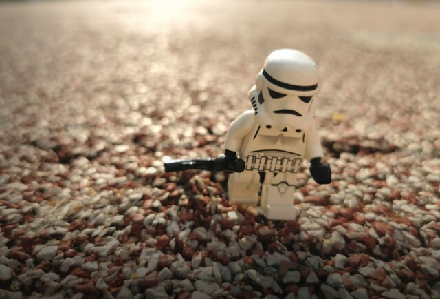](https://www.freelug.org/IMG/jpg/sb-01_grand_.jpg)

* * *

**A-03 - Rémi L. - Attaque du câlin baveux**

[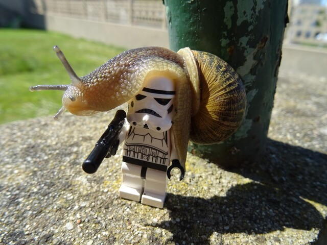](https://www.freelug.org/IMG/jpg/rl-01_grand_-4.jpg)

* * *

**A04 - Mathieu W. - Ils sont où ces droïdes ?**

[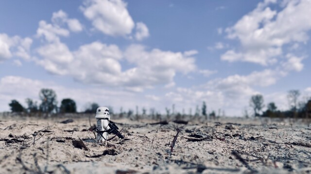](https://www.freelug.org/IMG/jpg/mw-01_grand_.jpg)

* * *

**A05 - Jérôme T. - I’m a poor lomesome stormtrooper....**

[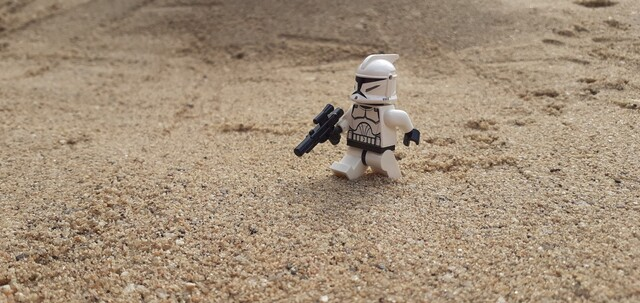](https://www.freelug.org/IMG/jpg/jt-01-3.jpg)

* * *

**A06 - Pierre C. - Un p’tit café pour viser juste !**

[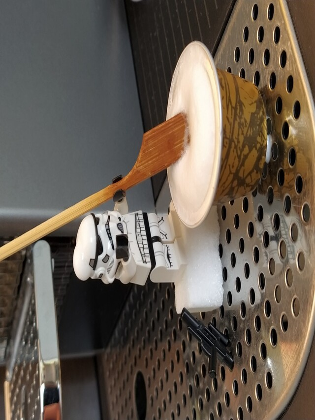](https://www.freelug.org/IMG/jpg/pc-01_grand_.jpg)

* * *

**A07 - Charles F. - Seul sur le sable...**

[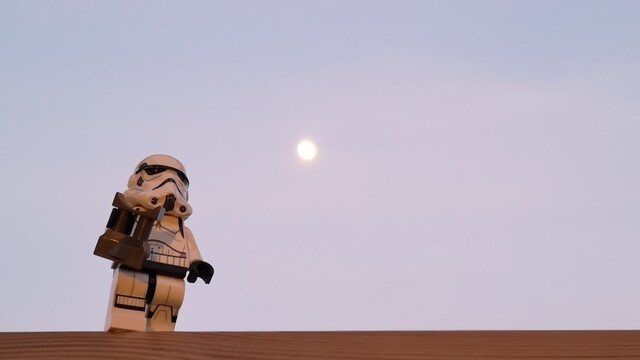](https://www.freelug.org/IMG/jpg/cf-01_grand_-4.jpg)

* * *

**A08 - Coralie G. - Lâche-le, ou je tire !**

[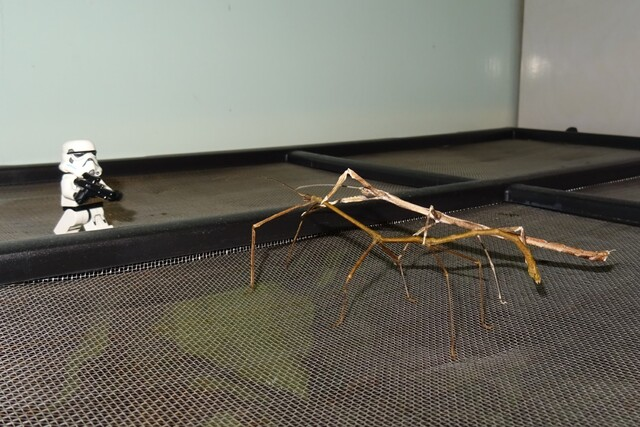](https://www.freelug.org/IMG/jpg/cg-01_grand_-2.jpg)

* * *

**A09 - Emilie G. - En embuscade**

[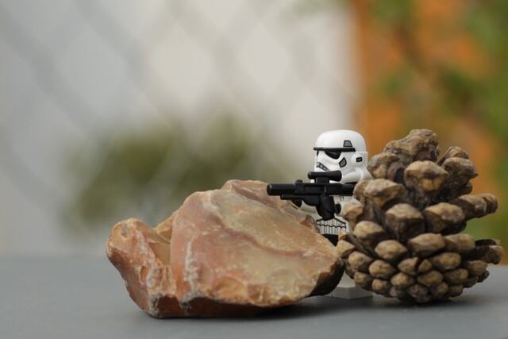](https://www.freelug.org/IMG/jpg/eg-01.jpg)

* * *

**A10 - Amine R. - Lost in the rock**

[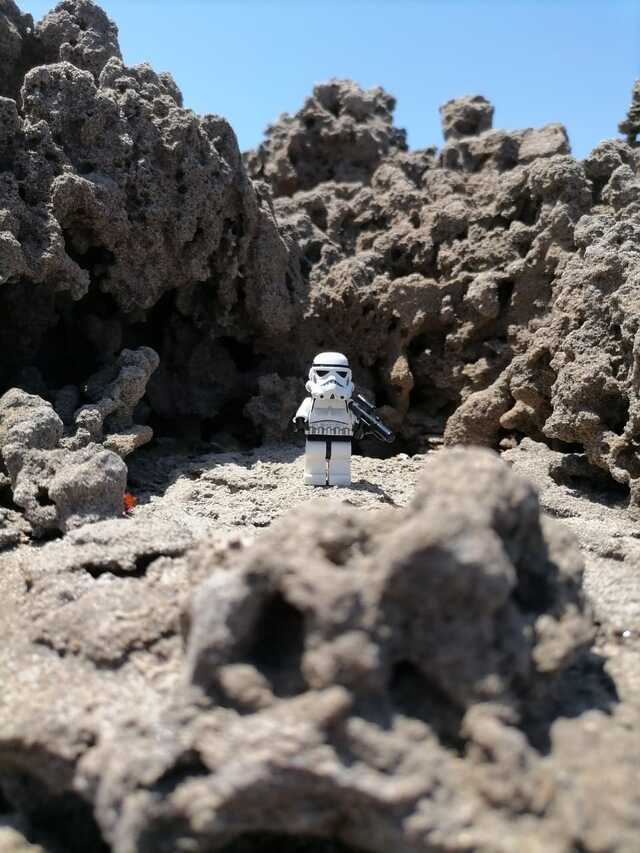](https://www.freelug.org/IMG/jpg/ar-01.jpg)

* * *

**A11 - Nicolas W. - Un stormtrooper de l’Avent dans un arbre de Noël**

[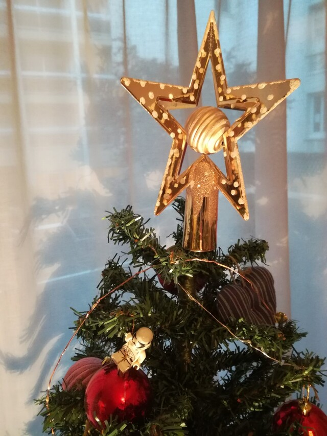](https://www.freelug.org/IMG/jpg/nw-01_grand_-2.jpg)

* * *

L’heureux gagnant de ce concours catégorie adulte est **A04 - Mathieu W. qui remporte le set SW Ref 75261 – Clone Scout Walker – 20th Anniversary Edition**.

Classement :  
1\. Mathieu W. (5 pts)  
2\. Charles F. - Rémi L. (3 pts)  
3\. Xavier D. (1 pt)  
4\. Stéphane B. - Jérôme T. - Pierre C. - Charles F. - Coralie G. - Emilie G. - Amine R. - Nicolas W. (0 pt)

Jury enfants et adultes :  
Exceptionnellement aucun membre du GFC n’a voté car on étaient tous participants donc le jury adhérents a été monté à 12 personnes et était composé de :

**–** Julien S.  
**–** Stéphane P.  
**–** Jérôme V.  
**–** Ève-Elise J.  
**–** Duy Hai D.  
**–** Sylvain J.  
**–** Sébastien M.  
**–** Stéphane M.  
**–** Cyriac F.  
**–** Laurent C.  
**–** Nadége B.  
**–** Nathan B.

* * *

Edit du 13/05/2021 :

Il est temps de faire le tirage au sort pour le concours May the fourth be with you (« Que le 4 mai soit avec vous »). Pour être le plus juste possible et le plus transparent, nous allons prendre les résultats de L’Euro million du vendredi 14 mai 2021 pour tirer les gagnants aux sorts.  
Chaque participant s’est vu attribuer 3 numéros de la grille d’EuroMillions :  
A01  : 1 ; 15 ; 29.  
A02  : 2 ; 16 ; 30.  
A03  : 3 ; 17 ; 31.  
A05  : 4 ; 18 ; 32.  
A06  : 5 ; 19 ; 33.  
A07  : 6 ; 20 ; 34.  
A08  : 7 ; 21 ; 35.  
A09  : 8 ; 22 ; 36.  
A10  : 9 ; 23 ; 37.  
A11 :10 ; 24 ; 38.  
E01 :11 ; 25 ; 39.  
E02 :12 ; 26 ; 40  
E03 :13 ; 27 ; 41.  
E04 :14 ; 28 ; 42.

A04 - Mathieu W. est exclu du tirage au sort car il a remporté le vote adulte et qu’on ne peut remporter qu’un lot par concours.  
Tous les enfants sont présent (E01 à E04) car le lot enfant du vote étant moins gros que le lot principal du tirage au sort, on laisse la même chance aux enfants et adultes de remporter une jolie boite. Au vu du nombre de participation nous désignerons 2 gagnants au tirage au sort.

RÈGLEMENT :  
Le premier numéro dans l’ordre d’apparition du tirage qui sera annoncé sera le gagnant. Si ce numéro est compris entre 43 et 50 alors nous prendrons le 2eme numéro annoncé et ainsi de suite. Si par malchance tous les numéros tirés sont compris entre le 43 et le 50 alors nous prendrons les résultats du tirage d’EuroMillions suivant.

* * *

Edit du 14/05/2021 :

[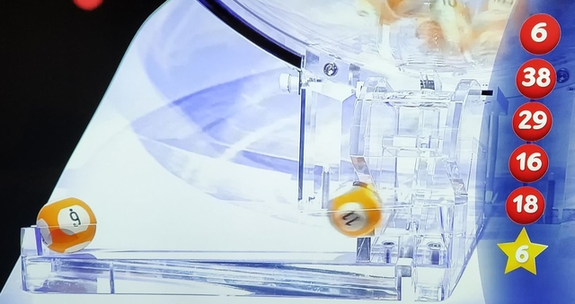](https://www.freelug.org/IMG/jpg/resultat_tirage.jpg)

C’est donc :  
**\- A07 - Charles F. qui remporte le set SW Ref 75258 – Anakin’s Podracer – 20th Anniversary Edition  
**–** A11 - Nicolas W. qui remporte le set Ref 60224 - City- Satellite Service Mission**

* * *

Merci à toutes et tous et à bientôt pour un nouveau concours !
