Ce nouvel article est une mise à jour de l’article de Didier Malon du 18 août 2003 intitulé « [Construction modulaire](/articles/142/) » qui, en 2003, dès la création de FreeLUG, posait les bases de la conception modulaire pour la réalisation de dioramas, notamment ferroviaires, en exposition.

## Préambule

Ces dernières années, dans l’univers du train, l’accent a été mis sur la reproduction de locomotives et de wagons pour enrichir la [base de données](/articles/535/) initiée par Didier Enjary en octobre 2006, sans forcément imaginer en parallèle et dans les détails, des décors pouvant accompagner ces reproductions.

Une Ligne à Grande Vitesse a été créée pour battre des records de vitesse sur rail pour des trains LEGO, avec la [**LVG 1**](/articles/1368/) puis la [**LGV 2**](/articles/1220/) pour laquelle, lors de ses sorties, un décor, la jouxtant, est imaginé pour l’accompagner lors des expositions, comme notamment le [Quartier des Affaires](/articles/1452/).

Au final, le décor est tout aussi important que le matériel qui roule sur un réseau. L’objectif de cet article, au-delà de fédérer les « traineux » de l’association, est de permettre à tout à chacun d’intégrer dans ses constructions et décors, s’il le souhaite, les éléments ferroviaires (voies) pour créer de l’animation ou pouvoir participer à des constructions ferroviaires collaboratives par l’assemblage de dioramas compatibles.

A l’instar du modélisme ferroviaire classique (Ho notamment), la standardisation pour la construction modulaire de réseaux de trains LEGO permet de pouvoir imaginer son(es) module(s) pour un usage individuel chez soi ou seul en exposition (avec un espace coulisse de part et d’autres ou derrière le diorama, en fonction des configurations) mais surtout l’assemblage de ces modules divers et variés, entre eux, lors d’exposition ; entre membres de l’association mais aussi entre LUGs.

Pour envisager la réactivation de la section trains de FreeLUG, le **FLTC**, le FreeLUG _Lego Train Club_ ou encore imaginer un éventuel **L-Gauge CTI**, un _Club de Trains InterLUG_, il s’agit donc ici d’exposer et d’expliquer ces « standards ».

Ce travail de standardisation a déjà été fait à l’international, notamment dans des LUGs spécialisés dans le train, comme le M>LTC (Melbourne _Lego Train Club_), LNUR (_LEGO Northern UK Railway_) ou Pennsylvania LEGO User Group qui a une section train.

Plusieurs sites internet ou groupes Facebook, en anglais, décrivent l’ensemble des éléments de standardisation qui seront repris, traduits et adaptés ci-après dans cet article.

[http://l-gauge.org/wiki/index.php/W...](http://l-gauge.org/wiki/index.php/Welcome_to_L-Gauge)

[https://brickmodelrailroader.com/in...](https://brickmodelrailroader.com/index.php/l-gauge-modular-standard/)

[https://brickmodelrailroader.com/in...](https://brickmodelrailroader.com/index.php/2019/04/05/introducing-the-l-gauge-modular-standard/)

[https://www.facebook.com/groups/199...](https://www.facebook.com/groups/1993664530929494/)

[https://bricknerd.com/home/ballasti...](https://bricknerd.com/home/ballasting-track-the-x-factor-for-your-train-layout-6-11-21)

## En premier lieu, qu’est-ce que le L-Gauge ?

L-Gauge est un terme non officiel utilisé pour décrire l’échelle utilisée par les modélistes ferroviaires mettant en scène des trains LEGO sur des voies d’un écartement de 37,5 mm ou de 40 mm d’écartement central à l’axe du rail (5 tenons).

[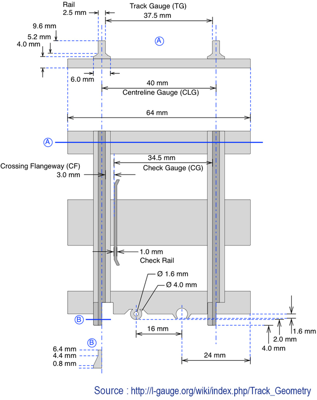](https://www.freelug.org/IMG/jpg/dimensions_rails.jpg)

La figure ci-dessous permet de comparer et de situer l’échelle **L-Gauge** vis à vis des autres échelles utilisées dans le modélisme ferroviaire.

[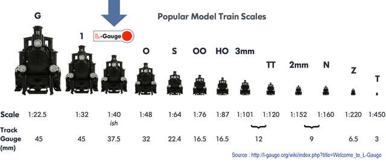](https://www.freelug.org/IMG/jpg/echelles.jpg)

Aujourd’hui, FreeLUG affiliée à la **FFMF** (Fédération Française de Modélisme Ferroviaire) est répertoriée au sein de la fédération avec l’échelle L-Gauge.

_NOTA : Un additionnel arrivera par la suite sur la question de la standardisation de la voie étroite LEGO pour compléter cet article et prolonger l’article publié par Paul Mauduit, le 26 avril 2020 « [De la voie étroite en LEGO](/articles/3038/) »_

**Aperçu des systèmes de rails de train LEGO® ou compatibles**

Un espacement de 16 tenons entre les axes de deux voies parallèles est très largement adopté et est fortement recommandé. Cet écartement est pratiqué depuis la sortie par LEGO du système 9V en 1991. En effet le système précédent 12V-4,5V proposait un écartement de 8 tenons (sans espace entre les 2 voies).

Ce pas de 16 tenons est également très courant parmi de nombreuses tailles de plaques de base LEGO, et par conséquent les éléments de rail peuvent souvent être montés sur des plaques de base avec les extrémités des connecteurs affleurant les bords.

[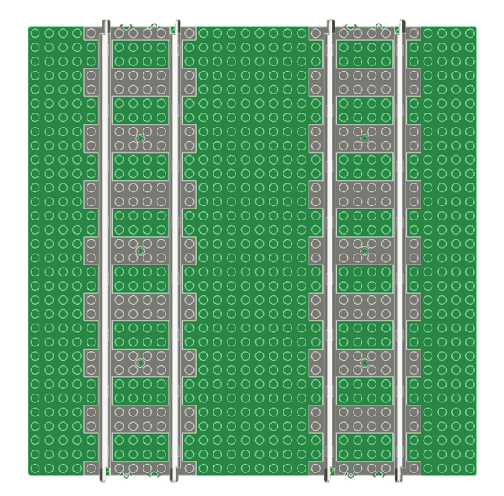](https://www.freelug.org/IMG/jpg/32x32.jpg)

On peut rappeler également le « _4-8-8-8-4_ », c’est-à-dire que sur une plaque de base de 32 tenons, à 4 tenons du bord, un premier rail de 8 tenons de large est disposé, puis 8 tenons de libres avant le second rail et enfin 4 tenons pour arriver aux 32 tenons.

Le rayon de courbure de LEGO original et unique est le "**R40**", ce qui se traduit par le fait que le rayon d’une boucle complète faite de rails courbes LEGO est de 40 tenons à l’axe du rail. Un cercle complet tient sur trois baseplates / plaques de base 32x32 au carré, en laissant 4 tenons de libre par rapports aux bords du module.

C’est un rayon de courbure petit, adapté pour les wagons et trains en 6 tenons de large, proposés par LEGO, mais qui peut devenir rapidement problématique lorsqu’il s’agit de faire circuler des MOCs de trains, plus larges ou plus longs que 32 tenons.

C’est pourquoi, au fil du temps, s’est développée une gamme de rails compatibles LEGO avec plusieurs rayons de courbures allant jusqu’au R184 et proposant différents croisements et aiguillages.

Malheureusement, pour la plupart, les rails proposés sont tout plastique et destinés aux alimentations par boitiers à piles et excluant donc le bon vieux "9V" avec prise de courant sur le rail métallique.

Les schémas ci-dessous montrent un aperçu du système de rails de train LEGO® 9V-RC-PFS (_en rouge sur les deux premiers schémas_) ou compatibles (ME Models®, Trixbrix®, FxTracks®, Bricktracks®).

[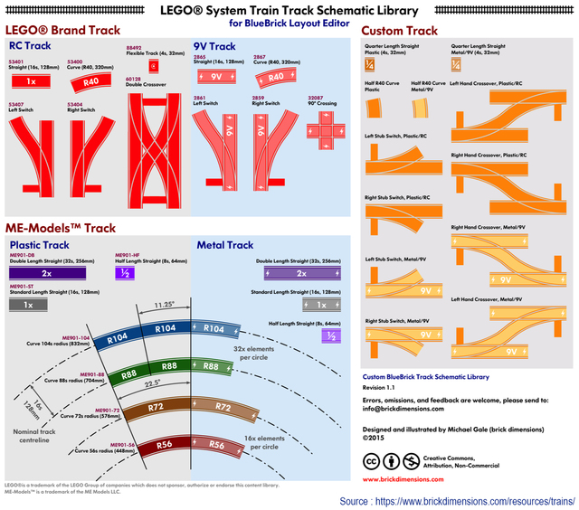](https://www.freelug.org/IMG/jpg/system_train_track.jpg)

[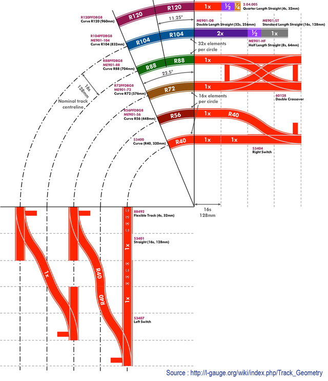](https://www.freelug.org/IMG/jpg/tracktemplates.jpg)

[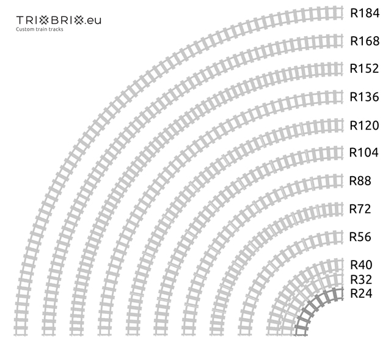](https://www.freelug.org/IMG/jpg/curve_trixbrix.jpg)

[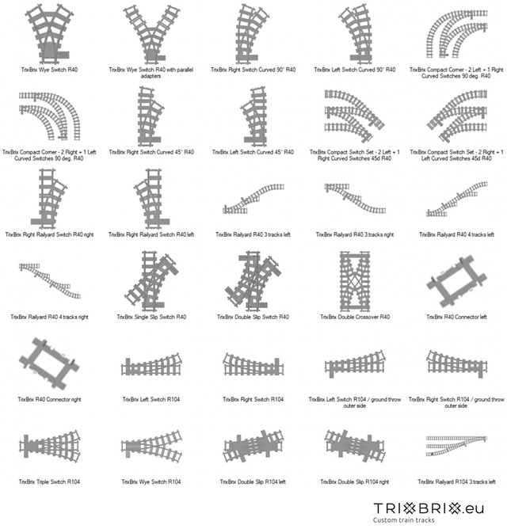](https://www.freelug.org/IMG/jpg/trixbrix_track.jpg)

Et [**FxBricks**](https://fxbricks.com/fxtrack/) qui commence à proposer des rails custom 9V, dont beaucoup de personnes, adeptes du 9V, attendent avec impatience ces nouveaux produits. A l’écriture de cet article, les rails droits de 32T de long et les courbes R72 sont déjà sortis, une "[review](/articles/3157/)" a été faite par Duy Hai DOAN et publiée, le 7 décembre 2021.

[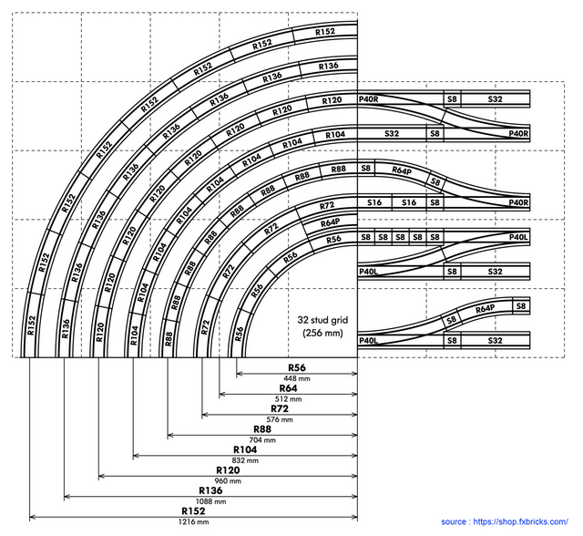](https://www.freelug.org/IMG/png/fxbricks.png)

Enfin, une technique existe pour réaliser une [courbe de **R238**](https://www.holgermatthes.de/bricks/en/smooth-curves.php) faite d’éléments droit de rail 9V LEGO®.

[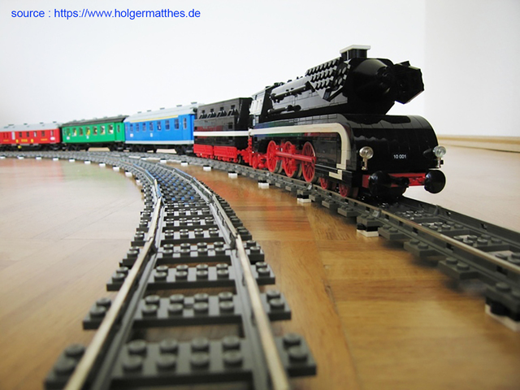](https://www.freelug.org/IMG/jpg/smooth-curve-example.jpg)

## En second lieu, qu’est-ce que le M.I.S.L. ?

**[M.I.L.S. : Modular Integrated Landscaping System](http://l-gauge.org/wiki/index.php?title=Modular_Standards)** ou Système d’aménagement paysager intégré et modulaire.

Cette norme a été développée par des membres de la communauté HispaLUG / HispaBrick pour la réalisation de dioramas collaboratifs. Parmi ses principales caractéristiques, le MILS est simple et flexible et peut être utilisé avec de nombreux thèmes LEGO différents en plus des trains.

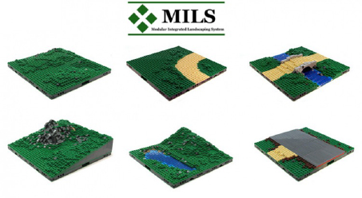

La norme MILS est basée sur une plaque de base 32x32 ; cependant, des modules de taille intermédiaire, de 16x32 ou 16x16 peuvent être utilisés tant que ses caractéristiques de terrain partagent un profil commun avec les modules adjacents.

Le niveau du sol est une brique et une plate au-dessus du niveau de référence de la plaque de base.

Les modules MILS s’interconnectent entre eux (comme pour les bâtiments Modular) avec des pins Technic dans des briques Technic 1x4 situées sur les 4 faces des modules. Une variante est proposée en utilisant des axe de 4 et en plaçant à l’arrière de la brique Technic 1x4 une brique Technic 1x2 avec le trou axe (Ref : 32064). Cette variante facilite grandement la connexion des modules entre eux.

En règle générale, l’espace d’angle 2x2 est utilisé comme fonction d’identification des modules. Cette identification peut être utilisée par un constructeur pour montrer la propriété ou elle peut être utilisée comme guide pour l’orientation entre les modules adjacents.

[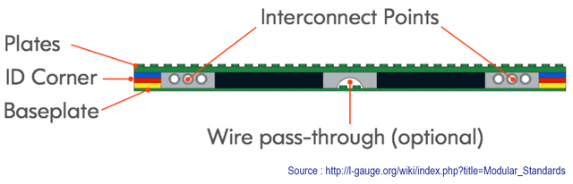](https://www.freelug.org/IMG/jpg/mils_structure.jpg)

Les modules MILS constituent une excellente base pour le montage des rails et la construction d’un réseau complet.

Les modules MILS forment une structure en caisson rigide qui fournit une surface stable et plane pour monter des sections de voie. Le « vide » généré par l’élévation d’une brique permet par exemple le passage de câbles pour l’alimentation des voies, l’éclairage ou encore l’automatisation des aiguillages.

Mais il faut néanmoins être conscient que les modules MILS sont consommateurs de briques et donc ont un coût.

[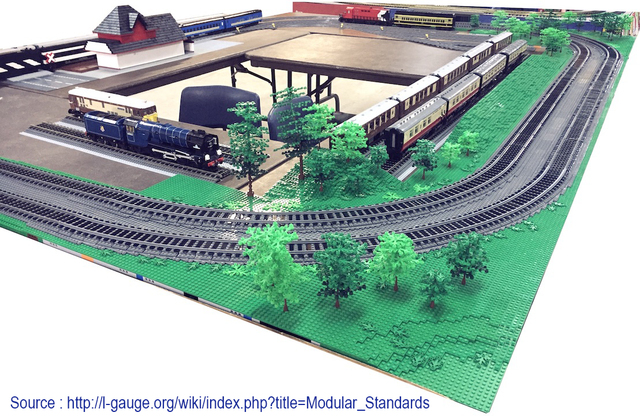](https://www.freelug.org/IMG/jpg/milswhitepinessmall.jpg)

[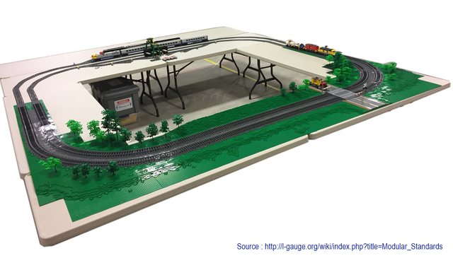](https://www.freelug.org/IMG/jpg/milslayoutexample2.jpg)

[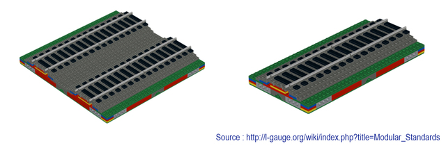](https://www.freelug.org/IMG/jpg/mils_rail.jpg)

Pour un réseau ferré qui doit passer du MILS à une section à la hauteur dite conventionnelle, c’est-à-dire une construction directement sur une plaque de base, un ensemble de 3 modules peut être construit et qui agit comme une transition à la fois fonctionnelle et esthétique entre un espace en MILS et un espace fait de plaques de base uniquement.

[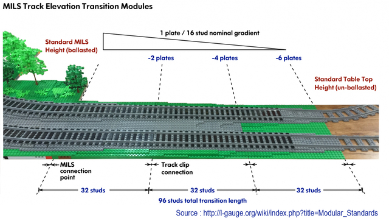](https://www.freelug.org/IMG/jpg/1400px-milstransitionmodules.jpg)

_Nota : cette transition est également envisageable et adaptée pour le passage d’une voie ballastée à une voie sans ballast._

Liens MILS : [MILS Standard](http://www.abellon.net/MILS/index.html#tip2) / [MILS Flickr gallery](https://www.flickr.com/groups/2014993@N20/pool/)

L’explication du L-Gauge et du MILS posée, rentrons dans le vif du sujet de la construction modulaire.

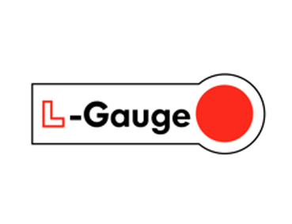

## La « Norme » pour la construction modulaire adaptée au ferroviaire

Voici une liste de recommandations pour la construction modulaire pour le « L-Gauge » afin qu’elle soit utilisée dans des présentations collaboratives.

[Cette norme écrite à l’origine en anglais](https://brickmodelrailroader.com/index.php/l-gauge-modular-standard/) permet également d’envisager des collaborations internationales.

Les modules doivent répondre aux exigences minimales énoncées dans cette norme ci-dessous. Pour cet article, traduisant et présentant la norme, des adaptations au contexte européen ont été introduites mais permettent toujours la compatibilité avec les modules américains ou australiens par exemple.

Cette norme permet d’envisager d’assembler des modules dans une configuration "classique", grand ovale ou tout en longueur avec une boucle de retournement de chaque côté ; mais elle peut également permettre une configuration tout autre, comme au [Bauspielbahntreffen 2021](https://www.youtube.com/watch?v=KClEzlMC7r8) - [BSBT 2021](https://www.flickr.com/photos/187797009@N06/albums/72157719689252944) en août 2021 à Schkeuditz, en Allemagne.

[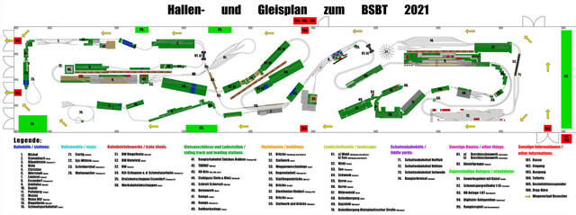](https://www.freelug.org/IMG/jpg/bsbt2021.jpg)

## 1.0. Introduction

1.1 L’objectif de la « Norme » est de fournir des règles simples pour la réalisation de dioramas réalistes. Le **LGMS** (L-Gauge Modular Standard) a été créé dans le seul but de coordonner des présentations de décors, en particulier dans un cadre de conventions ou d’expositions.

1.2 L’objectif est que plusieurs personnes puissent arriver à un salon avec différents modules et soient capables de mettre en place un ensemble cohérent. Modules rendus compatibles entre eux et permettant de mettre en valeur les différents décors proposés dans un ordonnancement réaliste. Et ce, dans des assemblages linéaires mais intégrant également des modules d’angles ou des boucles de retournement.

## **2.0. Définitions**

2.1 **La Voie** – la voie ferrée est un chemin de roulement pour trains constitué de deux files de rails dont l’écartement est maintenu constant par une fixation sur des traverses, reposant elles-mêmes sur du ballast.

2.2 **Le Ballast** – Fond de forme amortisseur sur lequel repose la voie

2.3 **La Baseplate** ou Plaque de Base LEGO - Plaque plastique mince (1/2 plate = 1,6 mm), semi-flexible, composée de tenons en surface et lisse en dessous. Les tailles sont généralement, mais pas exclusivement, dans des multiples de 16 tenons, 16x16, 16x32, 32x32, 48x48, etc.).

2.4 **Le MILS** – Modular Integrated Landscaping System. Plus d’informations sur [http://www.abellon.net/MILS/](http://www.abellon.net/MILS/)

2.5 **La ligne principale - double voie** – composée de deux voies, les éléments de voie sont écartés de 16 tenons (à l’axe) et disposés sur un module de 32 tenons de large de la façon suivante : 4-8-8-8-4. C’est-à-dire que sur une plaque de base de 32 tenons, à 4 tenons du bord, un premier rail de 8 tenons de large est disposé, puis 8 tenons de libres avant le second rail et enfin 4 tenons pour arriver aux 32 tenons

Toute mise en forme d’un module LGMS aura au moins une ligne principale à double voie, agissant comme élément fédérateur entre les différents décors.

2.6 **L’embranchement** - Un itinéraire de voie qui s’éloigne de la ligne principale. Les lignes secondaires peuvent avoir un terminus ou se reconnecter à la ligne principale à un autre endroit. (Coordination nécessaire)

2.7 **L’Aiguillage** : Une installation sur une voie qui sert à guider un train d’une voie à une autre.

2.8 **Le Croisement** – associé à des aiguillages, il permet de connecter deux voies parallèles en croisant une ou plusieurs voies intermédiaires séparatrices

2.9 **Le Plateau de présentation** – Le plan de travail présentant les modules LGMS, peut être personnalisé ou fait de tables pliables.

2.10 **La Face avant du module** - Le côté d’un module qui sera vu par le public.

2.11 **La Face arrière du module** - Le côté opposé où les opérateurs doivent exécuter le contrôle du module ou la mise en circulation du matériel roulant

_NB : Dans certaines configurations de dioramas les 2 faces sont vues par le public._

## 3.0. Dimensions du module LGMS (L-Gauge Modular Standard)

3.1 **Les dimensions d’un module de base** – la profondeur (largeur) d’un module de base est de trois plaques de base LEGO® 32x32. La longueur d’un module de base est également de trois plaques de base LEGO® 32x32.

La taille minimale d’un module est donc de trois plaques de base LEGO® au carré, soit 96 tenons x 96 tenons , soit 76,8cm x 76,8 cm, soit 30 "x 30" (pouces)

3.2 **La longueur d’un module de présentation** - peut être augmentée par ajouts de module de base de trois plaques de base LEGO® 32x32 au carré.

## 4.0. Hauteur Rail / Sol

4.1 **La hauteur du rail** (mesurée du sol au haut du rail) doit être constante et de 32-3/16” (pouces), mesure anglo-saxonne, soit environ 81,76 cm, aux bords d’un module de présentation pour permettre les raccordements.

_32” = 81,28 cm et 3/16” = 0,48 cm soit un total de 81,76 cm_

4.2 L’utilisation du système **MILS** est préférée.

Pour permettre néanmoins les raccordements et le maintien de la hauteur du rail, pour l’utilisation du système dit conventionnel (construction directement sur plaque de base), une compensation de l’équivalent d’une brique et une plate devra être réalisée pour les plateaux de présentation supportant un système dit conventionnel, soit 9,6 mm +3,2 mm = 12,8 mm.

4.3 Les tables de hauteur inférieure (exemple : tables pour un module fluvial ou d’une vallée) sont autorisées tant que la hauteur du rail (de 81,76 cm) est maintenue aux bords d’un module.

4.4 Des tables pliantes peuvent être utilisées tant que la hauteur du rail (de 81,76 cm) est maintenue. _(Prévoir un jeu de cales en exposition)_

## 5.0. La ligne principale – double voie

5.1 Tout module mis en place dans un diorama collaboratif doit inclure au moins une ligne principale à double voie. Car il s’agit de l’élément fédérateur.

5.2 La ligne principale à double voie doit entrer d’un côté du module LGMS et sortir du côté opposé du module.

5.3 Chaque ligne principale doit commencer avec 20 tenons entre le bord de la première voie et le bord extérieur du module (**Face avant du module de base**).

C’est-à-dire qu’un élément de 16 tenons de décor est mis au premier plan, permettant ainsi d’avoir un recul des voies par rapport au public (petites mains de spectateurs), mais également d’avoir par exemple un bout de route de l’autre côté d’un passage à niveau pour plus de réalisme.

[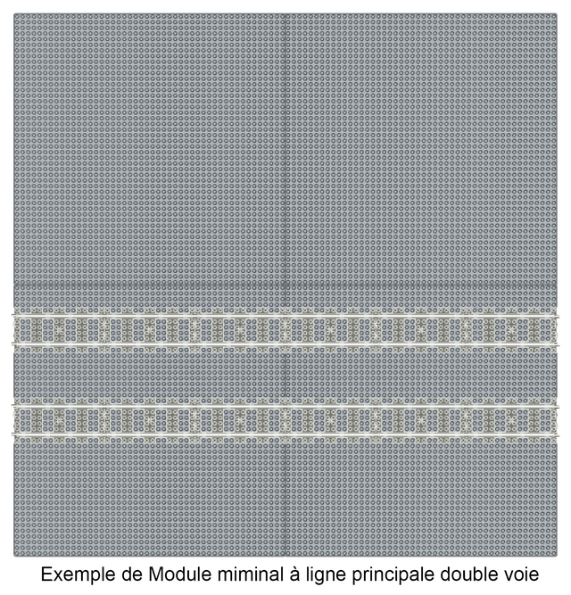](https://www.freelug.org/IMG/jpg/module_double_voie.jpg)

5.4 Les rails placés pour réaliser la double voie ne doivent à aucun moment avoir moins de huit (8) tenons de séparation

5.5 Il est conseillé de ne pas mettre de pente sur la ligne principale pour assurer une bonne mobilité du matériel roulant

5.6 Les rails 4,5 V et 12 V ne doivent pas être utilisés pour la ligne principale

5.7 A l’international, c’est le "tout plastique" qui a pris le dessus, reléguant ainsi le 9V. Au-delà du fait que LEGO ait arrêté les rails 9V, le tout plastique permet également de s’affranchir des problèmes de court-circuit que l’on peut retrouver dans des boucles de retournement ou des aiguillages.

5.7._bis_ Pour ce présent règlement, après sondage auprès de "traineux" français et belges, le 9V reste le système privilégié sur la ligne principale. L’arrivée de nouveaux rails 9V proposés par [**FxBricks**](https://fxbricks.com/fxtrack/) permettra de faire face à la pénurie de rails 9V pour ceux souhaitant se lancer.

5.8 Un rayon minimum de R104 est conseillé pour tout aiguillage ou croisement de la ligne principale. Mais en attendant la sortie de ce matériel en 9V par FxBricks (aiguillages P40), une tolérance est accepté avec les aiguillages 9V LEGO.

## 6.0. Modules d’angle

6.1 Des modules d’angle peuvent être utilisés en complément des modules linéaires, permettant la création de boucles de retournement ou de grands ovoïdes en exposition.

6.2 Les modules d’angles doivent répondre aux exigences énumérées dans les sections 3.0 et 4.0

6.3 Les rayons conseillés pour les voies courbes de la ligne principale sur un module d’angle sont : R104 sur la voie intérieure et R120 pour la voie extérieure (traduction de règlement en anglais utilisant les rails tout plastique). Aujourd’hui existe en 9V la courbe R72 et bientôt la R88.

6.3._bis_ C’est pourquoi l’usage de la [grande courbe réalisée en rails droits](https://www.holgermatthes.de/bricks/en/smooth-curves.php) de R238 est de fait également possible

Il s’agira de privilégier les grandes courbes en lieu et place de la courbe R40 de LEGO trop serrée.

## 7.0. Modules supportant une boucle de retournement

7.1 Des modules de retournement peuvent être utilisés en complément des modules linéaires ou des modules d’angle, permettant ainsi la création de boucles de retournement complètes en exposition pour un diorama tout en longueur.

7.2 Les modules supportant une boucle de retournement doivent répondre aux exigences énumérées dans les sections 3.0 et 4.0

7.3 Ces modules supportant une boucle de retournement complète peuvent être "en coulisse" et non décorés car non visibles par le spectateur ou visibles et faisant partie intégrante du diorama.

## 8.0. Modules supportant une voie d’embranchement

8.1 Les voies d’embranchement sont autorisées. Elles doivent se connecter à la ligne principale du constructeur du module sauf en coordination avec un autre participant. Ces modules permettent l’accès à une voie secondaire.

8.2 Les modules d’embranchement doivent répondre aux exigences énumérées dans les sections 3.0 et 4.0, mais n’ont pas nécessairement besoin d’une ligne principale.

8.3 En dehors de la ligne principale fédératrice entre modules, les autres types de rails sont autorisés sur les voies d’embranchement, que ce soient 12V ou PFS (avec le matériel roulant adapté).

8.4 Il n’y a pas de rayon minimum établi pour les modules supportant une voie d’embranchement.

8.5 La pente maximale pour les modules supportant une voie d’embranchement doit être d’une plate de hauteur pour 16 tenons de longueur.

## 9.0. Modules supplémentaires

9.1 Des modules supplémentaires peuvent être ajoutés à côté des modules de la ligne principale. Les voies parallèles à la ligne principale, les voies d’évitement pour les industries, les bâtiments, etc. entrent dans cette catégorie.

9.2 Les modules supplémentaires doivent répondre aux exigences répertoriées dans les sections 3.0 et 4.0, mais n’ont pas besoin d’une ligne principale.

9.3 En dehors de la ligne principale fédératrice entre modules, les autres types de rails sont autorisés, que ce soient 12V ou PFS (avec le matériel roulant adapté).

9.4 Les modules supplémentaires doivent se connecter aux modules de la ligne principale du constructeur, sauf en coordination avec un autre participant.

## 10.0. Les aiguillages

10.1 Les aiguillages peuvent être lancés à la main ou contrôlés à distance.

10.2 Tous les aiguillages motorisés doivent être autonomes dans leur module.

10.3 Tout mécanisme motorisant un aiguillage doit être encastré de manière à ne pas faire obstacle à une locomotive ou un wagon. D’où la préférence à l’utilisation du système MILS.

## 11.0. Décor et Paysage

11.1 Toutes les voies doivent être ballastées

[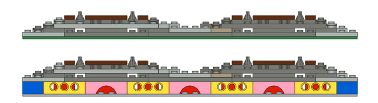](https://www.freelug.org/IMG/jpg/ballast_rail.jpg)

Un ballast type « PennLUG », soient 2 plates, puis le rail et des tiles (1x1 et 1x4) qui représentent les traverses

11.2 Le décor doit couvrir la totalité du module.

11.3 Les bords de tous modules nominatifs doivent être plats pour éviter tout « relief » indésirable sauf :

11.3.1 En coordination avec un autre participant.

11.3.2. Pour la mise en place d’un tunnel permettant la transition vers un autre module ayant également mis en place un tunnel de transition ou permettant la sortie vers les coulisses.

11.4 Le décor doit, au moins sur quatre tenons de part et d’autre de la traverse des rails, être maintenu en dessous de la hauteur du rail, pour éviter tout obstacle à la circulation des trains.

11.5 Les tunnels et les passages supérieurs (ponts, passerelles) doivent être au moins à 17 briques au-dessus des rails.

11.6 Pour un complément d’informations sur les gabarits, l’article « [Gabarit pour les trains](/articles/2869/) » publié le 27 avril 2018 peut être consulté.

## 12.0. Pratique recommandée

12.1 Les aiguillages et les croisements sur la ligne principale devraient permettre aux grosses locomotives d’entrer et de sortir de la ligne principale.

12.2 La hauteur du rail par rapport au sol est de 32-3 / 16 ", mesure anglo-saxonne, soit environ 81,76 cm.

La méthode recommandée pour atteindre cette hauteur consiste à utiliser :

**–** Un module MILS standard dédié aux trains (une plaque de base, une brique, une plaque) avec un rail ballasté type « PennLUG » (soient 2 plaques, puis le rail et des tiles (1x1 et 1x4) pour représenter les traverses)

[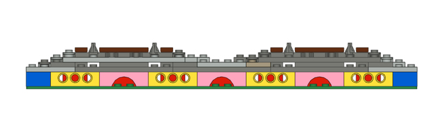](https://www.freelug.org/IMG/jpg/ballast_rail_2.jpg)

**–** Le tout posé sur une table haute de 31 ” soit 78,74 cm.

## 13.0. Sens de circulation

13.1 En Europe, les trains peuvent circuler à gauche mais également à droite sur les doubles voies. En Belgique, en France (à l’exception de l’Alsace-Moselle), en Italie, en Suède et en Suisse les trains circulent sur la voie de gauche, en conséquence sur les modules **LGMS** (L-Gauge Modular Standard), du point de vue du spectateur, sur la ligne principale, les trains devront circuler de gauche à droite sur la voie plus éloignée du spectateur et de droite à gauche sur la voie la plus proche des spectateurs.

13.2. En Allemagne, aux Pays-Bas, en Pologne, en Espagne, au Canada ou aux États-Unis, les trains roulent à droite.

S’il s’avère que des dioramas communs sont organisés avec ces pays, une coordination préalable sera faite (_Cf section 14.0_).

## 14.0. Collaboration

14.1 Les réseaux doivent être conçus et construits par les participants avant l’arrivée au lieu de représentation. Tout comme la base de données des trains construits, un listing sera tenu pour centraliser l’ensemble des modules qui seront imaginés et créés avec leurs caractéristiques et le nom de son créateur (_Objet d’un futur article_).

14.2 Les projets collaboratifs sont ouverts aux participants qui peuvent apporter leurs propres modules conformes au LGMS, ou simplement du matériel roulant pouvant circuler sur les réseaux qui seront assemblés.

14.2 _bis_ Les projets collaboratifs sont également ouverts aux participants qui peuvent apporter un module uniquement décor, qui viendra en coordination, enrichir un réseau de trains.

Exemple : Un village de Noël où passerait devant une ligne principale à double voie.

14.3 L’agencement des différents réseaux doit être coordonné. Le coordinateur désigné aura en charge la mise en place de l’agencement des modules pour la durée de l’exposition ou de l’événement, y compris l’installation et le démontage.

14.3 Le coordinateur est chargé également de l’organisation de tous les modules d’embranchement et modules supplémentaires de manière ordonnée.

## 15.0. Divers

15.1 Il n’y a pas d’échelle précise définie pour les trains utilisés sur les modules. Cela signifie que peuvent être acceptés à circuler sur un réseau LGMS des trains officiels LEGO de 6 tenons de large jusqu’aux trains de 8 tenons de large voire 9 tenons que l’on retrouve pour certaines locomotives vapeur aux 1/38ème par exemple.

15.2 La ligne principale des modules doit être faite de rails 9V, permettant ainsi de faire rouler les trains motorisés 9V mais également les trains alimentés par batterie.

15.3 Le mix entre L-Gauge et réseau à voie étroite peut être imaginé sur certains modules, le L-Gauge restant le réseau principal.

15.4 Le mix entre 9V et 12V peut être imaginé sur certains modules, le 9V restant le réseau principal.

15.4 Le plexiglas n’est pas une exigence mais peut être utilisé. S’il est utilisé, il ne doit pas dépasser 3 ” mesure anglo-saxonne, soit environ 7,2 cm au-dessus de la hauteur de la table. Il doit être fixé à la façade du module.

## 16.0. Exemples

En exemple, voici quelques sources d’inspiration, parmi tant d’autres...

La page [Flickr de Mickaël Gale](https://www.flickr.com/photos/michaelgale/)

La page [Flickr d’Alexender du MTLC](https://www.flickr.com/photos/narrow-gauge/)

Source : Melbourne LEGO Train Club, Australia

[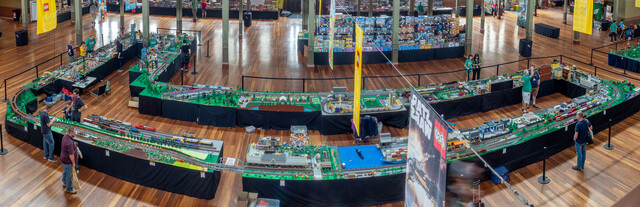](https://www.freelug.org/IMG/jpg/49421696662_086a7d9234_k.jpg)

Source : Mike Pianta

[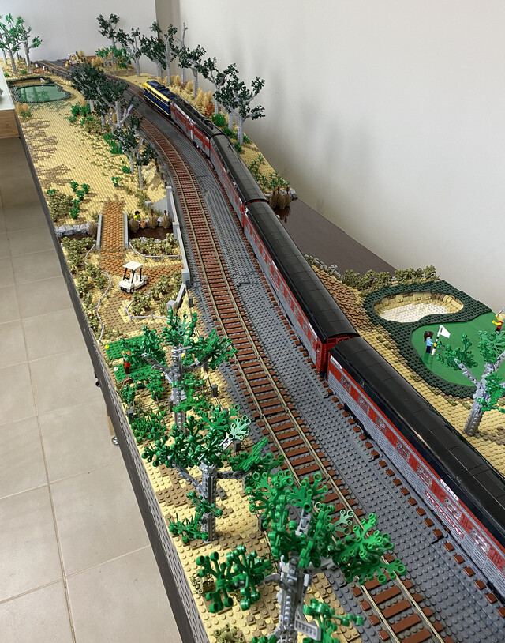](https://www.freelug.org/IMG/jpg/50577318453_ae42c8f6cf_k.jpg)

Source : Thomas Reincke

[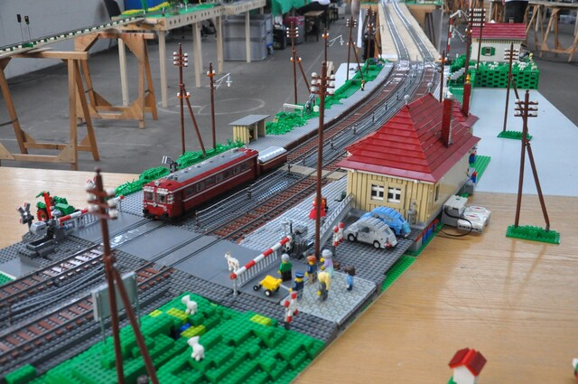](https://www.freelug.org/IMG/jpg/50286762676_fa5e0c02cd_k.jpg)

Source : Michael Gale

[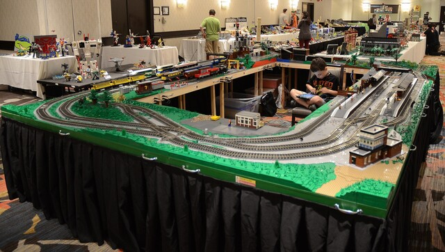](https://www.freelug.org/IMG/jpg/14711327464_b053823513_k.jpg)

Source : Mateusz Waldowski

[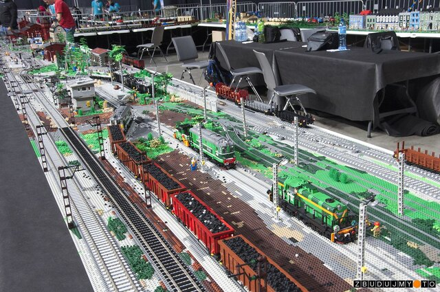](https://www.freelug.org/IMG/jpg/50965399873_991287b7d6_h.jpg)

Source : Alexender

[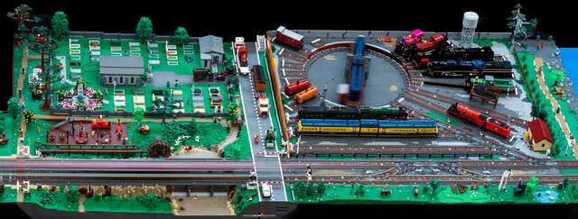](https://www.freelug.org/IMG/jpg/32949274348_d4c1245657_k.jpg)
