Partons en kayak pour aller dans un petit chalet de montagne !

[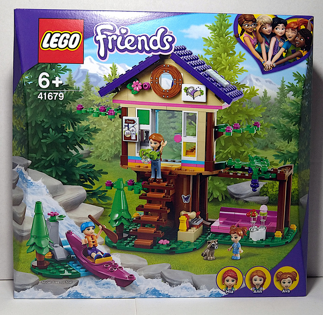](https://www.freelug.org/IMG/jpg/dsc_2997.jpg)

Le set comprend 326 pièces avec trois personnages, et un raton laveur !  
Pour un prix de 29,99 € soit un rapport prix/pièces de 0,09 euros, c’est correct pour un set récent.

Une petite vue arrière donne une idée de la jouabilité du set :

[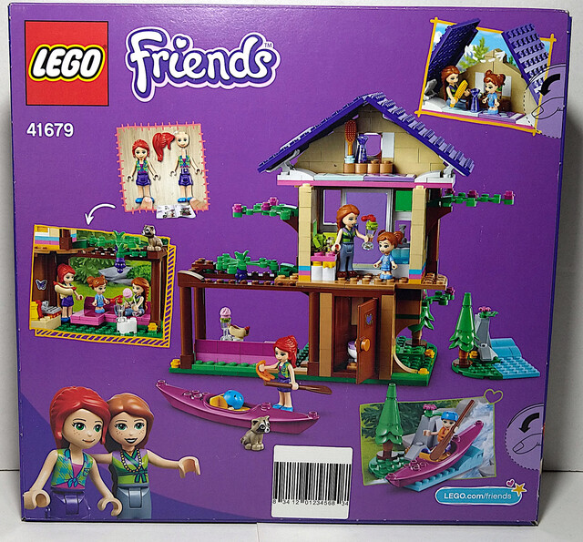](https://www.freelug.org/IMG/jpg/dsc_2998.jpg)

Venons au principal, le contenu de la boite :

[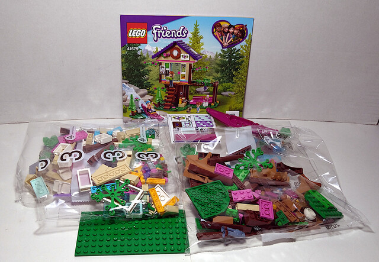](https://www.freelug.org/IMG/jpg/dsc_2999.jpg)

Et voilà une feuille de sticker !

[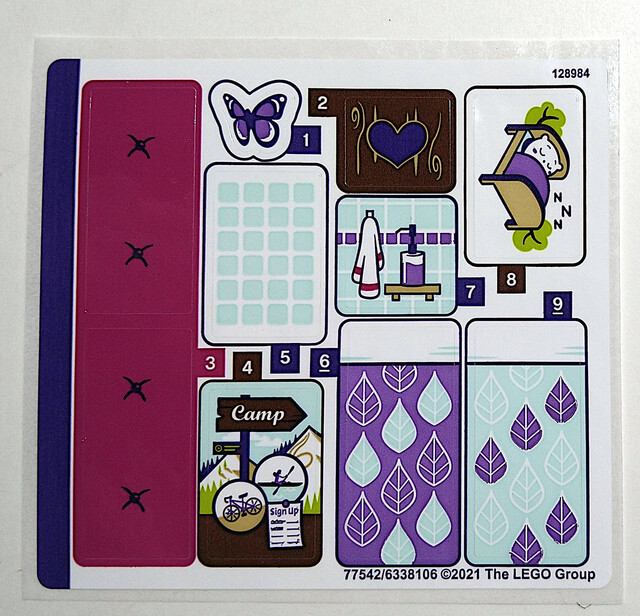](https://www.freelug.org/IMG/jpg/dsc_3000.jpg)

Trois personnages, dont un enfant.

[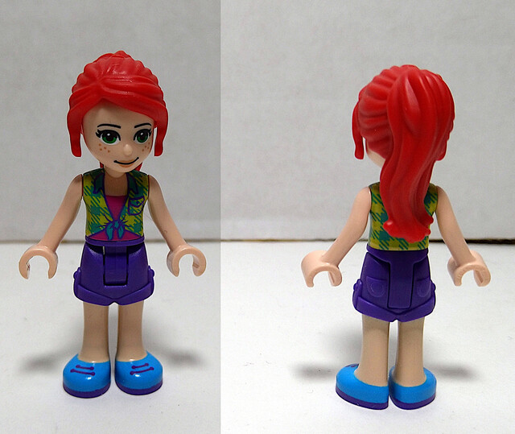](https://www.freelug.org/IMG/jpg/dsc_3006.jpg)

[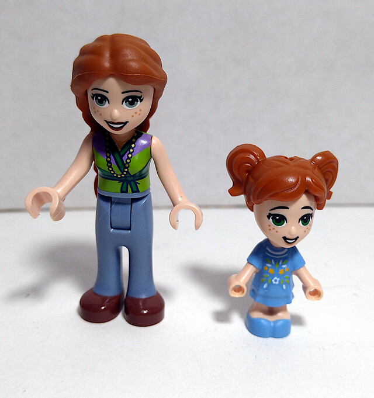](https://www.freelug.org/IMG/jpg/dsc_3011.jpg)

Et un raton laveur !

[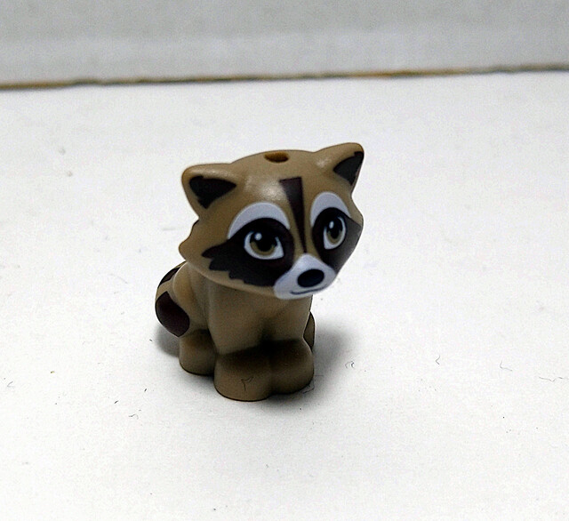](https://www.freelug.org/IMG/jpg/dsc_3005.jpg)

Passons au sachet 1 : un kayak et sa petite rivière

[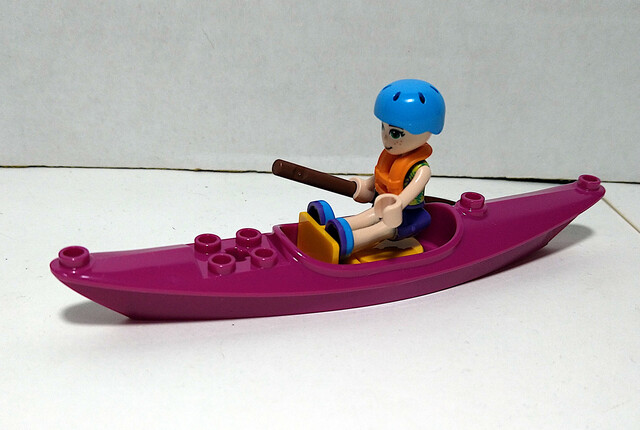](https://www.freelug.org/IMG/jpg/dsc_3008.jpg)

[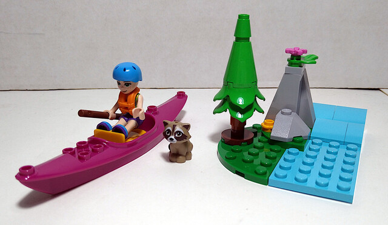](https://www.freelug.org/IMG/jpg/dsc_3009.jpg)

Sachet 2 :  
On commence par les toilettes :

[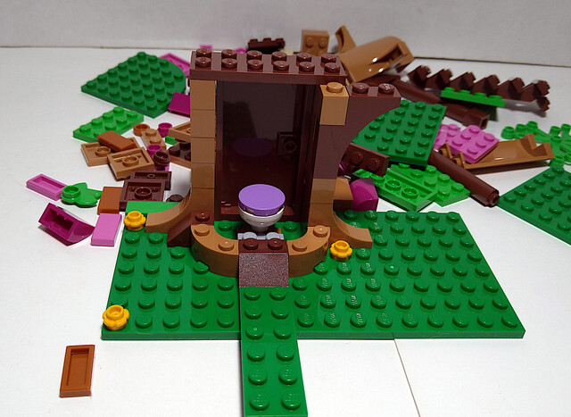](https://www.freelug.org/IMG/jpg/dsc_3012.jpg)

Puis on continue le chalet :

[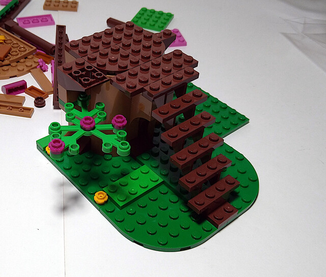](https://www.freelug.org/IMG/jpg/dsc_3013.jpg)

[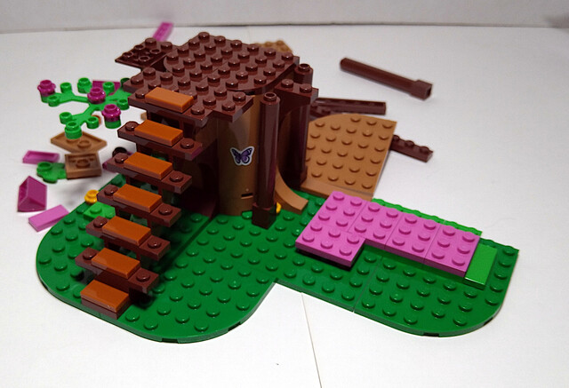](https://www.freelug.org/IMG/jpg/dsc_3014.jpg)

[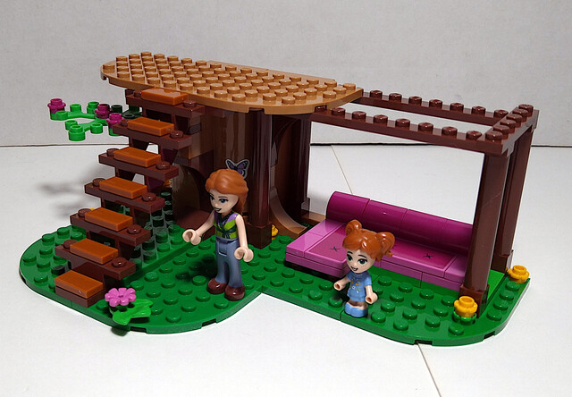](https://www.freelug.org/IMG/jpg/dsc_3015.jpg)

Sachet 3 :

[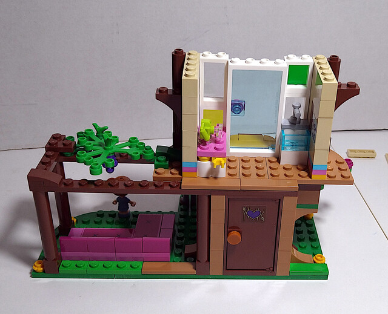](https://www.freelug.org/IMG/jpg/dsc_3022.jpg)

[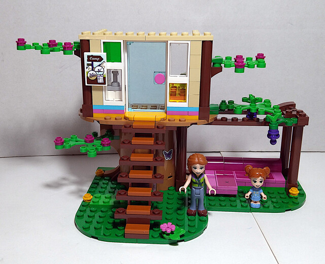](https://www.freelug.org/IMG/jpg/dsc_3023.jpg)

[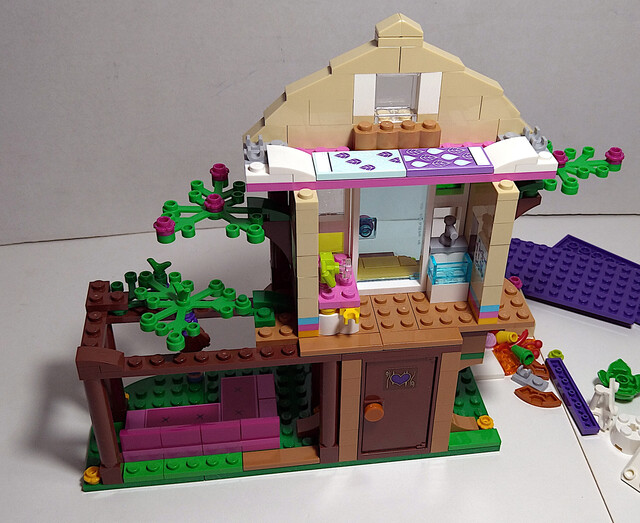](https://www.freelug.org/IMG/jpg/dsc_3025.jpg)

Sachet 4 :

[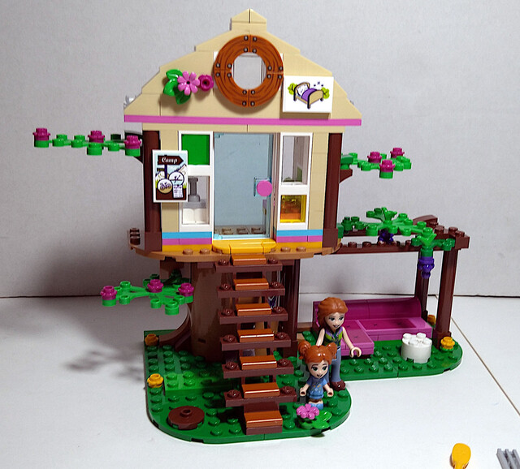](https://www.freelug.org/IMG/jpg/dsc_3027.jpg)

[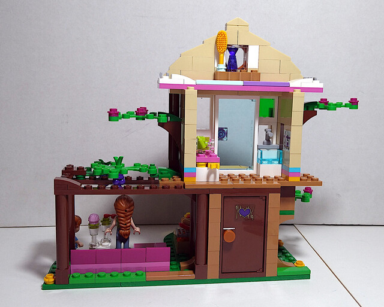](https://www.freelug.org/IMG/jpg/dsc_3028.jpg)

Et voilà déjà fini :

[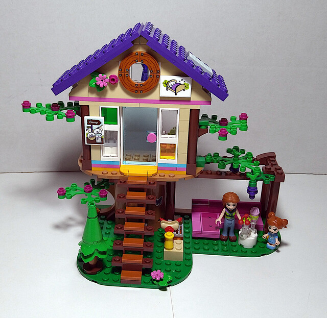](https://www.freelug.org/IMG/jpg/dsc_3029.jpg)

Voilà fini, une petite photo de famille !

[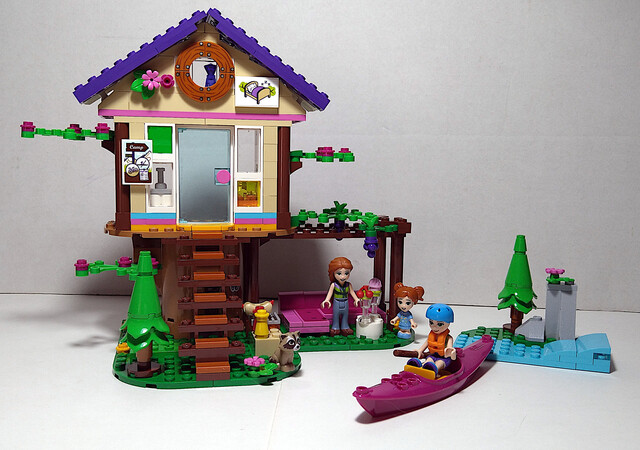](https://www.freelug.org/IMG/jpg/dsc_3030.jpg)

Et pour terminer les extra parts :

[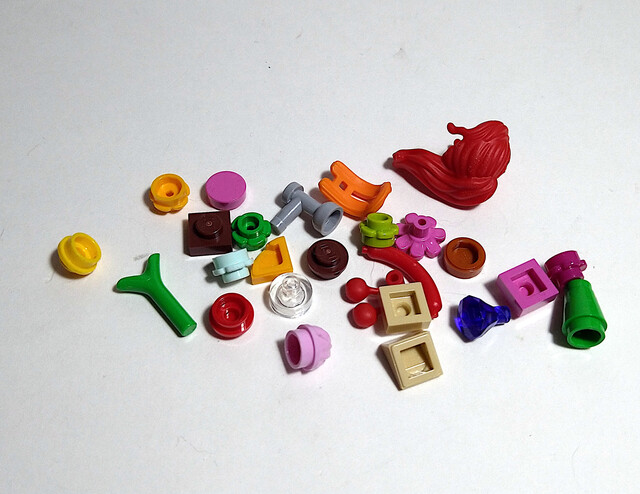](https://www.freelug.org/IMG/jpg/dsc_3031.jpg)

**Conclusion**  
Que dire : Un set que j’aime bien. Bon c’est du Friends, coloré etc., mais entre le petit raton-laveur, les trois personnages dont un enfant et un chalet très jouable, pour moi, le boulot est fait.

Donc, moi j’achète ! (Remarque c’est déjà fait ^^)
