Partons à la découverte de cette boite qui nous invite à partir faire du buggy !

[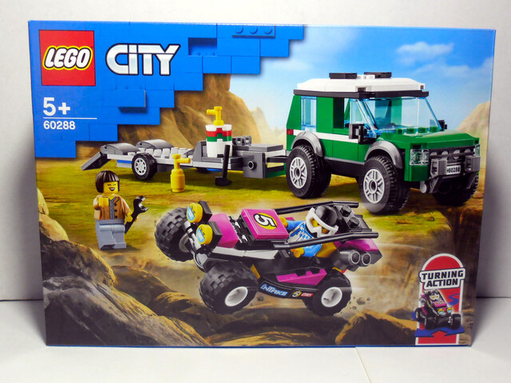](https://www.freelug.org/IMG/jpg/sam_3543.jpg)

Le set comprend 210 pièces avec deux personnages, et deux véhicules. Pour un prix de 19,99 € soit un rapport prix/pièces de 0,095 euros, c’est très correct pour un set avec deux véhicules et deux minifigs.

Une petite vue arrière donne une idée de la jouabilité du set :

[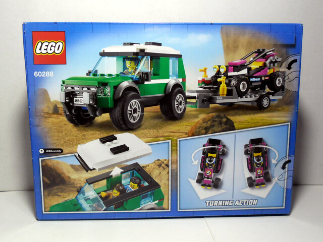](https://www.freelug.org/IMG/jpg/sam_3544.jpg)

Un gros plan sur la fonctionnalité du set : des roues orientables !

[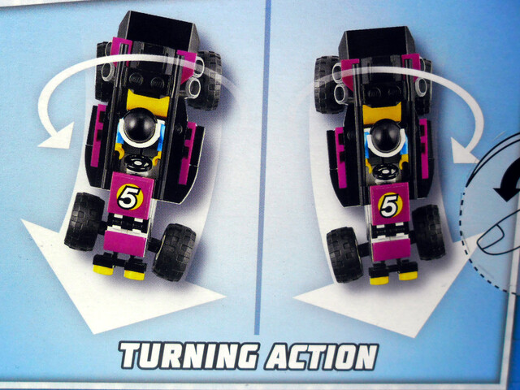](https://www.freelug.org/IMG/jpg/sam_3545.jpg)

Ainsi que les pièces qui le permettent :

[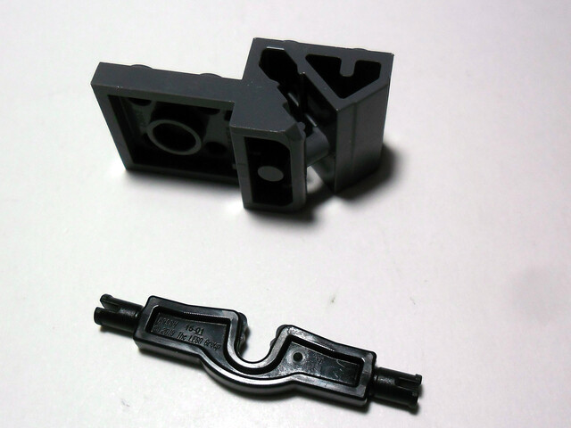](https://www.freelug.org/IMG/jpg/sam_3553.jpg)

Venons au principal : le contenu de la boite :

[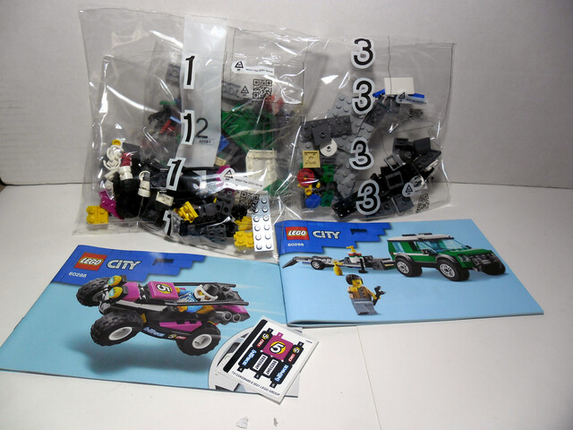](https://www.freelug.org/IMG/jpg/sam_3546.jpg)

Et voilà une feuille de stickers !

[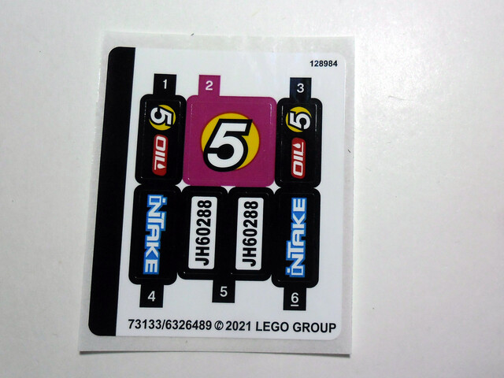](https://www.freelug.org/IMG/jpg/sam_3547.jpg)

Deux personnages, mixte

[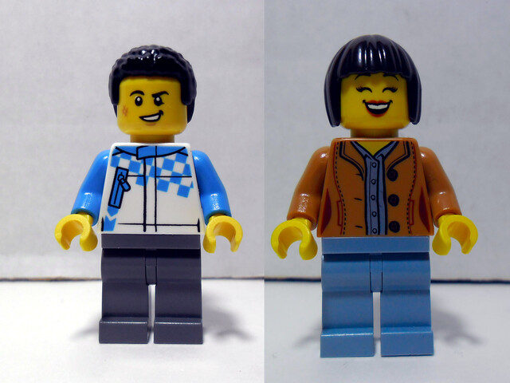](https://www.freelug.org/IMG/jpg/sam_3550.jpg)

[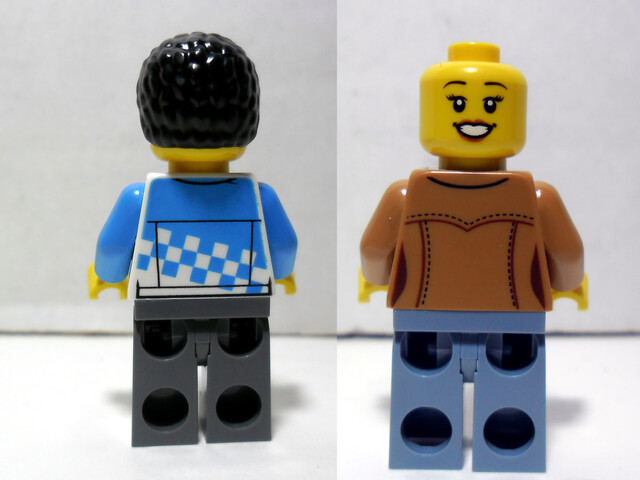](https://www.freelug.org/IMG/jpg/sam_3551.jpg)

Commençons par le buggy :

[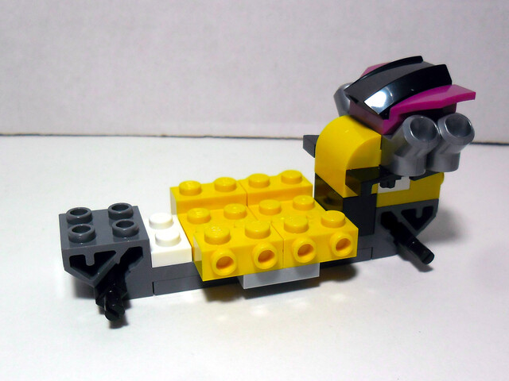](https://www.freelug.org/IMG/jpg/sam_3555.jpg)

[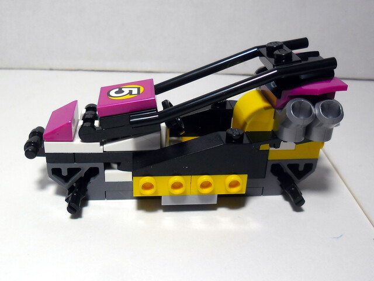](https://www.freelug.org/IMG/jpg/sam_3557.jpg)

[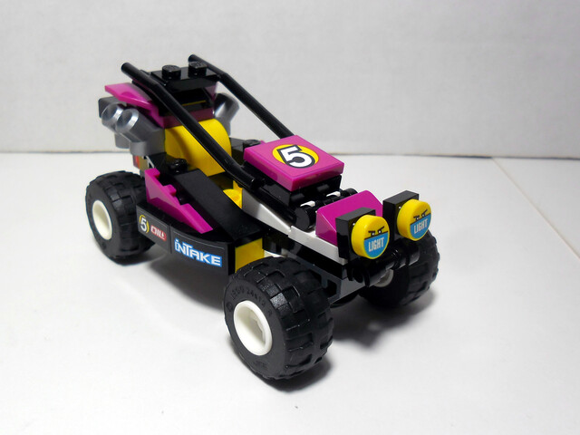](https://www.freelug.org/IMG/jpg/sam_3559.jpg)

Puis au 4x4 :

[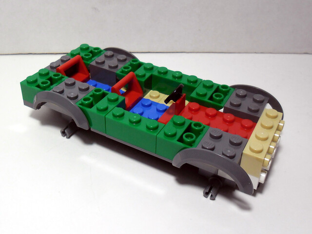](https://www.freelug.org/IMG/jpg/sam_3564.jpg)

[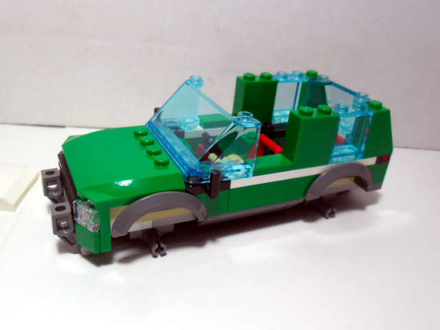](https://www.freelug.org/IMG/jpg/sam_3565.jpg)

[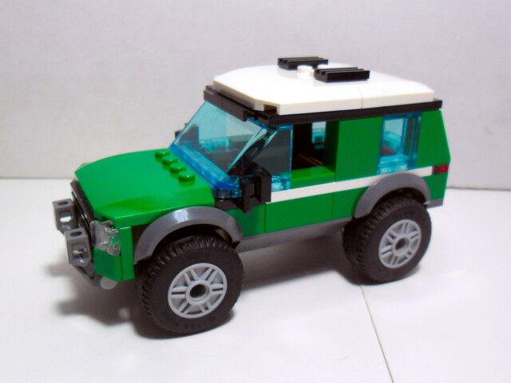](https://www.freelug.org/IMG/jpg/sam_3566.jpg)

Finissons avec la remorque :

[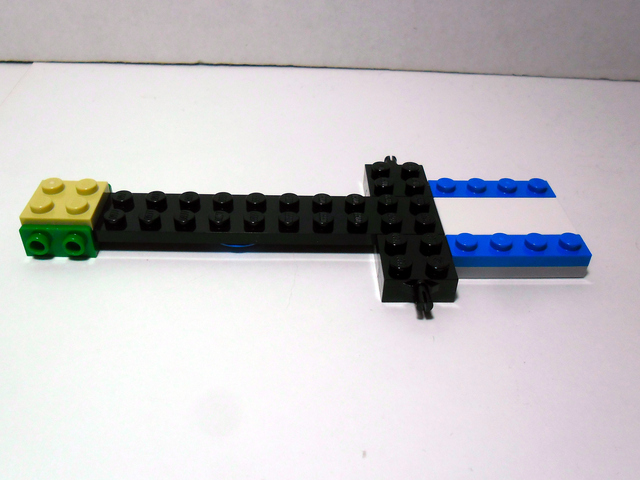](https://www.freelug.org/IMG/jpg/sam_3568.jpg)

[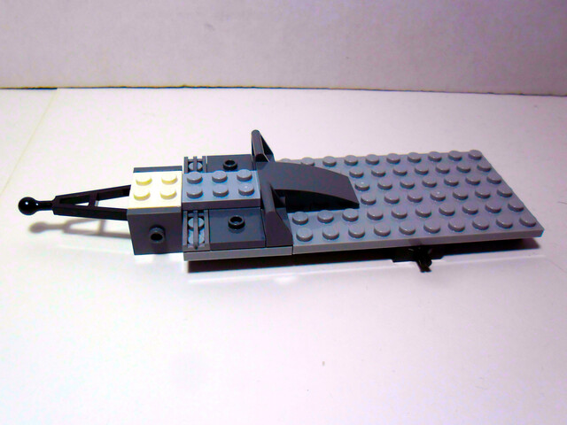](https://www.freelug.org/IMG/jpg/sam_3570.jpg)

[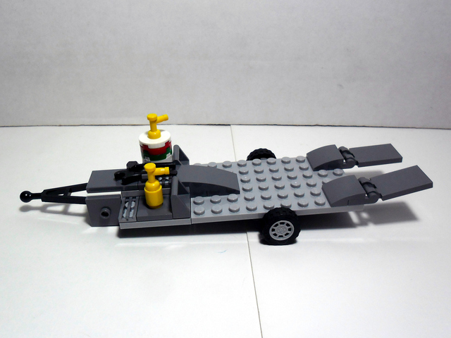](https://www.freelug.org/IMG/jpg/sam_3571.jpg)

Voilà fini, une petite photo de famille !

[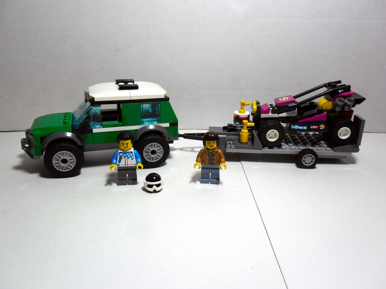](https://www.freelug.org/IMG/jpg/sam_3572.jpg)

Et pour terminer les extra parts :

[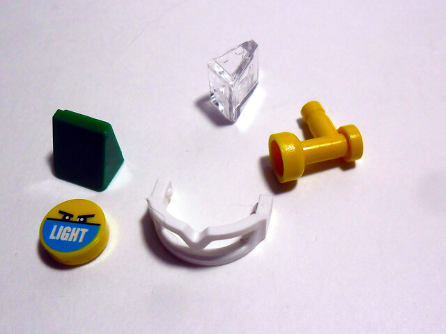](https://www.freelug.org/IMG/jpg/sam_3574.jpg)

**Conclusion**  
Que dire : Le transport de buggy ou de quad est un classique de chez LEGO. Ici, le set a une jouabilité amusante (les roues directionnelles) et je trouve pas trop cher.  
Donc j’achète !
