Partons à la découverte de cette boite qui nous invite au voyage en Afrique !

[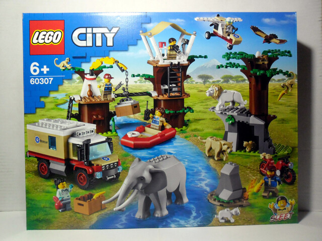](https://www.freelug.org/IMG/jpg/sam_3600.jpg)

Le set comprend 503 pièces avec six personnages, une famille de lions, deux singes, un aigle et surtout l’éléphant ! Pour un prix de 109,99 € soit un rapport prix/pièces de 0,2 euros, c’est très cher. On paye clairement les métapièces et l’éléphant !  
Une petite vue arrière donne une idée des mises en scène possibles :

[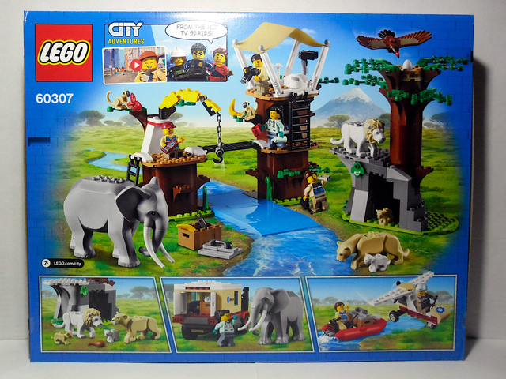](https://www.freelug.org/IMG/jpg/sam_3601.jpg)

Venons au principal : le contenu de la boite :

[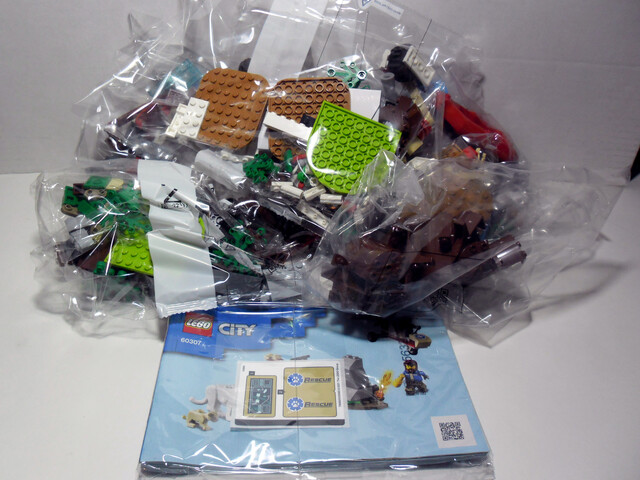](https://www.freelug.org/IMG/jpg/sam_3602.jpg)

Et voilà une petite feuille de sticker !

[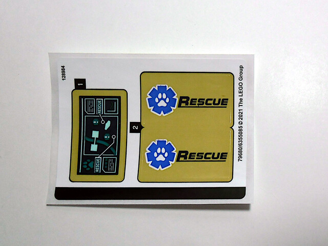](https://www.freelug.org/IMG/jpg/sam_3603.jpg)

**Sachet un :**  
Deux personnages, mixte

[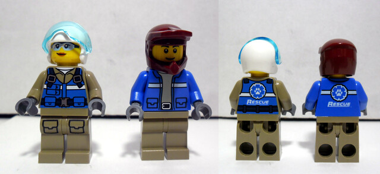](https://www.freelug.org/IMG/jpg/sam_3606.jpg)

et d’autres petits éléments de jouabilité

[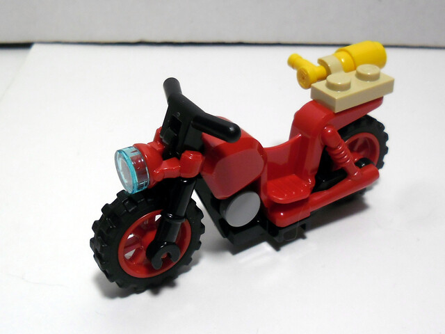](https://www.freelug.org/IMG/jpg/sam_3608.jpg)

[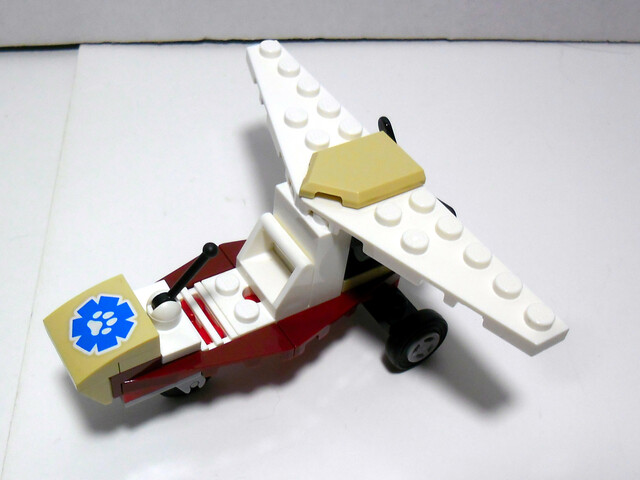](https://www.freelug.org/IMG/jpg/sam_3609.jpg)

[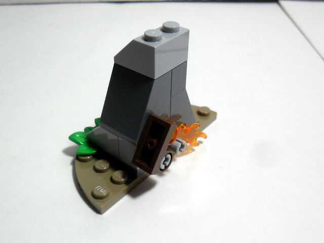](https://www.freelug.org/IMG/jpg/sam_3610.jpg)

[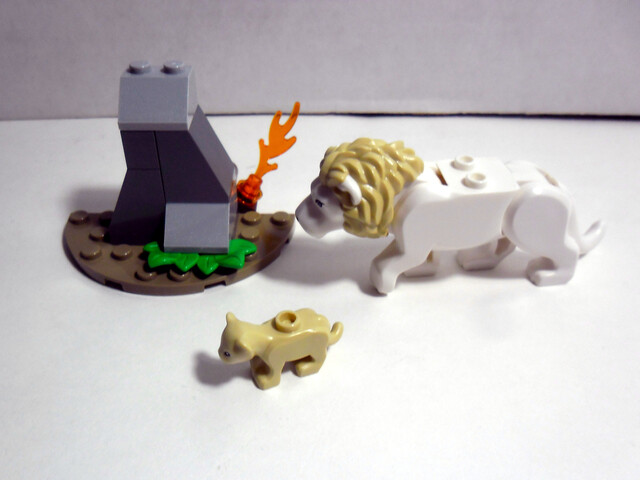](https://www.freelug.org/IMG/jpg/sam_3611.jpg)

**Sachet deux :**  
Un arbre qui sera accompagné par un aigle et deux lions

[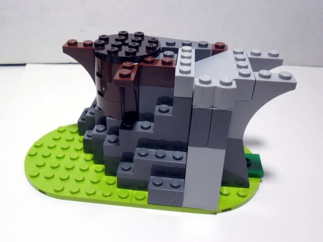](https://www.freelug.org/IMG/jpg/sam_3613.jpg)

[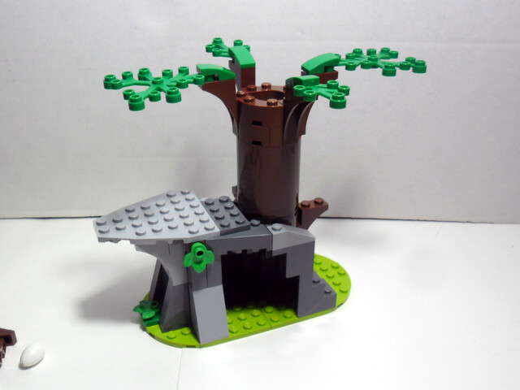](https://www.freelug.org/IMG/jpg/sam_3614.jpg)

[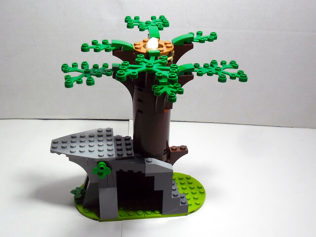](https://www.freelug.org/IMG/jpg/sam_3615.jpg)

[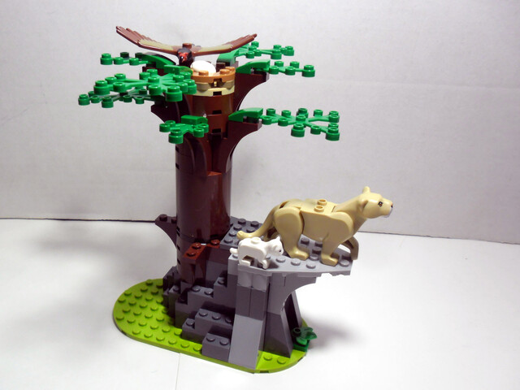](https://www.freelug.org/IMG/jpg/sam_3616.jpg)

**Sachet trois :**  
Deux personnages de plus, mixte, dont une vétérinaire

[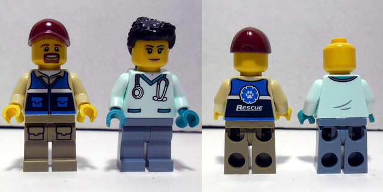](https://www.freelug.org/IMG/jpg/sam_3618.jpg)

Et le début du camion :

[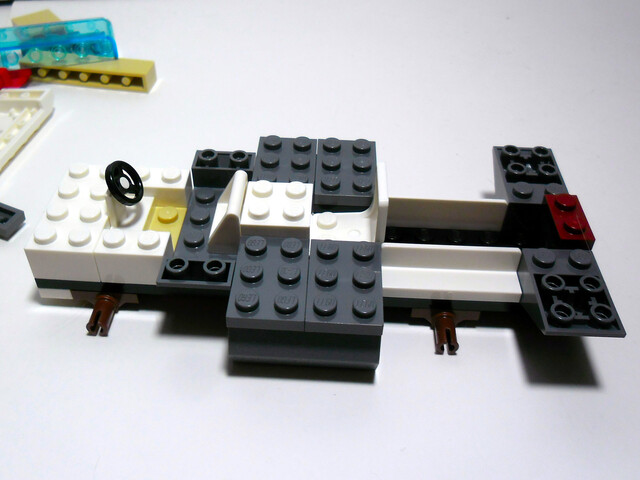](https://www.freelug.org/IMG/jpg/sam_3620.jpg)

[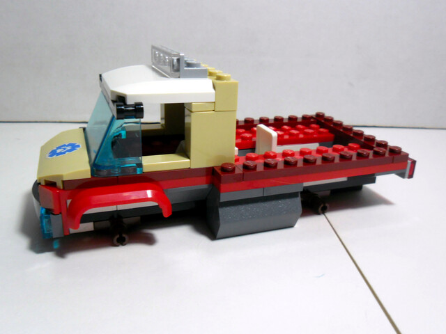](https://www.freelug.org/IMG/jpg/sam_3621.jpg)

**Sachet quatre :**  
Un éléphant :

[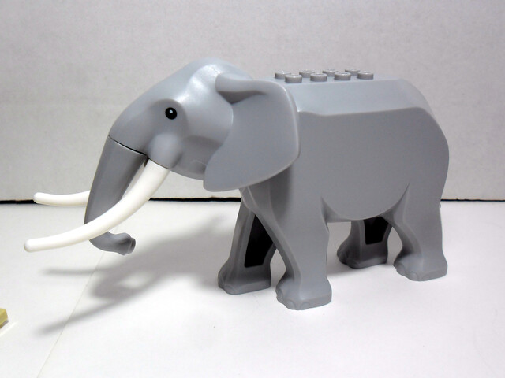](https://www.freelug.org/IMG/jpg/sam_3623.jpg)

et on continue le camion :

[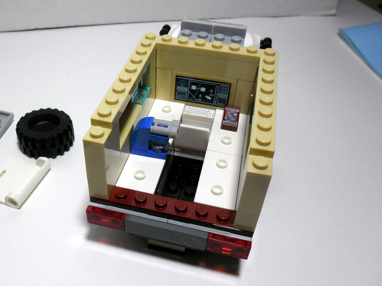](https://www.freelug.org/IMG/jpg/sam_3625.jpg)

[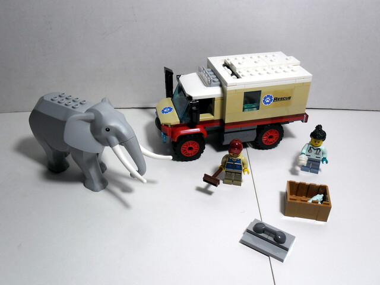](https://www.freelug.org/IMG/jpg/sam_3626.jpg)

**Sachet cinq :**  
Deux personnages mixtes de plus :

[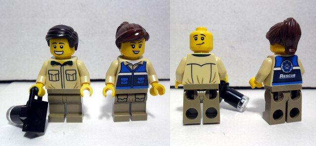](https://www.freelug.org/IMG/jpg/sam_3628.jpg)

On poursuit avec un bateau :

[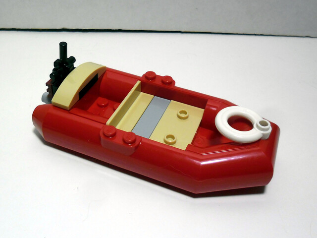](https://www.freelug.org/IMG/jpg/sam_3631.jpg)

Deux petits singes jouent avec des caisses :

[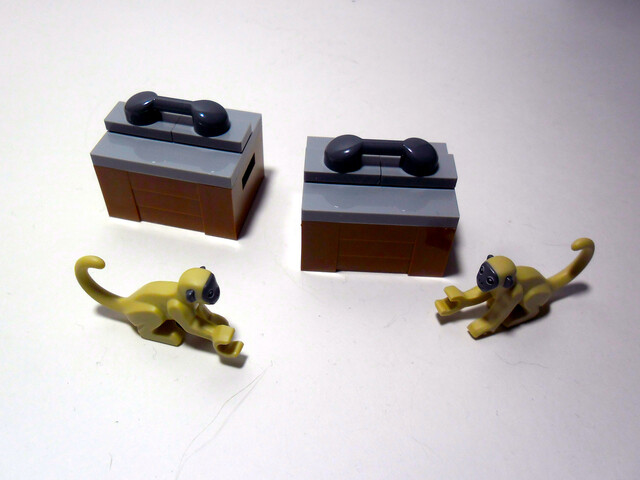](https://www.freelug.org/IMG/jpg/sam_3632.jpg)

Et on avance, une cabane perchée :

[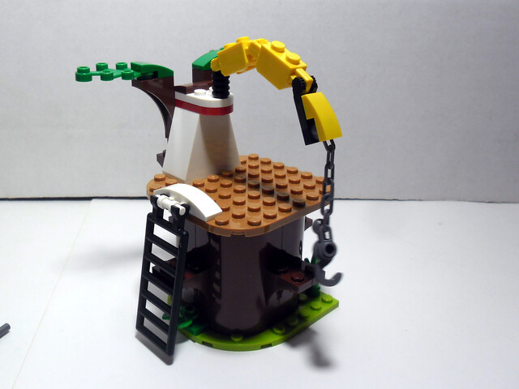](https://www.freelug.org/IMG/jpg/sam_3633.jpg)

[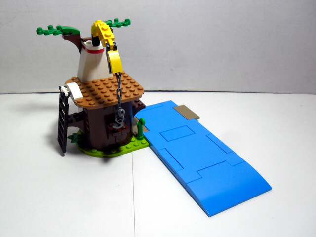](https://www.freelug.org/IMG/jpg/sam_3635.jpg)

**Sachet six :**  
On finit la cabane avec sa petite rivière :

[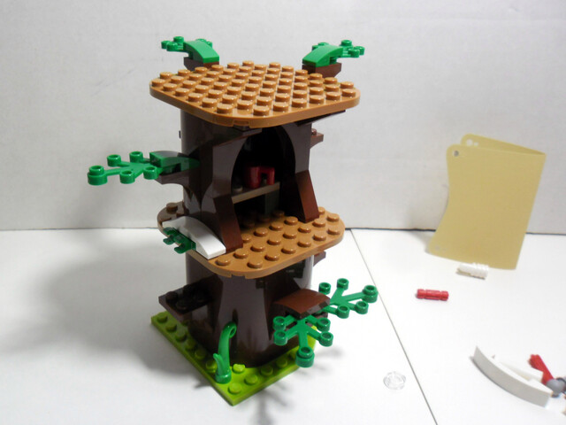](https://www.freelug.org/IMG/jpg/sam_3637.jpg)

[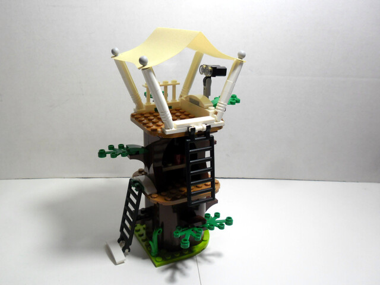](https://www.freelug.org/IMG/jpg/sam_3638.jpg)

[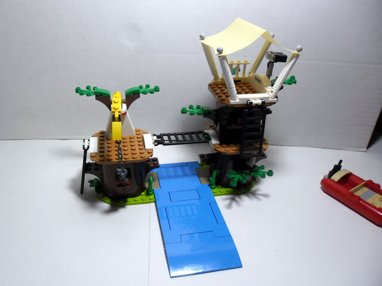](https://www.freelug.org/IMG/jpg/sam_3639.jpg)

Voilà fini, une petite photo de famille !

[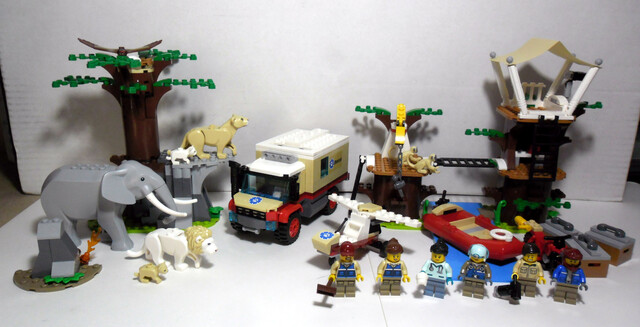](https://www.freelug.org/IMG/jpg/sam_3640.jpg)

Et pour terminer les extra parts :

[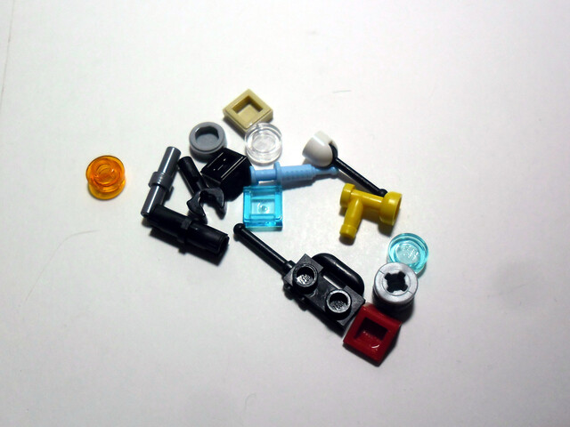](https://www.freelug.org/IMG/jpg/sam_3642.jpg)

**Conclusion**  
Que dire : c’est cher, très cher, mais mine de rien, il y a du volume et de quoi jouer. Pour moi, dix ou vingt euros de moins me paraît plutôt logique. Enfin, moi je cherche les animaux, et je crains que le prix au détail va faire très mal… Surtout l’éléphant !
