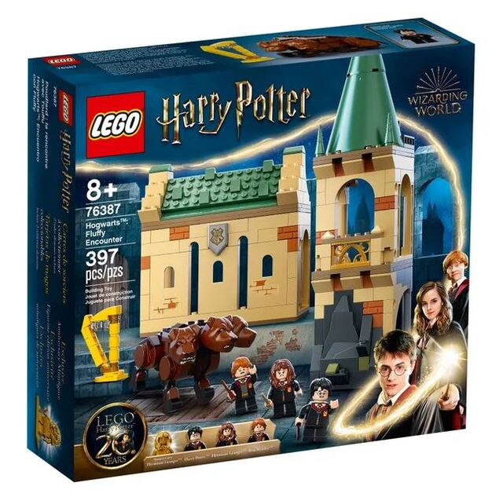
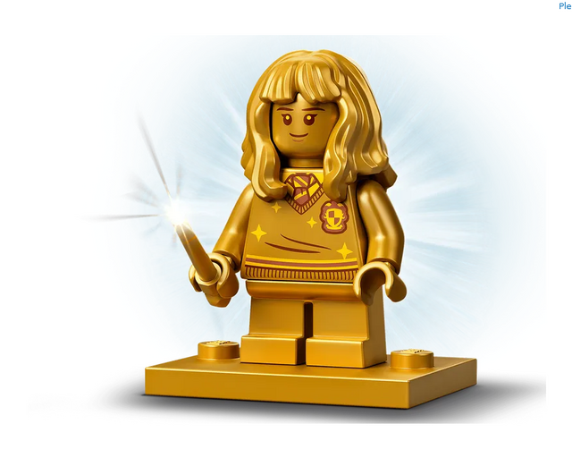
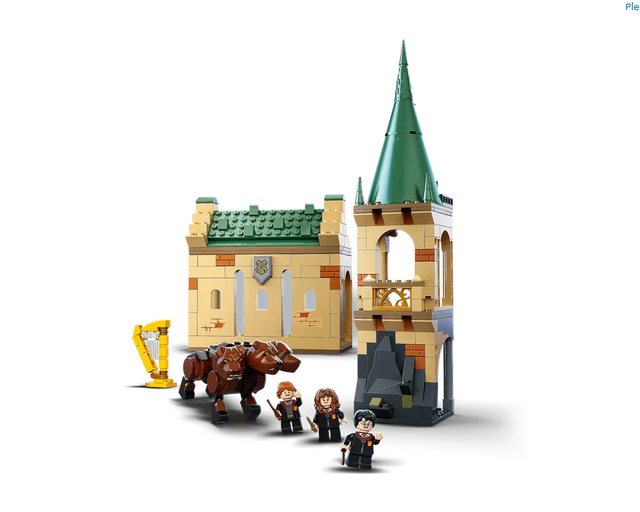
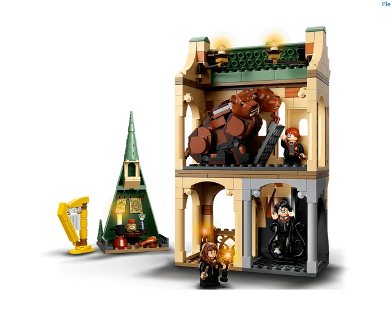
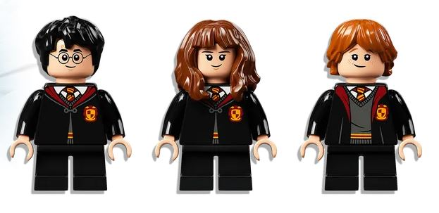
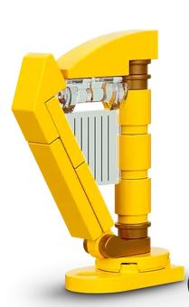
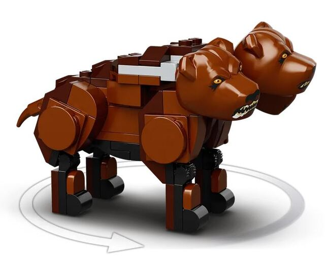
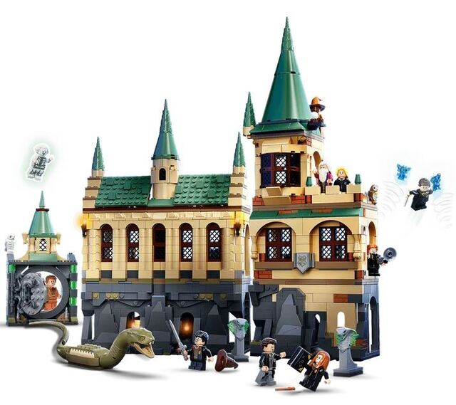

Bonjour à tous,

Ce petit set, 397 pièces, prend place dans l’ensemble des sets de la vague "20 ans Harry Potter".

Il permet, comme les autres sets, d’obtenir une des figurines "dorées" exclusives. Ici, il s’agit d’Hermione.

Ce set est assez facile à assembler. La partie "bâtiment" est composée de deux éléments qui s’assemblent grâce à des "pin Technic" : une partie horizontale et une tour.

Rien d’extraordinaire si ce n’est que la modularité de la tour permet de la séparer en 3 et ainsi de recréer une scène du livre "La pierre philosophale". Deux parties de la tour viennent se placer sous la partie horizontale. Reste que du coup, on a le chapeau de la tour qui se retrouve seul...

Les 3 figurines fournies ont les nouveaux uniformes et des jambes courtes.

La lyre, élément important de cette saynète dans l’histoire, est bien présente.

Personnellement, je l’aurai faite en "reddish brown" plutôt qu’en jaune. A noter que les cordes sont figurées par un sticker placé sur un drapeau transparent. L’astuce pour l’accrocher grâce à 2 "plate round with bar handle" est bien vue.

Par contre, pour moi, le gros point noir est Touffu.

Monsieur le designer, qu’est-ce que c’est que ce machin ??? Autant les 3 têtes sont réussies (chacune a une expression différente), autant le corps de la bête est une catastrophe. Les pattes avant et arrière sont identiques ce qui, visuellement, m’a choqué tout de suite. Le corps... bon j’arrête. En résumé, je n’aime pas du tout. Attention, je suis bien conscient que c’est un exercice particulièrement difficile. Mais là, je trouve que c’est raté. Voilà, c’est dit.

L’ensemble trouvera sans problème sa place dans le set 76389, "La chambre des secrets de Poudlard", puisque Lego a décidé pour cette gamme de renouer avec cette possibilité qui existait dans les premiers sets proposés en 2001.

Au final, que l’on souhaite l’exposer sur une étagère ou laisser les enfants jouer avec, ce set donnera satisfaction.

Ah, j’oubliai, pour les accros de la collection, on trouve aussi dans cette boite 2 "cartes de Bertie Bott". Pour mémoire, elles sont placées totalement aléatoirement dans les sets...

Jouez bien !

Voir en ligne : [Poudlard™ : Rencontre avec Touffu](https://www.lego.com/fr-fr/product/hogwarts-fluffy-encounter-76387)
