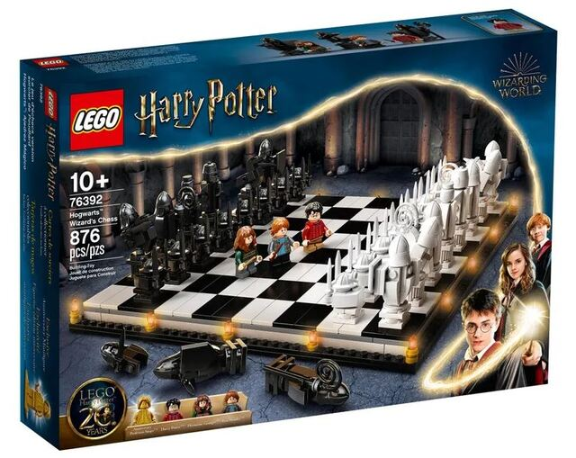
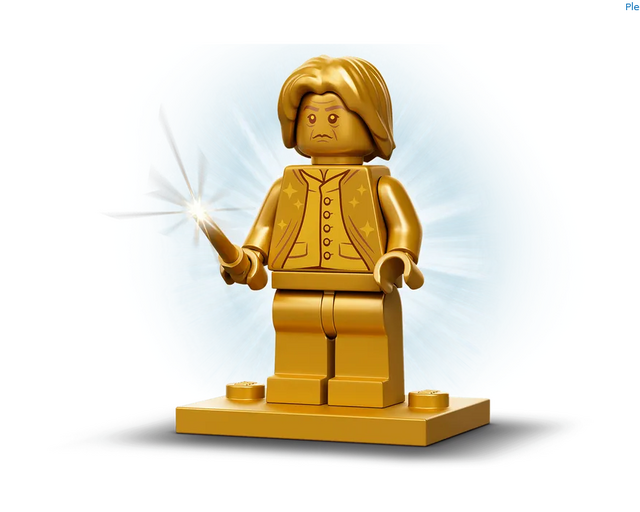
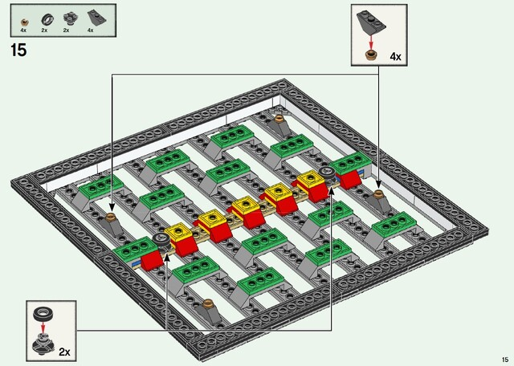
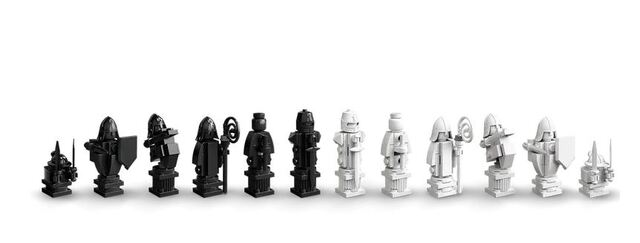
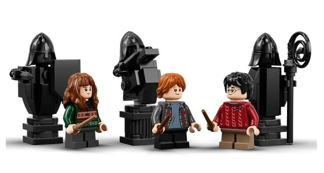
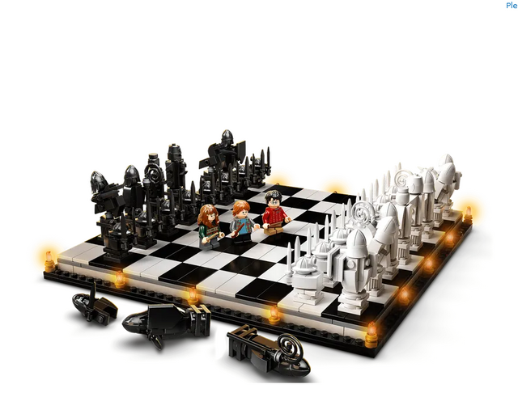
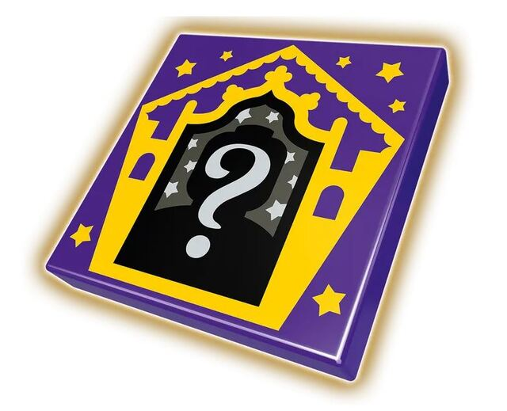

Bonjour à tous,

Ce set de 876 pièces fait partie de l’ensemble des sets de la vague « 20 ans Harry Potter ».

Il permet, comme les autres sets, d’obtenir une des figurines « dorées » exclusives. Ici, il s’agit du professeur Rogue.

Ce set est assez simple à assembler. La partie « plateau » est composée d’un ensemble de "plate par 2" reposant sur le cadre sur lesquelles viennent s’emboiter les "tiles" noires et blanches qui constituent l’échiquier. Rien d’extraordinaire mais cette technique présente l’énorme avantage d’être économe en briques. A noter les deux pneus placé à l’horizontale sous le plateau grâce à la pièces "Plate Round 2 x 2 Thin with Rotation Stem" [https://www.bricklink.com/v2/catalog/catalogitem.page?P=40145&idColor=11](https://www.bricklink.com/v2/catalog/catalogitem.page?P=40145&idColor=11) qui forment un système "anti-glissement" du plateau : le caoutchouc des pneus adhérera à la table sur laquelle vous ferez votre partie d’échecs.

Car c’est le point fort de ce set : en plus d’être une saynète du livre "la Pierre philosophale", c’est aussi un jeu d’échecs fonctionnel.

Le montage des pièces du jeu d’échecs est un peu fastidieux pour les pions mais l’ensemble est plutôt bien vu.

Les cavaliers, véritable défi de cet ensemble, sont stylisés de manière plutôt réussie. Le choix de la dimension des cases imposait des pièces assez "ramassées". On retrouve cette contrainte qui a certainement amené les designers à ne pas utiliser de torses de minifig pour les pions. Les pièces sont, dans l’ensemble, suffisamment solides pour être manipulées au cours d’une partie.  
Les 3 figurines des héros fournies ont des torses originaux et des jambes courtes (1ère année oblige).

Le choix de faire les cases noires et blanches de 4x4 tenons permet de contenir les dimensions de l’ensemble : 34x34 tenons au total. Il pourra donc être facilement posé quelque part à la maison. Cependant, ces dimensions modestes sont au détriment de la jouabilité. En début de partie, je doute que Hagrid puisse attraper une pièce sans en renverser une autre...

(Attention, contrairement à ce que laisse penser les photos du set sur le site officiel de LEGO®, les flammes placées autour du plateau ne s’éclairent pas.)

On trouve aussi dans cette boite 3 « cartes de Bertie Bott » représentant un personnage de la saga sur une "tile" mauve. Pour mémoire, elles sont placées totalement aléatoirement dans les sets...

Jouez bien !  
ERic

Voir en ligne : [Le jeu d’échecs version sorcier de Poudlard™](https://www.lego.com/fr-fr/product/hogwarts-wizard-s-chess-76392)
