En ces temps où l’actualité spatiale est assez présente, retour sur une petite boîte de numéro _60230_, intitulée _Ensemble de figurines : la recherche et le développement spatiaux_.

Sortie en 2019, cette boîte contient 209 pièces et coûtait aux alentours de 39 €. Un peu cher, mais elle contient pas mal de figurines, c’est sans doute une des raisons.

Comme d’habitude, la face avant présente le contenu de la boîte mis en scène, avec en haut à gauche le logo « City » et à droite une tête d’astronaute, tandis qu’un encart en bas à gauche indique que c’est « inspiré des métiers de la NASA », en anglais (mais la mention se retrouve dans d’autres langues sur un côté de la boîte). Bon, je le dis tout de suite, ni l’astronaute ni le drone ne volent, bien sûr...

[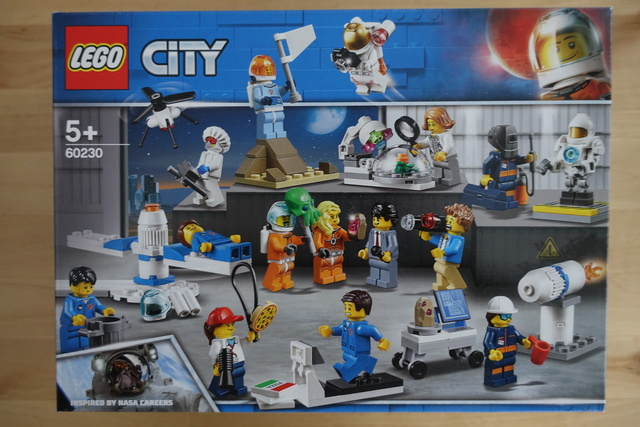](https://www.freelug.org/IMG/jpg/dsc02997.jpg)

L’arrière montre à nouveau les différentes scénettes, avec toujours l’encadré NASA, plus un petit encart en bas à droite « Mars exploration ». J’admets ignorer les sous-gammes d’espace liées à City.

[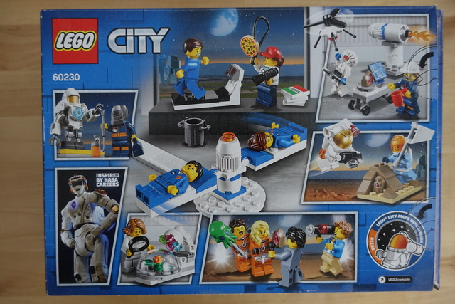](https://www.freelug.org/IMG/jpg/dsc02998.jpg)

Deux petits manuels donnent les instructions pour tout assembler, ce qui permet à deux personnes de monter en parallèle. Soyons honnête, la construction n’est vraiment pas compliquée, en phase avec la classification « 5+ » de la boîte.

[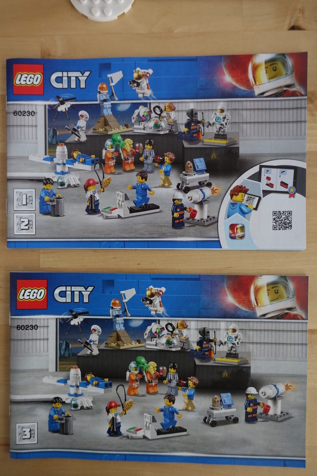](https://www.freelug.org/IMG/jpg/dsc03000.jpg)

* * *

Voici une vue d’ensemble des petites scènes, détaillées dans la suite.

[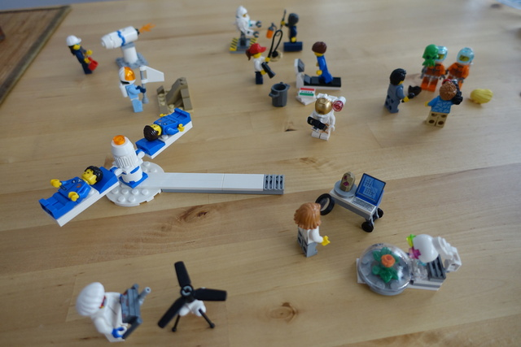](https://www.freelug.org/IMG/jpg/dsc02955.jpg)

* * *

Ici, un technicien fait voler un drone. J’adore cette simple construction avec les antennes qui stabilisent l’engin. Pour une raison inconnue le technicien porte une combinaison de protection, peut-être anti-poussière parce que le drone y est sensible ? Auquel cas sur Mars cela serait compliqué, avec les tempêtes... Le boîtier de commande est lui aussi très simple, une pièce « en U », une plate tampographiée, et une poêle pour l’antenne — mais ça fait le job.

[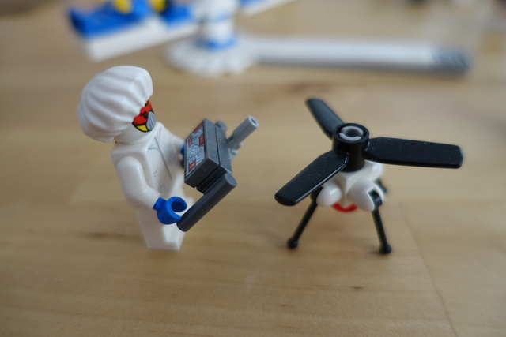](https://www.freelug.org/IMG/jpg/dsc02957.jpg)

[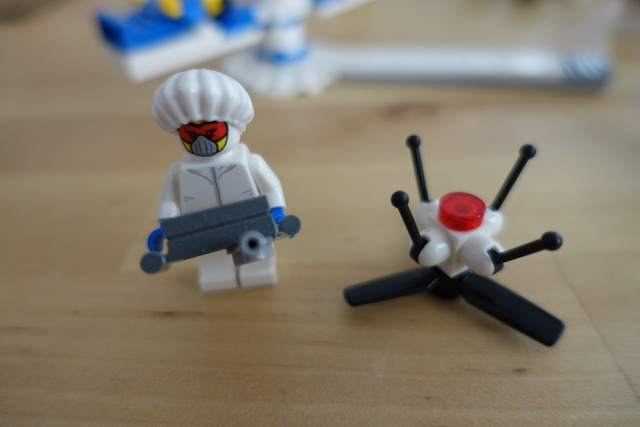](https://www.freelug.org/IMG/jpg/dsc02958.jpg)

Le dos est simple, pas de tampographie sur les jambes.

[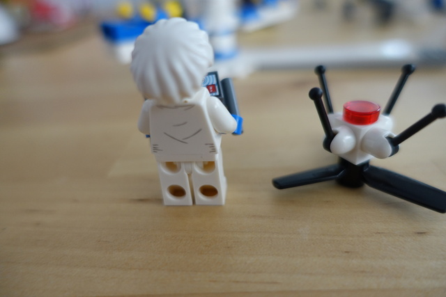](https://www.freelug.org/IMG/jpg/dsc02959.jpg)

* * *

Seconde scène, un mini-laboratoire avec un cristal à côté d’un ordinateur et une plante sous serre à lumières colorées. La scientifique examine à l’aide d’une grosse loupe la plante, tentative de simulation de croissance sous lumière artificielle ?

[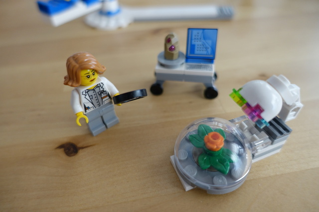](https://www.freelug.org/IMG/jpg/dsc02960.jpg)

La plante sous cloche est basique, mais avec la lampe à trois couleurs, le rendu est correct.

[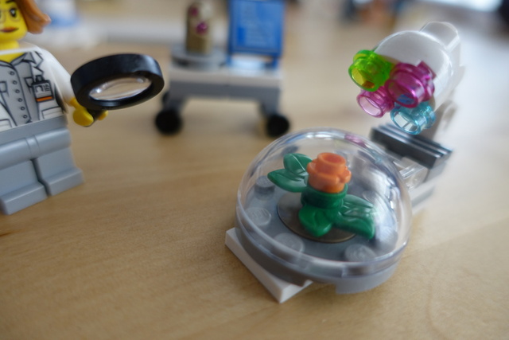](https://www.freelug.org/IMG/jpg/dsc02961.jpg)

L’ordinateur et la roche à cristal sont simples, posés sur un chariot mobile.

[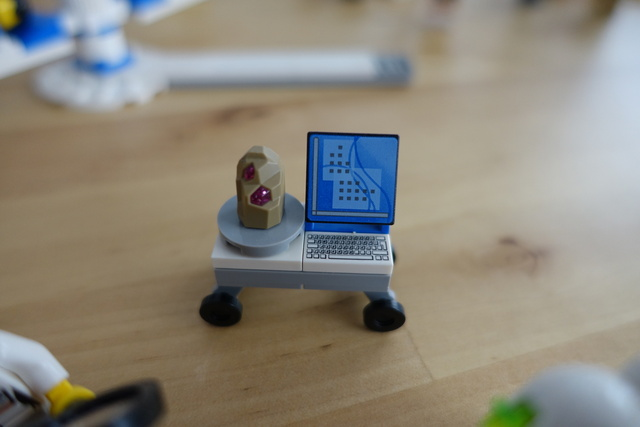](https://www.freelug.org/IMG/jpg/dsc02962.jpg)

La scientifique a un visage alternatif, et son dos a quelques motifs. Jambes toujours unies.

[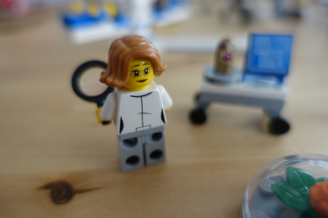](https://www.freelug.org/IMG/jpg/dsc02963.jpg)

* * *

Troisième petite scène, une candidate astronaute en plein entraînement physique sur un tapis roulant, avec une coach qui la motive à coup de pizza (face pas visible de la pièce ronde) au bout d’un fouet. Une pile de cartons prouve qu’il y a matière à faire question motivation...

[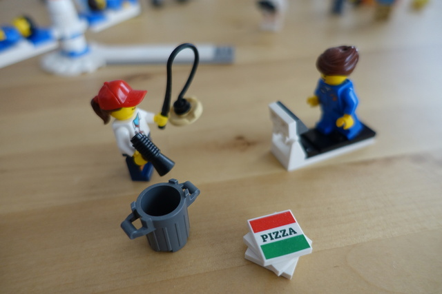](https://www.freelug.org/IMG/jpg/dsc02964.jpg)

Le tapis roulant est constitué de quelques pièces, avec un panneau de contrôle pour régler la vitesse.

[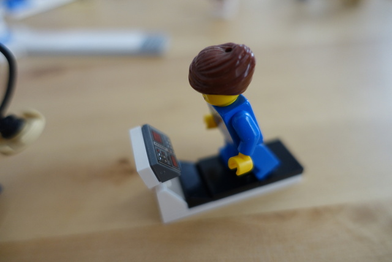](https://www.freelug.org/IMG/jpg/dsc02965.jpg)

La coach a un petit sourire en coin, peut-être qu’elle prend du plaisir à son métier. Elle a un mégaphone pour mieux encourager l’astronaute. Les jambes ont une petite bande orange, toujours ça de pris.

[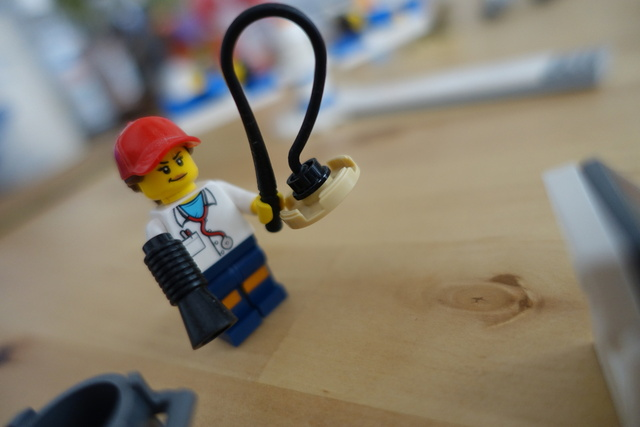](https://www.freelug.org/IMG/jpg/dsc02966.jpg)

Les deux figurines ont quelques plis dans le dos, pour simuler un vêtement, en revanche pas de visage alternatif.

[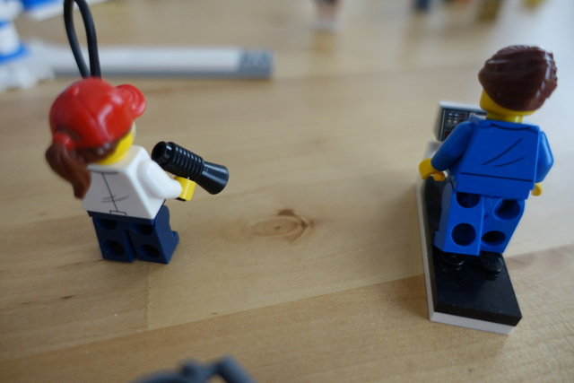](https://www.freelug.org/IMG/jpg/dsc02967.jpg)

* * *

Figurine suivante, une astronaute. Équipée d’un appareil photo, elle a également une lampe sur l’épaule, pour mieux éclairer ses sujets.

[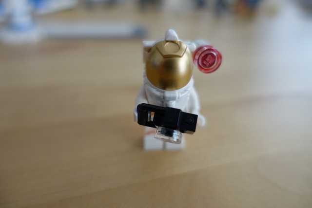](https://www.freelug.org/IMG/jpg/dsc02968.jpg)

Le scaphandre est équipé de propulseurs, ici en pleine action.

[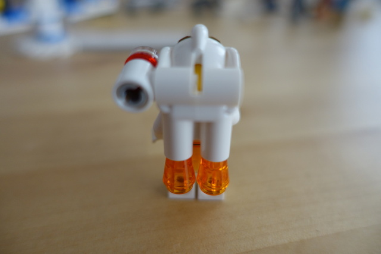](https://www.freelug.org/IMG/jpg/dsc02969.jpg)

La tenue est simple, avec quelques bandes de couleur, y compris sur l’avant des jambes, et cadrans, plus un logo d’espace sur le torse. Pas de visage alternatif.

[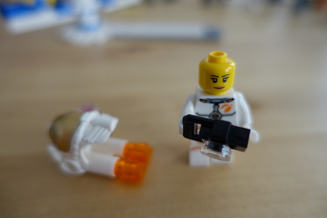](https://www.freelug.org/IMG/jpg/dsc02970.jpg)

[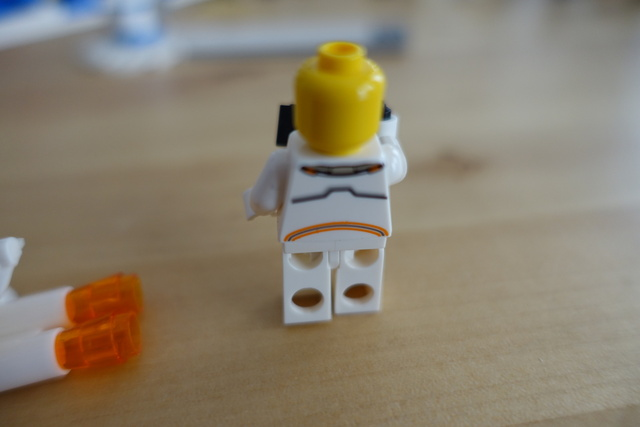](https://www.freelug.org/IMG/jpg/dsc02971.jpg)

[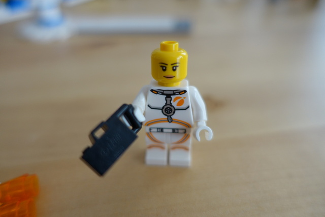](https://www.freelug.org/IMG/jpg/dsc02972.jpg)

* * *

Scène amusante, un journaliste accompagné d’un cameraman qui interviewent deux astronautes, l’un tenant une tête d’alien au bout d’un bâton.

[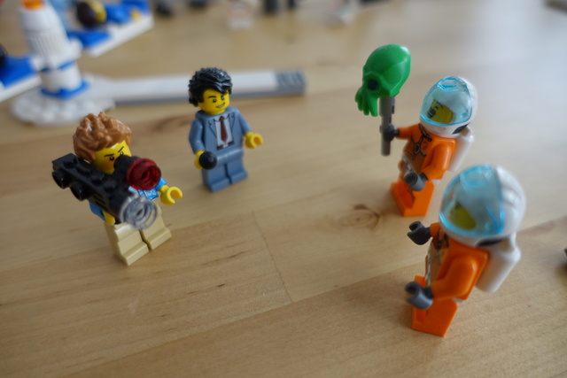](https://www.freelug.org/IMG/jpg/dsc02973.jpg)

Les deux journalistes sont en tenue « civile », par rapport aux autres figurines. Celui au micro est habillé classiquement avec veste et cravate, cheveux bien rangés, son partenaire est plus relâché avec plutôt un pull.

[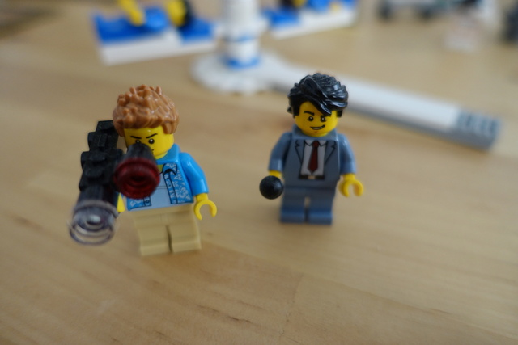](https://www.freelug.org/IMG/jpg/dsc02974.jpg)

Simples plis pour le journaliste, le cameraman voit son motif à fleur se poursuivre dans le dos, et son visage alternatif est effrayé, la tête d’alien lui fait de l’effet.

[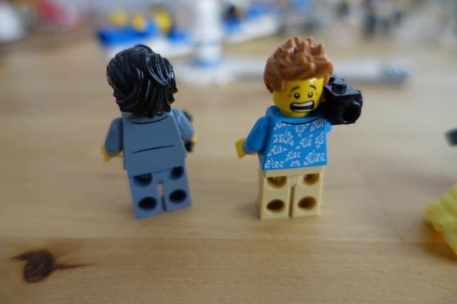](https://www.freelug.org/IMG/jpg/dsc02978.jpg)

Les astronautes ont la même tenue, casque bleu transparent, cadrans et sangles sur le torse et le jambes, tous deux sourient, lui rigole même franchement du tour qu’il joue aux journalistes avec sa tête d’alien. Deux chevelures permettent de retirer le casque.

[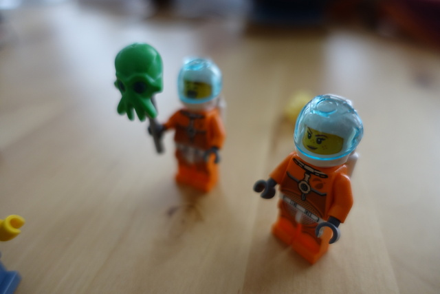](https://www.freelug.org/IMG/jpg/dsc02975.jpg)

[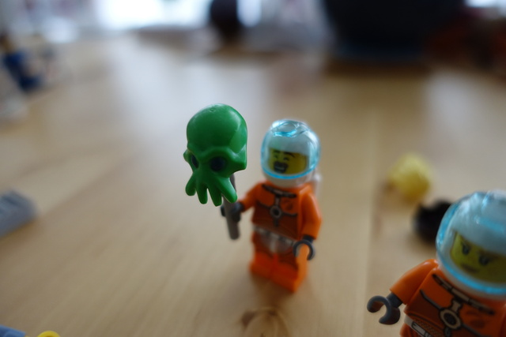](https://www.freelug.org/IMG/jpg/dsc02976.jpg)

Tous deux ont un visage alternatif joyeux, avec sur le dos le prolongement de motifs de l’avant.

[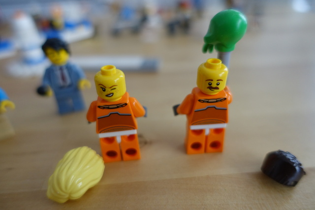](https://www.freelug.org/IMG/jpg/dsc02977.jpg)

* * *

Autre petit assemblage, une centrifugeuse avec deux astronautes en plein entraînement. Ils ne sont clairement pas en forme, l’un effrayé et l’autre au bord de la nausée. Même tenue, seuls la tête et les cheveux les différencient, jambes unies.

[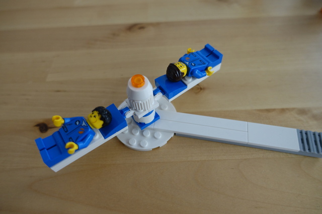](https://www.freelug.org/IMG/jpg/dsc02979.jpg)

[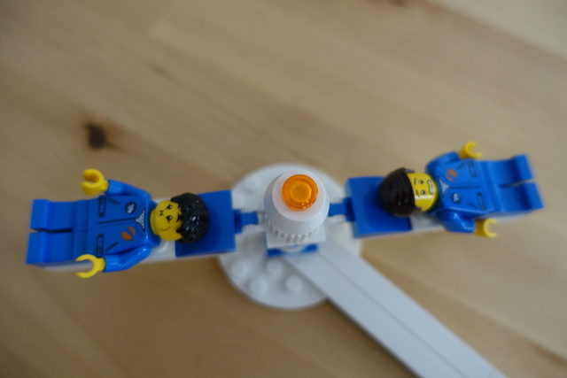](https://www.freelug.org/IMG/jpg/dsc02980.jpg)

[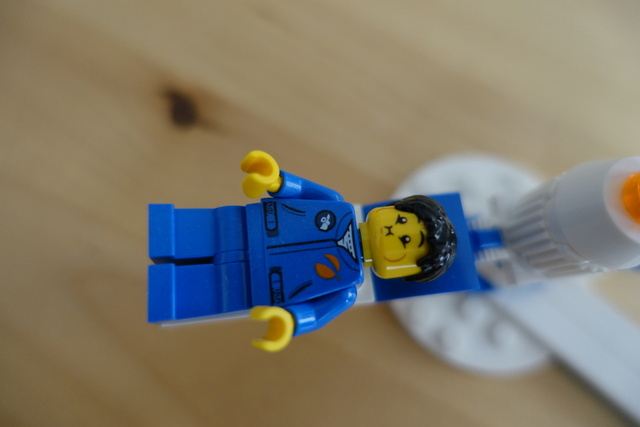](https://www.freelug.org/IMG/jpg/dsc02981.jpg)

[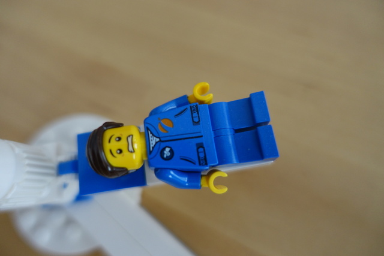](https://www.freelug.org/IMG/jpg/dsc02982.jpg)

Les visages alternatifs en revanche sont franchement souriants, ils sont contents de participer à ce programme spatial et d’aller un jour dans l’espace.

[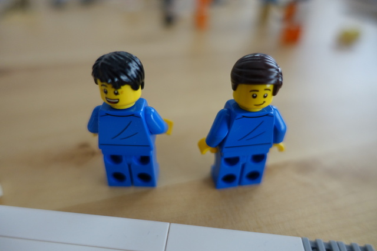](https://www.freelug.org/IMG/jpg/dsc02983.jpg)

La centrifugeuse peut se refermer. Les pièces 4x1 à deux tenons permettent de fixer solidement les astronautes tout en autorisant une position très allongée, c’est une idée astucieuse.

[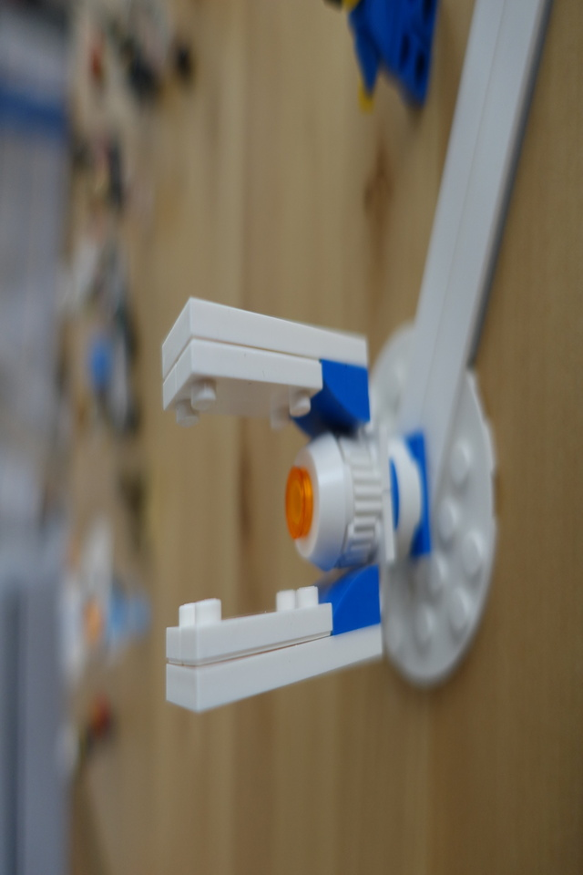](https://www.freelug.org/IMG/jpg/dsc02984.jpg)

* * *

Passons maintenant à une technicienne qui surveille un propulseur. Elle boit tranquillement du café à côté d’une flamme de feu, quel sans-froid !

[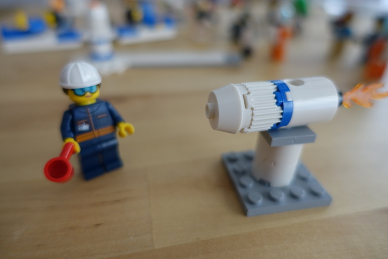](https://www.freelug.org/IMG/jpg/dsc02985.jpg)

Elle porte des lunettes de protection et une combinaison à poches, plus un badge sur le côté droit.

[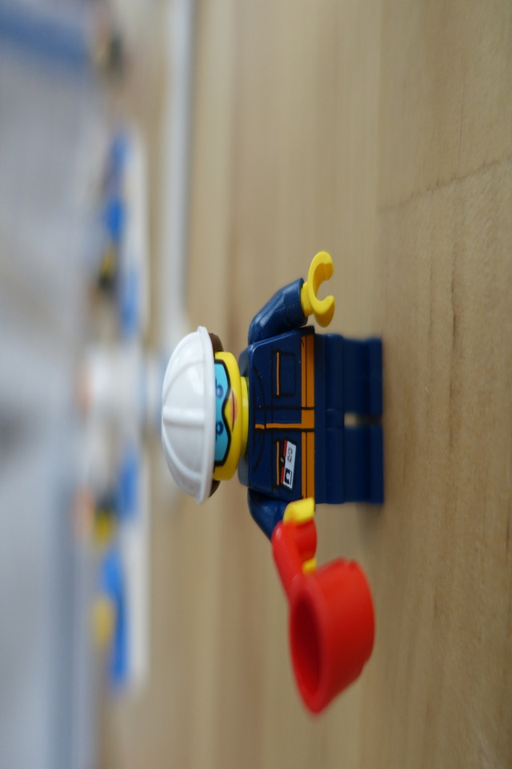](https://www.freelug.org/IMG/jpg/dsc02987.jpg)

Dans le dos, simple bande orange pour rappeler la tenue.

[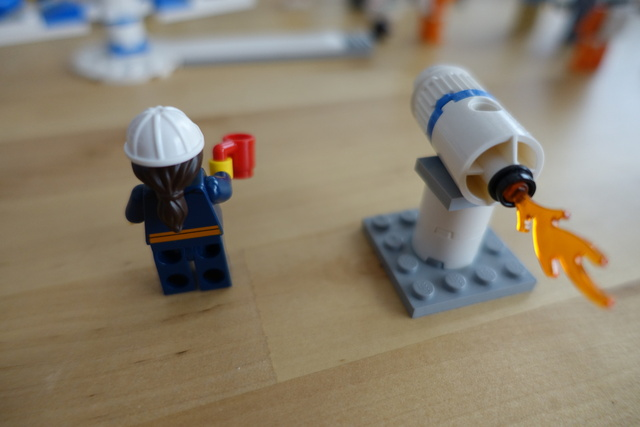](https://www.freelug.org/IMG/jpg/dsc02988.jpg)

En revanche le visage alternatif est clairement cramé, avec une expression désabusée, elle a probablement eu un petit souci avec la flamme du propulseur ! J’admets que ce détail tout simple m’a fait rire.

[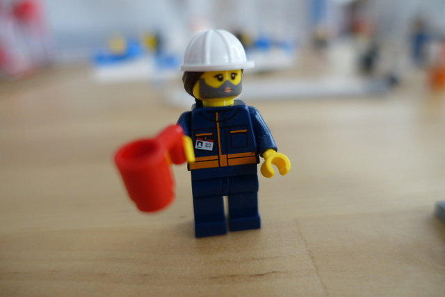](https://www.freelug.org/IMG/jpg/dsc02989.jpg)

[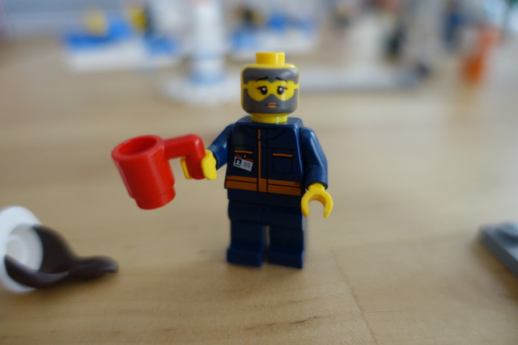](https://www.freelug.org/IMG/jpg/dsc02990.jpg)

* * *

Autre scène, un astronaute plantant un drapeau en haut d’une petite élévation. Bon, vraiment petite, deux pièces de hauteur... Magnifique cristal sur l’un des côtés de la pente.

[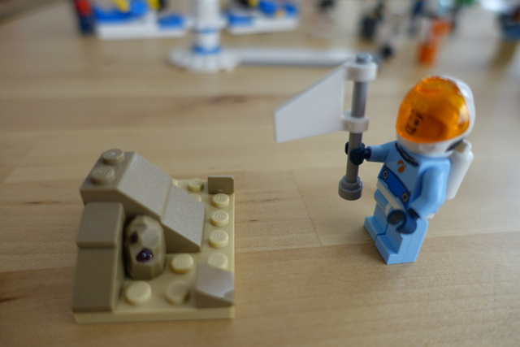](https://www.freelug.org/IMG/jpg/dsc02991.jpg)

[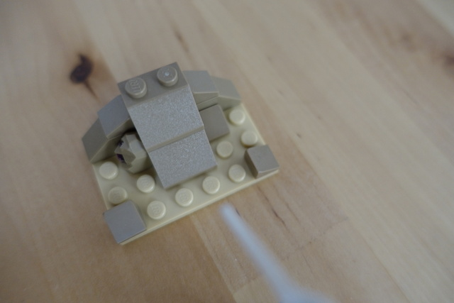](https://www.freelug.org/IMG/jpg/dsc02992.jpg)

Le drapeau est uni, il aurait je trouve mérité un peu de décoration. L’astronaute est équipé d’une combinaison bleue, avec au centre un motif d’espace. Casque et bouteilles complètent sa tenue.

[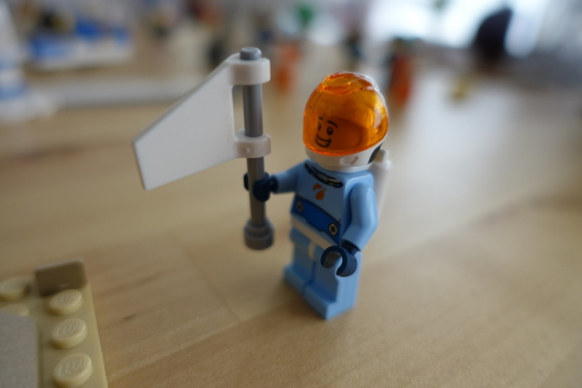](https://www.freelug.org/IMG/jpg/dsc02993.jpg)

[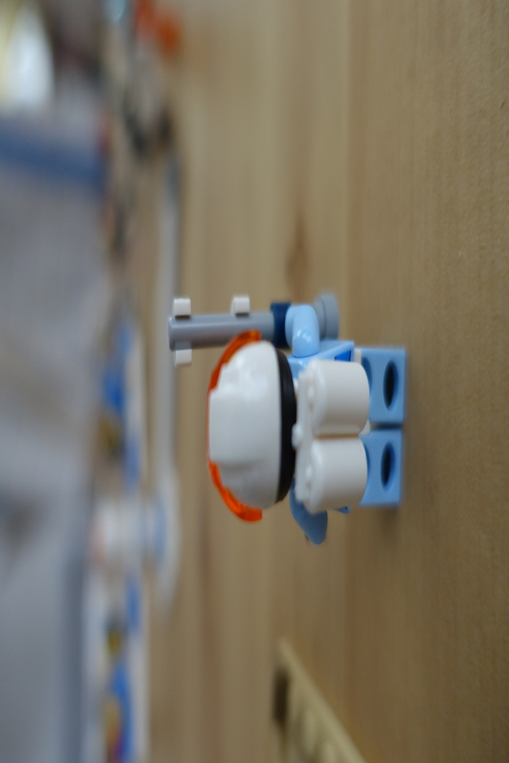](https://www.freelug.org/IMG/jpg/dsc02994.jpg)

Sa ceinture se prolonge dans le dos, mais les jambes sont unies.

[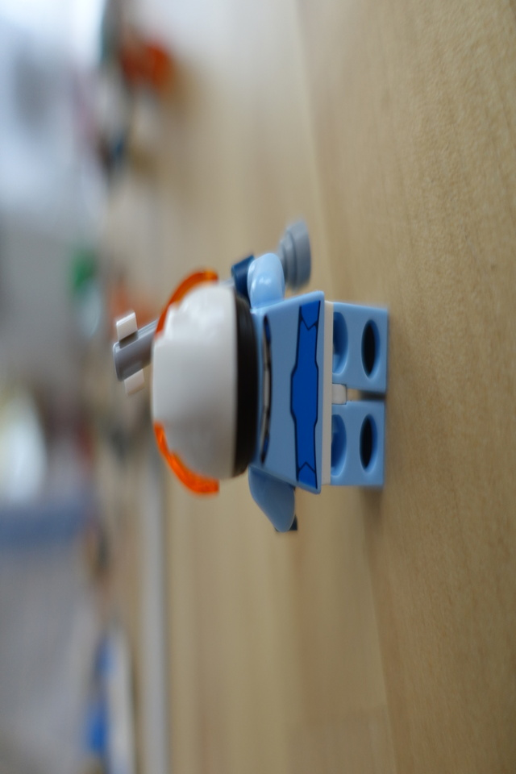](https://www.freelug.org/IMG/jpg/dsc02995.jpg)

* * *

Il me manque des photos de la dernière scénette, un soudeur travaillant sur une combinaison posée sur un support. Elle est visible sur l’avant et l’arrière de la boîte.

* * *

**Avis :** même si les constructions ne sont pas particulièrement compliqués, je trouve que le rendu global est plutôt réussi. L’assortiment de figurines est varié : quatre modèles de casque, trois combinaisons différentes, quelques visages alternatifs, des cheveux pour remplacer certains casques. Les torses sont variés, avec des motifs d’espace mais à différents endroits. Les petits objets habilleront sans problème une ou deux pièces d’un bâtiment.

Sans qu’il soit inoubliable, j’admets être conquis par ce petit ensemble.
