Une boite dans la gamme 4+, ça donne quoi ?

[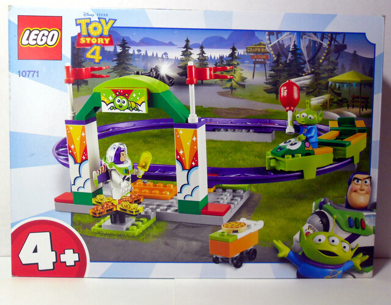](https://www.freelug.org/IMG/jpg/sam_3714.jpg)

Le set comprend 98 pièces avec deux personnages. Pour un prix de 19,99€ soit un rapport prix/pièces de 0,204 euros, c’est cher certes, mais est-ce jouable ?  
Une petite vue arrière donne une idée de la jouabilité du set :

[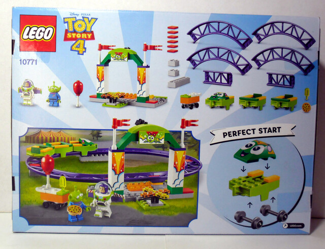](https://www.freelug.org/IMG/jpg/sam_3715.jpg)

Venons au principal : le contenu de la boite :

[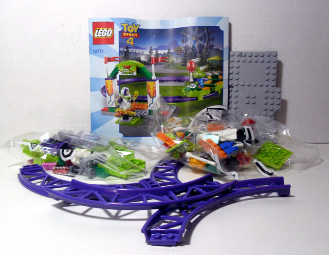](https://www.freelug.org/IMG/jpg/sam_3716.jpg)

De magnifiques pièces tampographiées :

[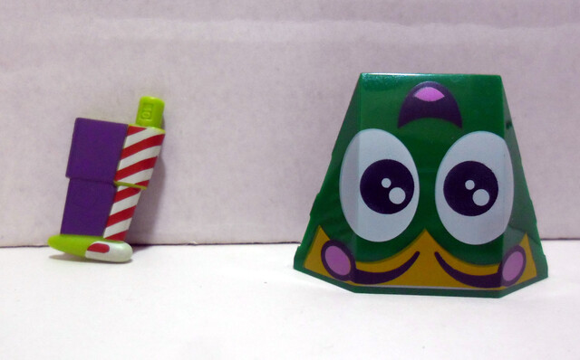](https://www.freelug.org/IMG/jpg/sam_3726.jpg)

Premier personnage, un extra-terrestre :

[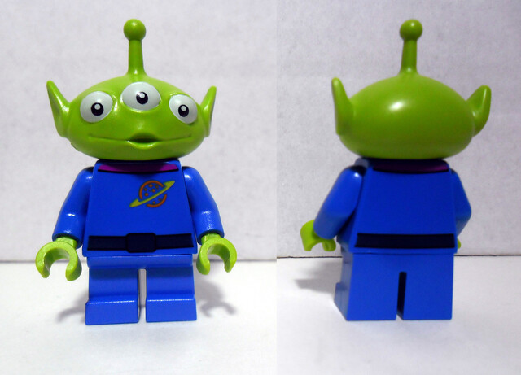](https://www.freelug.org/IMG/jpg/sam_3721.jpg)

Un petit stand de nourriture :

[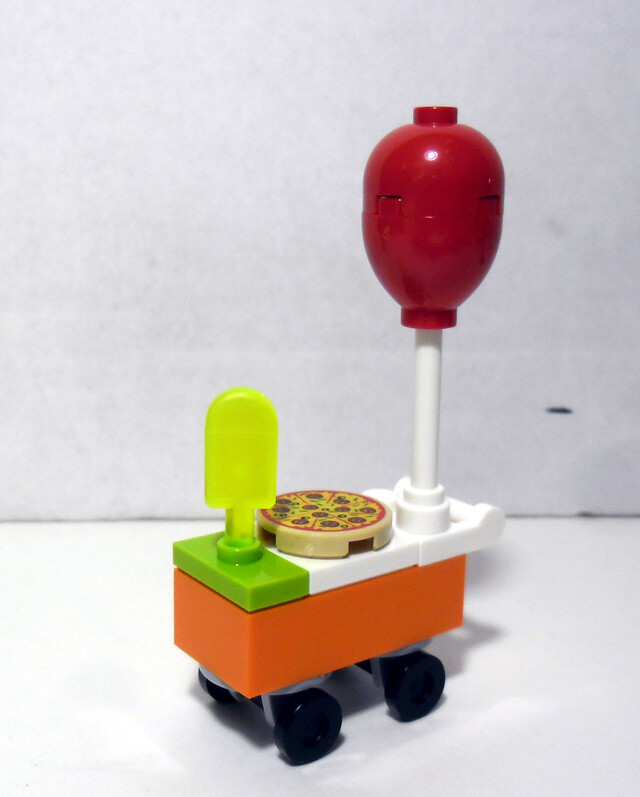](https://www.freelug.org/IMG/jpg/sam_3722.jpg)

Et la construction de l’entrée du manège :

[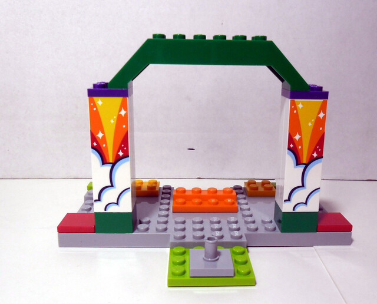](https://www.freelug.org/IMG/jpg/sam_3723.jpg)

[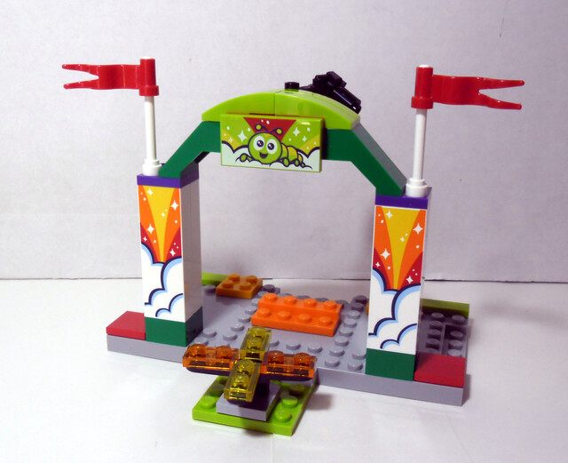](https://www.freelug.org/IMG/jpg/sam_3724.jpg)

Passons à l’autre personnage : Buzz.

[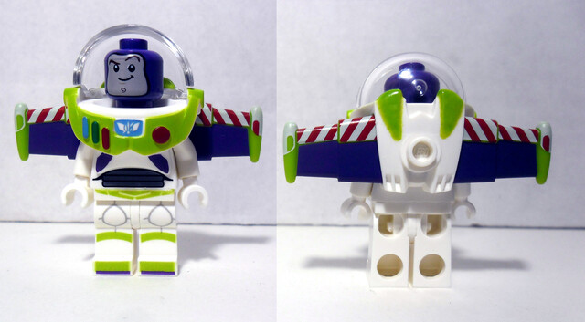](https://www.freelug.org/IMG/jpg/sam_3730.jpg)

Puis la construction du circuit :

[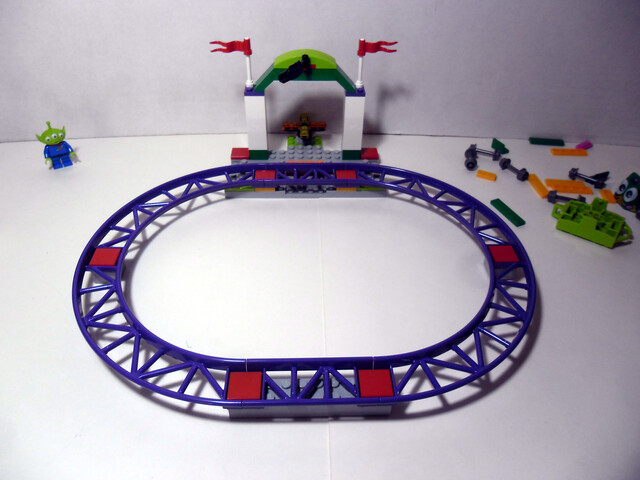](https://www.freelug.org/IMG/jpg/sam_3731.jpg)

Et finissons avec le petit train :

[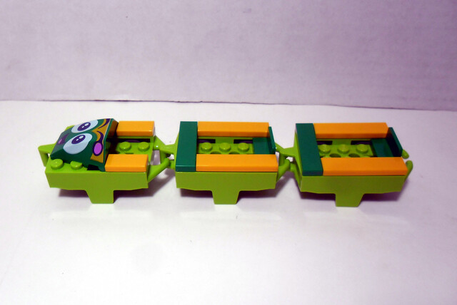](https://www.freelug.org/IMG/jpg/sam_3732.jpg)

Voilà fini, une petite photo de famille !

[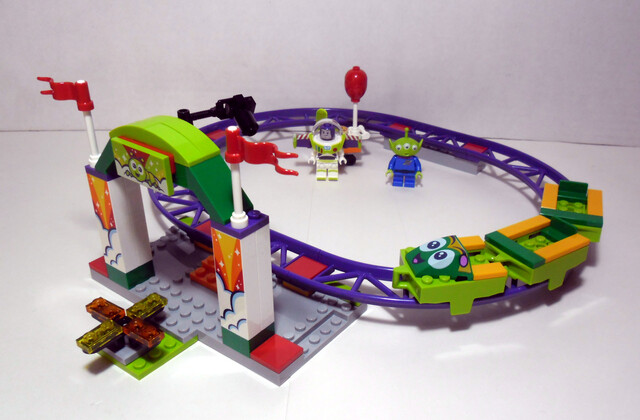](https://www.freelug.org/IMG/jpg/sam_3733.jpg)

**Conclusion**  
Que dire : jouable assez vite, le manège n’a de palpitant que le nom.  
Pour être précis, il tourne en rond... Mais avoir un petit train de rollercoaster et un bout de circuit, c’est pas si mal pour le prix...
