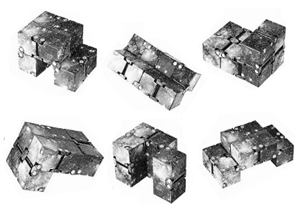
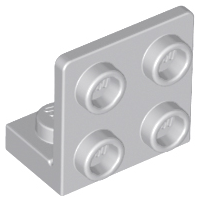
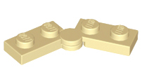
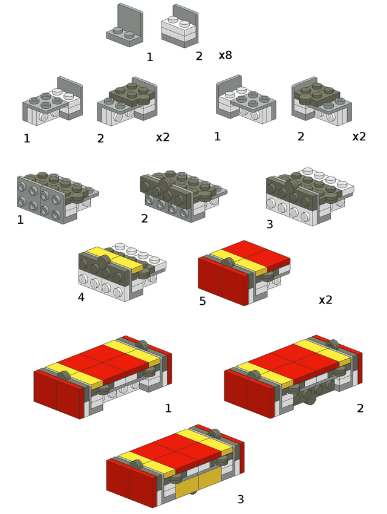

On appelle cela un cube infini ou cube pliable (folding cube ou infinite cube en anglais).

La plupart d’entre vous se souviendront d’en avoir fabriqué un en papier durant leurs jeunes années et on peut en acheter un (en plastique) sur les sites marchands à partir de 10 euros.

Chacun des 8 cubes est relié aux autres par une simple arête pour en former un plus grand, déformable de manière cyclique.

En pièces LEGO, la ["bracket" 1 x 2 - 2 x 2 Inverted (#99207)](https://img.bricklink.com/ItemImage/PN/86/99207.png) existe depuis 2012 et permet maintenant de faire un cube infini assez facilement.

Les autres pièces nécessaires sont courantes :

-   plaques 1x2 : 24 (en blanc)
-   tiles 1x2 : 8 (en jaune)
-   tiles 2x2 : 8 (en rouge)
-   [charnières 1x4](https://img.bricklink.com/ItemImage/PN/2/2429c01.png) : 8 (en gris foncé sur la notice)

C’est la pièce qui va permettre de transformer le cube.

N’utilisez pas des pièces plus grandes (plaques et tiles) et respectez bien leurs positions, sinon le mouvement du mécanisme sera bloqué.

Le cube infini est présenté ici pour le montage dans une position rectangulaire plutôt que cubique pour faciliter la notice. Il est présenté en plusieurs couleurs pour faciliter la lecture de la notice mais vous pouvez bien sûr le monter en une seule couleur ou avec des couleurs variées.

Certes, on ne "joue" pas longtemps avec ce gadget mais il y a un certain aspect pédagogique dans la compréhension de la dimension 3D et des articulations indépendantes qui amusera les plus jeunes mais peut aussi déstresser leurs parents.

A savoir, il est possible de faire un cube infini avec des pièces TECHNIC. Les plus curieux trouveront des vidéos sur Internet.
