7 participants ont relevé le défi de proposer un design original pour la machine à remonter le temps qui permettra de récupérer ou non les membres du GFC avant les Fêtes de fin d’année.

Vous pouvez retrouver le [règlement de ce concours ici](https://www.freelug.org/spip.php?article3135).

Tout d’abord, nous tenons à remercier les 7 participants qui nous ont proposé de très belles inventions.

Les participations sont présentées dans l’ordre de réception.

**01 - Jérôme A. - Pumpkinmobile**

[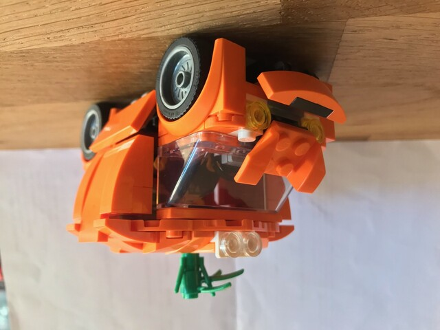](https://www.freelug.org/IMG/jpg/ja-01_personnalise_.jpg)

[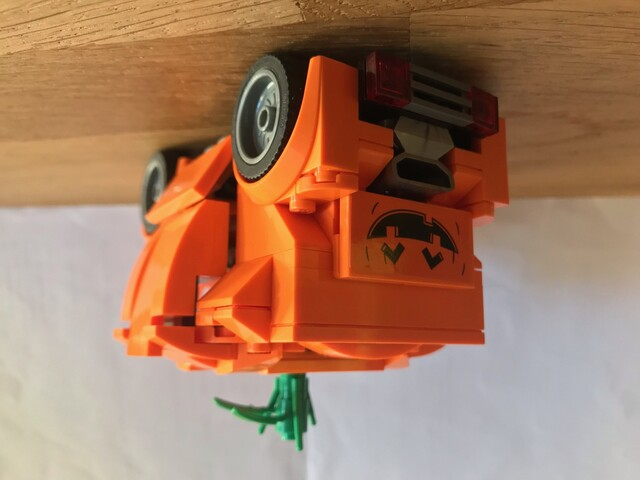](https://www.freelug.org/IMG/jpg/ja-02_personnalise_.jpg)

[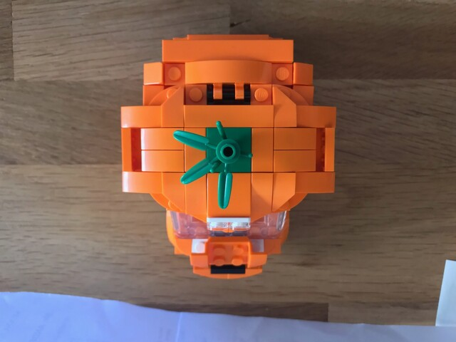](https://www.freelug.org/IMG/jpg/ja-03_personnalise_.jpg)

[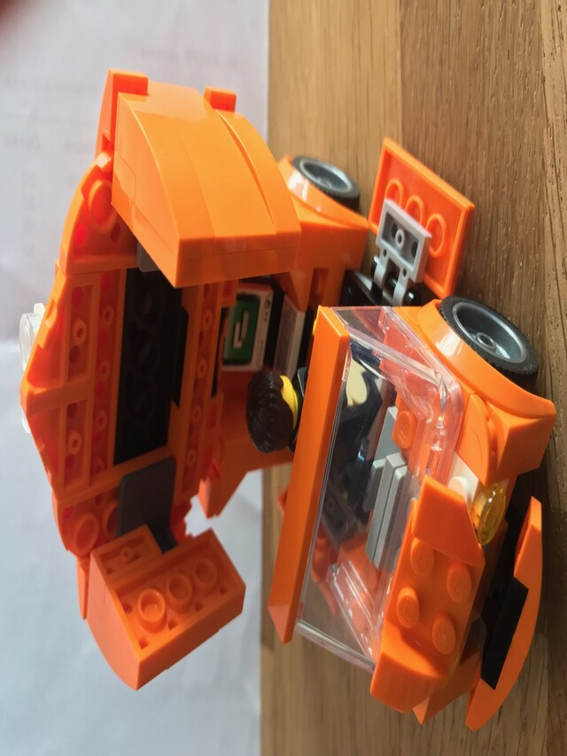](https://www.freelug.org/IMG/jpg/ja-04_personnalise_.jpg)

* * *

**02 - William V.D. - L’arachnomobile**  
Conçue pour pouvoir se déplacer sur tout terrain avec ses 8 roues motrices indépendantes, l’Arachomobile ne vous laissera jamais prise au piège !  
Compacte, une fois repliée dans son garage, elle a l’avantage d’être écologique, ne roulant qu’au jus de citrouille !"

[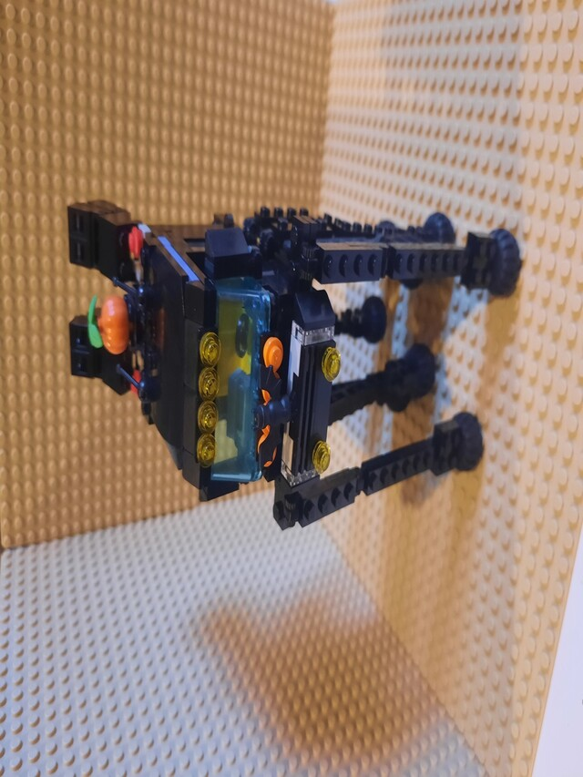](https://www.freelug.org/IMG/jpg/wvd-01_personnalise_.jpg)

[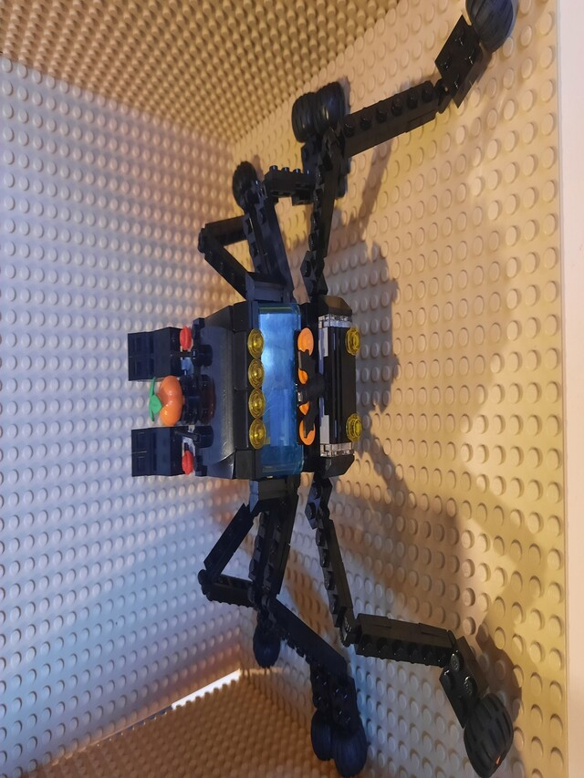](https://www.freelug.org/IMG/jpg/wvd-02_personnalise_.jpg)

[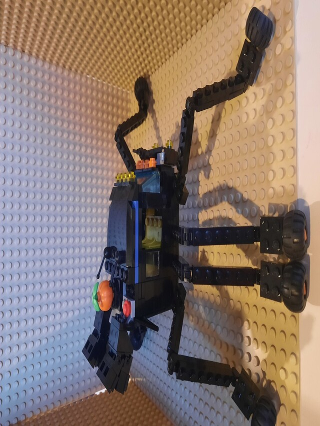](https://www.freelug.org/IMG/jpg/wvd-03_personnalise_.jpg)

[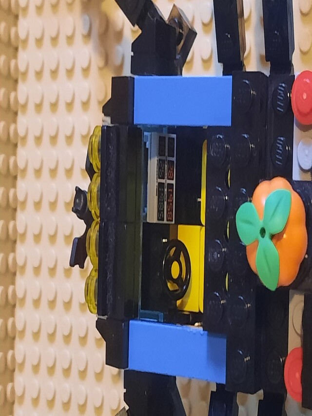](https://www.freelug.org/IMG/jpg/wvd-04_personnalise_.jpg)

* * *

**03 - Yoann G. - Le char à voile temporelle de Timmy**  
Voici le char à voile temporelle capable de rouler mais également de voler avec ses ailes

[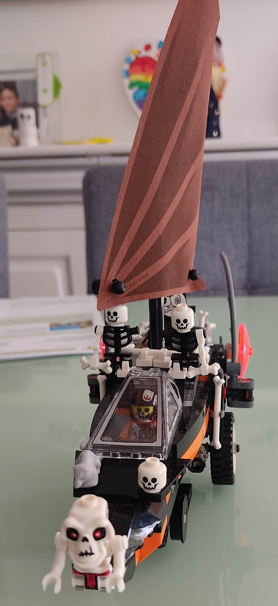](https://www.freelug.org/IMG/jpg/yg-01.jpg)

[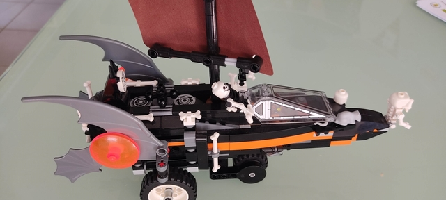](https://www.freelug.org/IMG/jpg/yg-02.jpg)

[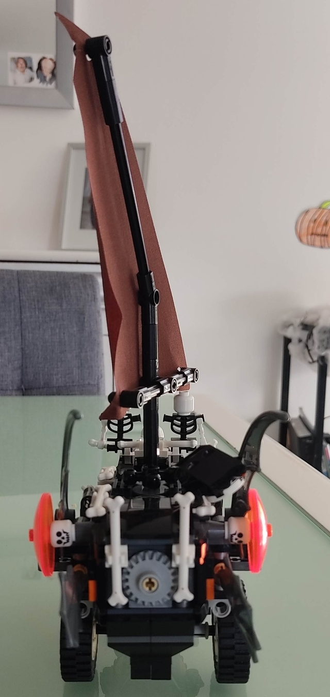](https://www.freelug.org/IMG/jpg/yg-03.jpg)

[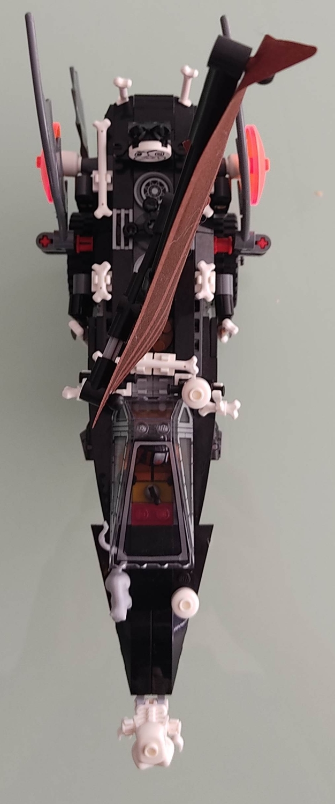](https://www.freelug.org/IMG/jpg/yg-04.jpg)

* * *

**04 - Xavier L. - HalloSpeeder de première génération**  
Il a la particularité de fonctionner à base d’essence d’âmes égarées et permets de voyager dans le temps et dans les univers parallèles.

[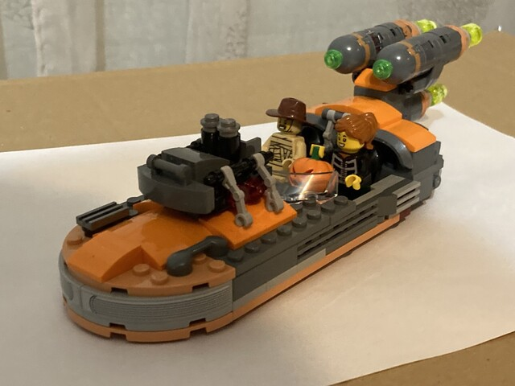](https://www.freelug.org/IMG/jpg/xl-01_personnalise_.jpg)

[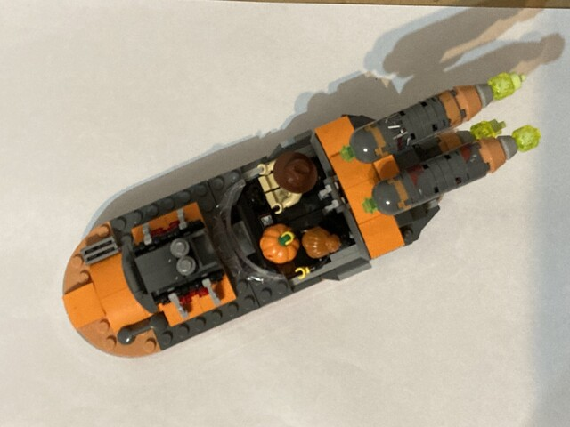](https://www.freelug.org/IMG/jpg/xl-02_personnalise_.jpg)

[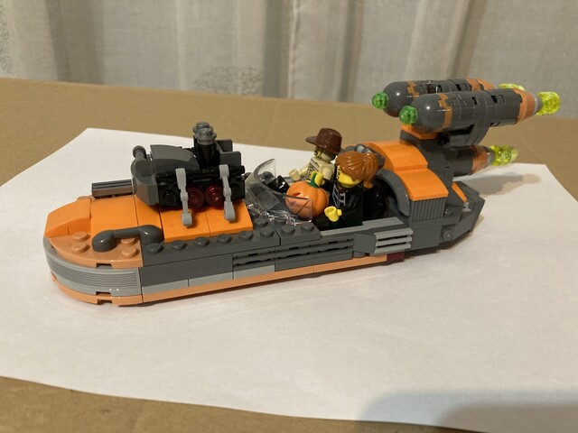](https://www.freelug.org/IMG/jpg/xl-03_personnalise_.jpg)

[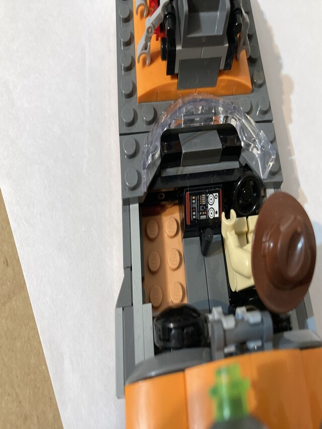](https://www.freelug.org/IMG/jpg/xl-04_personnalise_.jpg)

* * *

**05 - Jean-Michel R. - Il est temps**

[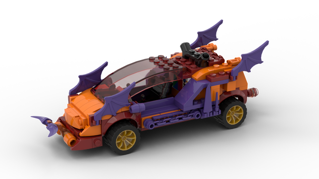](https://www.freelug.org/IMG/png/jmr-01_personnalise_.png)

[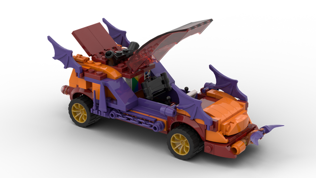](https://www.freelug.org/IMG/png/jmr-02_personnalise_.png)

[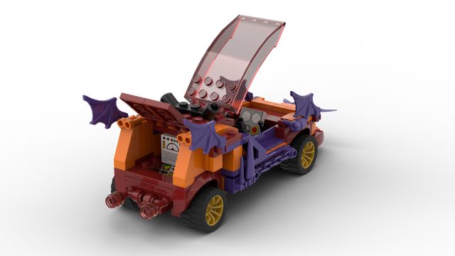](https://www.freelug.org/IMG/png/jmr-03_personnalise_.png)

[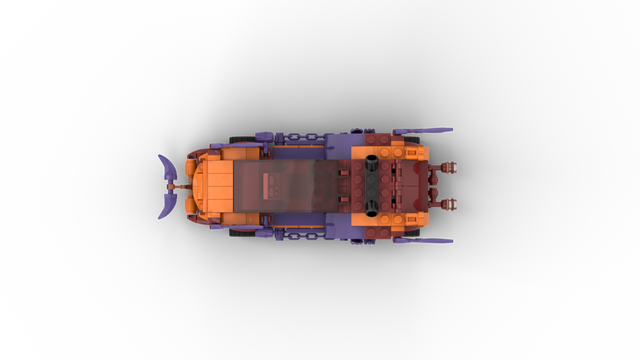](https://www.freelug.org/IMG/png/jmr-04_personnalise_.png)

* * *

**06 - Camille V. - C.I.T.R.O.U.I.L.L.E.**  
ou Cellule d’Intervention Temporelle Rotative à Observatoire Uniaxial Interne et Lames Latérales en Ecomatériau

[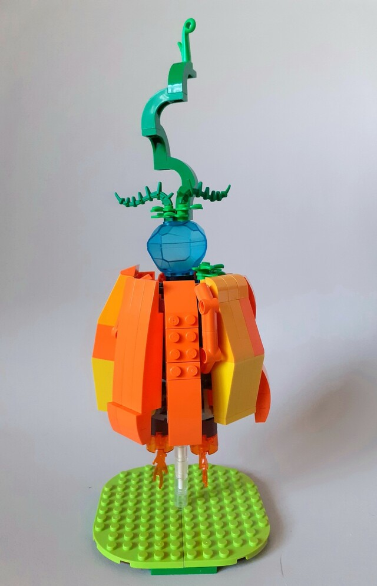](https://www.freelug.org/IMG/jpg/cv-01_personnalise_.jpg)

[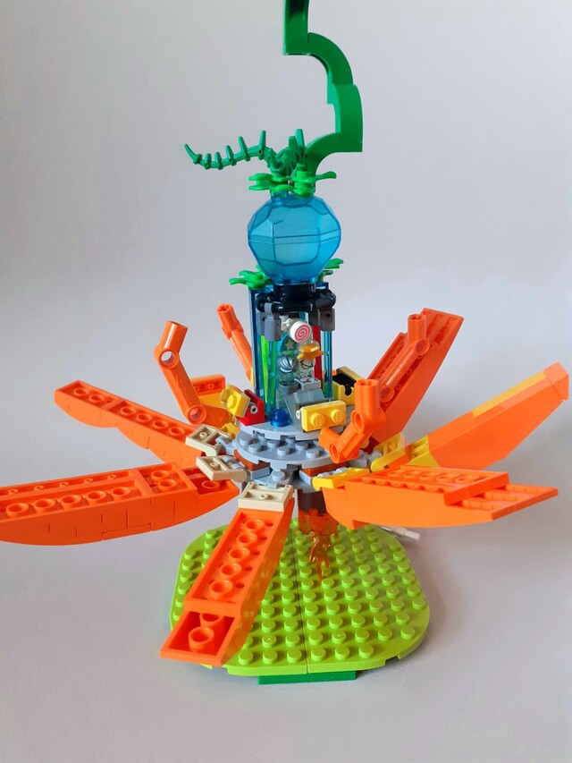](https://www.freelug.org/IMG/jpg/cv-02_personnalise_.jpg)

[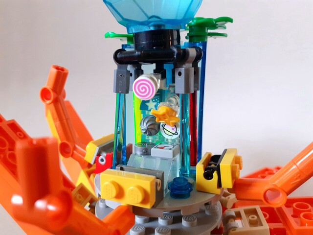](https://www.freelug.org/IMG/jpg/cv-03_personnalise_.jpg)

* * *

**07 - Charles F. - Halloween Train**  
Lors de leur retrouvaille sur la Route 66, Timmy avait sollicité l’aide de créatures vertes pour inventer des cristaux temporelles… le carburant de sa machine temporelle.  
Cette machine se révèle être un engin à l’allure de train d’ Halloween. En dépliant ses ailes, il peut alors s’envoler en faisant des bonds dans le temps.

[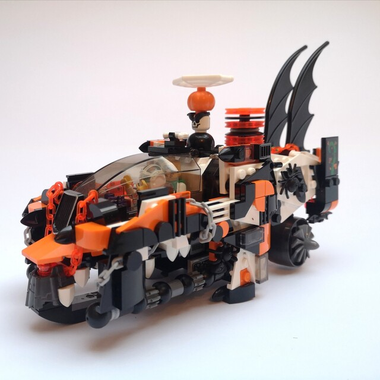](https://www.freelug.org/IMG/jpg/cf-01_personnalise_-2.jpg)

[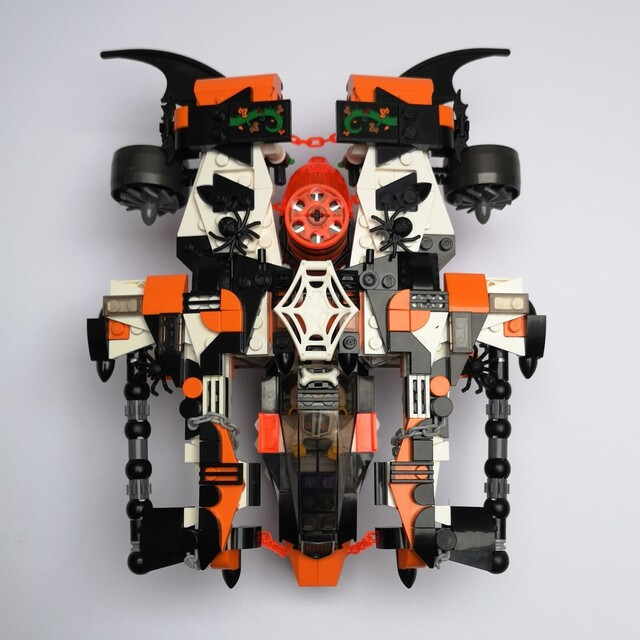](https://www.freelug.org/IMG/jpg/cf-02_personnalise_-2.jpg)

[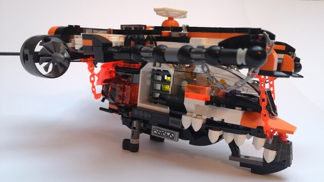](https://www.freelug.org/IMG/jpg/cf-03_personnalise_-2.jpg)

[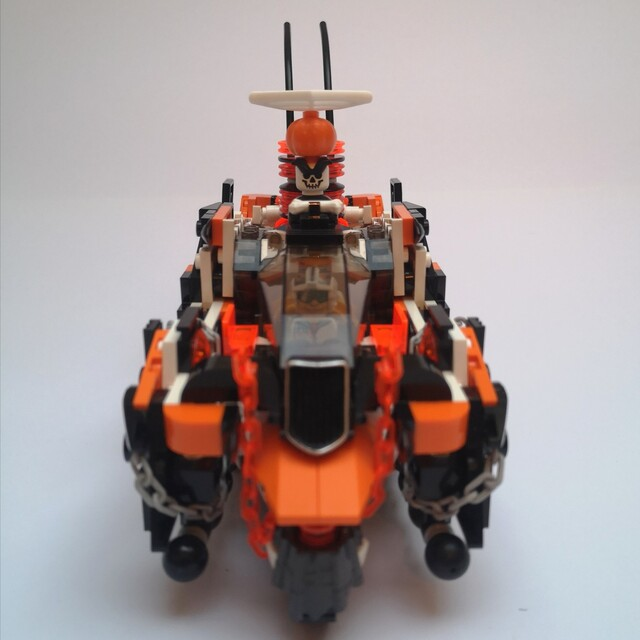](https://www.freelug.org/IMG/jpg/cf-04_personnalise_-2.jpg)

* * *

Devant la qualité des réalisations proposées, le GFC a décidé de récompenser le premier et le second.

**Les heureux gagnants de ce concours sont :**  
**–** **01 - Jérôme A. - Pumpkinmobile** qui remporte le set LEGO **Ref 21019 - The Eiffel Tower**  
**–** **06 - Camille V. - C.I.T.R.O.U.I.L.L.E.** qui remporte le set LEGO **Ref 75940 - Gallimimus and Pteranodon Breakout**

**Classement :**  
1\. Jérôme A. (5 points)  
2\. Camille V. (4 points)  
3\. Charles F. (3 points)  
4\. Xavier L. & Jean-Michel R. (1 point)  
5\. William V.D. & Yoann G. (0 point)

**Composition du jury :**  
Mathieu W. (GFC)  
Pierre C. (GFC)  
Xavier D. (GFC)  
Rémi L. (GFC)  
Julien S.  
Stéphane M.  
Fabrice A.  
Jeremie D.  
Elisabeth L.  
Julien P.  
Stéphane L.Q.  
Jérôme V.  
Duy Hai D.  
Benoit F.

* * *

**Merci à toutes et tous et à bientôt pour un nouveau concours !**
