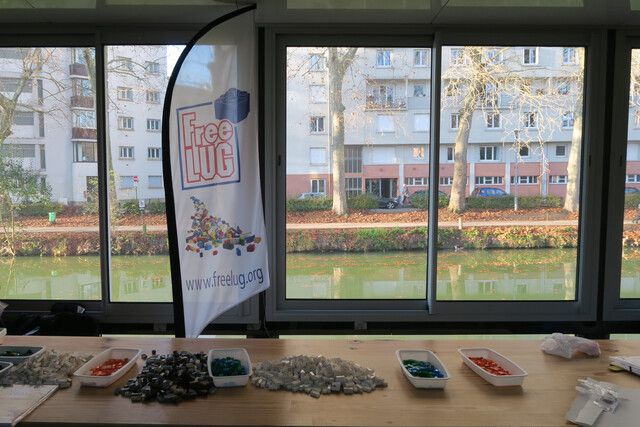
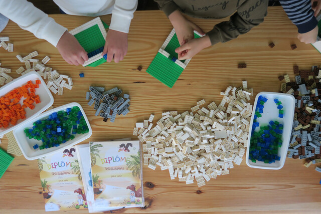
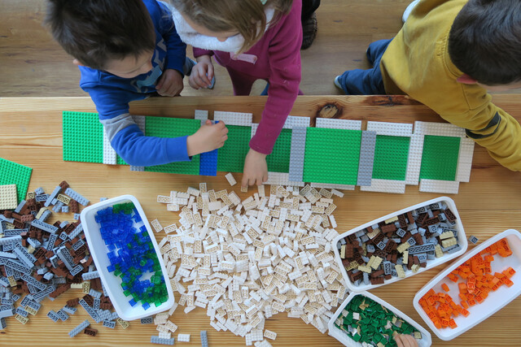
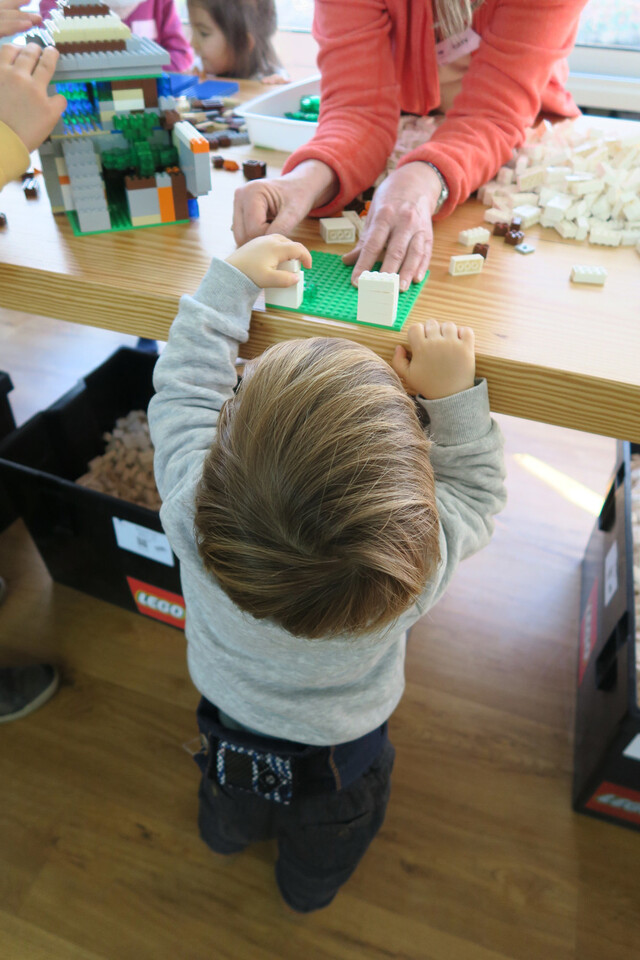

Une trentaine de parents et environ 25 enfants se sont retrouvés ce samedi sur une péniche sur le canal du midi. Les familles ne se connaissaient pas mais toutes avaient un point commun : un de leurs enfants est diabétique. La rencontre était patronnée par l’association Enfance Adolescence & Diabète.

L’objectif de notre atelier de construction libre LEGO était d’occuper les enfants et ainsi permettre aux parents de discuter de la prise en charge quotidienne de la santé de leurs enfants.

Nous étions somptueusement installés sur une péniche ancrée sur le canal du midi à Toulouse.

Les enfants étaient contents de construire et fiers de leurs créations. Une étape importante était la photo et la remise du diplôme.

Les enfants ont appris à se connaître à travers des constructions collaboratives.

Les enfants étaient de tous ages et même les plus petits ont participé.

L’objectif a été atteint. Les enfants étaient contents. Les parents ont pu largement échanger entre eux. Nous nous sommes promis de nous revoir.
