Aujourd’hui, je vous propose de découvrir une boîte de la gamme retirée Hidden Side. Il s’agit de la référence _70425_, portant le nom _L’école hantée de Newbury_.

Sortie en 2019, cette boîte comporte 1474 pièces et coûtait à l’époque 129,99 €. Sept personnages plus un chien fantôme sont inclus.

La boîte comporte un gros manuel d’instructions, une planche de stickers, et des sachets numérotés de 1 à 9.

Je ne vais pas présenter la construction, qui n’inclut pas de technique particulière mais est amusante néanmoins.

À noter que je n’ai pas appliqué les stickers, ce qui rend le résultat moins complet...

* * *

[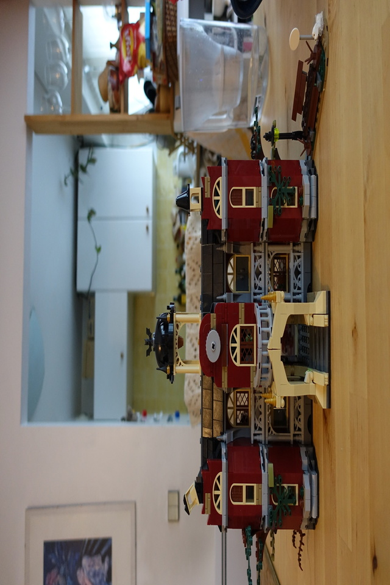](https://www.freelug.org/IMG/jpg/dsc03022.jpg)

[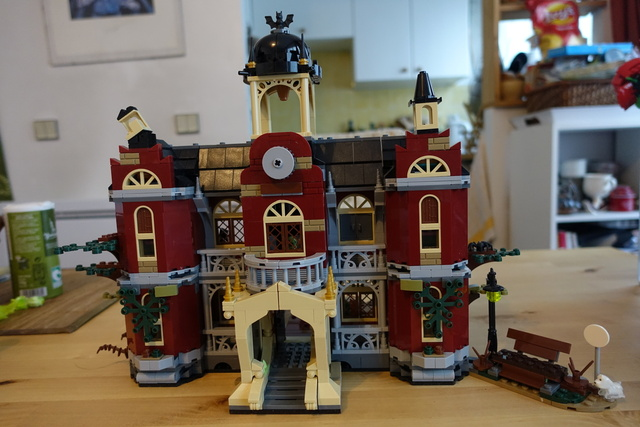](https://www.freelug.org/IMG/jpg/dsc03023.jpg)

Petite vision globale de l’école. La construction est quasiment symétrique (y compris la brique tan au milieu du rouge foncé), avec une tour de chaque côté. Seule la mini-tourelle au sommet est différente. Sur le côté droit [^1], un arrêt de bus avec un banc.

[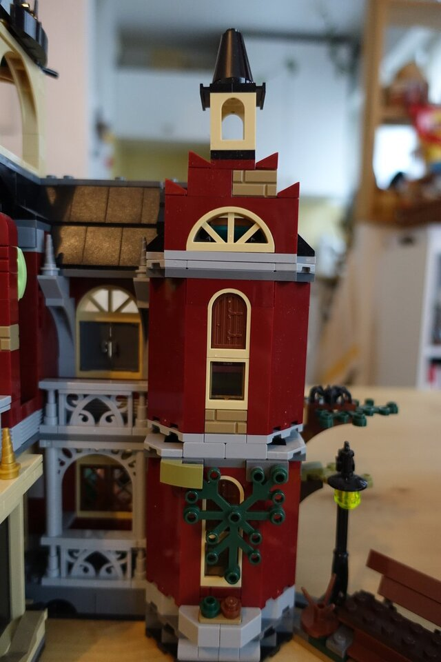](https://www.freelug.org/IMG/jpg/dsc03024-r90.jpg)

Le côté droit de l’école. La fenêtre de l’étage a un volet, tandis que celle du bas est plus qu’à moitié recouverte d’une plante, il ne doit pas faire très clair dans la salle correspondante...

[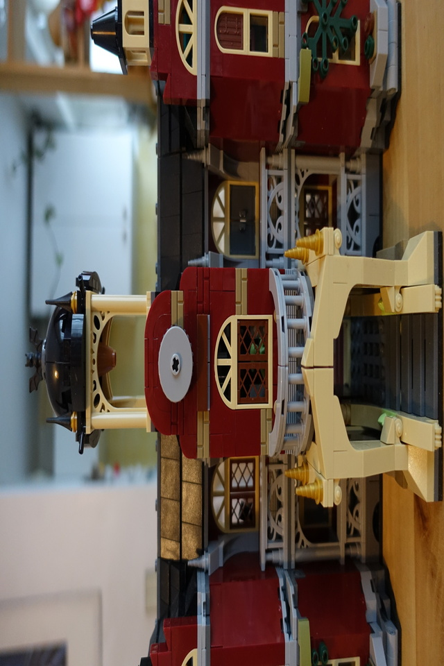](https://www.freelug.org/IMG/jpg/dsc03025.jpg)

Le centre, avec une balustrade pour mettre une figurine (pas d’escalier pour y accéder) surplombant l’entrée principale de l’école. La chauve-souris au sommet de la tour centrale est un petit plus rigolo. L’engrenage est une horloge, et la brique plate marron dessous est le nom de l’école... C’est ça que de ne pas avoir mis les autocollants !

[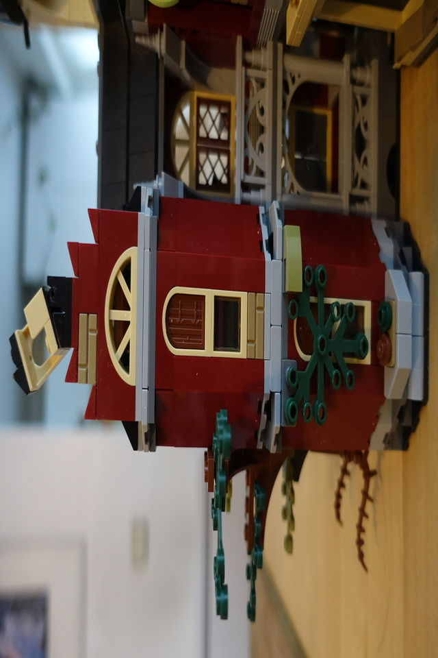](https://www.freelug.org/IMG/jpg/dsc03026.jpg)

Et le côté gauche, presque identique au côté droit.

[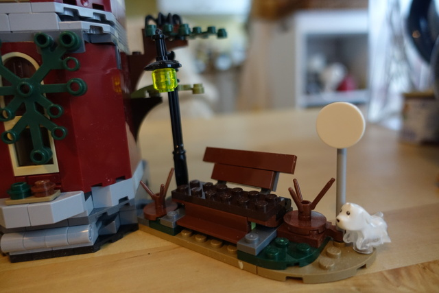](https://www.freelug.org/IMG/jpg/dsc03027.jpg)

Connecté à l’école, petit banc pour attendre le bus avec même un éclairage pour la nuit. Les plantes font un peu pitié en marron, elles semblent toutes sèches...

[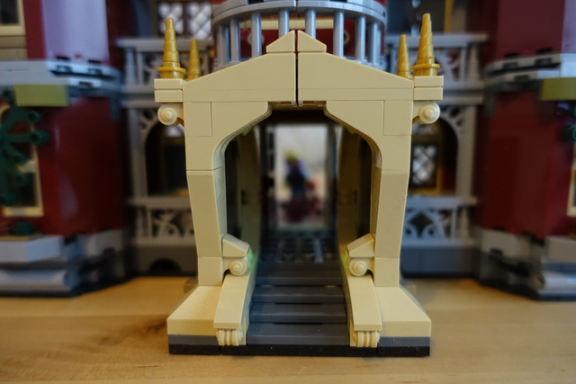](https://www.freelug.org/IMG/jpg/dsc03028.jpg)

Petite vue de l’entrée principale, qui traverse l’école via une porte ici ouverte.

[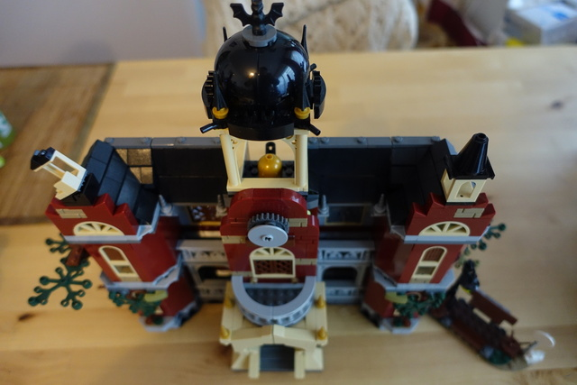](https://www.freelug.org/IMG/jpg/dsc03029.jpg)

Enfin une vue en plongée.

[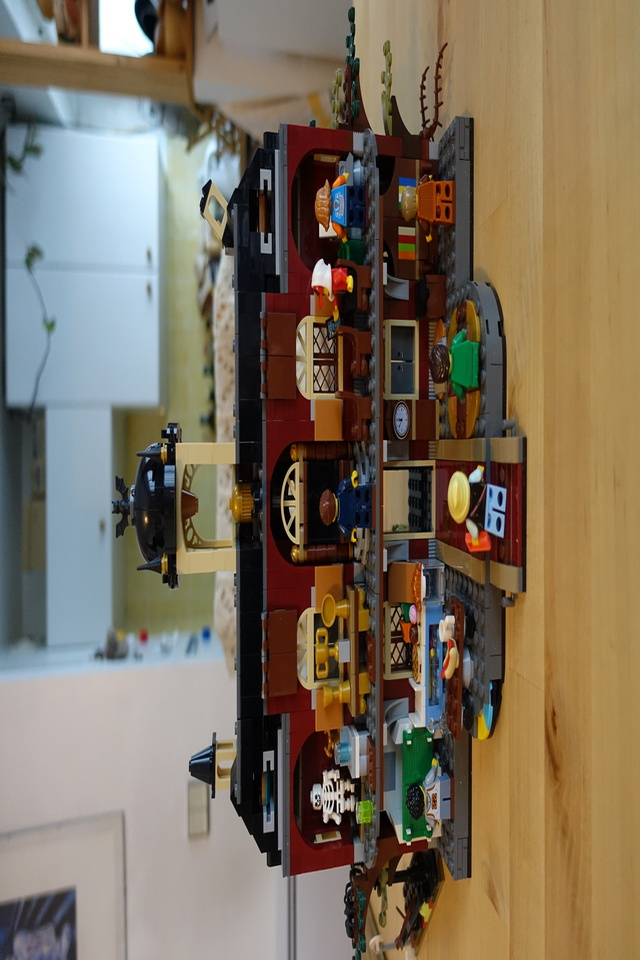](https://www.freelug.org/IMG/jpg/dsc03031.jpg)

De dos l’école présente de nombreux détails.

[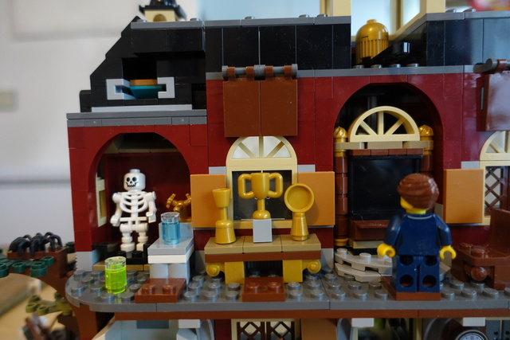](https://www.freelug.org/IMG/jpg/dsc03032.jpg)

À l’étage, sur le côté gauche un présentoir à trophées, et une salle genre laboratoire avec un joli squelette.

[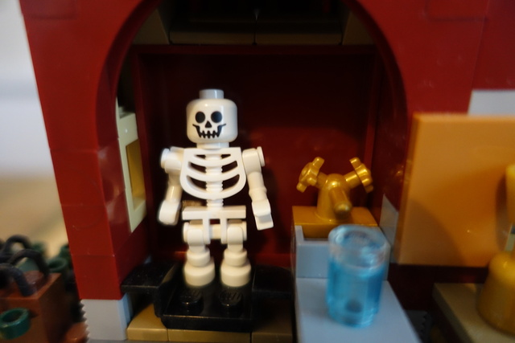](https://www.freelug.org/IMG/jpg/dsc03033.jpg)

Il y a même un point d’eau, pour rincer des récipients.

[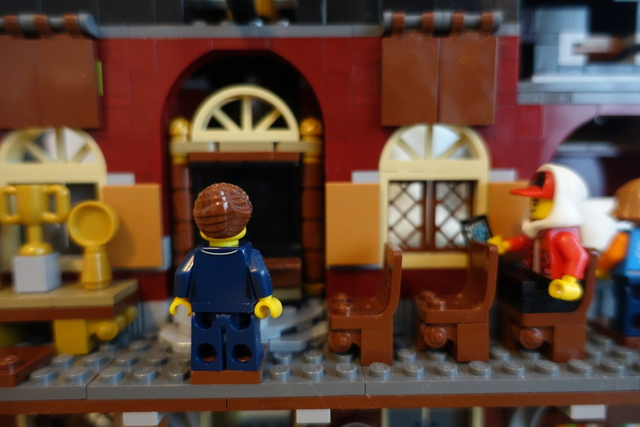](https://www.freelug.org/IMG/jpg/dsc03034.jpg)

[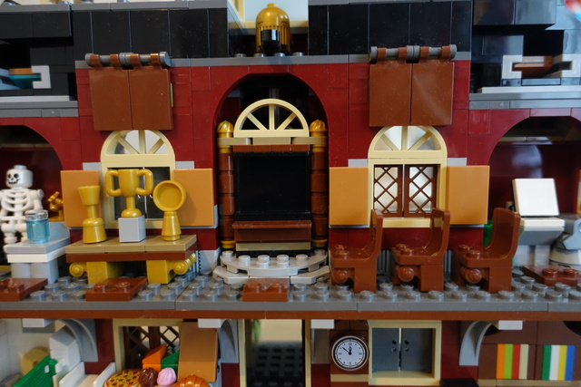](https://www.freelug.org/IMG/jpg/dsc03043.jpg)

La partie centrale est une salle de classe stylisée, avec un tableau noir (qui doit avoir un autocollant...), et des sièges pour les étudiants. Bon, ici, il est clairement dissipé, il joue avec son téléphone...

[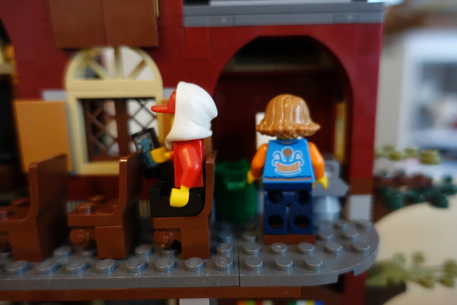](https://www.freelug.org/IMG/jpg/dsc03035.jpg)

[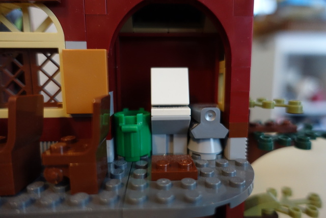](https://www.freelug.org/IMG/jpg/dsc03042.jpg)

Sur le côté droit, un mini bureau, avec ordinateur, imprimante, et une poubelle (pour jeter les ratés d’impression ?). À noter à différents endroits, à l’étage et en bas, de plaques 2x2 à 2 tenons pour accrocher des figurines à des endroits stratégiques.

[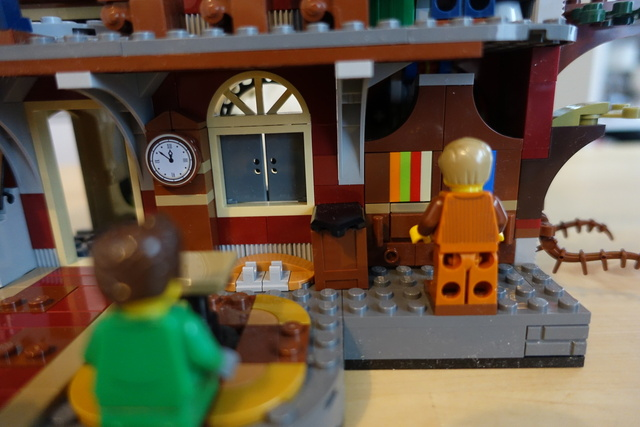](https://www.freelug.org/IMG/jpg/dsc03036.jpg)

[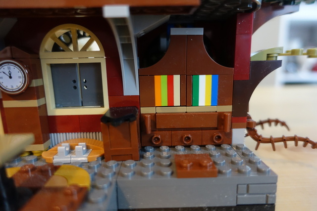](https://www.freelug.org/IMG/jpg/dsc03041.jpg)

Au rez-de-chaussée, une magnifique bibliothèque. Pas tellement de profondeur pour les livres, mais quelques pièces donnent un peu de relief, c’est déjà ça de pris.

[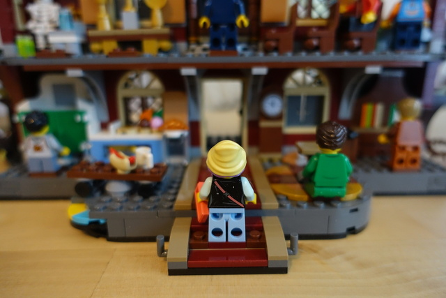](https://www.freelug.org/IMG/jpg/dsc03037.jpg)

Au centre, et un peu en retrait, une table basse (à droite) et un chariot avec un hot-dog. Sur le côté gauche, une roue à quatre couleurs, utilisée par l’application pour activer différents modes.

[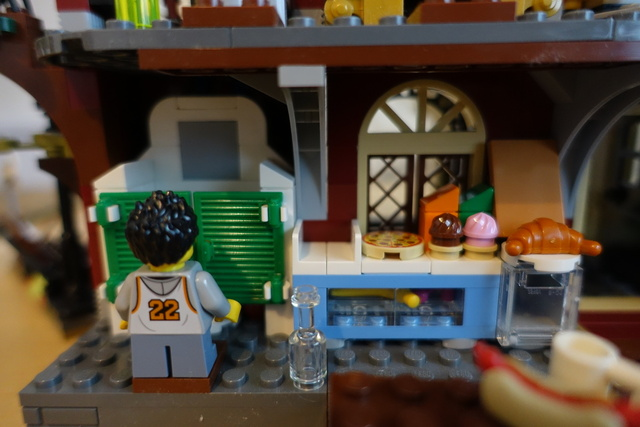](https://www.freelug.org/IMG/jpg/dsc03038.jpg)

[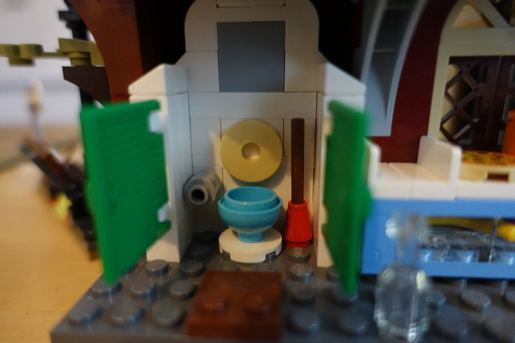](https://www.freelug.org/IMG/jpg/dsc03040.jpg)

À gauche, un buffet avec croissant et glaces ou gâteaux, et même une bouteille (j’espère d’eau ! Pas d’alcool dans les écoles !). Un coin toilettes bien rendu avec quelques pièces.

[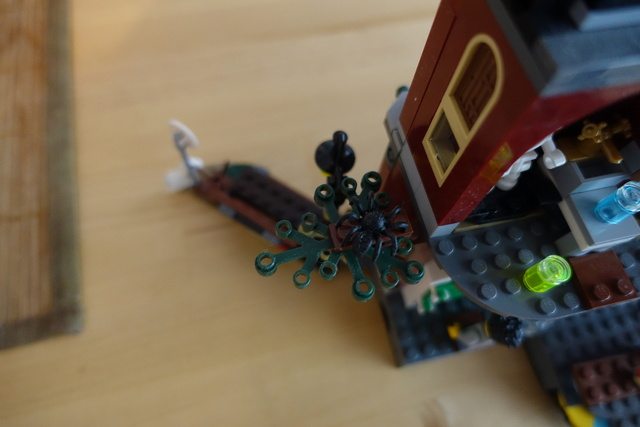](https://www.freelug.org/IMG/jpg/dsc03039.jpg)

Dernier petit détail, sur les feuilles de gauche se trouve une jolie araignée - peut-être qu’elle aussi veut assister aux cours...

* * *

Sept personnages sont fournis pour peupler l’école. D’après le nom écrit sur la boîte, je dirais qu’il y a trois professeurs et quatre élèves (ou trois plus un petit enfant là par hasard ?).

[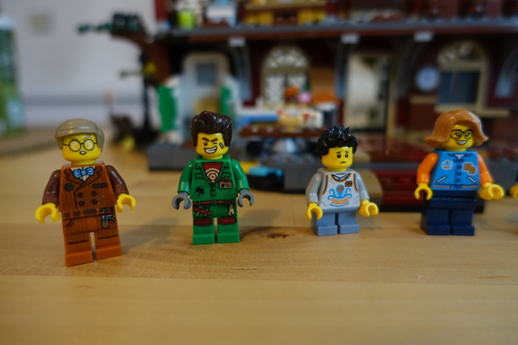](https://www.freelug.org/IMG/jpg/dsc03045.jpg)

Nous avons donc de gauche à droite :  
**–** M. Clarke, avec un air naïf et un joli complet plus nœud papillon, sans oublier la montre à gousset. Si je devais deviner, il serait directeur de l’école et pince-sans-rire  
**–** M. Elton, qui fait bricoleur bien équipé et prêt à tout. À vue de mon nez, le professeur sympa et apprécié des élèves  
**–** Wade, le seul enfant du groupe, qui a un air triste. Il est fan d’une équipe de sports (basketball ?), portant le costume du numéro 22 des « Squids »  
**–** Paola, qui a l’air de bien s’amuser et a une veste également des « Squids »

[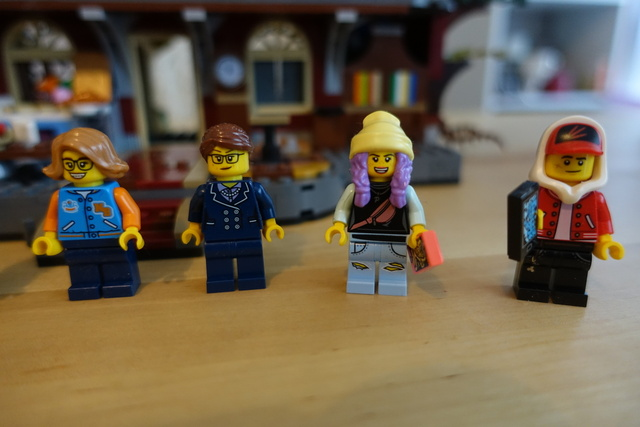](https://www.freelug.org/IMG/jpg/dsc03047.jpg)

suivis de :  
**–** Rose Davids, qui fait femme d’affaires mais est probablement professeur.  
**–** Parker, avec de magnifiques tresses violettes, une banane en bandoulière, un pantalon déchiré, et à la main le téléphone qui lui permet je crois de voir et chasser les fantômes  
**–** Jack enfin, avec une magnifique capuche à visière intégrée, une veste ouverte sur un t-shirt blanc, et également un téléphone

Les tampographies sont jolies, même si les bras mériteraient quelques décorations.

[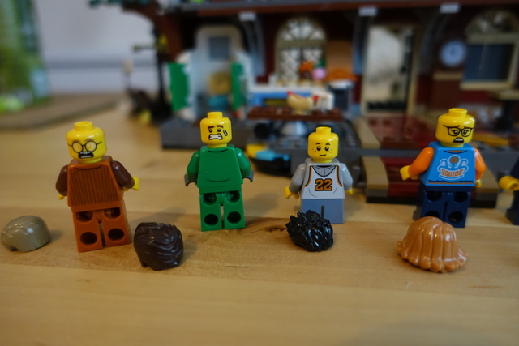](https://www.freelug.org/IMG/jpg/dsc03050.jpg)

[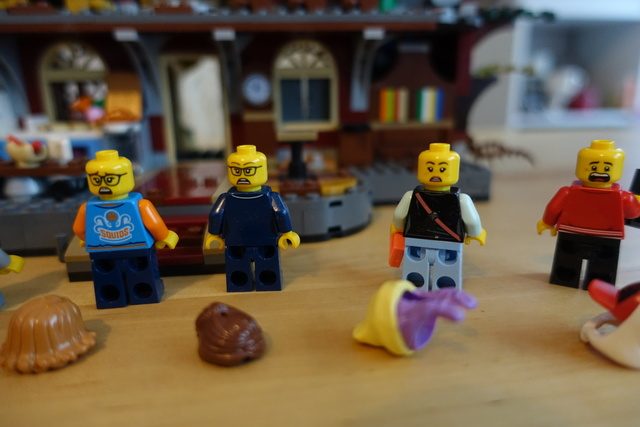](https://www.freelug.org/IMG/jpg/dsc03051.jpg)

Tous les personnages ont un visage alternatif, qui exprime de la peur ou de l’effroi (possible que je me sois trompé de visage « principal » pour Wade). Les dos ne sont pas toujours très recherchés mais en raccord avec l’avant (équipe de sport, rayures de costume, etc.).

* * *

Comme il se doit pour cette gamme, l’école présente un « aspect caché », fantômatique.

[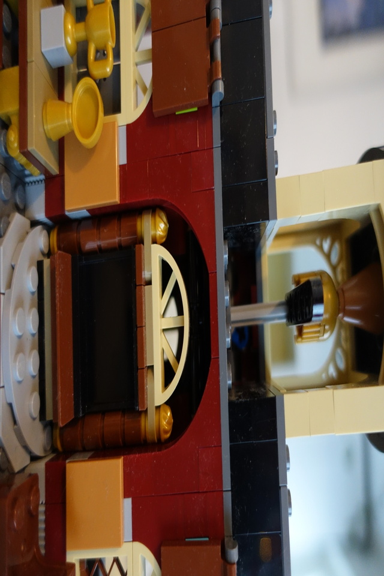](https://www.freelug.org/IMG/jpg/dsc03054.jpg)

En soulevant le levier sous la cloche, ...

[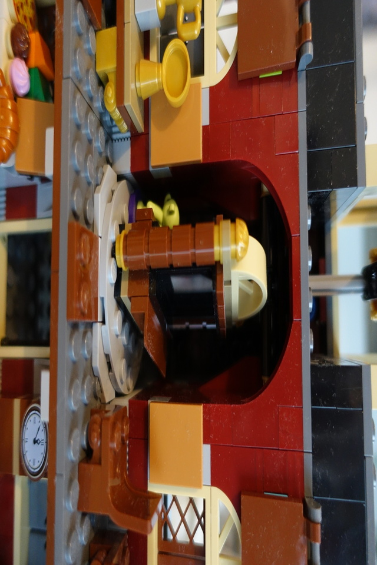](https://www.freelug.org/IMG/jpg/dsc03055.jpg)

on peut faire tourner le tableau noir (à noter qu’il faut bien assembler les pièces, sinon la rotation peut être très difficile voire impossible !), ...

[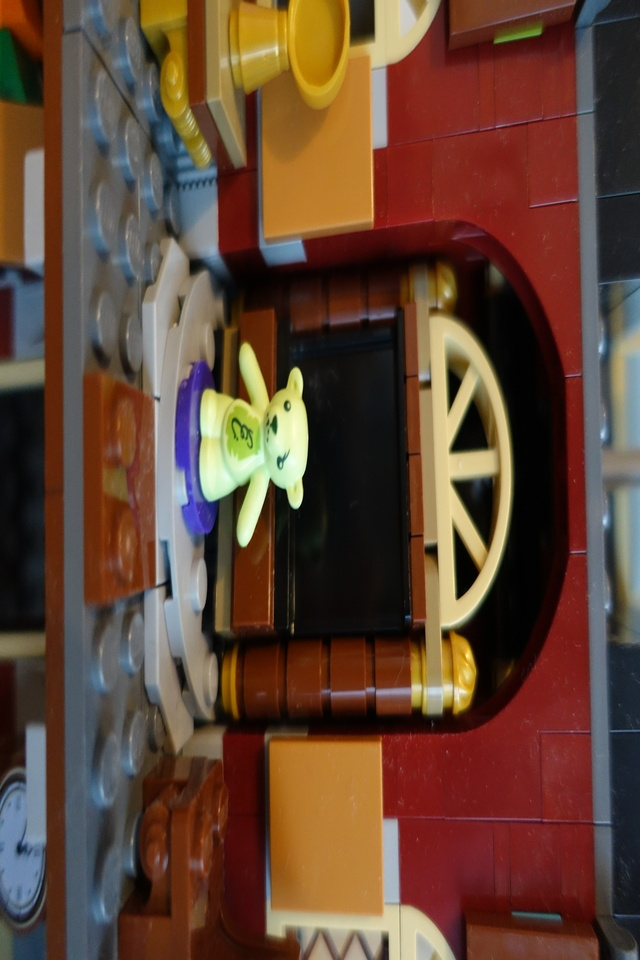](https://www.freelug.org/IMG/jpg/dsc03056.jpg)

qui révèle un magnifique ours fantôme. Ce personnage est peut-être important dans l’histoire, qui sait.

[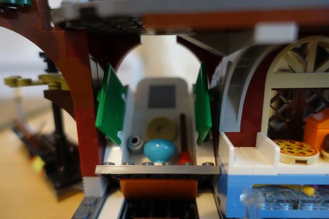](https://www.freelug.org/IMG/jpg/dsc03052.jpg)

Les toilettes...

[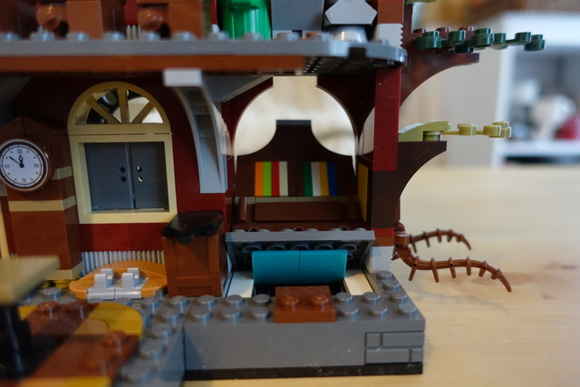](https://www.freelug.org/IMG/jpg/dsc03053.jpg)

... et la bibliothèque basculent, ...

[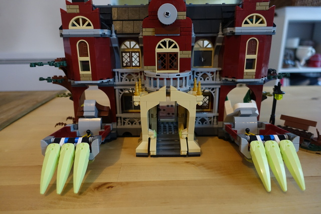](https://www.freelug.org/IMG/jpg/dsc03057.jpg)

... pour faire sortir de magnifiques griffes du plus bel effet.

[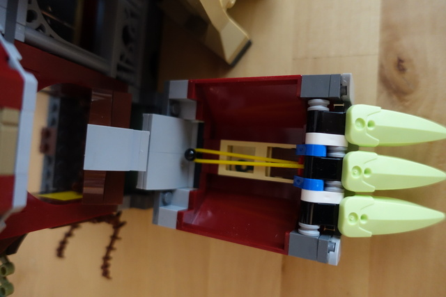](https://www.freelug.org/IMG/jpg/dsc03061.jpg)

Ces griffes sont actionnées par un simple élastique, qui se tend quand le mur est relevé et se détend au basculement.

[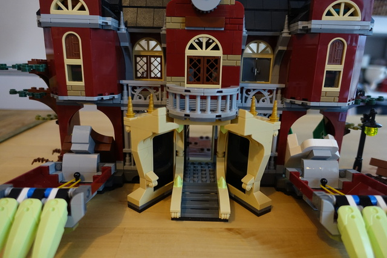](https://www.freelug.org/IMG/jpg/dsc03058.jpg)

L’entrée principale s’ouvre comme une grande bouche, pour avaler les élèves y pénétrant (autocollants des deux côtés... décidément j’aurais mieux fait de les coller !).

[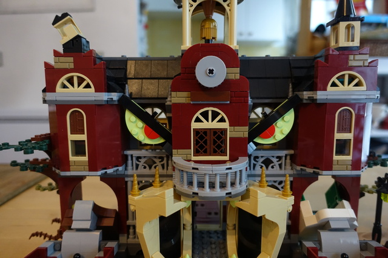](https://www.freelug.org/IMG/jpg/dsc03059.jpg)

En tournant l’horloge, on libère les deux yeux menaçants.

[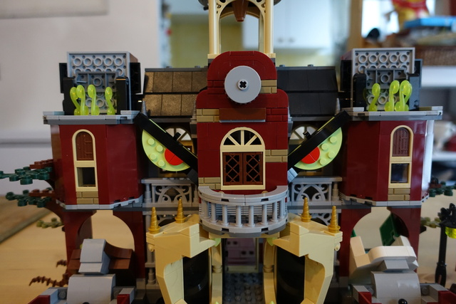](https://www.freelug.org/IMG/jpg/dsc03060.jpg)

Les toits des tours basculent pour permettre à de jolis tentacules d’émerger.

[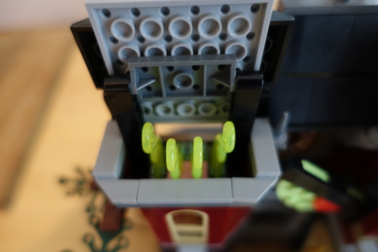](https://www.freelug.org/IMG/jpg/dsc03062.jpg)

Le mécanisme est simple également, avec un système de bascule faisant monter et descendre les griffes.

[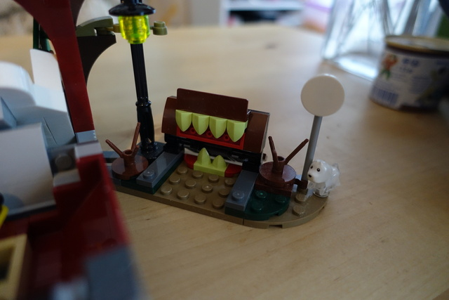](https://www.freelug.org/IMG/jpg/dsc03063.jpg)

Enfin le banc de l’arrêt de bus bascule pour dévoiler de magnifiques dents phosphorescentes.

[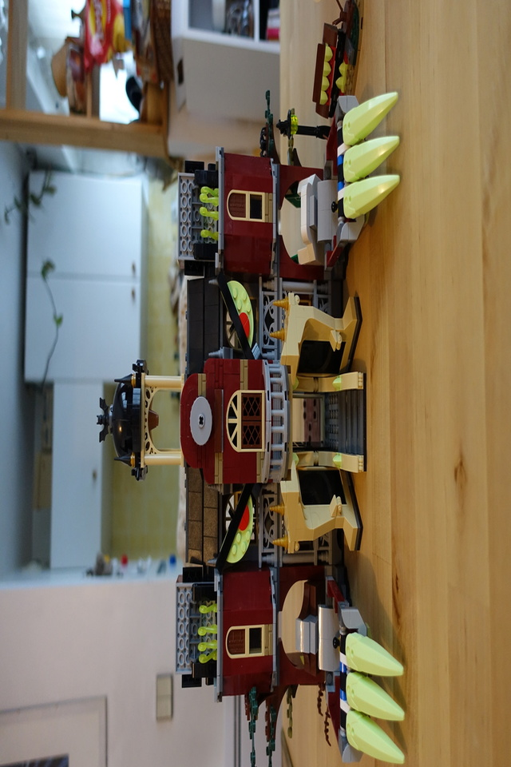](https://www.freelug.org/IMG/jpg/dsc03064.jpg)

[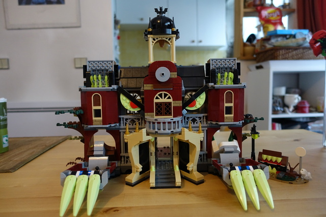](https://www.freelug.org/IMG/jpg/dsc03066.jpg)

L’école version « monstrueuse » dans toute sa splendeur. Franchement, ça rend vraiment bien, on voit très bien le monstre apparaître !

[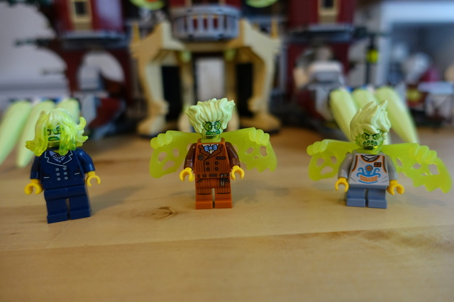](https://www.freelug.org/IMG/jpg/dsc03069.jpg)

[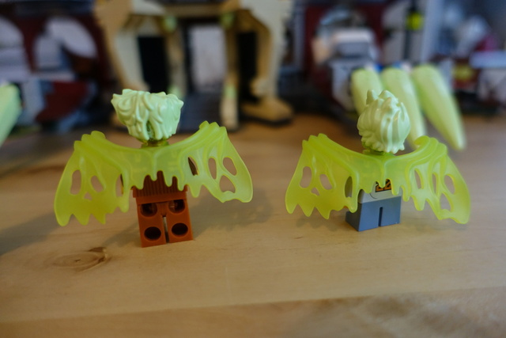](https://www.freelug.org/IMG/jpg/dsc03070.jpg)

Trois personnages se transforment également : Rose Davids, M. Clarke et le pauvre Wade.

[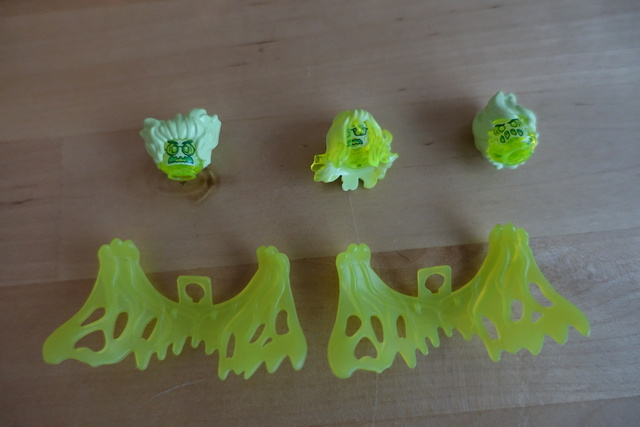](https://www.freelug.org/IMG/jpg/dsc03067.jpg)

Les ailes sont vraiment réussies, avec un aspect « usé, troué, effiloché ». Leur plastique est un peu mou, pas le même que les briques. Les visages version fantôme sont très jolis, rappelant le visage d’origine (lunettes par exemple). Mention spéciale pour la chevelure de Rose qui a des extrémités translucides accentuant le côté fantastique.

[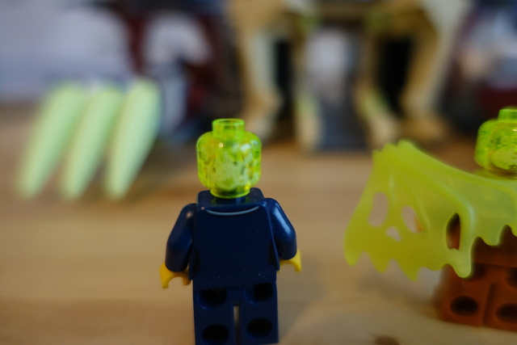](https://www.freelug.org/IMG/jpg/dsc03071.jpg)

[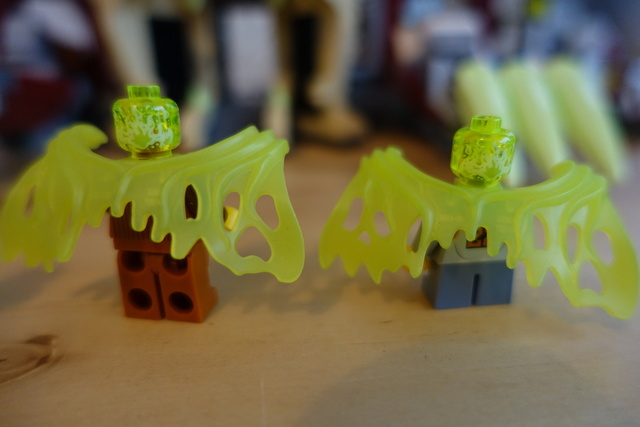](https://www.freelug.org/IMG/jpg/dsc03072.jpg)

Les têtes ont un petit motif en forme vaguement de flamme à l’arrière, je ne sais pas s’il a un sens ou pas, mais c’est un plus appréciable.

* * *

**Avis :** une excellente boîte ! L’école rend à mon avis très bien (même si elle peut être améliorée en rajoutant de la profondeur sur l’arrière), et l’aspect « transformable » est vraiment un plus appréciable.

Je verrais bien cette école intégrée à une ville, peut-être dans un parc comme les écoles américaines « cliché ».

De nombreuses pièces sont phosphorescentes, pour renforcer le côté « fantômatique ».

On pourrait reprocher le nombre de stickers, mais peu importe.

En revanche je n’ai pas pu installer l’application pour voir ce que cela rendait en réalité virtuelle...

Bref, aucun regret pour cet achat !

[^1]: « Gauche » et « droit » sont relatifs au côté de la photo, pas par rapport à la construction.
