11 participants ont capturés des photos inédites du Père-Noël qui permettent de nous en apprendre un peu plus sur cette célébrité du mois de décembre.

Vous pouvez retrouver le [règlement de ce concours ici](https://www.freelug.org/spip.php?article3154).

Tout d’abord, nous tenons à remercier les 11 participants qui nous ont proposé de très belles photos.

Les participations sont présentées dans l’ordre de réception.

**01 - Carl R. - Il est temps de rentrer**

[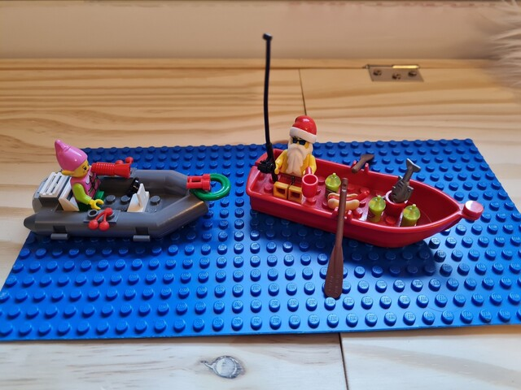](https://www.freelug.org/IMG/jpg/01-01_personnalise_-2.jpg)

* * *

**02 - Gaultier O.-G. - Rennes à louer !**

[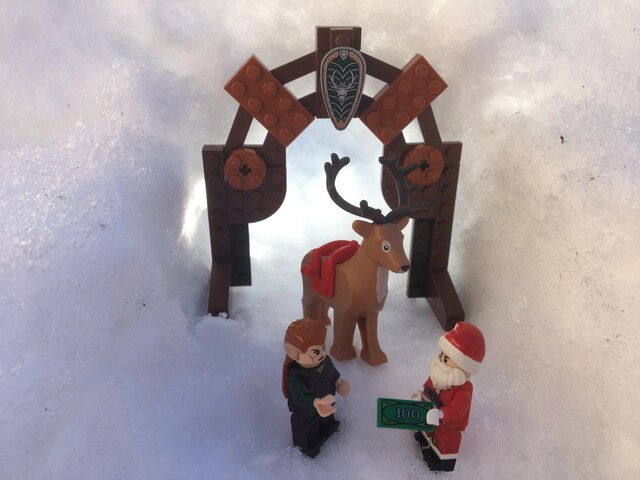](https://www.freelug.org/IMG/jpg/02-01_personnalise_-3.jpg)

* * *

**03 - Jean-Michel R. - Décadence Instagramée. #santa #blog #pasdenoel**

[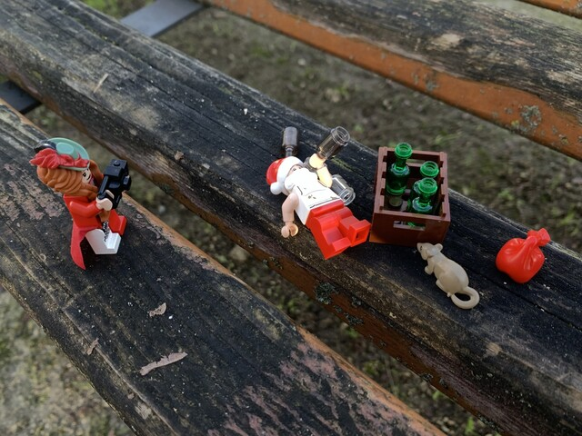](https://www.freelug.org/IMG/jpg/03-01_personnalise_-2.jpg)

* * *

**04 - Mathieu W. - J’en ai marre de chercher les droïdes, je change de métier !**

[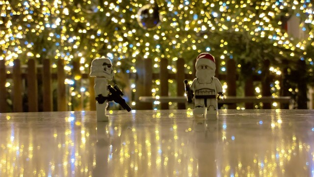](https://www.freelug.org/IMG/jpg/04-01_personnalise_.jpg)

* * *

**05 - Xavier D. - Le Père Noël va être en retard... il court après son bonnet ! Fichu lutin !**

[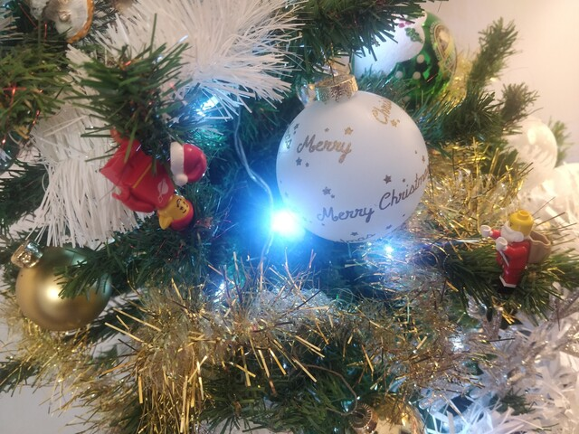](https://www.freelug.org/IMG/jpg/05-01_personnalise_.jpg)

* * *

**06 - Stéphane B. - Scandale révélé ! Le Pole Dance est la passion secrète du Père Noël !**

[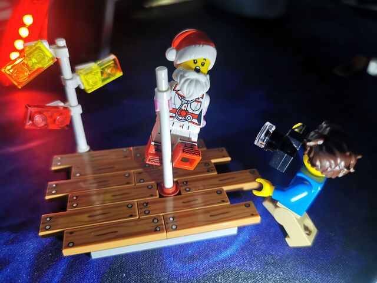](https://www.freelug.org/IMG/jpg/06-01.jpg)

* * *

**07 - Rémi L. - Le Père Noël ne passera pas cette année (Citation de Vil Coyote)**

[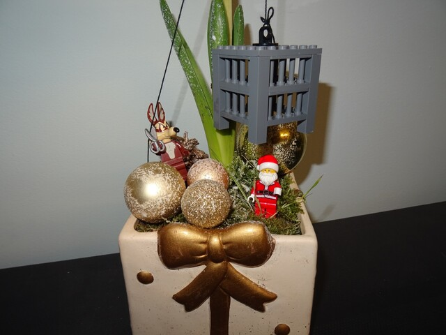](https://www.freelug.org/IMG/jpg/07-01_personnalise_.jpg)

* * *

**08 - Céline D. - Entre vieux sages, tu te baladeras**

[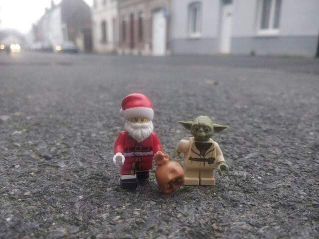](https://www.freelug.org/IMG/jpg/08-01.jpg)

* * *

**09 - Eric P. - Aujourd’hui, je règle mes comptes avec les Playmobils !**

[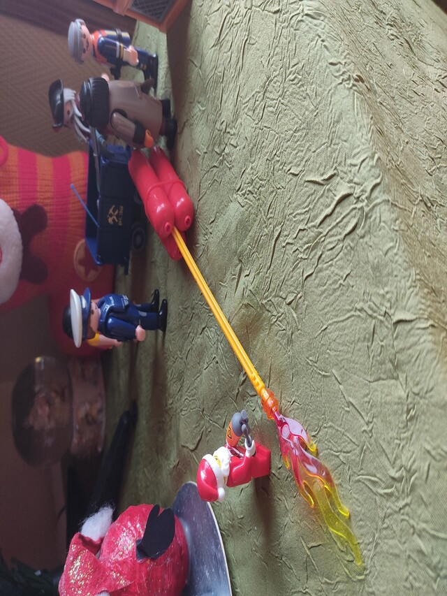](https://www.freelug.org/IMG/jpg/09-01_personnalise_-2.jpg)

* * *

**10 - Erik A. - Le Père Noël s’offre un nouveau tatouage**

[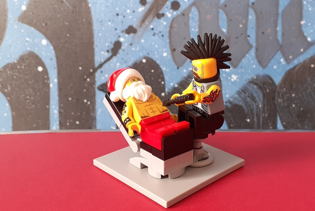](https://www.freelug.org/IMG/jpg/10-01.jpg)

* * *

**11 - Laurent C. - Le froid s’installe doucement, il est temps... de prendre des forces**

[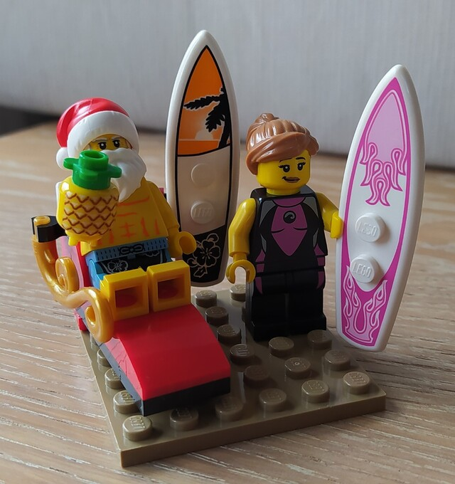](https://www.freelug.org/IMG/jpg/11-01.jpg)

* * *

Hors concours car hors délai :  
**12 - Duy Hai D. - Ciel, mon pantalon !**

[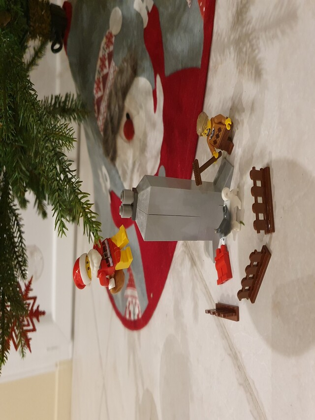](https://www.freelug.org/IMG/jpg/12-01_personnalise_.jpg)

* * *

Edit du 29/01/2022 :  
Il est temps de faire le tirage au sort pour ce concours. Pour être le plus juste possible et le plus transparent, nous allons prendre les résultats du Loto du Samedi 29 Janvier 2022 pour tirer les gagnants aux sorts.  
Chaque participant (sauf les gagnants du vote) s’est vu attribuer 6 numéros de la grille du loto :

Carl R. : 1, 9,17,24,32,41  
Mathieu W. : 2,10,18,26,34,42  
Xavier D. : 3,11,19,27,35,43  
Stéphane B. : 4,12,20,28,36,44  
Céline D. : 5,13,21,29,37,45  
Eric P. : 6,14,22,30,38,46  
Erik A. : 7,15,23,31,39,47  
Laurent C. : 8,16,24,32,40,48  
Remise en jeu pour le numéro suivant 49

RÈGLEMENT :  
Le premier numéro dans l’ordre d’apparition du tirage qui sera annoncé sera le gagnant. Si ce numéro est 49 alors nous prendrons le 2ème numéro annoncé et ainsi de suite.

* * *

Pour ce concours, le GFC a décidé de récompenser 3 gagnants au vote en plus du gagnant au tirage au sort, soit 4 gagnants en tout.

Les heureux gagnants de ce concours pour le vote sont :  
**–** Gaultier O.-G. - "Rennes à louer !" qui remporte le set Ref 76152 - Avengers Wrath of Loki  
**–** Rémi L. - "Le Père Noël ne passera pas cette année (Citation de Vil Coyote)" qui remporte le set Ref 41390 - Andrea’s Car & Stage  
**–** Jean-Michel R. - "Décadence Instagramée. #santa #blog #pasdenoel" qui remporte le set Ref 31102 - Fire Dragon

L’heureux gagnant du tirage au sort est :  
**–** Mathieu W. - J’en ai marre de chercher les droïdes, je change de métier ! qui remporte le set Ref 11008 - Bricks and Houses

Vous pouvez retrouver la vidéo du tirage [ici](https://www.youtube.com/watch?v=V2OfxRoIGCQ)

* * *

Classement :  
1\. Gaultier O.-G. (23 points)  
2\. Rémi L. & Jean-Michel R. (13 points)  
3\. Erik A. (12 points)  
4\. Stéphane B. (11 points)  
5\. Mathieu W. (10 points)  
6\. Céline D. (5 points)  
7\. Eric P. (3 points)  
8\. Carl R. & Xavier D. & Laurent C. (0 point)

Composition du jury :  
Pierre C. (GFC)  
Charles F. (GFC)  
Maxence L. (enfant)  
Thibault P.  
Simon P.  
Christophe L.  
Christophe M.  
Sylvain J.  
Camille V.  
Benjamin G.  
Stéphane M.  
Romain G.  
Xavier L.  
Jeremie D.  
Cyril L.

* * *

**Merci à toutes et tous et à bientôt pour un nouveau concours !**
