Noël étant passé, les espions du père Fouettard n’étant plus dans les environs, il est temps de vous présenter les différents Mecha imaginés pour le Père Noël et de découvrir celui qui lui a permis de déposer pleins de cadeaux au pied du sapin en 2021.

Bonjour à toutes et à tous,

Vous pouvez retrouver le [règlement de ce concours ici](https://www.freelug.org/spip.php?article3151)

Tout d’abord, nous tenons à remercier les 5 participants qui nous ont proposé de très jolis robots. (4 en réel et 1 seul en virtuel)

Les participations sont présentées dans l’ordre de réception.

## Concours catégorie "Réelle"

**01 - Jean Michel R. - "Santamama"**  
Nous le savons désormais tous, le Renne Rudolf à été brutalisé par Tonnerre lors d’une soirée "olé olé" digne des plus grandes reines ! La Mère Noël à décidé que toute cette décadence ne pouvait plus durer et à décidé de prendre un Mecha.  
Bien que la version officielle diffère quelque peu des faits, les détails de cette machine sont assez proches de ce qu’a édité le journal SantaFree(lug), à savoir qu’elle a absolument tenu à avoir un four pour concocter des merveilleux gâteaux à son mari, et pouvoir être à ses côtés si le cœur lui en dit.  
Elle a également demandé à ce que ce robot puisse transporter les cadeaux des mioches (gentils ou méchants) dans sa hotte, mais attention, le Père Noël a imposé certaines conditions...  
C’est pourquoi ce robot est équipé :  
\- d’un canon à boules de neige, à la ceinture, et puisant sa matière première directement de la neige au sol grâce à un merveilleux système de canalisation qui transforme la neige en boules.  
\- de canons qui lance des bâtons magiques, à la ceinture également, pour se protéger des Rennes voulant reprendre leur poste.  
\- d’un propulseur de cadeaux qui relie la hotte à un bras lanceur (oui, le Père Noël est âgé, il souhaite ne plus trop bouger).  
\- d’un autre bras lui permettant de grimper dans les montagnes les plus élevés grâce à ses pointes antidérapantes.

[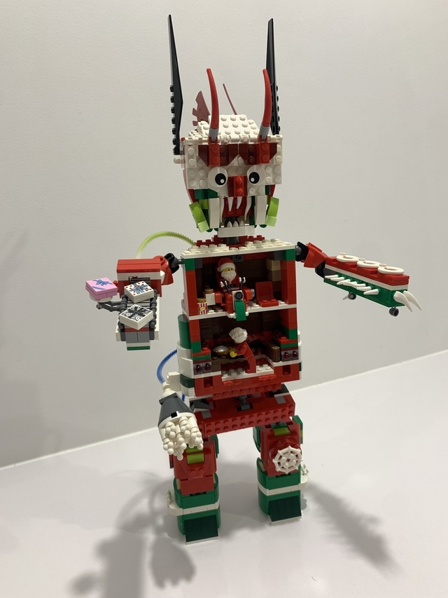](https://www.freelug.org/IMG/jpg/025-01-01.jpg)

[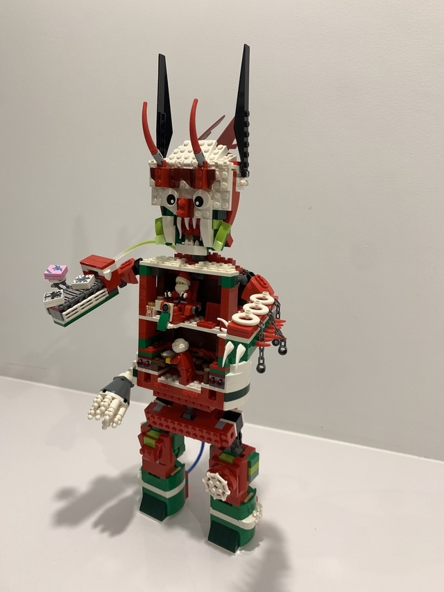](https://www.freelug.org/IMG/jpg/025-01-02.jpg)

[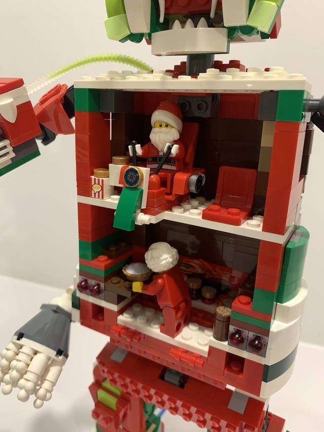](https://www.freelug.org/IMG/jpg/025-01-03.jpg)

[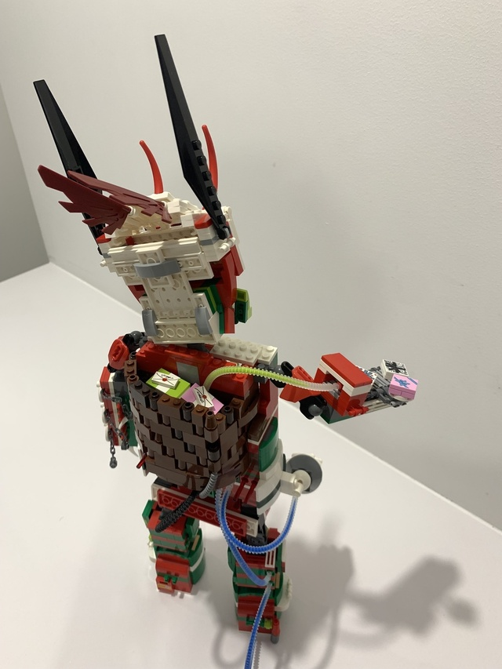](https://www.freelug.org/IMG/jpg/025-01-04.jpg)

[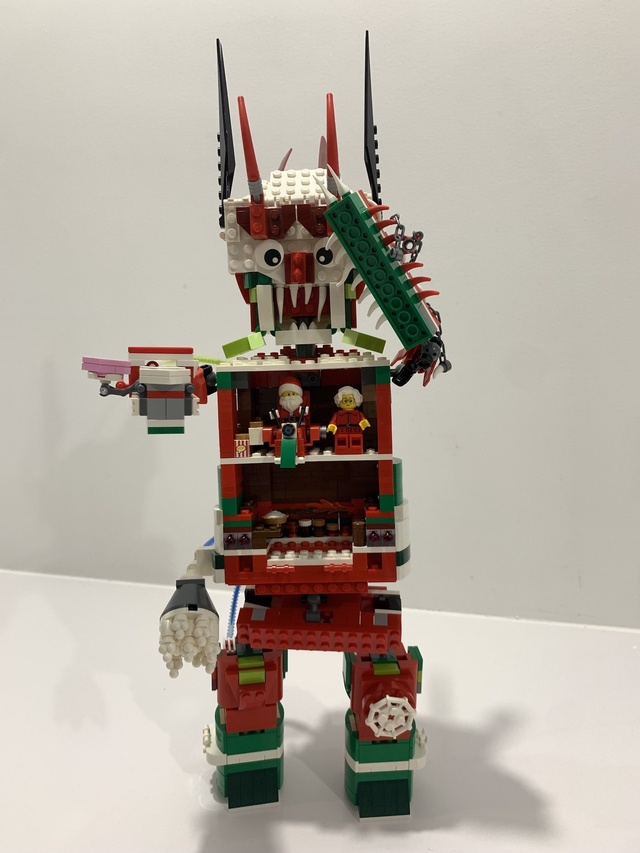](https://www.freelug.org/IMG/jpg/025-01-05.jpg)

[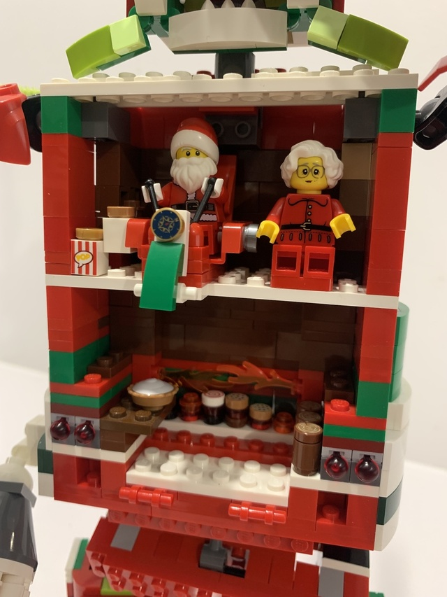](https://www.freelug.org/IMG/jpg/025-01-06.jpg)

[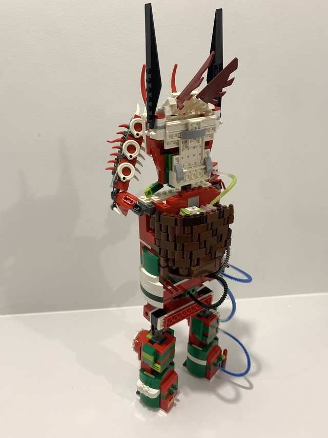](https://www.freelug.org/IMG/jpg/025-01-07.jpg)

* * *

**02 - Gaultier O.-G. - "Le père Noël a un nouveau joujou !"**  
Issu des usines de Ninjago City, Le S4-NT4 est le nouveau joujou du père-Noël…  
Malgré ses dimensions impressionnantes, la prise en main est facile. Il est à la fois capable de porter de lourdes charges et d’une précision remarquable permettant même d’attraper un cookie (ou la mère Noël) sans l’écraser. La salle des commandes se trouve dans le buste et la version numéro 16 est même équipée d’un four à cookie situé dans la tête du robot. Il ne reste plus qu’à charger la hotte et la tournée pourra commencer.

[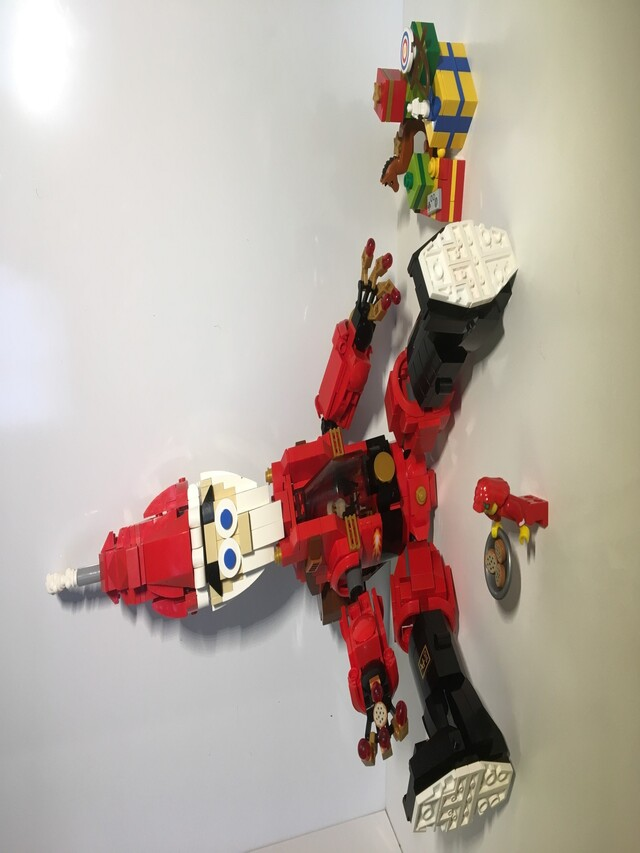](https://www.freelug.org/IMG/jpg/25-02-01_personnalise_.jpg)

[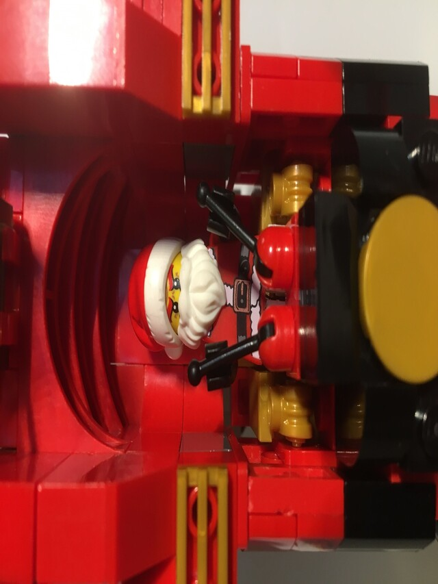](https://www.freelug.org/IMG/jpg/25-02-02_personnalise_.jpg)

[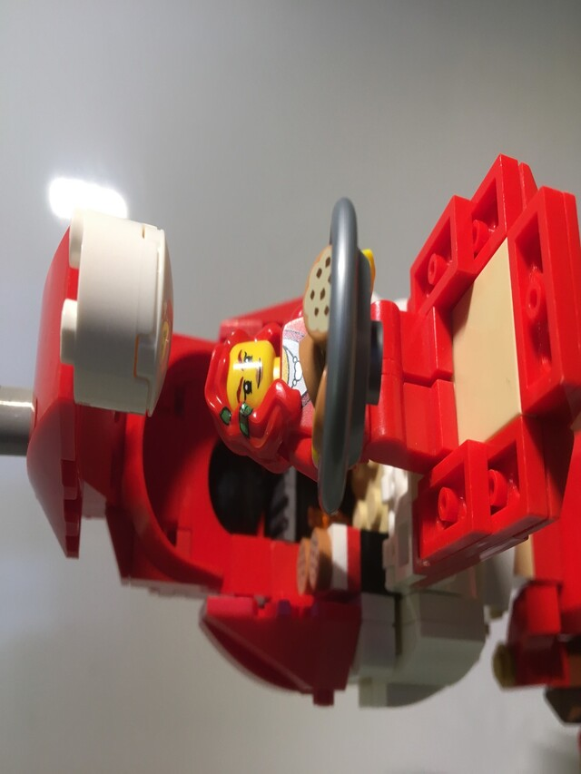](https://www.freelug.org/IMG/jpg/25-02-03_personnalise_.jpg)

[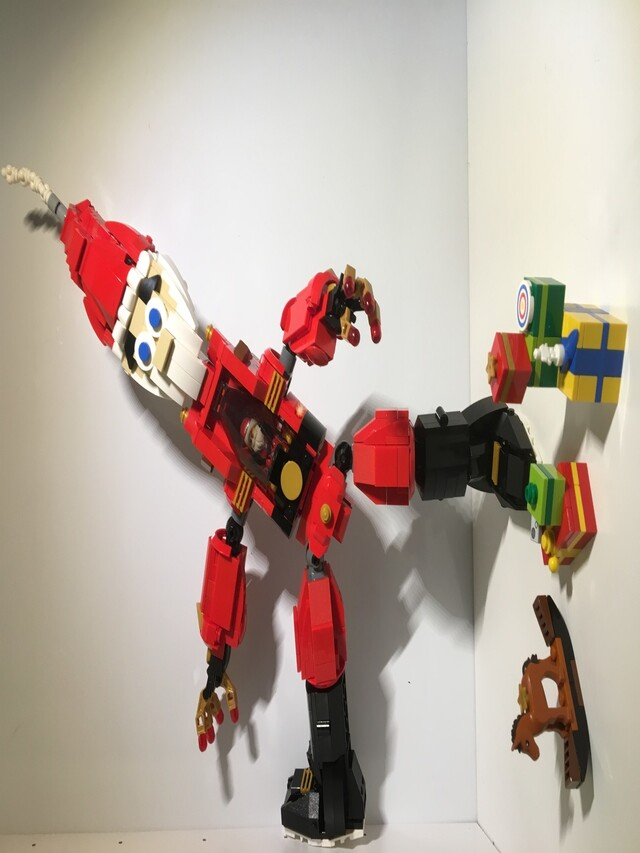](https://www.freelug.org/IMG/jpg/25-02-04_personnalise_.jpg)

[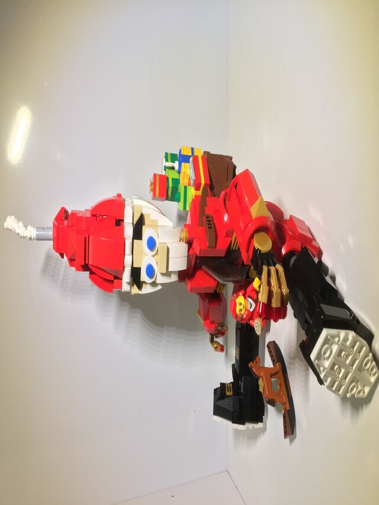](https://www.freelug.org/IMG/jpg/25-02-05_personnalise_.jpg)

[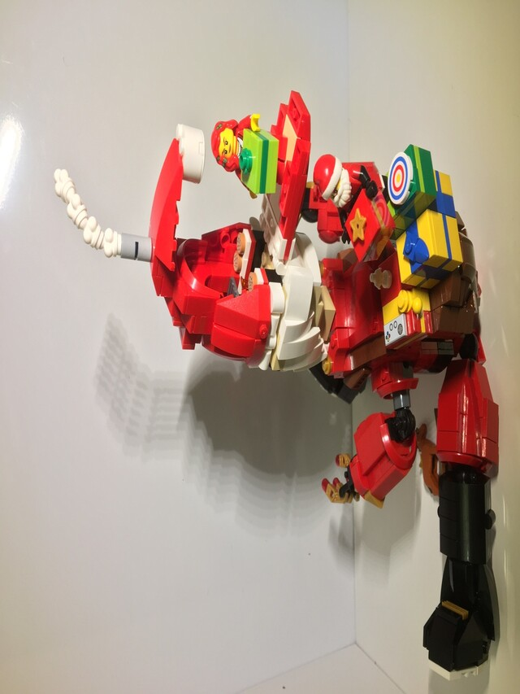](https://www.freelug.org/IMG/jpg/25-02-06_personnalise_.jpg)

[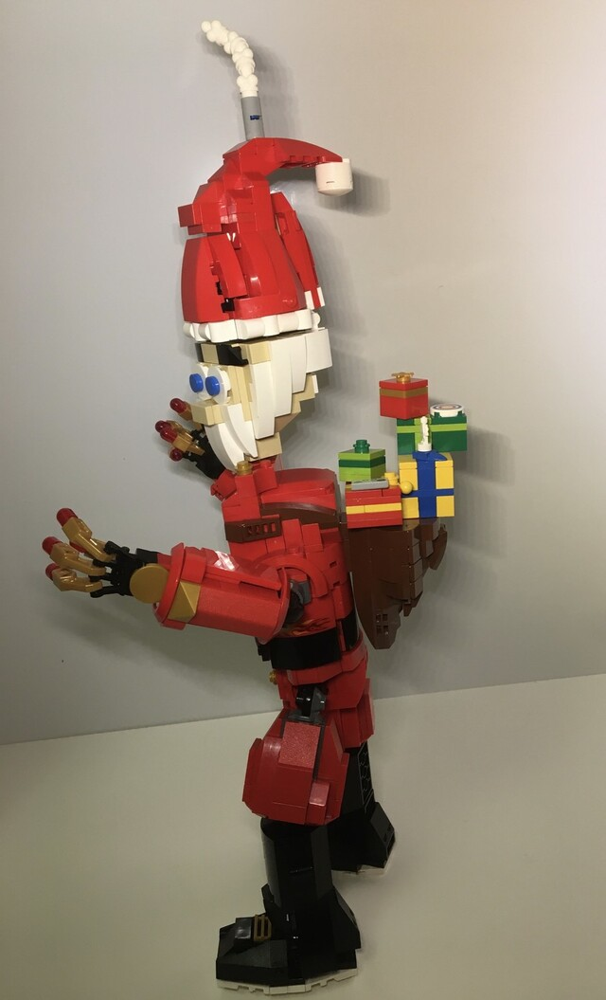](https://www.freelug.org/IMG/jpg/25-02-07_personnalise_.jpg)

[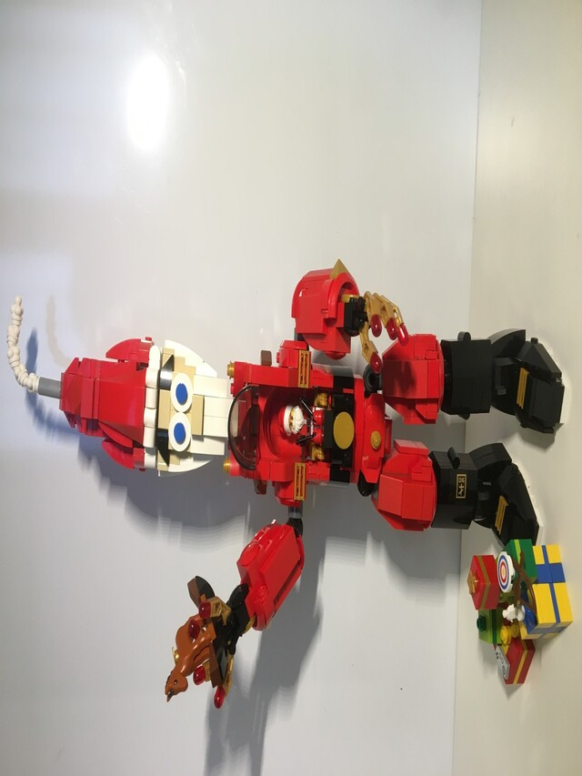](https://www.freelug.org/IMG/jpg/25-02-08_personnalise_.jpg)

* * *

**03 - Rémi L. - "Mecha Père Noël (Non ce n’est pas vrai, il est gentil !)"**  
Voila le Mecha du Père-Noël. Tout dans la démesure, cet immense robot est aussi grand qu’un immeuble et aussi magique que le Père Noël, il peut donc changer de taille à volonté. Il sait être grand pour traverser les grandes étendues enneigées et minuscule pour passer les conduits de cheminé.  
Son corps est composé de 2 niveaux :  
**–**  Un 1er niveau qui comprend la cuisine avec le four surpuissant de la Mère-Noël. il permet de cuire 2 fournées de cookies à la fois pour fournir ce gourmand de Père-Noël pendant cette longue nuit. On y trouve également un atelier de retouche de dernière minute pour les cadeaux endommagés dans le transport. Ne vous inquiétez pas, tout est magique, la peinture n’est pas toxique et peut même se manger. D’ailleurs la Mère Noël l’utilise comme colorant dans certains de ses gâteaux.  
**–**  2ème niveau qui comprend un grand poste de pilotage équipé de 2 fauteuils en cuir blanc pivotant à 360°. Il est équipé de 3 puissants ordinateurs pour gérer la machinerie, une pendule qui se met automatiquement à l’heure selon le pays traversé mais surtout, il est équipé de la vieille boussole du Père-Noël qui équipe habituellement son traineau. Et oui, ce vieux monsieur ne perd jamais le Nord . Le Nez rouge de Rudolph a été créé artificiellement sur le radar qui orne le dessus du robot.  
Ce robot géant peut s’asseoir pour que les occupants puissent monter et descendre plus facilement mais l’échelle peut se déplier jusqu’au sol si le robot est coincé en position debout. Il faut parer à toute éventualité. L’échelle repliée se rabat sur la porte évitant ainsi les accidents stupides.  
Pas besoin de sortir du robot pour distribuer les cadeaux, le robot a le bras suffisamment long pour les prendre lui-même dans la hotte et les déposer au pied du sapin.  
Pas sur que pour Noël 2022, le Père Noël veuille reprendre son ancien traineau avec ses rennes. On s’habitue vite au confort.

[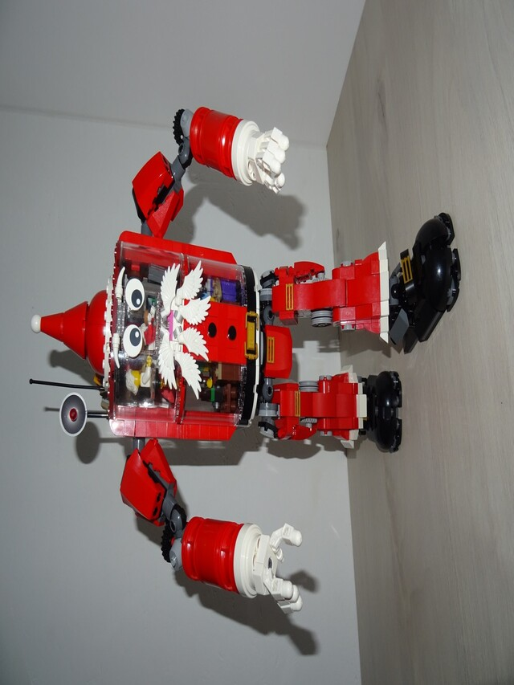](https://www.freelug.org/IMG/jpg/25-03-01.jpg)

[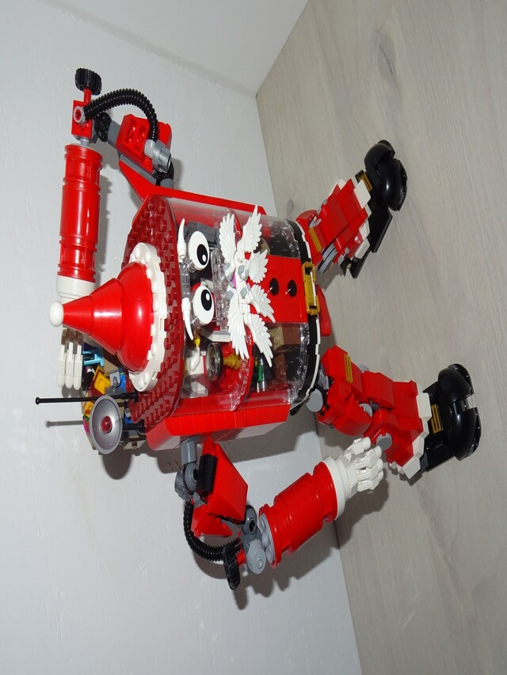](https://www.freelug.org/IMG/jpg/25-03-02.jpg)

[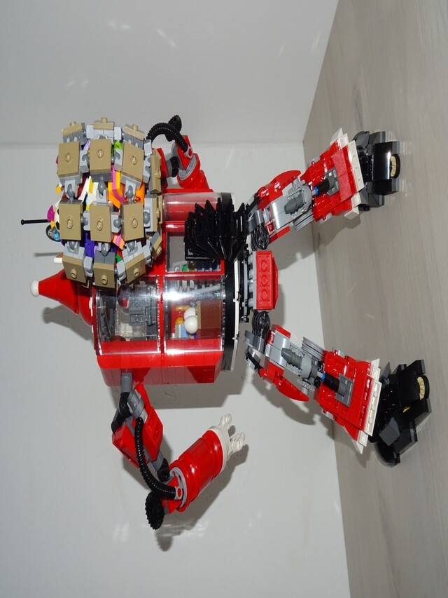](https://www.freelug.org/IMG/jpg/25-03-03.jpg)

[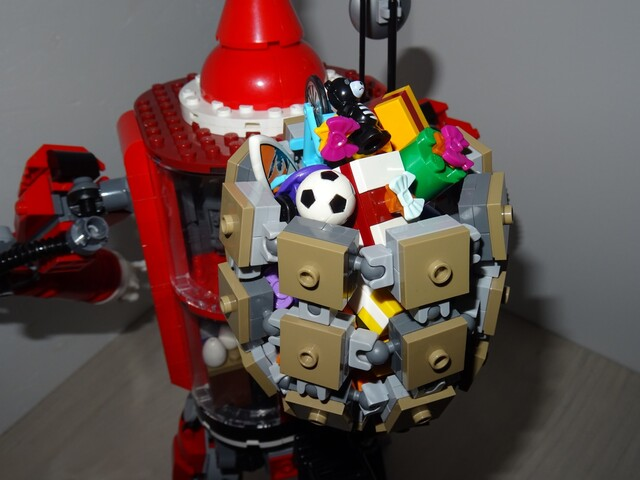](https://www.freelug.org/IMG/jpg/25-03-04.jpg)

[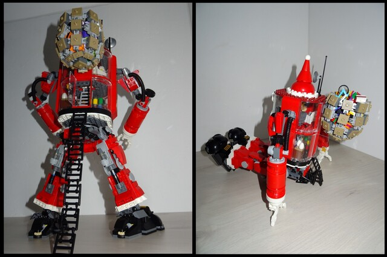](https://www.freelug.org/IMG/jpg/25-03-05.jpg)

[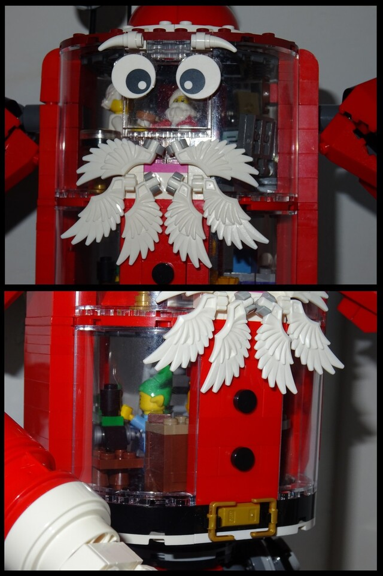](https://www.freelug.org/IMG/jpg/25-03-06.jpg)

[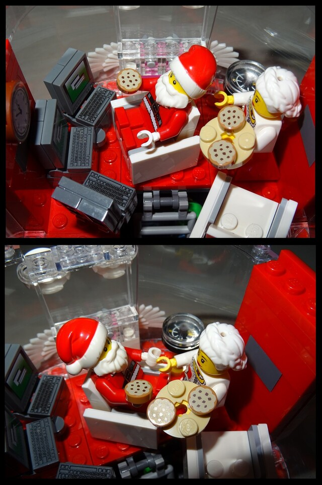](https://www.freelug.org/IMG/jpg/25-03-07.jpg)

[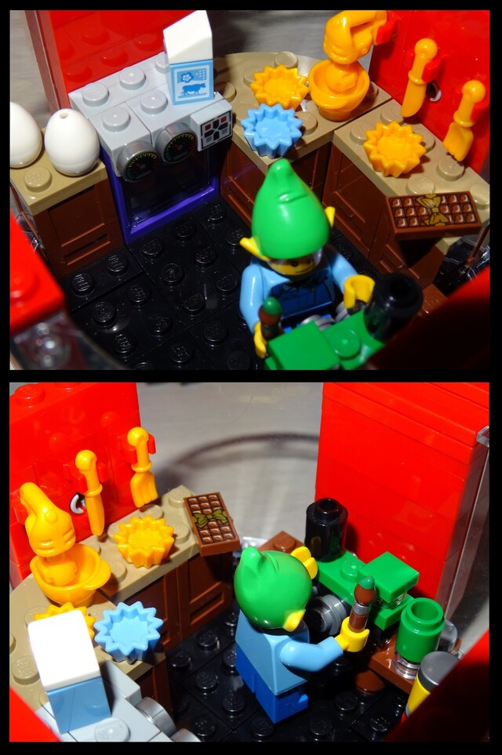](https://www.freelug.org/IMG/jpg/25-03-08.jpg)

* * *

**04 - Erik A. - "Robolphe, le mécha du Père Noël"**  
Pour remplacer le traineau après la blessure de Rudolph, quoi de mieux qu’un mécha avec l’apparence de Rudolph !  
Le poste de conduite, perché tout en haut, permet au Père Noël d’être au plus près des cheminées.  
La Mère Noël, elle, retrouve sa cuisine équipée : four, plaque, évier... pour préparer cookies, biscuits, et autres tartes pour son gourmand mari. Une cheminée permet d’évacuer les fumées de cuisson.  
A l’arrière, une grande hotte pour ranger tous les cadeaux à distribuer.  
Robolphe peut également attraper les cadeaux pour aider le Père Noël dans la distribution.

[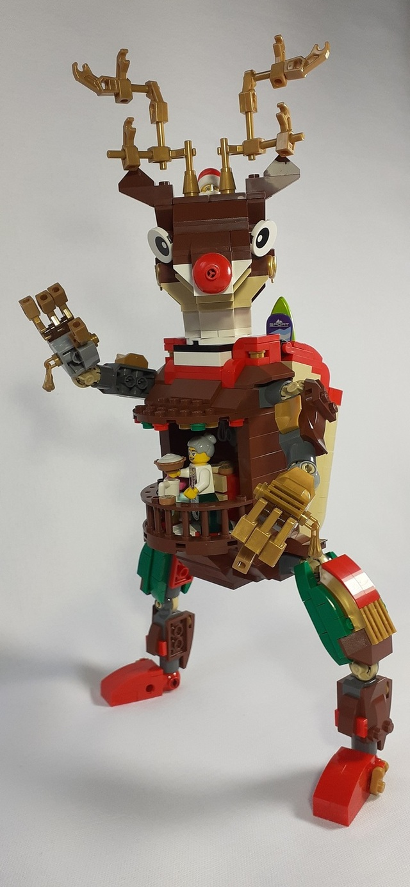](https://www.freelug.org/IMG/jpg/25-04-01.jpg)

[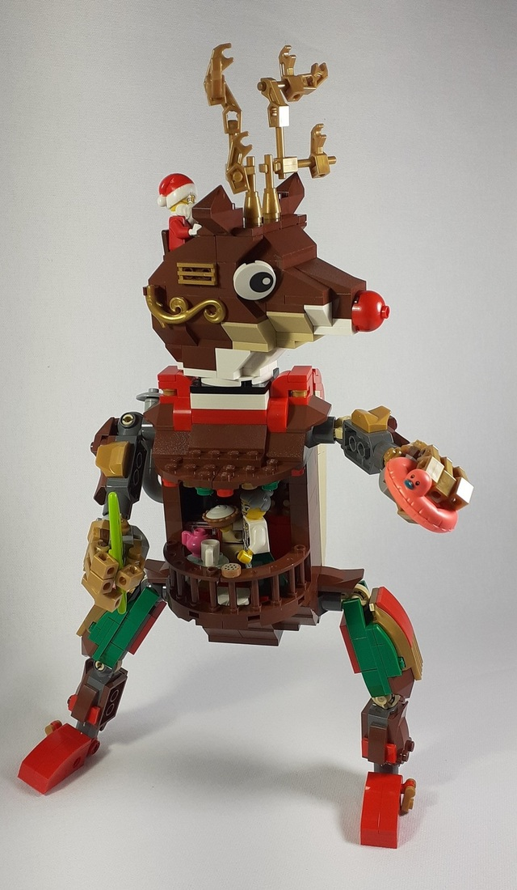](https://www.freelug.org/IMG/jpg/25-04-02.jpg)

[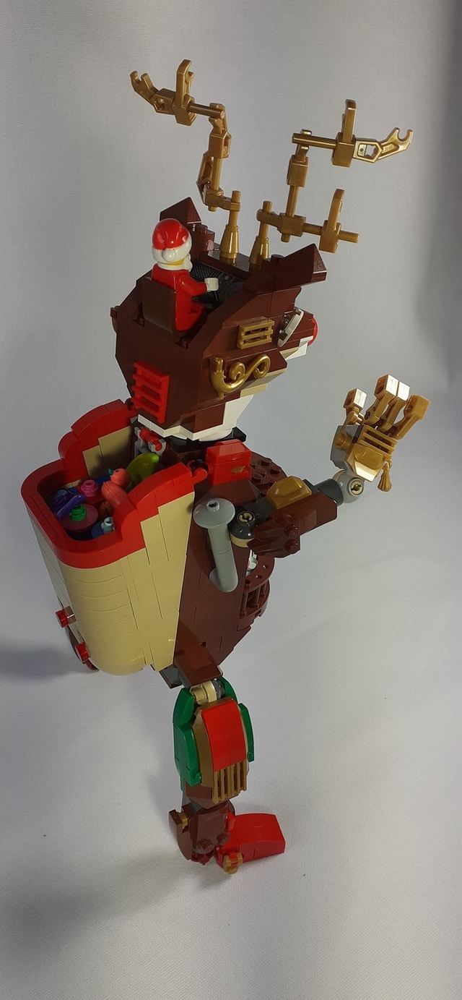](https://www.freelug.org/IMG/jpg/25-04-03.jpg)

[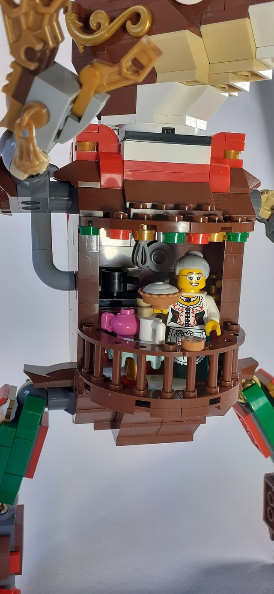](https://www.freelug.org/IMG/jpg/25-04-04.jpg)

[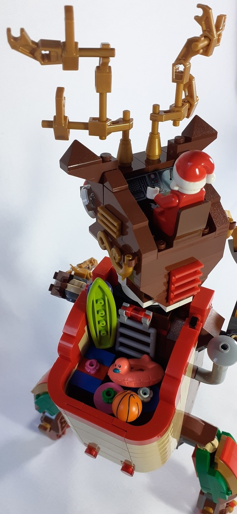](https://www.freelug.org/IMG/jpg/25-04-05.jpg)

[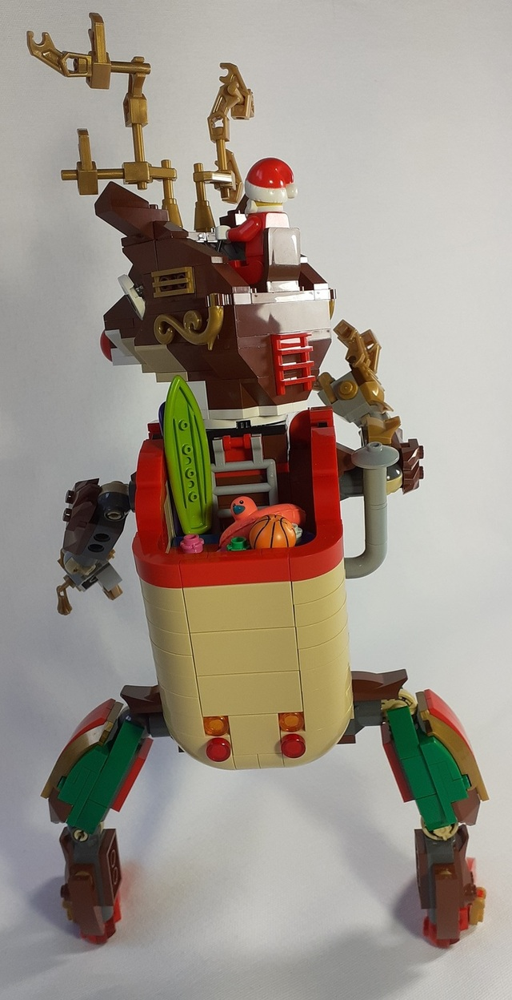](https://www.freelug.org/IMG/jpg/25-04-06.jpg)

* * *

**L’heureux gagnant de ce concours est :**  
**–** **04 - Erik A. - "Robolphe, le mécha du Père Noël"** qui remporte le set LEGO **Ref 21311 - Voltron**

**Classement :**  
1\. Erik A. (33 pts)  
2\. Rémi L. (30 pts)  
3\. Gaultier O.-G. (16 pts)  
4\. Jean Michel R. (5 pts)

**Composition du jury catégorie réelle :**  
**–** Mathieu W. (GFC)  
**–** Pierre C. (Tribolego) (GFC)  
**–** Xavier D. (GFC)  
**–** Charles F. (GFC)  
**–** Cyril L.  
**–** Alexandre D.  
**–** Jeremie D.  
**–** Norman H.  
**–** Frank S.  
**–** Sebastien le Q.  
**–** Wilfried R.  
**–** Julia R.  
**–** Elisabeth L.  
**–** Céline D.

* * *

## Concours catégorie "Virtuelle"

**01 - Xavier D. - "Mecha Clauss"**  
Le Mecha Claus est un Prototype permettant d’accueillir 4 personnes :  
**–** Mr Clauss dans le cockpit,  
**–** Mme Clauss dans la hotte de cuisine  
**–** 1 siège par pied pour accueillir un lutin et suppléer Mr Clauss quand il a les mains occupé à manger les cookies de Mme Clauss

[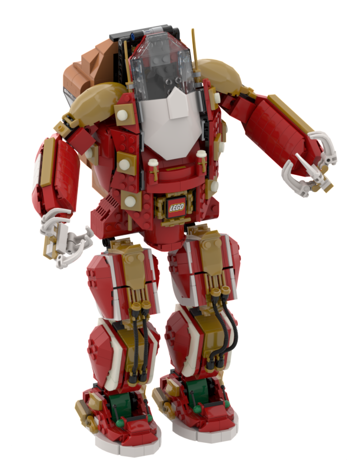](https://www.freelug.org/IMG/png/025-v01-01.png)

[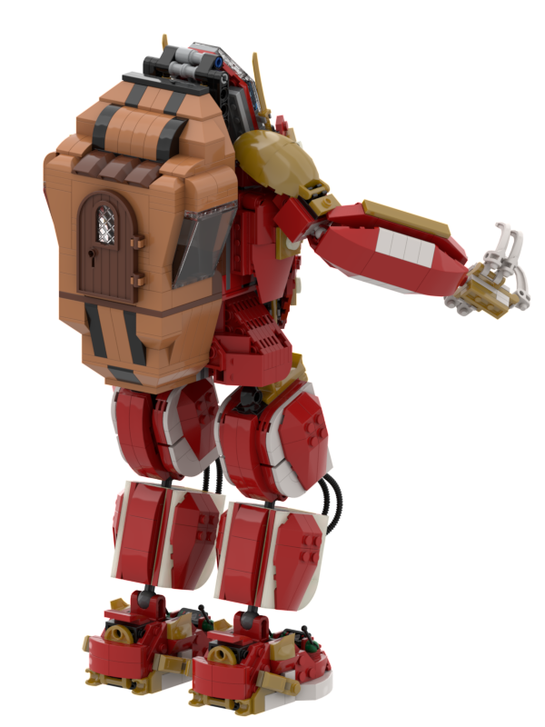](https://www.freelug.org/IMG/png/025-v01-02.png)

[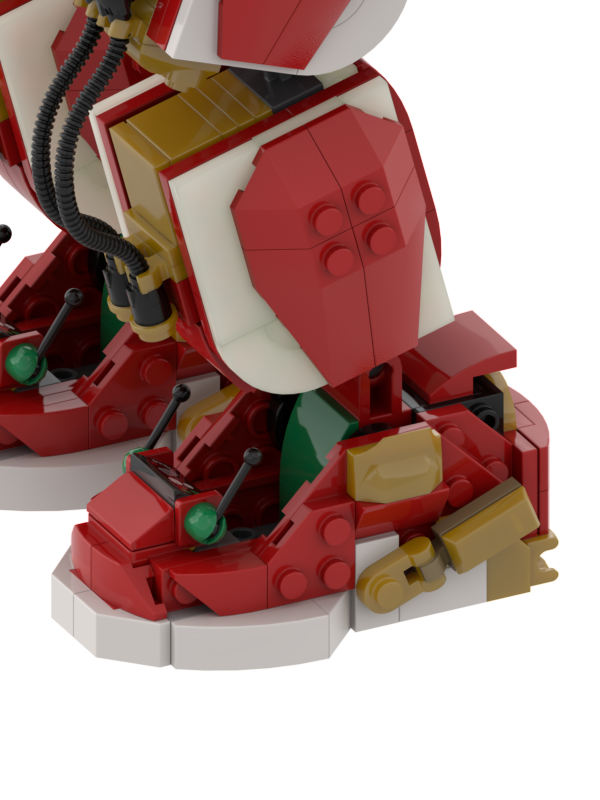](https://www.freelug.org/IMG/png/025-v01-03.png)

[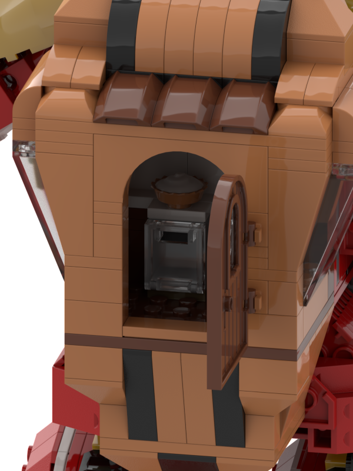](https://www.freelug.org/IMG/png/025-v01-04.png)

[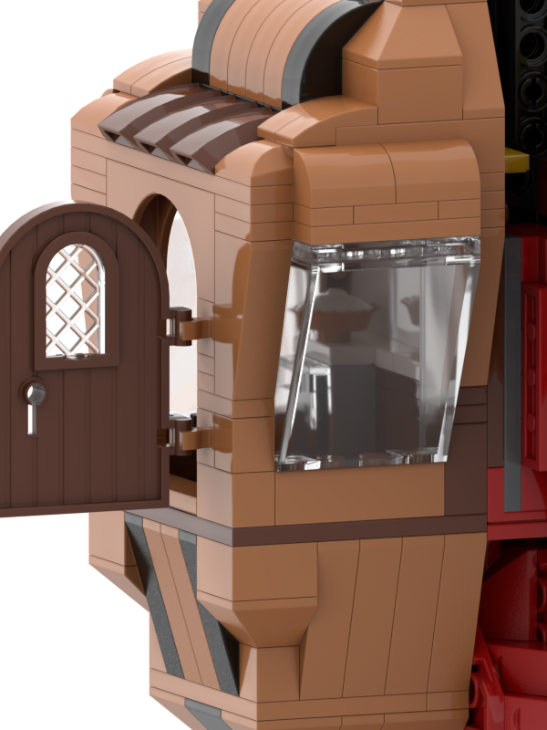](https://www.freelug.org/IMG/png/025-v01-05.png)

[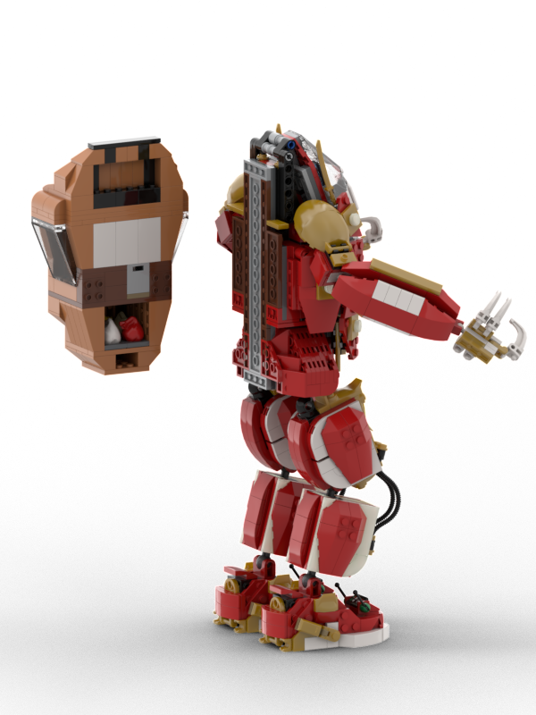](https://www.freelug.org/IMG/png/025-v01-06.png)

Faute de concurrents, l’heureux gagnant de ce concours est **01 - Xavier D. - "Mecha Clauss"** qui remporte le set LEGO **Ref 41074 - Azari and the Magical Bakery**

**Classement :**  
1\. 01 - Xavier D. - "Mecha Clauss"

Composition du jury catégorie virtuelle :  
Vu qu’il n’y a eu qu’un seul participant en virtuel, il n’y a pas eu besoin de jury.

**Merci à toutes et tous et à bientôt pour un nouveau concours !**
