Après l’annulation de l’édition 2021, les associations Regards et Sens Actifs ont su motiver les bénévoles et relancer l’édition 2022 du festival

Nous avons repris la même place que pour l’[édition 2020](/articles/3014/), avec deux tables et, en plus, une table hauteur maternelle.

[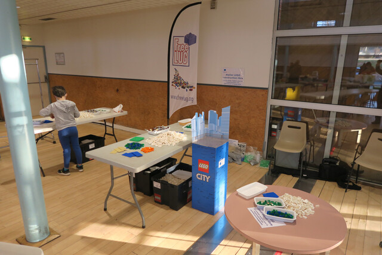](https://www.freelug.org/IMG/jpg/img_8773-3.jpg)

Cette année, des lapins avec leur masque ont accueilli les visiteurs

[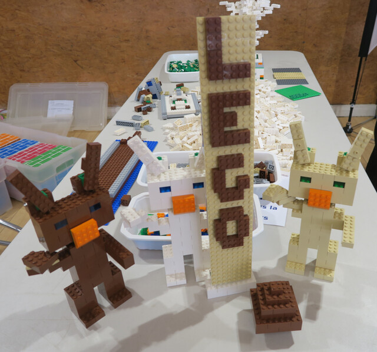](https://www.freelug.org/IMG/jpg/img_8811_b.jpg)

10h, dans le matin presque blême, les briques sont prêtes.

[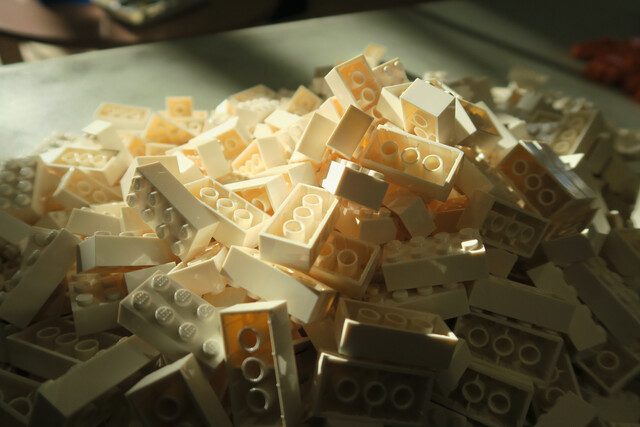](https://www.freelug.org/IMG/jpg/img_8779-2.jpg)

Des briques utilisées par des petits

[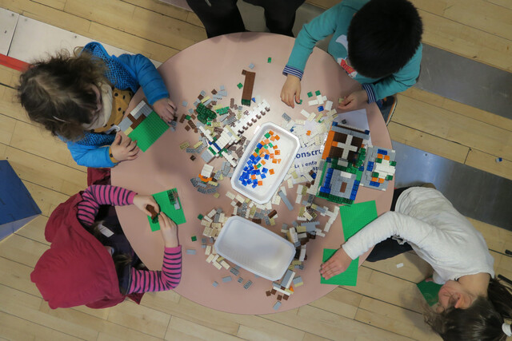](https://www.freelug.org/IMG/jpg/img_8854.jpg)

des encore plus petits

[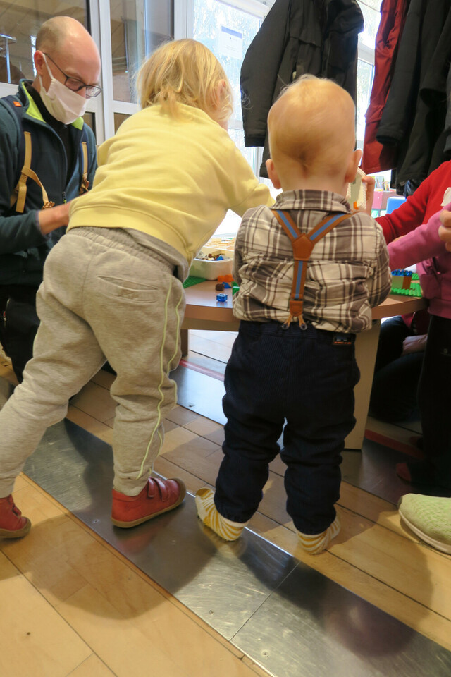](https://www.freelug.org/IMG/jpg/img_8800.jpg)

et des plus grands

[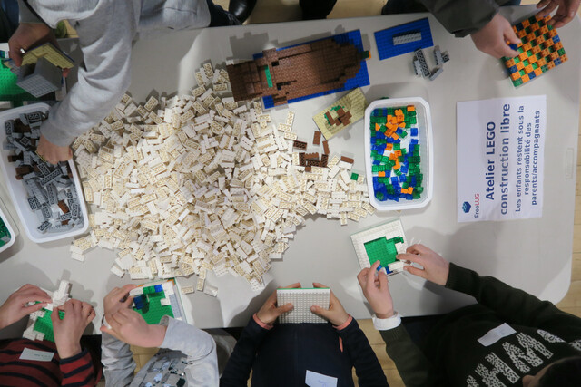](https://www.freelug.org/IMG/jpg/img_8788-2.jpg)

[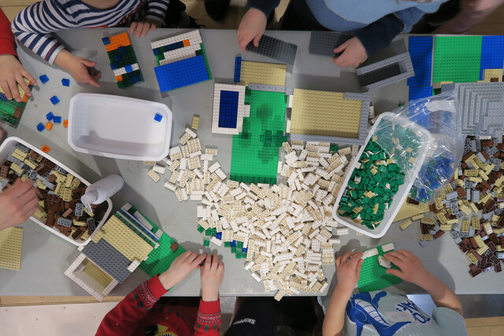](https://www.freelug.org/IMG/jpg/img_8828.jpg)

Pour des tours design

[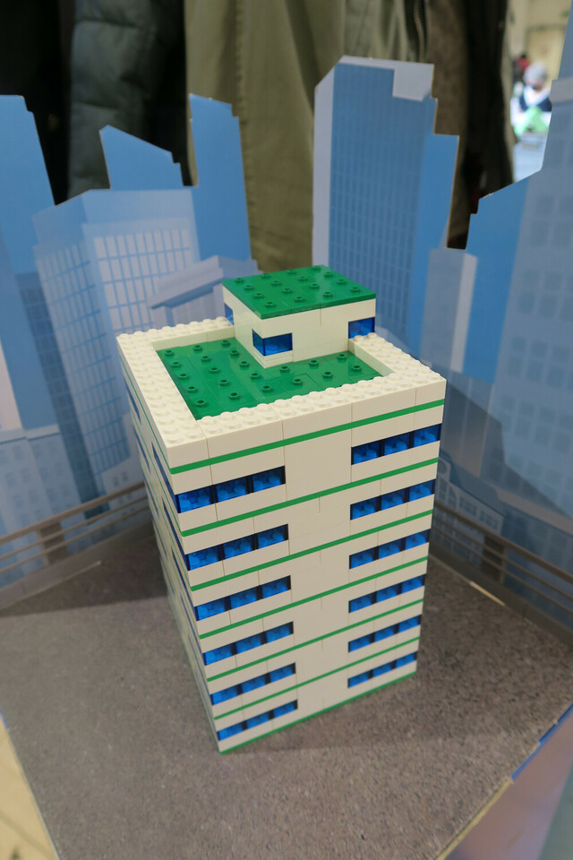](https://www.freelug.org/IMG/jpg/img_8841.jpg)

hautes

[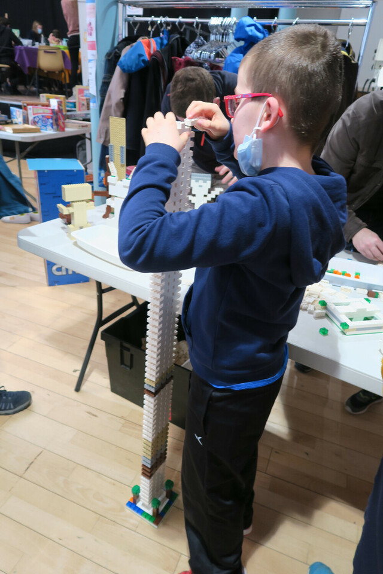](https://www.freelug.org/IMG/jpg/img_8848.jpg)

et biscornues

[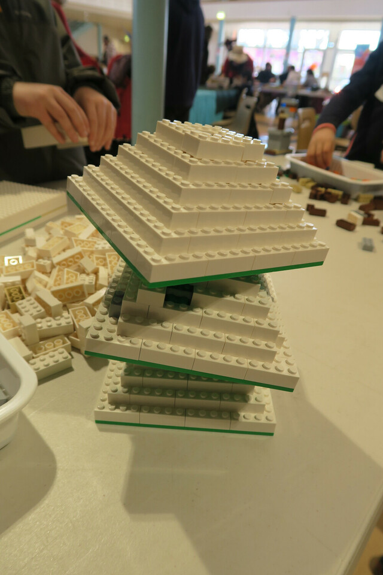](https://www.freelug.org/IMG/jpg/img_8792-2.jpg)

Pour des avions prêts à décoller

[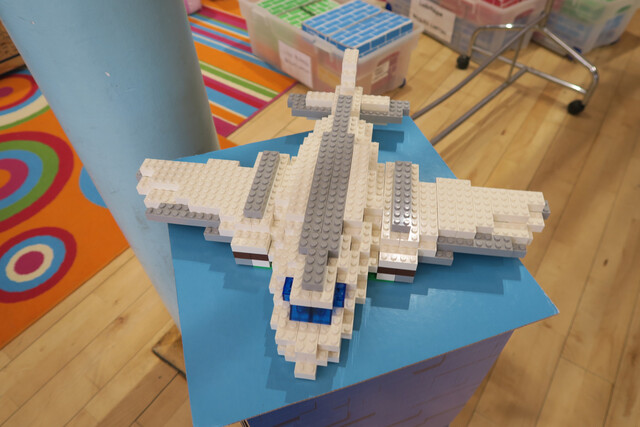](https://www.freelug.org/IMG/jpg/img_8809.jpg)

[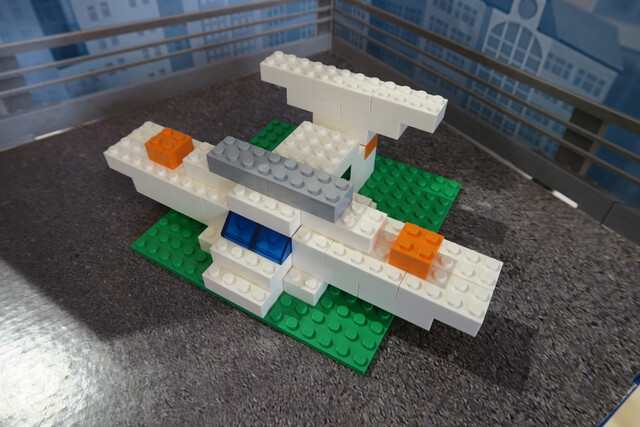](https://www.freelug.org/IMG/jpg/img_8835.jpg)

[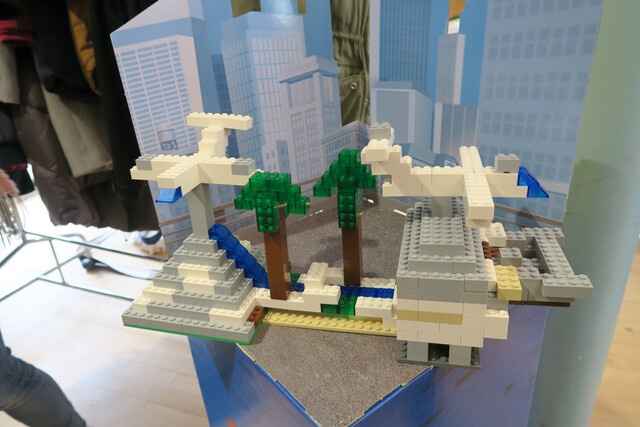](https://www.freelug.org/IMG/jpg/img_8849.jpg)

et accidentés

[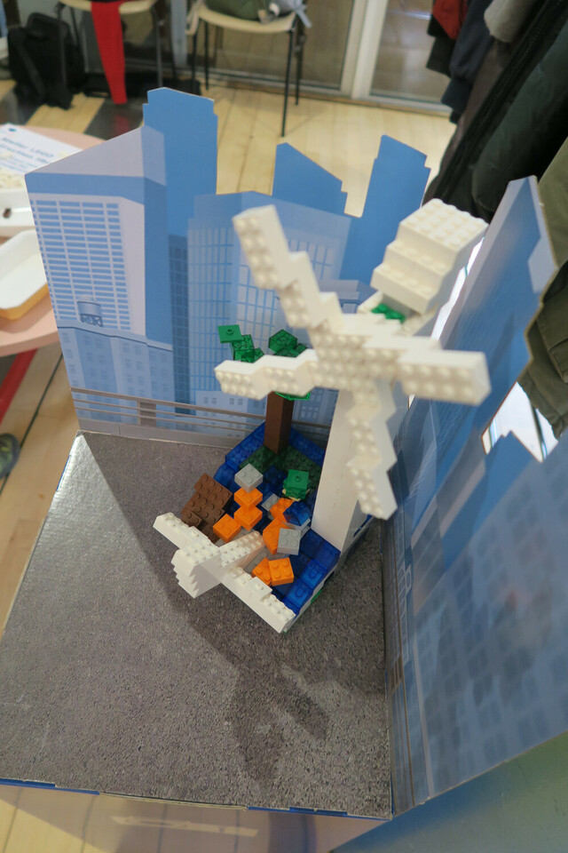](https://www.freelug.org/IMG/jpg/img_8838.jpg)

Pour des bateaux

[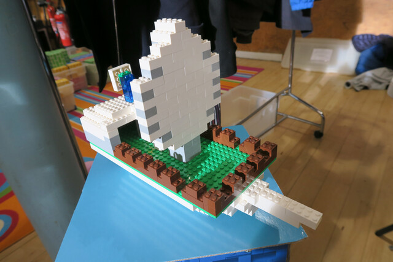](https://www.freelug.org/IMG/jpg/img_8858.jpg)

Et plein d’autres créations : une maison en coupe avec le métro en souterrain

[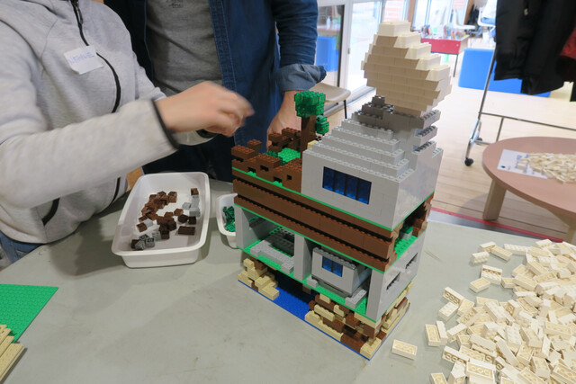](https://www.freelug.org/IMG/jpg/img_8814.jpg)

un vitrail

[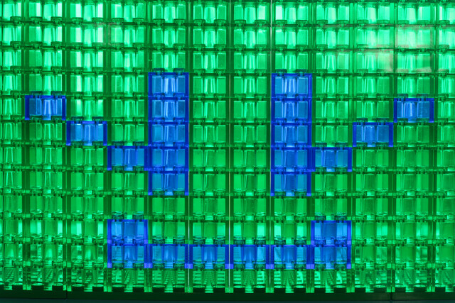](https://www.freelug.org/IMG/jpg/img_8820.jpg)

Que pouvons-nous ajouter : à l’année prochaine !
