Partons à la découverte de cette boite, spécial Saint Valentin !

[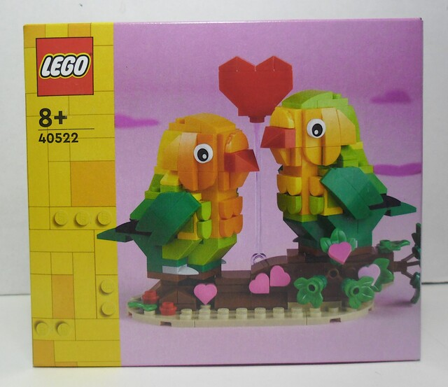](https://www.freelug.org/IMG/jpg/sam_4025.jpg)

Le set comprend 298 pièces pour un prix de 12,99€ soit un rapport prix/pièces de 0,044Euros, ce n’est pas cher si on ne regarde que ce ratio.  
Une petite vue arrière donne une avant-première du set spécial Pâques :

[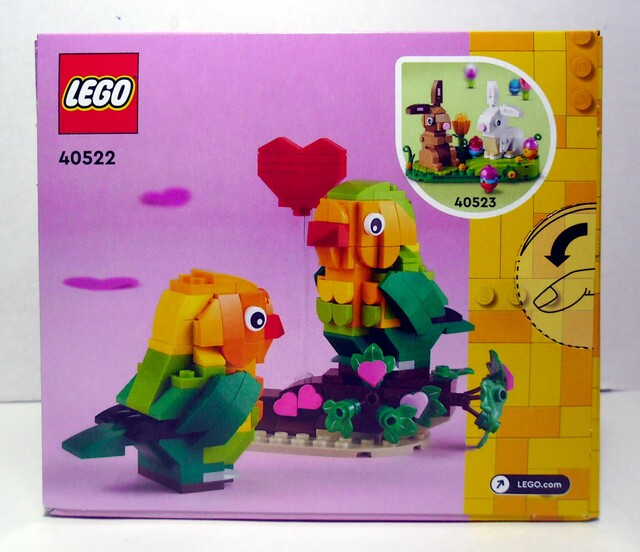](https://www.freelug.org/IMG/jpg/sam_4026.jpg)

Venons au principal, le contenu de la boite : beaucoup de sachets.

[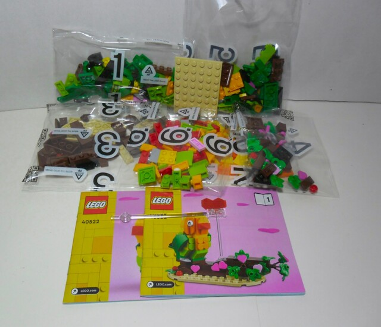](https://www.freelug.org/IMG/jpg/sam_4030.jpg)

On commence par le premier oiseau :

[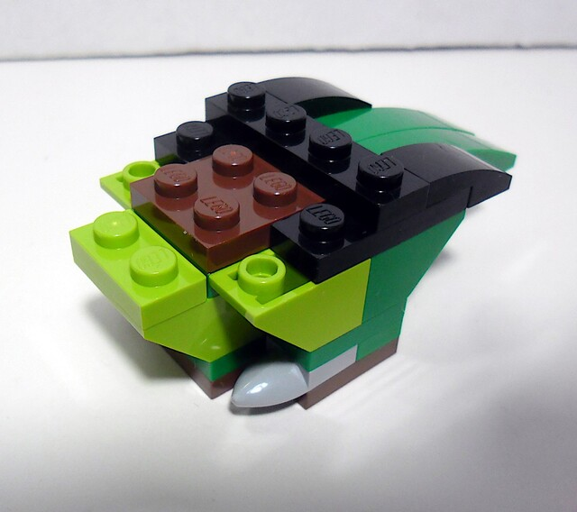](https://www.freelug.org/IMG/jpg/sam_4032.jpg)

[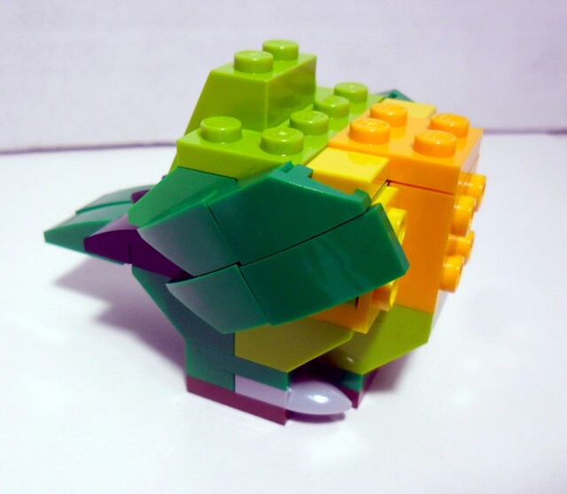](https://www.freelug.org/IMG/jpg/sam_4033.jpg)

[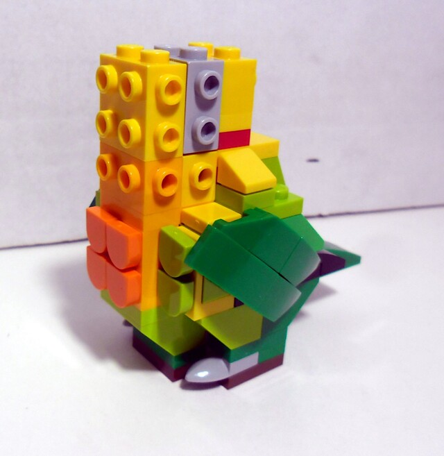](https://www.freelug.org/IMG/jpg/sam_4036.jpg)

[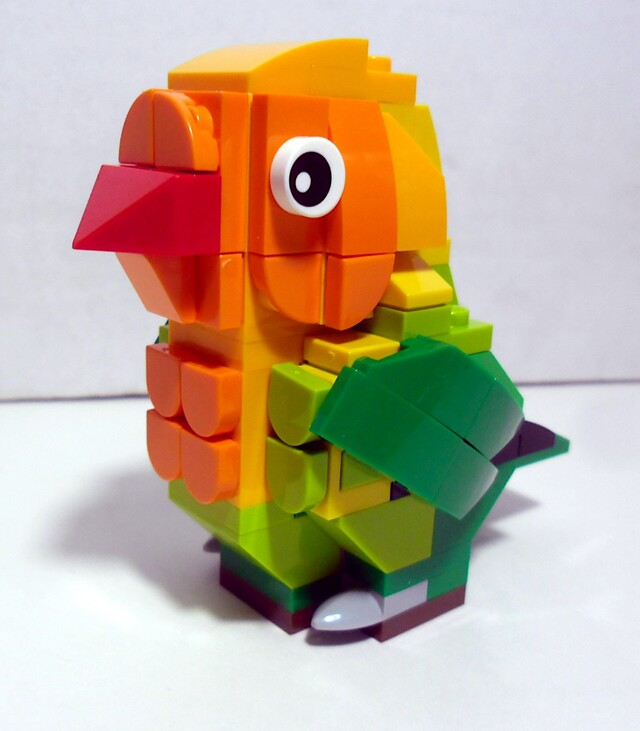](https://www.freelug.org/IMG/jpg/sam_4037.jpg)

On poursuit avec le petit tronc qui sert de présentoir :

[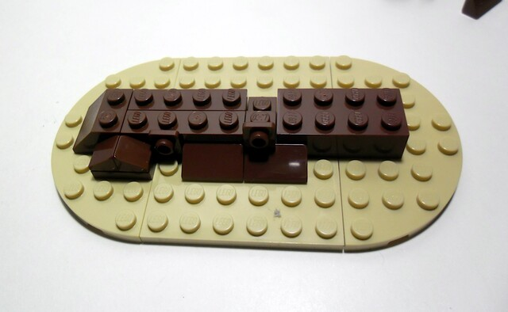](https://www.freelug.org/IMG/jpg/sam_4039.jpg)

[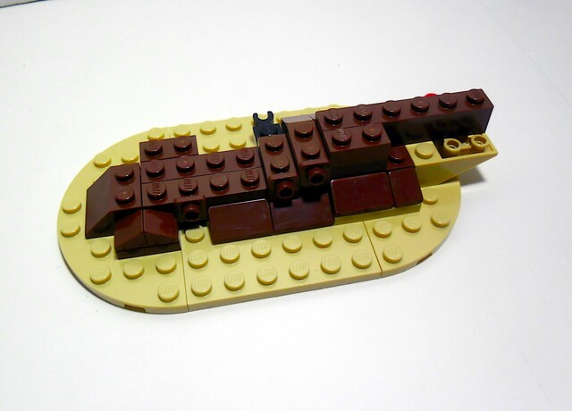](https://www.freelug.org/IMG/jpg/sam_4040.jpg)

[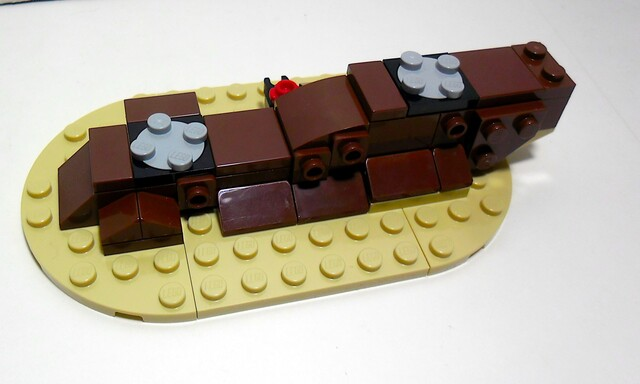](https://www.freelug.org/IMG/jpg/sam_4042.jpg)

Continuons avec le deuxième oiseau :

[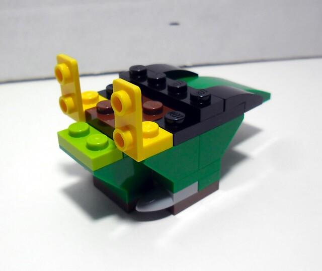](https://www.freelug.org/IMG/jpg/sam_4045.jpg)

[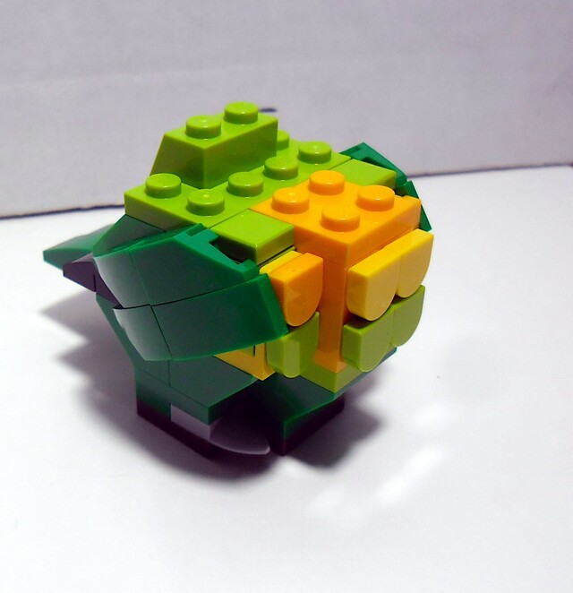](https://www.freelug.org/IMG/jpg/sam_4046.jpg)

[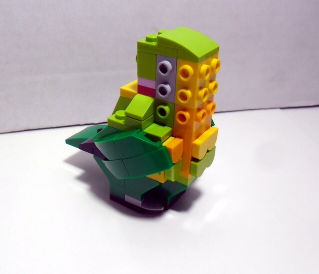](https://www.freelug.org/IMG/jpg/sam_4048.jpg)

[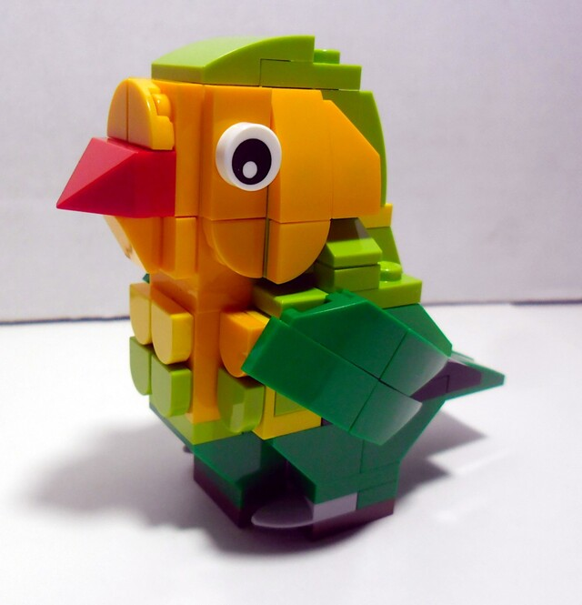](https://www.freelug.org/IMG/jpg/sam_4049.jpg)

Voilà fini, une petite photo de famille !

[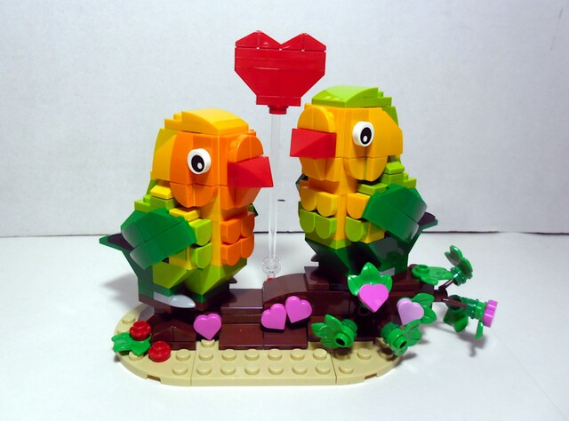](https://www.freelug.org/IMG/jpg/sam_4050.jpg)

Et pour terminer les extra parts :

[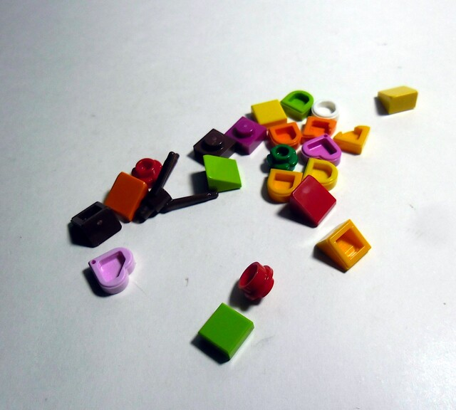](https://www.freelug.org/IMG/jpg/sam_4051.jpg)

**Conclusion**  
Que dire : moi j’adore ! C’est vraiment un petit set sympathique qui rend tout de suite très bien.
