C’est la première voiture de rallye que j’assemble dans cette gamme. Voyons voir si l’esprit course de ses années folles est conservé.

Pour ma part, l’Audi Quattro c’est une pilote, Michèle Mouton. Elle a été championne du monde des rallyes dans cette voiture en 1982. Par contre, je ne peux pas vous dire si c’est la version que LEGO nous offre dans cette boite car il y en a eu 4 différentes.

A cette époque, en rallye c’est la course à la puissance. Les principaux constructeurs nous sortent des bolides de fou. En voici quelques-uns qui ont marqués ma mémoire : Ford RS200 ; Lancia Delta S4 ; Renault 5 Maxi turbo ; 205 et 405 T16 ; Austin Metro et j’en oublie surement...

Du coup, certaines voitures font un peu monstrueuse. C’est le cas de l’Audi Quattro que LEGO a choisi de reproduire et qui fait un peu cubique. Elle a des élargisseurs d’ailes énormes et un aileron disproportionné à l’arrière. L’ajout des longues portées sur la calandre n’arrange pas les choses pour le look.

Voyons voir ce que ça donne en brique... Mais d’abord commençons par les quelques informations habituelles pour cette petite boite :

-   Année de sortie 2020 ;
-   Prix 19,99 €, sur le Shop, à l’heure où j’écris ces lignes ;
-   2 sachets numérotés plus les enjoliveurs ;
-   246 pièces et une minifig ;
-   Temps de montage environ 1h.

La boite vu de devant, avec une belle photo qui nous présente la voiture en pleine vitesse.

[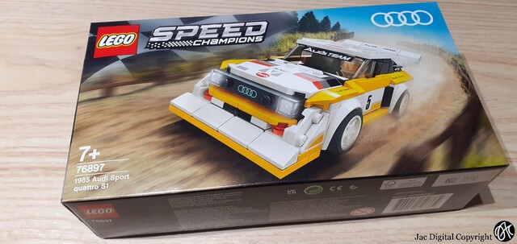](https://www.freelug.org/IMG/jpg/photo_1_-11.jpg)

Au dos, différentes images de la voiture. Comme d’habitude dans cette gamme, on a droit à une photo de la vraie voiture, pour se faire une idée de la ressemblance.

[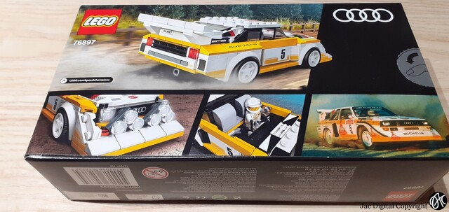](https://www.freelug.org/IMG/jpg/photo_2_-11.jpg)

Il y a deux sachets dans la boite. Ils contiennent des sous sachets, si on peut dire, pour les petites pièces, dont les enjoliveurs. Le châssis, la notice et la planche d’autocollants sont en vrac dans la boite. On est pas dans du haut de gamme...

[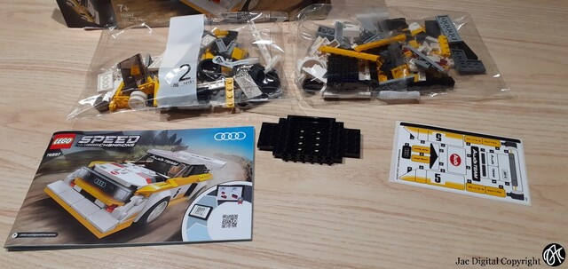](https://www.freelug.org/IMG/jpg/photo_3_-10.jpg)

Contenu du premier sachet qui permettra de construire la base de la voiture et son unique pilote. Euh, Messieurs les concepteurs LEGO, en rallye, on a un pilote ET un copilote. L’un ne va pas sans l’autre. C’est une équipe. Bon, vous verrez plus loin, que finalement, c’est peut être pas plus mal qu’il y en ait qu’un !

[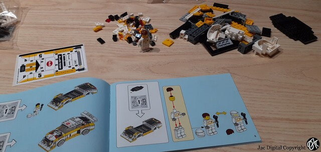](https://www.freelug.org/IMG/jpg/photo_4_-9.jpg)

Justement, voilà le pilote. Le torse est exclusif à cette boite, il a une belle inscription "Audi team", très fine imprimée devant et derrière. Pour les Audi R18 e-tron et R8LMS, ce ne sont pas les mêmes.

[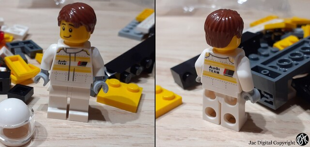](https://www.freelug.org/IMG/jpg/photo_5-6_-2.jpg)

Le montage des feux arrières est un peu particulier. Mais tout s’ajuste très bien au montage.

[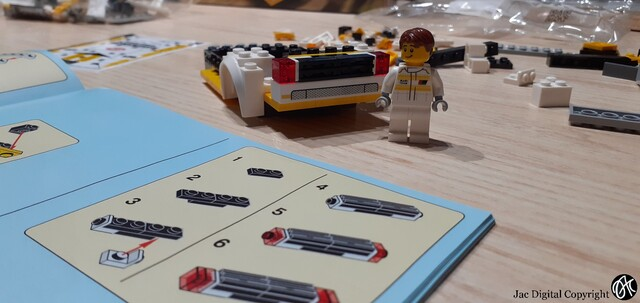](https://www.freelug.org/IMG/jpg/photo_7_-6.jpg)

Pas besoin de chercher le moteur, il n’y en a pas. L’arrière et l’avant sont un empilage de briques. C’est un peu dommage je trouve, il y avait la place. Mais il faut garder en tête que c’est un jouet, destiné d’après ce qui est écrit sur la boite à des enfants de 7 ans. Même si on peut se poser la question sur le choix des modèles reproduits, emplis de nostalgie...

[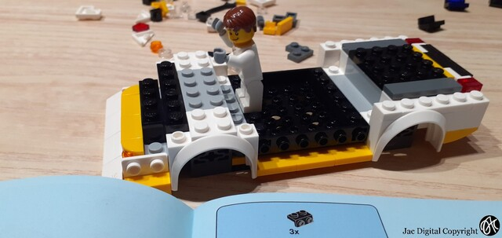](https://www.freelug.org/IMG/jpg/photo_8_-7.jpg)

C’est terminé pour les étapes de montage du premier sachet. On a déjà une Audi Quattro bien avancée, avec ses longues portées sur la calandre. Il reste un beau petit lot de pièce en plus. Petite déception du pilote qui se servira de cette clef uniquement pour les enjoliveurs.

[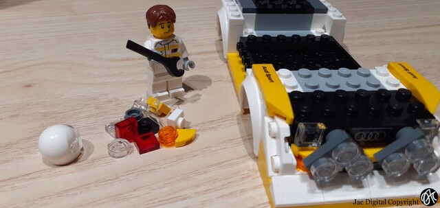](https://www.freelug.org/IMG/jpg/photo_11_-9.jpg)

Le contenu du deuxième sachet nous permet de découvrir un beau capot avant imprimé. Ca fera ça de moins à coller.

[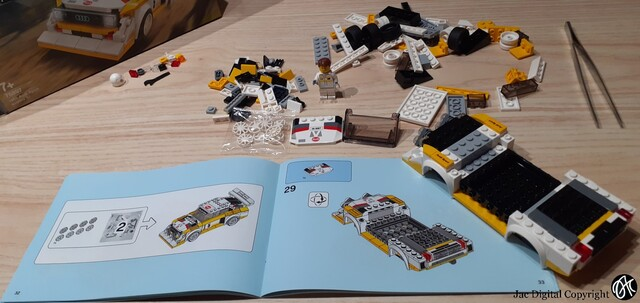](https://www.freelug.org/IMG/jpg/photo_12_-5.jpg)

Au cours du montage, je découvre aussi deux plates "wing" imprimées. Deuxième satisfaction ! L’intérieur est un empilage de pièces sans technique particulière. Le pilote a tout de même accès au levier de vitesse et à un frein à main.

[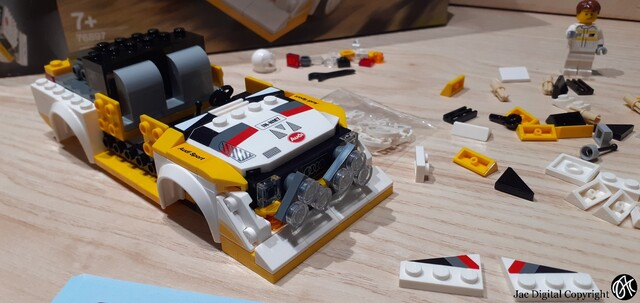](https://www.freelug.org/IMG/jpg/photo_13_-8.jpg)

A ce stade, tous les autocollants sont posés sur les pièces. La touche finale a été le pare soleil que j’ai réussi à centrer du premier coup !

[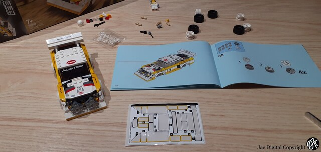](https://www.freelug.org/IMG/jpg/photo_14_-7.jpg)

Et enfin la voiture terminée. Le temps de montage peut paraitre long. Mais je dois m’appliquer à la pose des autocollants. Ca serait dommage de les mettre en travers. Pour les plus petits je me sers même d’une grande pince à épiler. C’est très pratique pour bien les ajuster sans être gêné par ses doigts !

[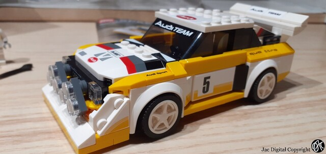](https://www.freelug.org/IMG/jpg/photo_16_-5.jpg)

On va pas trop s’éterniser sur sa taille par rapport au pilote. C’est un jouet. Mais quand même, le designer aurait pu faire plus d’effort pour pouvoir loger l’unique pilote. Et encore il y en a qu’un dans la boite. Si on veut mettre le copilote, ça coince vraiment.

On a le droit d’enlever les longues portées, ça fera moins énorme. Il y a surement un peu de travail à faire pour affiner la voiture, c’est à voir.

Une dernière photo sur piste, même si la garde au sol ne le permet pas trop...

[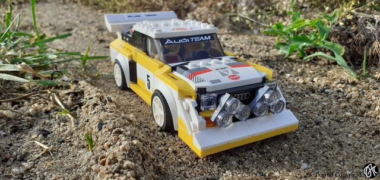](https://www.freelug.org/IMG/jpg/photo_19_-5.jpg)

Pour finir, je trouve l’attrait pour cette boite uniquement nostalgique, de ses temps de rallye fou. La voiture est reconnaissable, forcément avec ses couleurs et ses logos. Mais c’est vraiment du brut ! Dans la gamme de ces voitures de courses, je pense qu’il y avait le choix pour des voitures beaucoup plus profilées, moins cubiques. LEGO a voulu nous marquer dans les souvenirs, mais c’est un peu trop à mon sens.
