Pour sa deuxième participation au LEGOWorld, FreeLUG n’est pas passé inapercu :-). Voici le récit de cette exposition par nos fiers (et rigolards) exposants.

## Ambiance !!!

Si l’année 2003 fut l’année du premier contact, l’année 2004 fut l’année de la révélation de la bonne humeur francaise auprès de nos hôtes hollandais. Il en restera quelques termes qui deviendront mythiques : ZUUUUUUUUUUP [^1] et MULTIPASS [^2] :-)

Il faut dire qu’il y avait une sacré équipe de joyeux lurons (et on a même découvert que certains étaient des joyeux lurons .. n’est-ce pas Manu ? ;-))

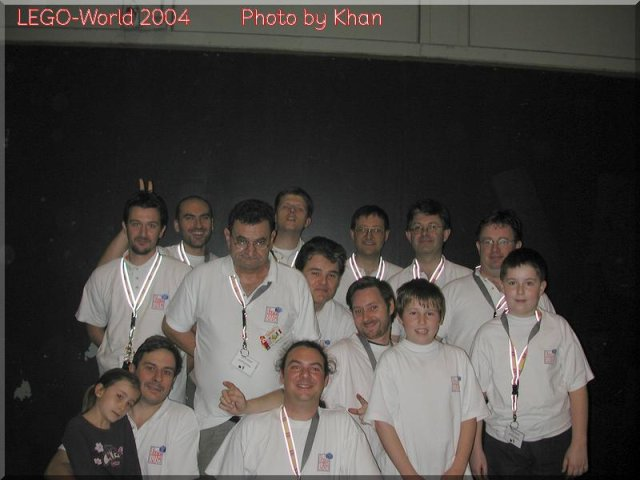

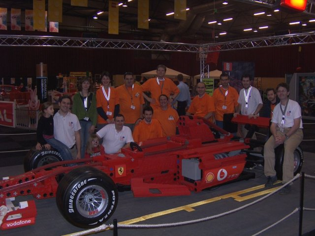

Ceci nous a valu de nous faire un grand copain : André le chauffeur du bus qui nous ramenait tous les soirs vers nos chalets (ca fait riche ce terme) :-)

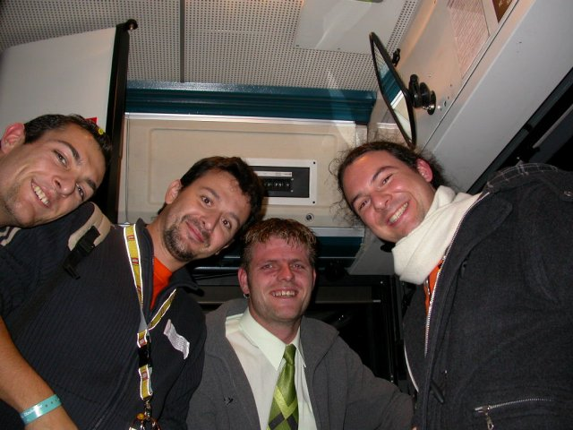

à qui nous chantions tous les soirs "Sneller André, Sneller .." [^3] sans que cela ait eu le moindre effet sur sa conduite (faut dire que ca flashait beaucoup la-bas .. n’est pas Nicolas ? :-D ). La voix de bariton de Gaël n’a d’ailleurs pas laissé une hollandaise de marbre, puisqu’il s’est fait une grande copine : Astrid

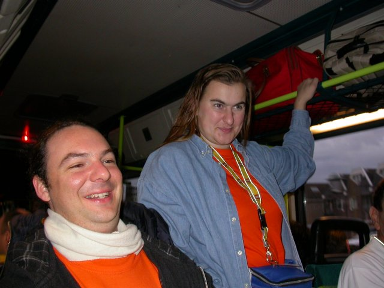

Notre bonne humeur ne s’arrêtant pas à la sortie du LEGOWorld, les soirées au chalet furent elles aussi plutot joviales, comme l’atteste ces quelques photos prisent au hasard (enfin presque)

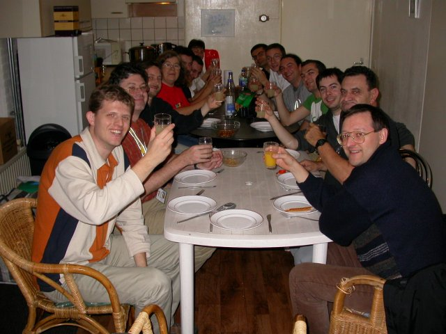

Certains aperos rendant certains "joyeux" ..

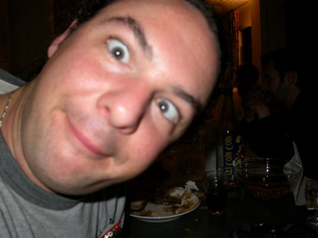

et d’autres un peu endormi .. :-)

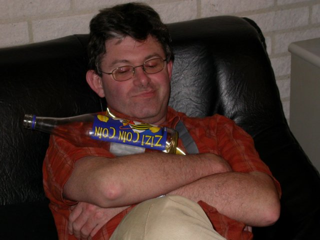

Heureusement que certains restaient sobre pour s’occuper de notre tambouille (merci à Dominique et Jean) .. enfin ils louchaient bien sur la bouteille de "zizcoincoin" quand même :-)

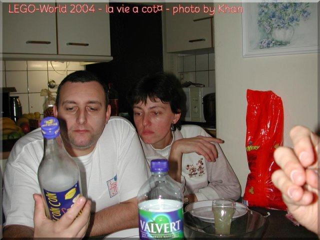

Les journées n’en n’etait pas moins festive avec notre troupe de danceurs étoiles (ici enflammant la piste de Foxkids)

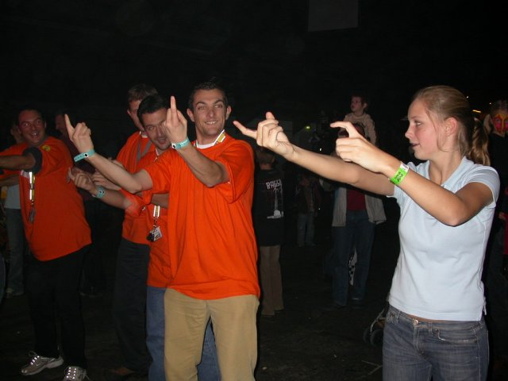

qu’on a aussi vu propager leur bonne humeur auprès des hotesses du salon (qui n’a pas eu son petit bracelet pour pas se perdre ?)

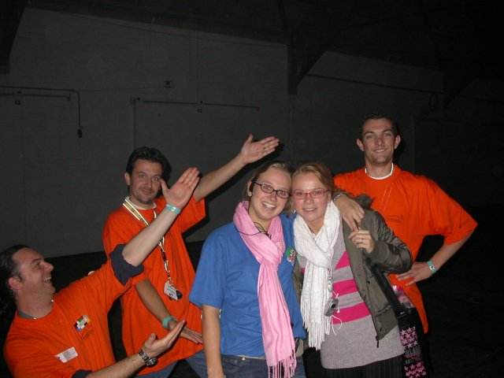

Heureusement que cette troupe de joyeux drille s’accordaient quelques moment de répis autour d’un "bon repas" le midi ..

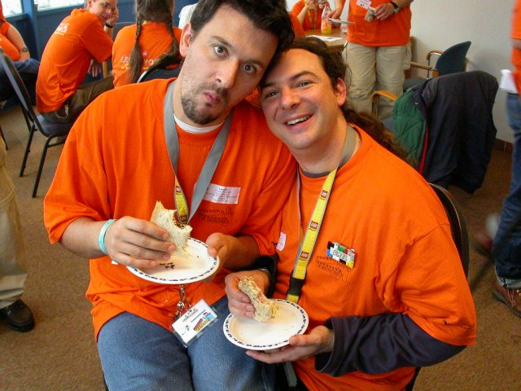

pour finir par une petite sieste sous la "hoth" ..

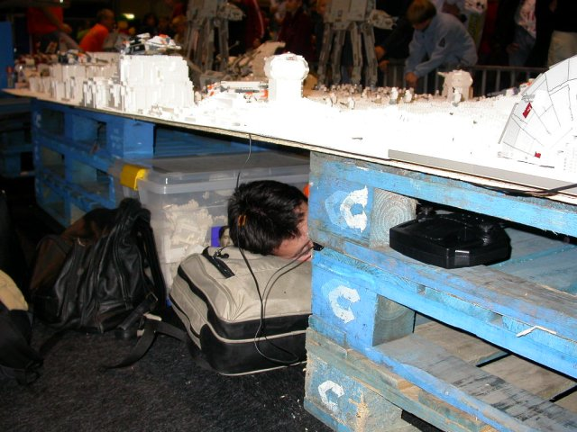

sinon ils n’auraient jamais fini la semaine (certains microbes ont pourtant bien essayé de les arreter).

Mais Le francais est quand même un peu professionnel et sait se tenir lorsque les parents d’Harald viennent visiter le stand FreeLUG (et admirer la sublimissime base de Hoth [^4])

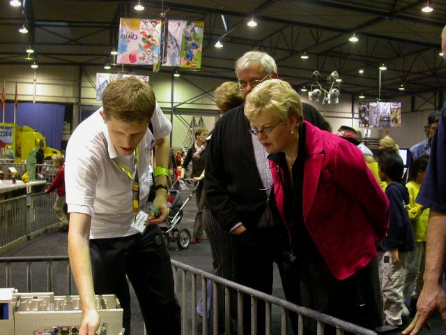

Cette semaine s’est d’ailleurs finie par le rêve de tout AFOL : un bain de briques dans l’intertoys (noté l’air interrogatif de notre quebecois :-))

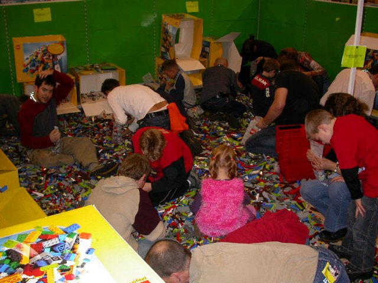

## Et sinon il y avait des briques a ce LEGOWorld ?

Heu oui je crois .. enfin j’ai pas bien regardé .. :-))

Une création qu’on ne pouvait pas rater, une replique gigantesque d’un futur pont en hollande. Le modèle lego faisant deja plus de 15 mètres de longs sur 4 mètres de haut.

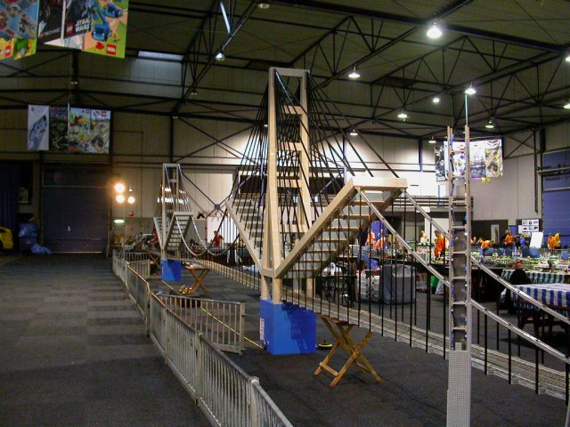

Et évidemment le fabuleux [^5] diorama StarWars de l’attaque de la planète Hoth ; fait conjointement avec Un hollandais : Hein-Jan Kemperman (aussi vendeur des fabuleuses armes de [LittleArmory](http://www.littlearmory.com/)), Yann, Gael et Jean-Louis (ah oui Manu a empiler quelques briques aussi :-))

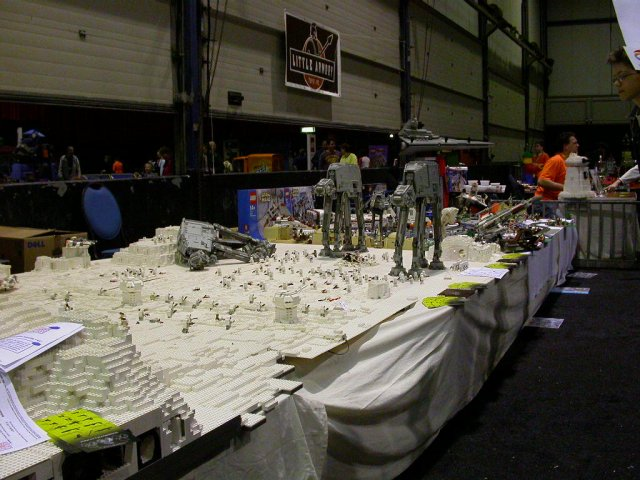

Je laisse maintenant la parole a chacun des particpants pour qu’ils puissent aussi raconter des co.. heu ce qu’ils ont trouver de bien dans ce millésime 2004 du LEGOWorld.

* * *

**Chris**

Du côté des Technics et Mindstorms la réalisation la plus belle était une pendule tout en LEGO de 1m70 environ et qui fonctionne vraiment...à préciser pour ceux qui connaissent le fonctionnement des pendules que notre AFOL à carrément inventé un systéme d’ échappement qui n’ existait pas...

Menno Gorter était également présent, cet inconnu sur le web fabrique de superbes robots marcheurs de toutes tailles et toutes formes : pneumatiques, moteurs, 2, 4 et 6 jambes. La spécificité de ses créations est qu’ il réduit l’ électronique au maximum cherchant d’abord des solutions mécaniques..là encore un vrai travail d’horlogerie....

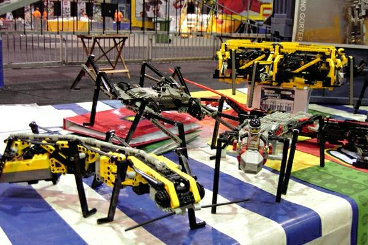

Il y avait aussi un podium sur lequel se déroulait des petits combats de robots radiocommandés (infrarouge et radio). Un vrai show musical et lumineux pour accompagner ces petits robots assez simple souvent chargés d’un caméra sans fil.

Et bien sûr qu’ elle n’a pas été notre surprise en découvrant des répliques quasi-identiques du lanceur de Cd et du jeux Simon de notre Philo nationnal....Même dans le monde des LEGO les bonnes idées sont trés vite accaparées..

Sinon il y avait une belle rétrospective des grosses voitures Technic créés par LEGO depuis 25 ans.

Enfin cette année la grande mode était au dernier modéle automobile radiocommandée, sitôt le salon fermé les modéles sortaient des boites afin de rouler à toute allure entre les différents stands. Ce modéle bien qu’ assez cher et récent à déjà inspiré certains AFOLS hollandais qui ont composé des "supercars" à 12 roues à l’ énérgie incroyable...

* * *

**Nicolas**

Cette première participation en tant qu’exposant fut un succès. Il y avait toujours autant de passionnés autour de notre stand. Une surprise de taille nous attendait lorsque nous entrions dans le hall des exposants, un gigantesque pont de 25 mètres de long sur lequel des trains circulaient.

Le diorama de nos amis belges de [Belug](http://www.belug.be/) fut également très apprécié du public. Enfin le magasin Intertoys à obtenu un franc succès auprès de tous, dans un chaos de briques éparpillées sur le sol chacun a fait son choix et parfois même certains ont dû protéger leurs trouvailles des mains innocentes.

Enfin le bus fut un grand moment de plaisir dans un chahut indescriptible. André le chauffeur s’en souviendra pour l’année prochaine.

* * *

**Yann**

Ben, mon résumé sera : ce fut court mais intense !

Arrivé de Rome via Bruxelles le vendredi soir vers les 2h30 du mat, juste avant Didier et ses deux petits, que ne faut-il pas faire pour voir des briques et boire du ZUPPP !

Quelles nouveautés cette année ?  
Une ambiance nettement plus déjantée, électrifiée à coup de bons petits plats de Doudou Dominique, d’apéro de Doudou Jean, et de bons calembours de toute la joyeuzzze bande.

Une fine équipe plus nombreuses que l’année dernière, et franchement internationale, des belges, un québécois, un breton...  
Des MOC moins nombreux que l’année passée, mais certains égalant largement en qualité leurs prédécesseurs, comme le pont déjà évoqué par Nicolas ou un diorama belge aussi impressionnant de détails que l’était celui de nos amis italiens il y a un an.

Un temps pluvieux et porteur de microbes, tout le monde est reparti avec une bonne crève dans les bagages.

Que retenir de cette année ?  
Les aller-retour en bus bercés par les voix mélodieuses de notre chœur freelugien (des enfants peuvent nous lire, je ne détaillerais pas les paroles des chansons !!), les ronflements de Bouclette (Gael) et de Ouin-Ouin (Jean-Louis), les 1900 minifigs montées dans leurs cadres, les péripéties de Simone et Marie-Hélène à Amsterdam, Nicolas qui trie, Richard qui râle (pour le principe), Manu qui rigole, le prez qui dort, Dominique qui nous bichonne, Jean qui sert l’apéro entre deux blagues belges, euh, oups, françaises, Pierre qui roule (facile celle-là), Ronan qui calemboure, Gaël qui crie "Pan-Pan" et Jean-Louis qui précise "Blague à deux balles" et tous qui boivent une rasade de maman Doudou !

Et de la brique, de la brique, de la brique.

Tout ca qui fait qu’on a envie d’y revenir l’année prochaine !

* * *

**Gael - Khan (aka bouclettes)**

Bon ben c’etait ma premiere fois a LegoWorld. Le zup et surtout les bulles ont aidés à bien vite détendre l’atmosphere.

Bon, il est vrai que habitué aux colos, j’ai pas pu m’empecher de "brailler" un peu dans le bus le matin et le soir, tres vite plusieurs d’entre nous se sont retrouves sans voix, enfin legerement ereintee ;) Mais Grace au chouchen (la je vois encore Ronan, jlb et manu sautillant sur place devant les yeux ebahis des hollandais) qui comme chacun le sait contient du miel, aide au mal de gorge, et pi pour les ch’ti mechant microbe, Jean a sorti de sa cave, une recette ancestrale, le ZIZI-coincoin ;)

Pi comme les journees etaient fort longues, a se promener en montrant nos "moultipass" aux agents de securite, et surtout aux interimairEs et hotesses LEGO, Dom nous preparait de copieux et excellent diner. Les photos de l’ambiance montre que les repas etaient un moment de joie intense.

Le matin, il etait de bon gout de passer faire un bonjour aux damoiselles du Shop@home, pi d’aller voir les filles qui donnaient des p’tits bracelets avec un No de telephone.  
Et apres une semaine, on arrivait a dire Rouillleuuu Morrren comme des hollandais ;) Sauf qu’apres il continuait dans une langue fort etrange et la on partait en courant en gloussant ;)

Bon, le but pricipal etait quand meme de voir des LEGO ... C’est ce que nous avons vu et expose. Une superbe realisation de la part de BeLUG. Cote De Bouwsteen, beaucoup d’idee sympa, bien que je regrette la multiplication de tables "train" toutes vides. De superbes realisations aussi de la part de Steve Burge, Megan et marc (utilisation des clickits dans une pieuvre, d’un vaisseau modulaire qui est un pur delire).

Bon, ben je crois que l’on a po le choix ... faut que l’on y retourne l’an prochain, avec une base de Hoth encore plus grande, pi un bo layout ;)

Pan pan ... ZUPPPPPPPPP et Moultipass ;)

* * *

**Didier - Qdm**

Le Legoworld 2004 s’est réduit pour moi cette année à un simple aller retour, histoire de retrouver les copains et surtout de présenter l’événement aux enfants !

Comme cela l’a déjà été évoqué plus haut, cette édition 2004 était moins riche que celle de 2003, car nos amis Italiens et Allemands n’avaient pas fait le voyage cette année. Heureusement nos voisins Belges étaient là pour exposer leur savoir faire, reprenant au passage l’idée des vaches d’Erik (sans la commande Mindstorm, toutefois).

Ma contribution aura été très modeste cette année, car à part avoir fait la livraison des 3000 briques 2x3 pour les présentoirs du prez et régler un problème de soudure sur le grogneugneu de Vauban, j’ai l’impression de ne pas avoir fait grand chose. Mais comme j’étais venu quasiment les mains vides, j’ai pu repartir avec beaucoup de sachets Intertoys dans les bagages.

Bravo à nos FreeLUGiens exposants pour leurs talents :  
**–** la base Hoth n’a pas laissé les visiteurs de glace  
**–** un super bon point à Christophe pour la présentation dynamique de ses créations - je te le répète, non seulement c’est bien ce que tu fais Christophe, mais en plus c’est beau !  
**–** désolé Gaël, je ne te confierai pas mes gamins pour une prochaine colo... (quel boulot maintenant pour leur désapprendre à ne pas chanter en voiture !)  
**–** merci à Dominique et Jean pour l’intendance  
**–** et re-merci à Jean et à Gaël pour être venu nous chercher quand je me suis perdu à notre arrivée à 2h00 du matin (il est où ce bungalow 30 ? - Ah bon, je ne suis pas dans la bonne résidence ?) et pardon d’avoir réveillé les autres...

* * *

**Harald - HJR**

Bon, qu’est-ce qu’il reste à dire ? Même si beaucoup des AFOLS (Amateur Adulte de LEGO) hollandais avaient amené que des trains (mais allez, quelle est la fonction d’un train sans passagers, sans gares, sans maisons etc.!!!), Il y avait suffisamment des constructions intéressantes à voir, que même mes parents sont restés plus qu’une heure à la salle des AFOLS. Ce que J’ai trouvé très intéressante moi-même était les horloges par un hollandais qui était là juste deux jours.

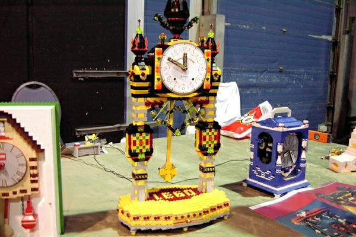

Il avait amené une horloge d’environ 1.80m de hauteur qui fonctionnait réellement (à quatre fois de la vitesse normale, mais bon) et c’était très impressionnant. J’aimerais également donner mes compliments à BELUG pour leur création d’une ville superbe. Honnêtement J’ai trouvé ça la plus belle création de Legoworld 2004.

L’atmosphère dans l’équipe était nickel, J’aimerais surtout les voyages dans l’autobus et je vais exercer mes chansons françaises pour l’année prochaine.

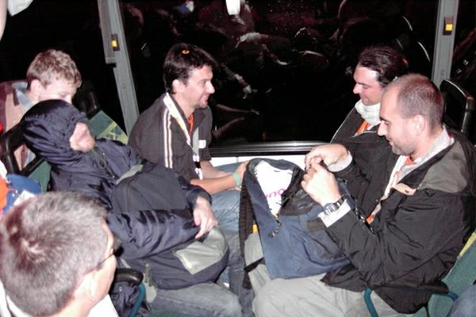

J’aimerais remercier tout l’équipe et surtout notre couple belge responsable pour l’achat de l’alimentation et pour la cuisine superbe !

## Liens

Voici des liens vers les galleries de nos participants :  
**–** Khan : [http://photos.freelug.org/main.php/...](http://photos.freelug.org/main.php/v/khan/LEGOWORLD/LegoWorld-2004/)  
**–** JLB : [http://photos.freelug.org/main.php/...](http://photos.freelug.org/main.php/v/JLB/LEGOWorld2004/)  
**–** HJR : [http://www.brickshelf.com/cgi-bin/g...](http://www.brickshelf.com/cgi-bin/gallery.cgi?f=102945)

[^1]: Vient de la boisson préférée des hollandais, le 7UP. LEs p’tits francais ont vite deformé la chose pour hurler ZUUUUUUUUP à tout bout de champ :-)

[^2]: Designe le pass que nous avons eu pour rentrer tous les jours, et fait allusion au "liloo Multipass" du film le 5ème élément

[^3]: "Plus vite André, Plus vite"

[^4]: Le fait que l’auteur de cette phrase soit l’auteur d’une partie de la base n’influence ne rien son jugement .. quoique :-))

[^5]: Puisque je vous dis que le fait que l’auteur de cette phrase est aussi participé a ce diorama, n’influence pas du tout son jugement :-)
