6 participants ont relevé le défi de proposer une création associant les valeurs communes des JO d’Hiver et de la Saint-Valentin.

Vous pouvez retrouver le [règlement de ce concours ici](https://www.freelug.org/spip.php?article3180).

Tout d’abord, nous tenons à remercier les 6 participants qui nous ont proposé de très jolies réalisations.

Les participations sont présentées dans l’ordre de réception.

**01 - Carl R. - A la Saint Valentin, la fée de l’amour passe partout, même aux jeux olympiques.**  
Cela se passe un 14 février après quelques épreuves des jeux, certains athlètes se rapproche pendant un moment de détente.. cosy cosy.

[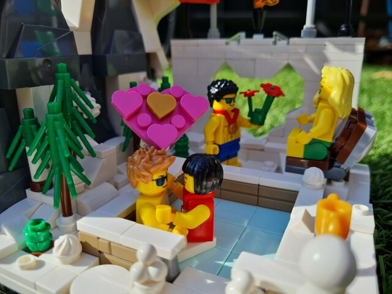](https://www.freelug.org/IMG/jpg/029-01-04_personnalise_.jpg)

[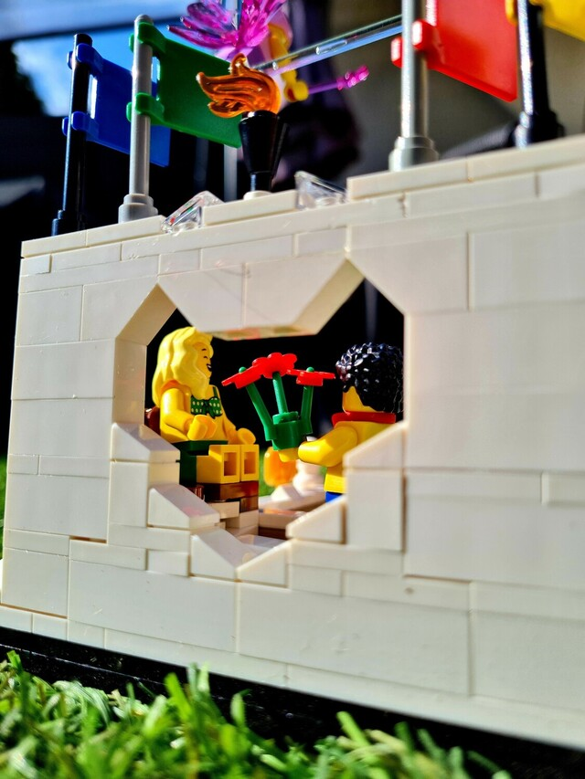](https://www.freelug.org/IMG/jpg/029-01-03_personnalise_.jpg)

[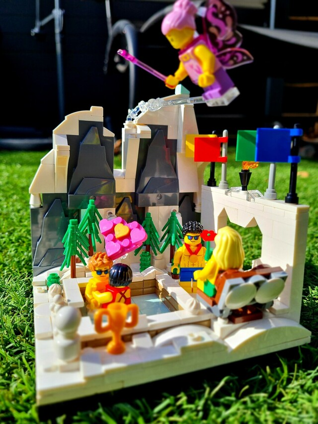](https://www.freelug.org/IMG/jpg/029-01-02_personnalise_.jpg)

[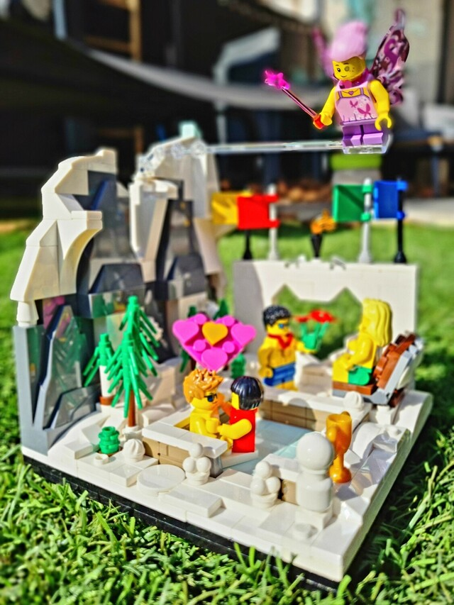](https://www.freelug.org/IMG/jpg/029-01-01_personnalise_.jpg)

* * *

**02 - Charles F. - Chacun ses rêves !**  
14 février 2022, deux patineurs artistiques français, en couple sur glace comme au lit ( et ça ne nous regarde pas !...) entre dans la compétition des Jeux Olympiques d’hiver de Pékin.  
Portés par leur espoir personnel, leur couple en sortira t’il vainqueur ?  
Une allégorie « très XXI ème siècle », de l’homme romantique et de la femme carriériste.

[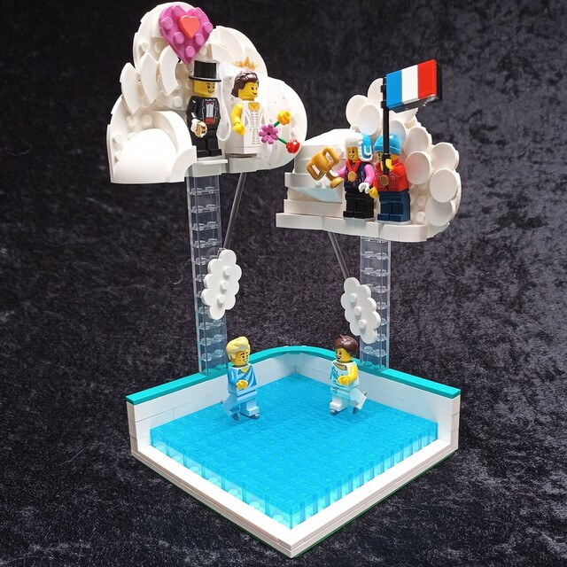](https://www.freelug.org/IMG/jpg/029-02-05_personnalise_.jpg)

[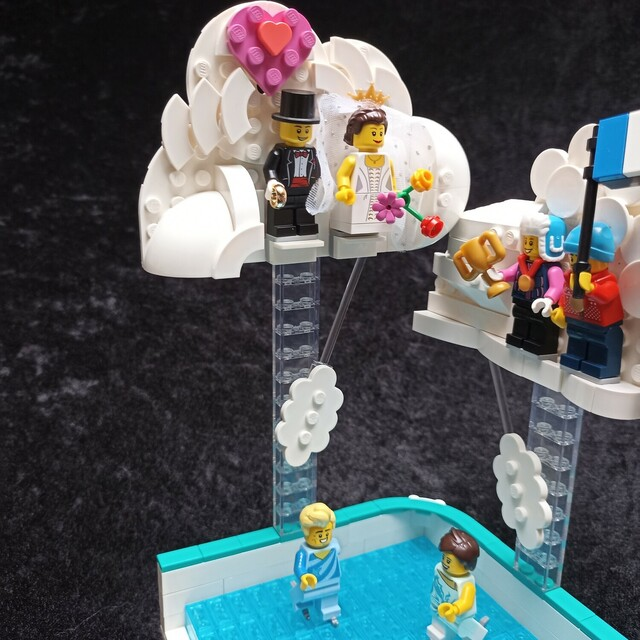](https://www.freelug.org/IMG/jpg/029-02-01_personnalise_.jpg)

[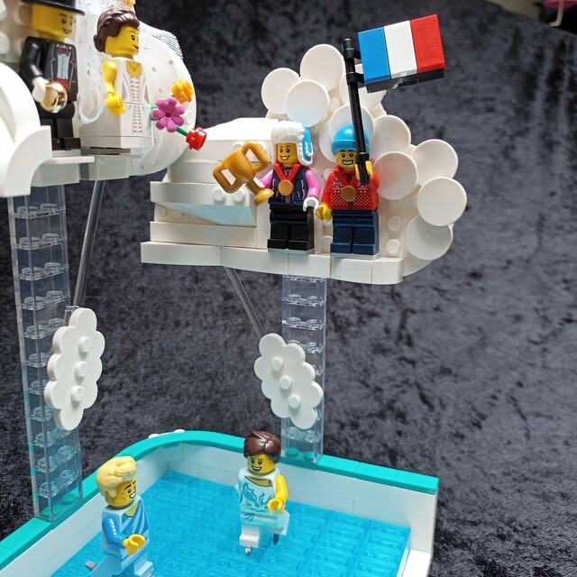](https://www.freelug.org/IMG/jpg/029-02-02_personnalise_.jpg)

[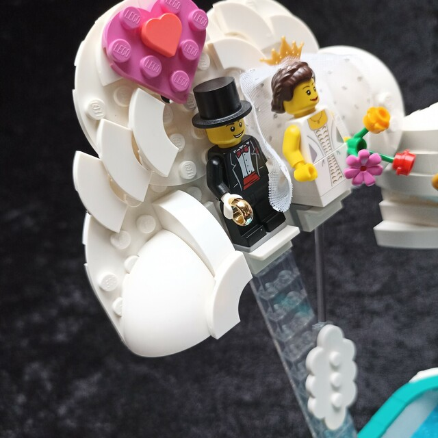](https://www.freelug.org/IMG/jpg/029-02-04_personnalise_.jpg)

[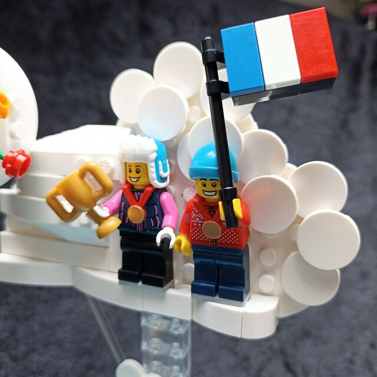](https://www.freelug.org/IMG/jpg/029-02-03_personnalise_.jpg)

* * *

**03 - Claude M. - Déclaration d’Amour aux JO de Pékin**  
J’aime les Jeux olympiques mais je t’aime mille fois plus...

[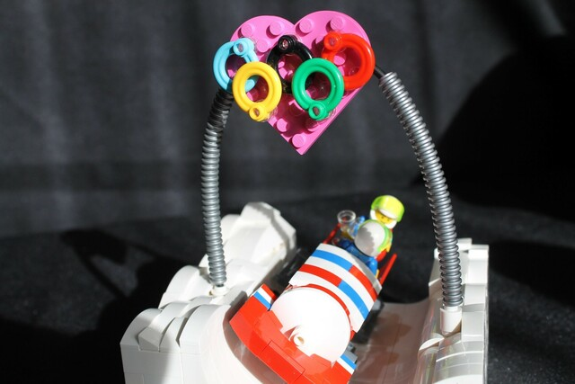](https://www.freelug.org/IMG/jpg/029-03-03_personnalise_.jpg)

[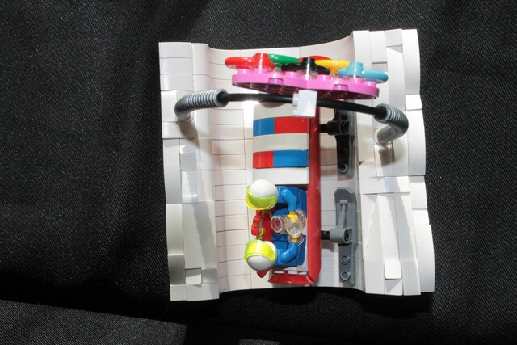](https://www.freelug.org/IMG/jpg/029-03-01_personnalise_.jpg)

[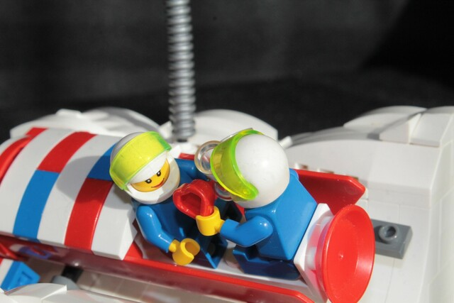](https://www.freelug.org/IMG/jpg/029-03-02_personnalise_.jpg)

[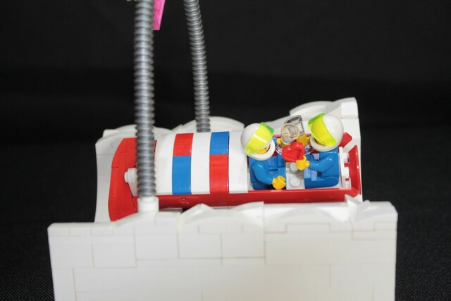](https://www.freelug.org/IMG/jpg/029-03-04_personnalise_.jpg)

[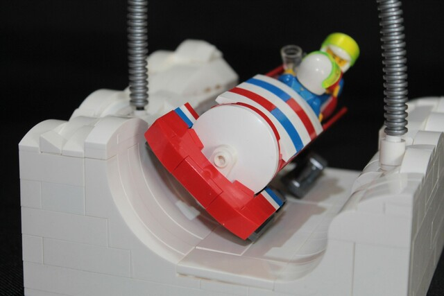](https://www.freelug.org/IMG/jpg/029-03-05_personnalise_.jpg)

* * *

**04 - Rémi L. - Fin d’une épreuve, début d’une histoire d’amour ?**  
Chute en descente femme, la médaille s’envole. Peut être que la demoiselle acceptera de se consoler dans les bras de son prétendant local ? La suite ne nous regarde pas mais j’espère qu’elle retrouvera le sourire.

[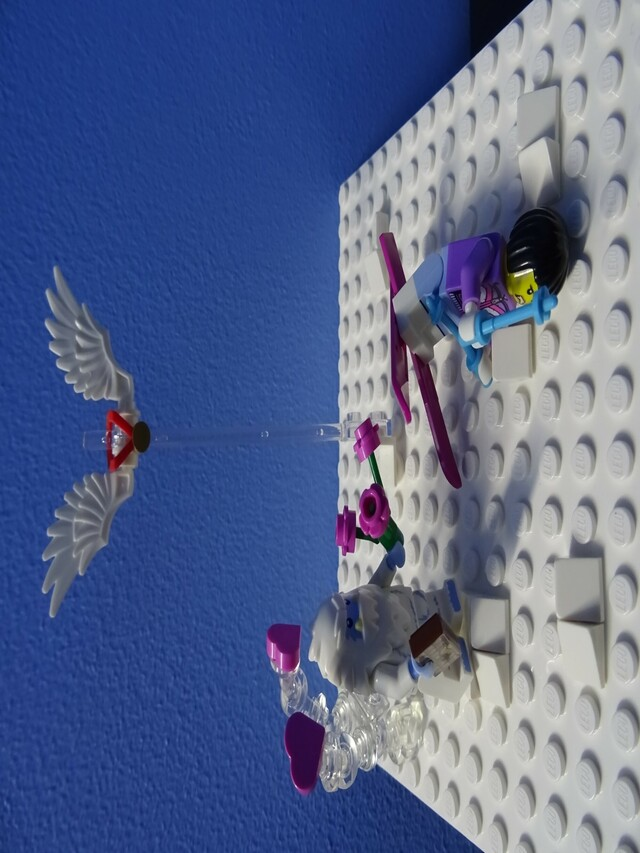](https://www.freelug.org/IMG/jpg/029-04-01_personnalise_.jpg)

[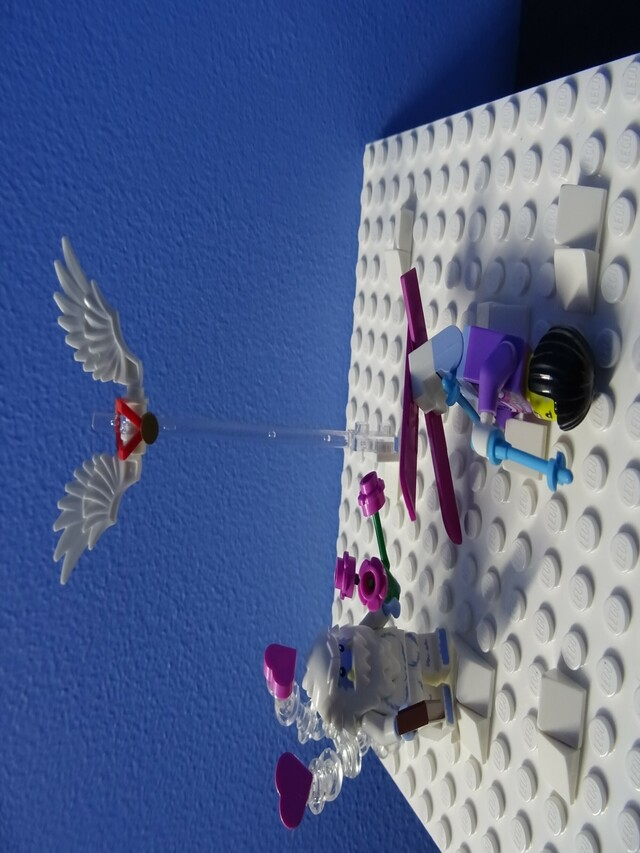](https://www.freelug.org/IMG/jpg/029-04-02_personnalise_.jpg)

[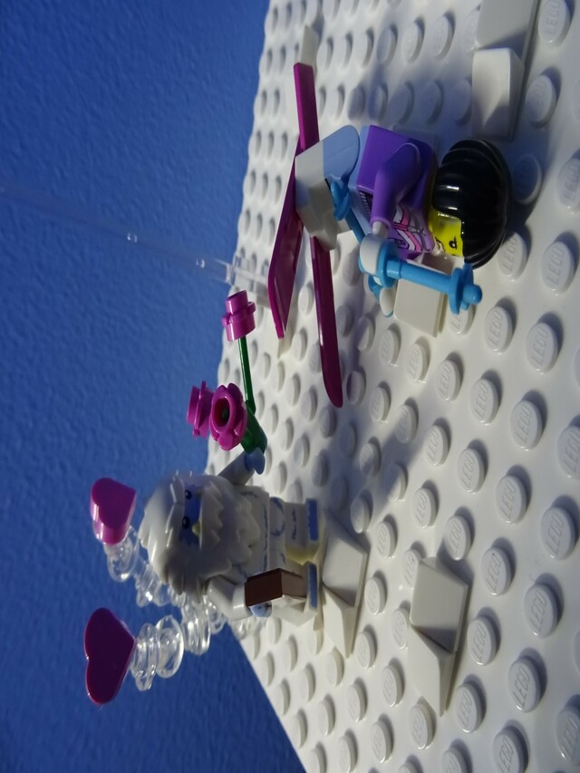](https://www.freelug.org/IMG/jpg/029-04-03_personnalise_.jpg)

[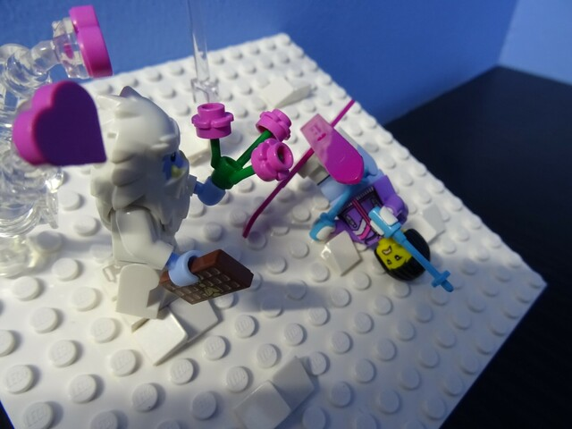](https://www.freelug.org/IMG/jpg/029-04-04_personnalise_.jpg)

[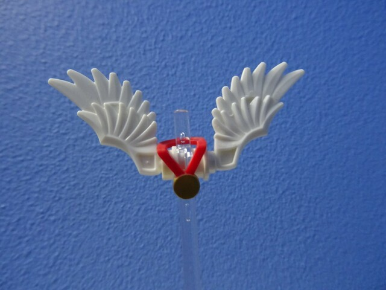](https://www.freelug.org/IMG/jpg/029-04-05_personnalise_.jpg)

* * *

**05 - Wilfried R. - Choc Meetic aux JO d’hiver**  
Alors que le réchauffement climatique guette, l’espace vital dédié aux jeux s’amenuise et les sportifs se rapprochent. Une rencontre fortuite, brutale, mais inéluctable va se produire... pour le grand bonheur des kinés et des chirurgiens. Mais ces deux-là monteront finalement sur le podium de l’amour et sans doute, l’idylle fera boule de neige... Peut-être que cette histoire rejoindra celle des deux tourtereaux transis... depuis des siècles, dans la glace des entrailles de la montagne.

[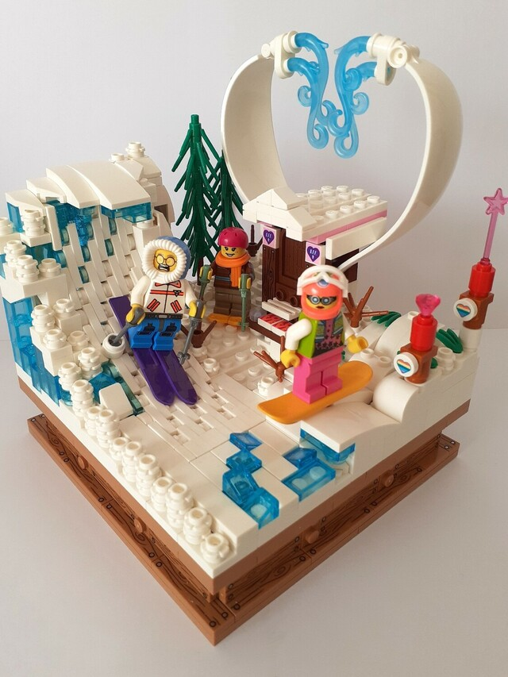](https://www.freelug.org/IMG/jpg/029-05-01.jpg)

[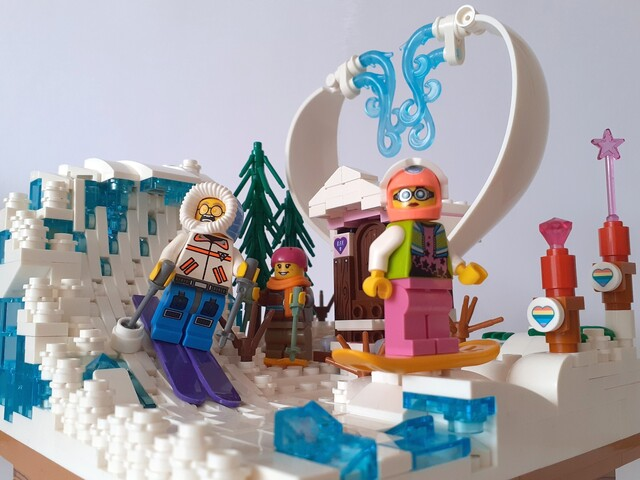](https://www.freelug.org/IMG/jpg/029-05-05.jpg)

[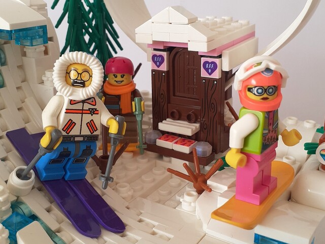](https://www.freelug.org/IMG/jpg/029-05-02.jpg)

[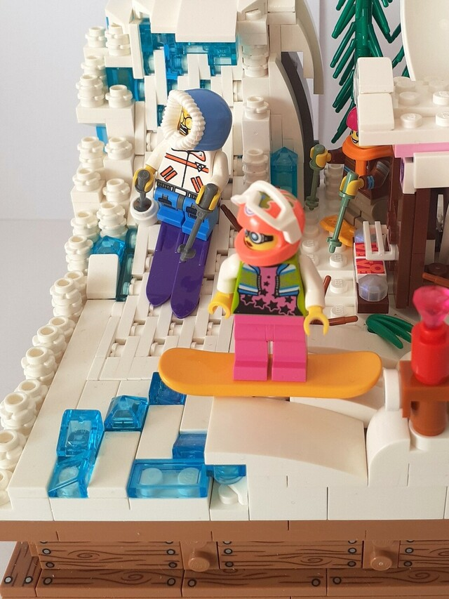](https://www.freelug.org/IMG/jpg/029-05-04.jpg)

[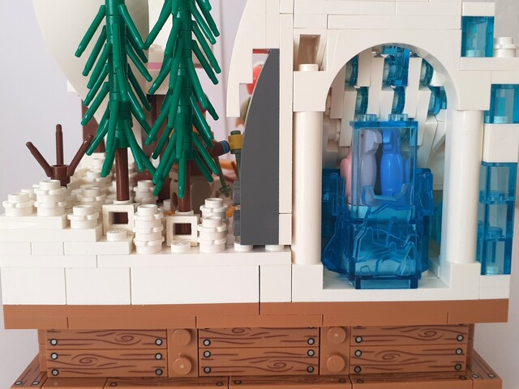](https://www.freelug.org/IMG/jpg/029-05-03.jpg)

* * *

**06 - Jean-Michel R. - #ensemble**  
Que se soit l’amour du sport ou l’Amour tout court, on peut passer toutes les épreuves ensemble et arriver au bout. Les couleurs de nos drapeaux ne sont pas les mêmes, mais le respect des autres est identique. #ensemble, cassons les préjugés.

[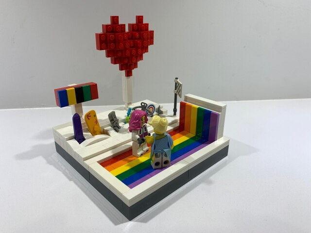](https://www.freelug.org/IMG/jpg/029-06-01.jpg)

[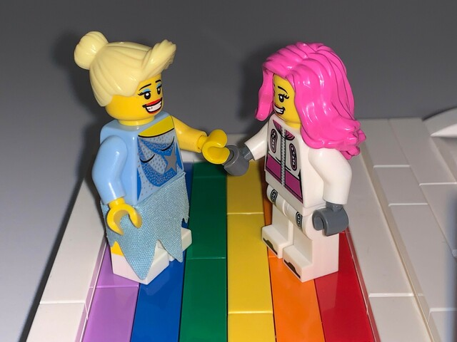](https://www.freelug.org/IMG/jpg/029-06-02.jpg)

[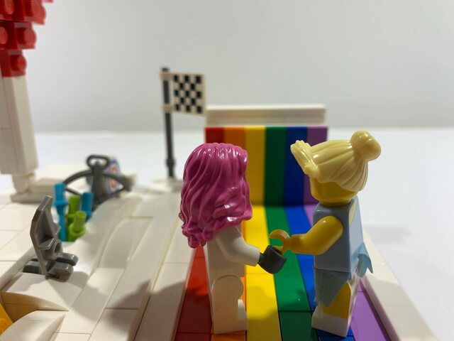](https://www.freelug.org/IMG/jpg/029-06-04.jpg)

[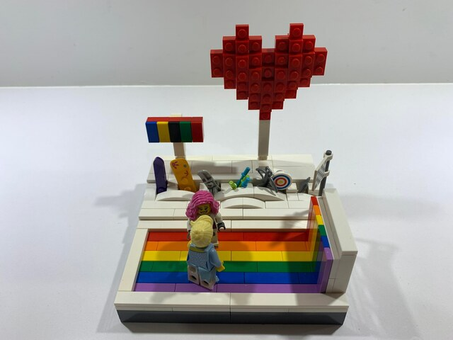](https://www.freelug.org/IMG/jpg/029-06-05.jpg)

* * *

Devant la qualité de réalisations proposées, le GFC a décidé de récompenser le premier et le second.

**Les heureux gagnants du concours sont :**  
**–** Charles F. (Chacun ses rêves !) qui remporte le set 41168 - Elsa’s Jewellery Box  
**–** Wilfried R. (Choc Meetic aux JO d’hiver) qui remporte le set 60253 - Ice-Cream Truck

**Classement :**  
Charles F. (15 pts)  
Wilfried R. (13 pts  
Claude M. (8 pts)  
Carl R., Rémi L. & Jean-Michel R. (3 pts)

**Composition du jury :**  
Pierre C. (Tribolego) (GFC)  
Mathieu W. (GFC)  
Xavier D. (GFC)  
Norman H.  
Céline D.  
Gaultier O-G.  
Nicolas W.  
Stéphane P.  
Stéphane R.  
Benjamin G.  
Xavier L.  
Duy Hai D.  
Denis H.  
Yoann G.  
Sylvain J.

**Merci à toutes et tous et à bientôt pour un nouveau concours !**
