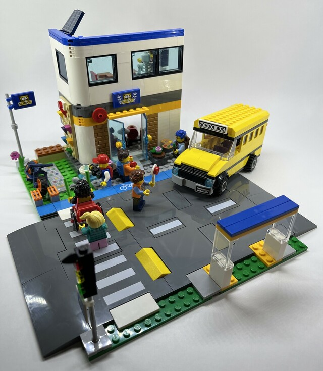
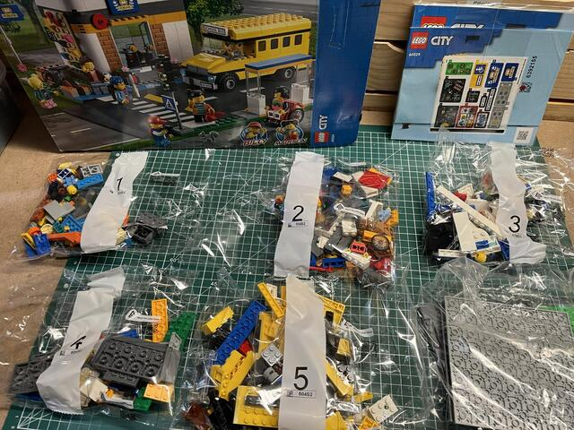
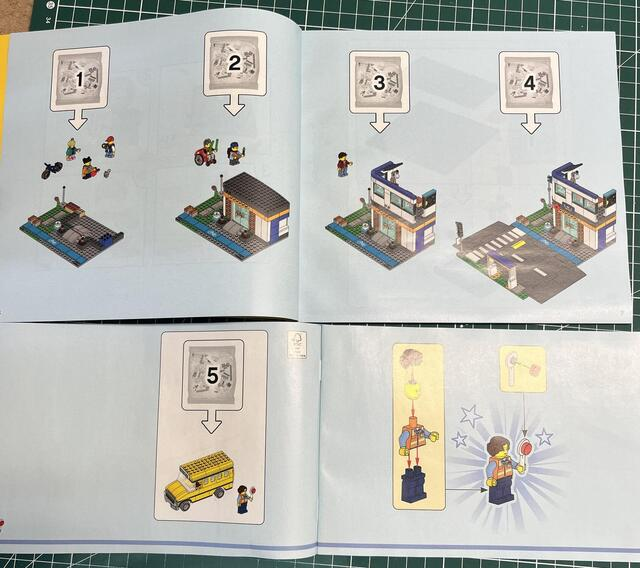
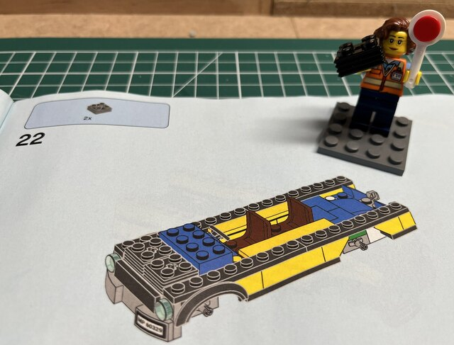
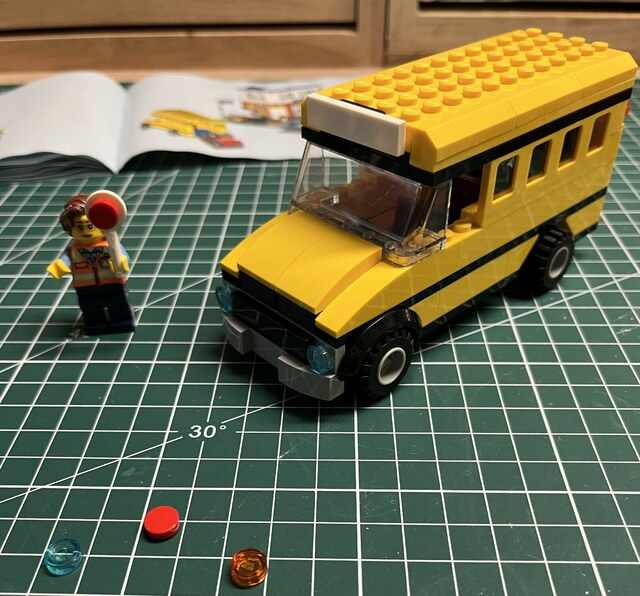
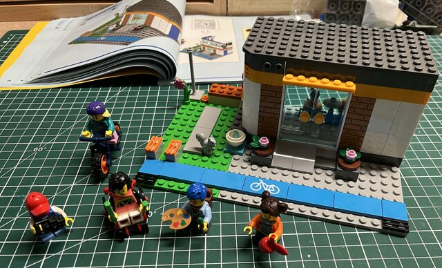
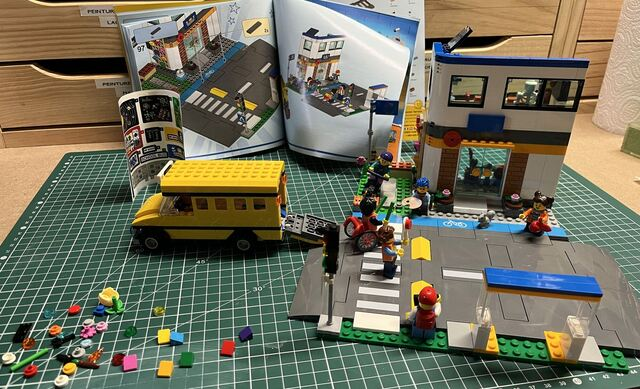
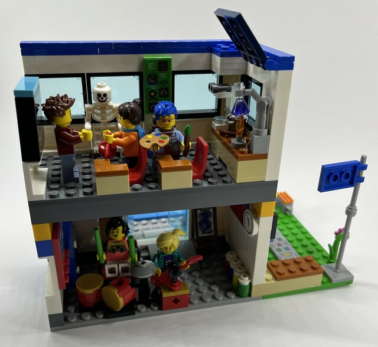

Voici un sujet que les enfants (petits et grands) connaissent bien et qui n’a été que très peu couvert jusqu’à ce jour. Revue de set en détails pour vous montrer ce qu’il y a dans la boîte et voir comment on peut l’exploiter.

Revue de set consacrée aujourd’hui à cette nouveauté 2022 dans la gamme LEGO City, le set 60329 - L’école.

S’il y a un sujet qui partage le quotidien des enfants à qui les jouets LEGO sont principalement destinés, c’est bien celui de l’école, lieu de départ de toutes les aventures et de naissance de tous les projets de vie. Il faut cependant signaler que ce sujet n’a été que très peu traité dans l’histoire des sets LEGO, retenons simplement que le sujet a été jusqu’à présent plutôt genré "filles" avec des sets [Friends](https://www.bricklink.com/v2/catalog/catalogitem.page?S=41134-1#T=S&O={{ '{%' }}22iconly%22:0}) et [Superheros](https://www.bricklink.com/v2/catalog/catalogitem.page?S=41232-1#T=S&O={{ '{%' }}22iconly%22:0}), exception faite d’un set [Fabuland de 1989](https://www.bricklink.com/v2/catalog/catalogitem.page?S=3647-1#T=S&O={{ '{%' }}22iconly%22:0}).

Nous avons maintenant avec ce set LEGO City 60329 l’illustration d’un beau bâtiment qui va peupler nos villes en complément des éternelles casernes de Police ou de Pompier. Et comme nous sommes en 2022, cette école s’adresse aussi bien aux petites filles qu’aux petits garçons, aux petits valides comme à ceux qui doivent malheureusement se déplacer en fauteuil roulant.

Sans plus attendre jetons un oeil dans ce qu’il y a dans cette boîte de 396 pièces, prix public sur le Shop LEGO à 59,99€.

Dans la boîte se trouvent donc 6 sachets de briques, dont 5 sont numérotés, 2 notices et une petite planche d’autocollants qui viendront enrichir la décoration du bus scolaire et du bâtiment.

La décomposition des sachets numérotés permet de séquencer les étapes de montage, les étapes 1 à 4 concernent le bâtiment, le 5 le bus scolaire typé "School bus" Américain. Le sixième sachet regroupe les plaques et éléments de route qui permettent d’insérer le bâtiment dans la ville.

Nostalgique du très beau modèle de School Bus réalisé en son temps par notre ami designer [Pierre Normandin](https://www.freelug.org/spip.php?article158), j’ai d’abord commencé par le sachet n°5 et la notice de ce petit bus.

Pas de difficulté particulière dans ce montage très classique. A signaler une nouvelle pièce avec ce module moteur en brique 2/3 de haut 4x4 avec des stries de ventilation, que nous présente la préposée à la conduite du bus.

Uniquement 2 sièges dans ce petit bus, dont celui de la préposée, c’est un peu surprenant, mais il vient en écho à la diversité des enfants fréquentant cette école dont l’un d’entre eux voyage avec son propre siège et qui dispose d’une plate-forme pour accéder au bus. Bon point à LEGO pour nous sensibiliser sur le sujet, même si on se posera la question de l’accès à la salle de science.

Quoiqu’il en soit une fois terminé, ce petit bus a plutôt fière allure.

Passons maintenant à la construction du bâtiment. Là aussi pas de difficulté particulière dans la construction de ce petit immeuble qui se décompose entre les fondations (sachet 1), les infrastructures du rez de chaussée avec la salle de musique (sachet 2), la salle de science (sachet 3) et les éléments de route (sachet 4).

On notera que tous les enfants ont des pieds d’enfants de taille réduite (ce qui est normal) mais que notre petit garçon en fauteuil roulant possède quant à lui des pieds de taille réduite, mais articulés, ce qui lui permet de plier ses jambes pour s’installer dans son fauteuil. Il est par contre équipé de 2 batons dont on se demande à quoi ils peuvent bien servir. La réponse vient à la fin de la construction du rez de chaussée, la salle de musique étant équipée d’une batterie qui n’attend plus que son batteur échevelé.

Les détails de la salle de science équipée d’une loupe binoculaire, d’un bec benzène et d’une roche ouverte de toute beauté vont élargir l’apport pédagogique de ce set pour lequel les questions ne manqueront pas.

Les illustrations présentes sur les autocollants ouvriront également la porte à quelques séances d’explication en chimie, botanique et astronomie...

La fin de la construction se termine avec les éléments de route, qui sont bien jolis et bien pensés avec la signalisation et les ralentisseurs. Mon côté "vieille école" me fait quand même préférer les anciennes plaques de bases "routes" permettant d’assembler un vrai circuit routier avec de belles courbes.

En conclusion, il s’agit d’un beau petit set qui viendra enrichir votre univers City. La diversité des enfants, le fait que le set ne soit pas genré fille ou garçon, les éventuels apports pédagogiques qui pourront être échangés en font un set intéressant. Il est très abordable par ses techniques de construction sans complexité particulière et présente un bon contenu par rapport au prix. Pour moi les éléments de route n’ont pas d’intérêt, sauf qu’ils viennent maintenant se substituer aux plaques de base "routes" que je crains de ne pouvoir retrouver que sur le marché de l’occasion.

N’hésitez pas à commenter cet article pour partager vos avis et impressions.
