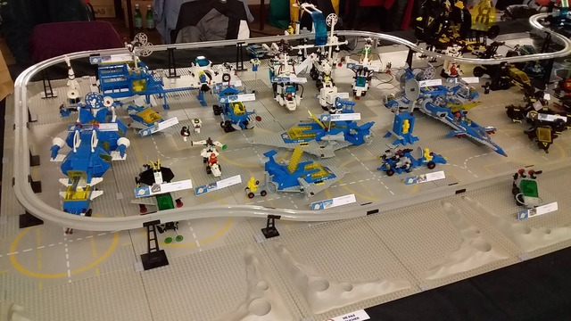
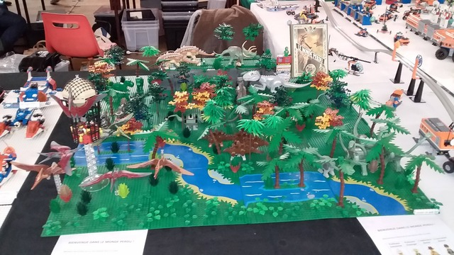
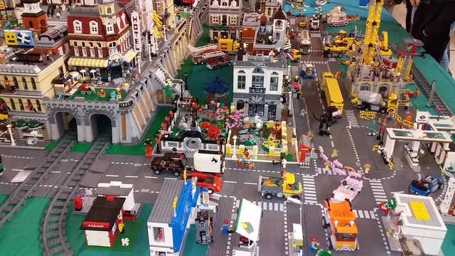
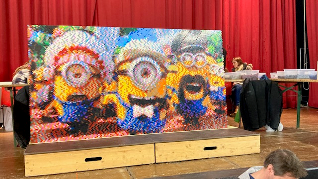

Cette année encore, nous étions 15 adhérents à avoir répondu présents pour cette exposition sur une journée au cours d’une bourse aux jouets anciens et culture geek.

Comme d’habitude, de sublimes créations étaient présentées, dans plusieurs thèmes, dont une majorité très anciens (certains sets datent de 1979/1980)

**rétro espace classic**

Et une fois de plus le public a été au rendez-vous malgré que cela se passe sur une seule journée.

**Les dinausaures**

**city 3**

Une très belle mosaïque "Des Minions" qui se composait d’environ 16330 briques 2x2 regroupant 27 couleurs a été réalisée en moins de 6 heures par le public présent sur place. Cette animation a remporté un grand succès auprès des jeunes comme des moins jeunes. Après la pose du dernier demi-losange, les flashs ont crépité ainsi que les applaudissements. Pour le démontage, le public encore présent a mis la main à la patte (un coup de main très apprécié).

**Mosaïque Minions**

Mosaïque Minions de 16335 briques 2x2 regroupant 27 couleurs

Nano69
