Au départ, c’est la mairie de la Côte St André qui est à l’origine de cette expo. Une personne dans leur service culturel nous connaissait, Marine et moi. Nous avons donc organisé cette petite expo au sein même de la mairie dans deux salles (150m² en tout), avec entrées gratuites .

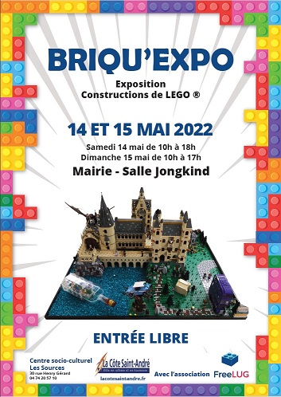

Nous étions sept exposants, parmi lesquels Clément et ses amis Olivier, Audrey et Claire, qui se lançaient dans leur première expo. Je dis toujours que ces petites expositions sont parfaites pour se lancer.

Nous avons du avoir environ 500 visiteurs, ce qui nous a permis de passer un excellent week-end, sans être trop surchargé. Le gros succès de l’expo fut encore une fois la mosaïque proposée par Arnaud, qui représentait Berlioz, natif de La Côte St André. Même les gens du musée Berlioz se sont déplacé pour voir ça !! Sinon, il était aussi proposé de voir des créations personnelles sur les thèmes de Harry Potter, l’espace, Disney, Napoléon et Ville Microscale.

Quelques photos de ...

Marine :

[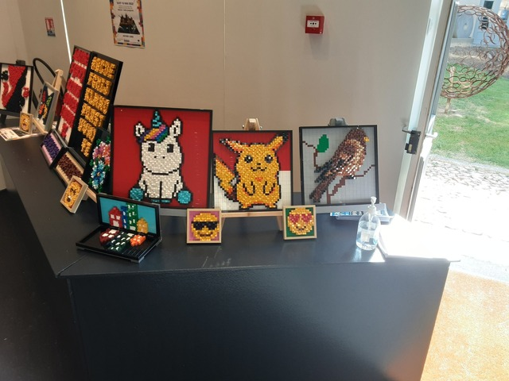](https://www.freelug.org/IMG/jpg/20220515_091214.jpg)

[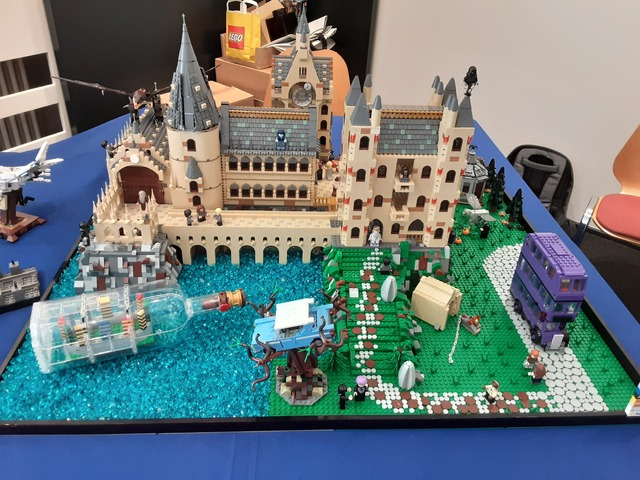](https://www.freelug.org/IMG/jpg/20220515_091244.jpg)

Clément et ses amis :

[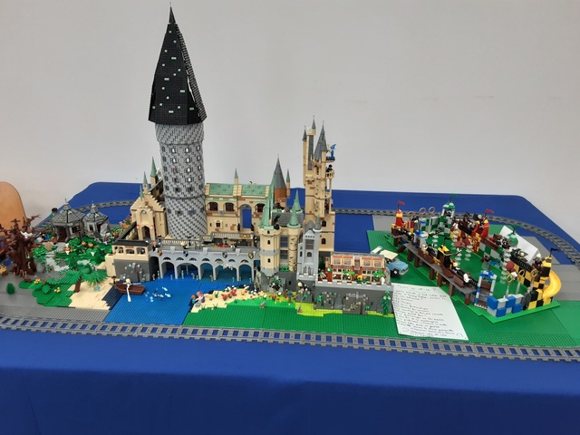](https://www.freelug.org/IMG/jpg/20220515_091356.jpg)

Mathieu :

[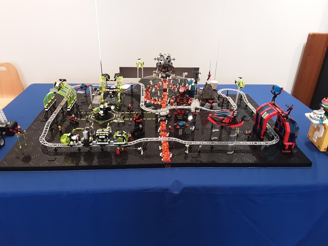](https://www.freelug.org/IMG/jpg/20220515_091318.jpg)

Fabrice :

[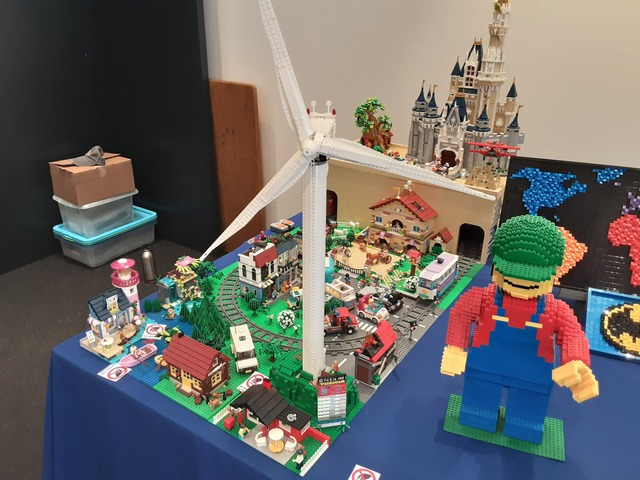](https://www.freelug.org/IMG/jpg/20220515_091326.jpg)

[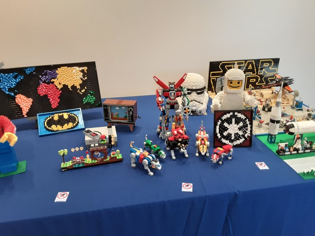](https://www.freelug.org/IMG/jpg/20220515_091334.jpg)

Noel :

[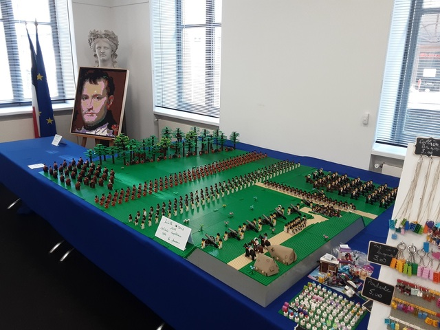](https://www.freelug.org/IMG/jpg/20220515_091414.jpg)

Loys :

[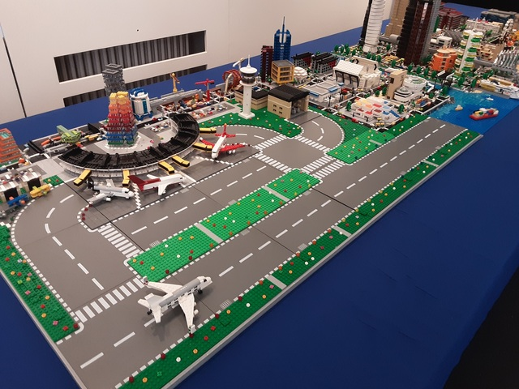](https://www.freelug.org/IMG/jpg/20220515_091250.jpg)

[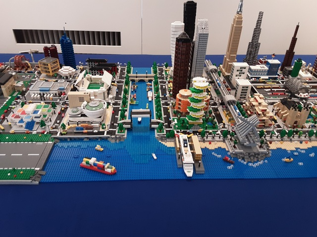](https://www.freelug.org/IMG/jpg/20220515_091258.jpg)

[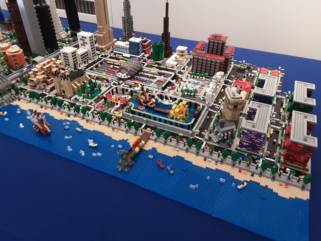](https://www.freelug.org/IMG/jpg/20220515_091306.jpg)

Une très belle mosaïque représentant le compositeur Hector Berlioz (natif de La Côte Saint-André) a été montée deux fois lors de cette petite exposition organisée par FreeLUG dans la mairie. Elle était composée de 13670 briques 2x2 regroupant 25 couleurs. Particularité de cette mosaïque, utilisation pour la première fois de 2 nouvelles couleurs qui étaient le "Bright Light Yellow" -"Jaune clair" et "Light Flesh" nouvellement appelé "Light Nougat" par LEGO qui représentait la couleur "caramel clair". Cette dernière couleur met bien en valeur le visage de la personne. Cette mosaïque a remporté un très grand succès auprès de la population locale puisque c’était la première fois que le visage d’Hector Berlioz était ainsi montré en pièce LEGO (La mosaïque faisant 1m84 de haut sur 1m13 de large). Elle a été photographiée sous toutes ses coutures.

[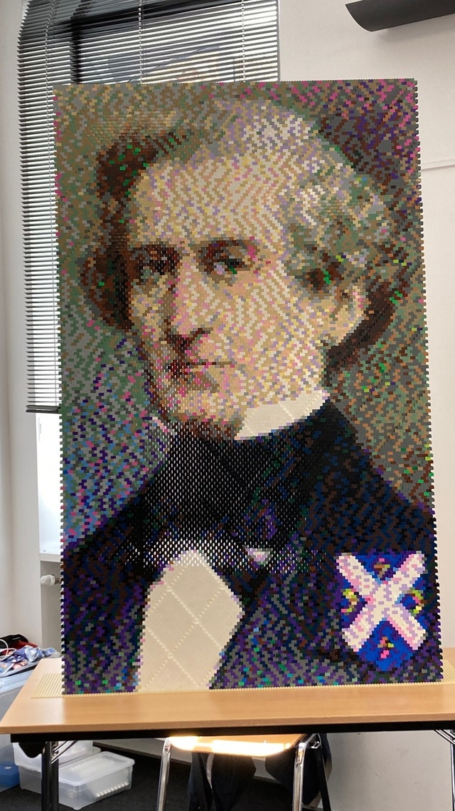](https://www.freelug.org/IMG/jpg/mosaique_h_berlioz.jpg)

**Mosaïque Hector Berlioz**

Mosaïque Hector Berlioz 13670 briques 2x2 regroupant 25 couleurs

Nano69

L’engouement des responsables de la mairie pourrait présager à l’avenir une nouvelle collaboration pour une vraie Briqu’Expo...

**Loys & Arnaud**
