Une Supra dans la gamme Speed Champions, dur de passer à côté.....

Les "Supra" sont une longue lignée de tradition sportive chez Toyota. Elles sont les plus performantes des "Celica". Ce sont aussi de très belles voiture, racées et qui me plaisent beaucoup, comme vous devez vous en douter. La voiture présentée aujourd’hui par la firme LEGO est la dernière sortie. Il n’a pas été facile de la reproduire avec toutes ces courbes. Mais voyons voir le résultat en vrai.

Commençons d’abord par les informations principales :  
Année de sortie 2021 ;  
Prix 19,99 €, sur le Shop, à l’heure où j’écris cet article ;  
2 sachets numérotés plus les enjoliveurs ;  
246 pièces et une minifig ;  
Temps de montage environ 1h.

La face avant de la boite est comme d’habitude chez Lego, on nous présente le modèle que l’on va construire. Ici, la belle Supra en pleine vitesse.

[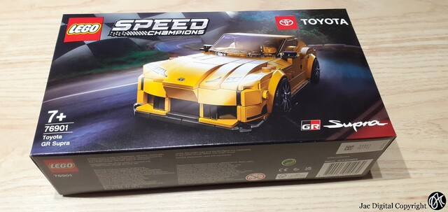](https://www.freelug.org/IMG/jpg/photo_01_.jpg)

Sur l’arrière de la boite, quelques photos supplémentaire. C’est une japonaise, on fait aussi du drift avec. Pour le reste, on est dans les habituelles photos de la gamme, avec une de la vraie voiture.

[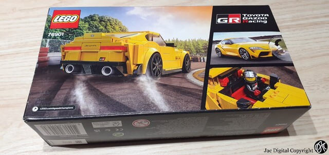](https://www.freelug.org/IMG/jpg/photo_02_.jpg)

A l’ouverture de la boite, on a 3 sachets, dont un qui contient 2 types d’enjoliveurs, le châssis, la planche d’autocollants et la notice. Tout cela "jeté" en vrac dans la boite.

[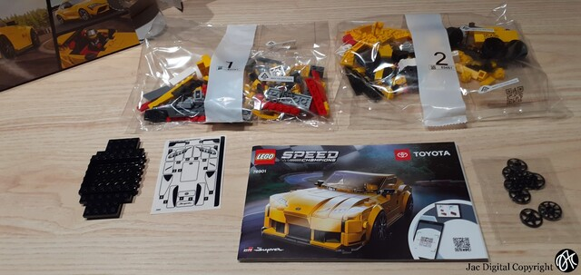](https://www.freelug.org/IMG/jpg/photo_03_-2.jpg)

Première phase de montage avec le premier sachet. C’est un peu répétitif dans la gamme "Speed Champions". Mais en même temps, on construit des voitures sur le même principe, donc, il fallait s’y attendre. On trouve deux sachets de petites pièces à l’intérieur, ça permet de faire des tas différents.

[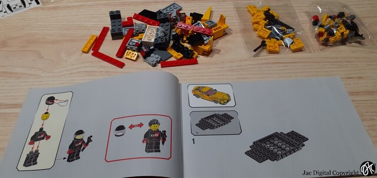](https://www.freelug.org/IMG/jpg/photo_04_.jpg)

Le personnage est exclusif à cette boite, avec un beau logo "GR" sur son blouson. On trouve une sorte de cheveux habituelle dans cette gamme de boite. A croire que les pilotes sont mal coiffés sous leur casque et même certains mal rasés.

[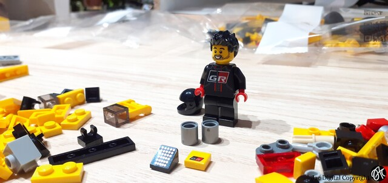](https://www.freelug.org/IMG/jpg/photo_05_.jpg)

Un peu de technique pour construire le sous bassement arrière de la voiture. C’est particulier mais efficace.

[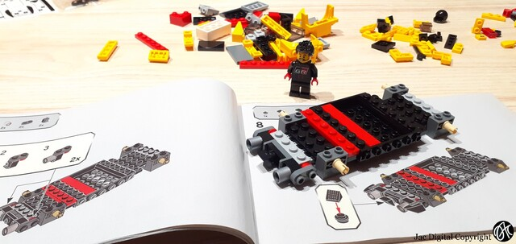](https://www.freelug.org/IMG/jpg/photo_06_-2.jpg)

L’arrière est un empilage de pièces, sans vraiment d’intérêt. Jusqu’à la mise en place de la vitre inclinée qui s’ajuste parfaitement avec les pièces penchées 1X4. J’adore ces montages "propres".

[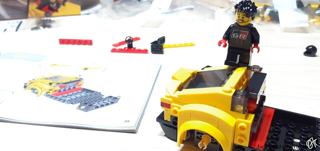](https://www.freelug.org/IMG/jpg/photo_08_.jpg)

Deux autocollants à mettre en place à la fin de cette première partie. Heureusement les pièces de 1 tenon sont en général tampographiées, comme ici le logo "GR" et la petite aération sur la "cheese". Il reste quelques pièces en extra sympa dont le "GR" que j’ai rajoutée sur la porte coté conducteur. Il faut bien apporter sa petite touche personnelle !

[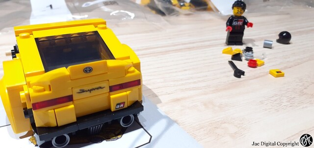](https://www.freelug.org/IMG/jpg/photo_09_.jpg)

Pour le deuxième sachet, on a le même rangement, on peut donc faire trois tas différents. C’est plus facile pour trouver les pièces surtout au début.

[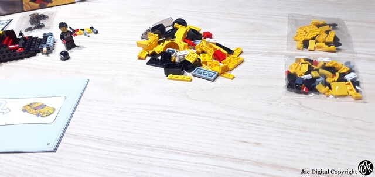](https://www.freelug.org/IMG/jpg/photo_10_-9.jpg)

Je trouve la représentation des lignes de portière très réussie. Le montage est par contre un peu habituel pour cette gamme, une fois de plus.

[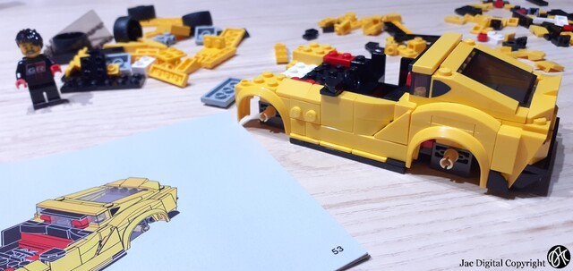](https://www.freelug.org/IMG/jpg/photo_11_-10.jpg)

Le montage de la face avant est très intéressant. Il faut tourner les pièces dans tous les sens. Une fois mise en place elle rend vraiment bien. La preuve en photo.

[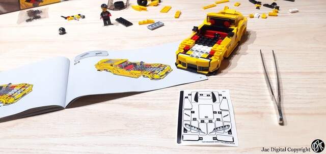](https://www.freelug.org/IMG/jpg/photo_12_-6.jpg)

C’est le moment de finaliser la voiture, avec la pose des derniers autocollants. Comme toujours avec les Speed Champions, il y en a une bonne quantité. Avec une pince à épiler de modéliste, ça aide bien. La notice est très bien faite pour ne pas se perdre avec les différents numéros. Mais ils sont aussi posés dans l’ordre sur la planche.

[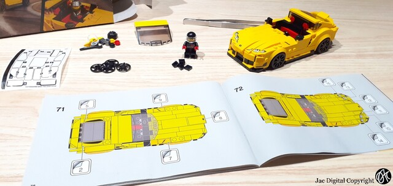](https://www.freelug.org/IMG/jpg/photo_14_-8.jpg)

Voilà le bolide terminé. Franchement, il y a eu beaucoup de critiques avec ces voitures aux formes arrondies très difficiles à reproduire. Mais finalement, quand on l’a devant nous ça passe très bien. Les courbes sont très bien définies et on reconnait bien la voiture. Une belle Toyota Supra à rajouter à ma collection. Y’a que les roues qui me plaisent pas. Ces métapièces ne sont pas belles, ça gâche ! Il reste plus qu’à lui trouver un beau site pour la prendre en photo.

[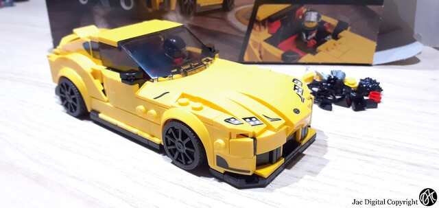](https://www.freelug.org/IMG/jpg/photo_15_-8.jpg)
