Quelques chiffres. Environ 10 heures de montage, 18 heures d’exposition sur deux jours et environ 1 heure de démontage. Un total de 10500 visiteurs et beaucoup d’enfants autour de notre stand.

Après plus d’une année de préparation, nous voici arrivés le 5 novembre 2004 14h00 pour l’installation du [stand FreeLUG](http://perso.freelug.org/orleans2004/plan14-01-2004.jpg) à l’exposition de modélisme ferroviaire organisée par l’Association des Modélistes Ferroviaires du Centre ([AMFC](http://perso.wanadoo.fr/amfc/)). Cette exposition prenait place dans le Parc des Expositions de la ville d’Orléans. [Eric Létang](http://www.brickshelf.com/cgi-bin/gallery.cgi?i=978583) est arrivé le premier (vive la sncf !), puis les arrivées se succèderont au cours de l’après-midi jusque tard le soir. Sans ordre particulier, [Philippe Label](http://www.brickshelf.com/cgi-bin/gallery.cgi?i=978588), [Jérôme Teyssier](http://www.brickshelf.com/cgi-bin/gallery.cgi?i=978704), [Nicolas](http://www.brickshelf.com/cgi-bin/gallery.cgi?i=978587) et [Simone Huyard](http://www.brickshelf.com/cgi-bin/gallery.cgi?i=978708), [Pascal](http://www.brickshelf.com/cgi-bin/gallery.cgi?i=844058) et [Florence Bréard](http://www.brickshelf.com/cgi-bin/gallery.cgi?i=978586), [Médérick Guilbert](http://www.brickshelf.com/cgi-bin/gallery.cgi?i=978581), [Erik Amzallag](http://www.brickshelf.com/cgi-bin/gallery.cgi?i=978712), [Didier Malon](http://www.brickshelf.com/cgi-bin/gallery.cgi?i=842366) accompagné de [Pierre Normandin](http://www.brickshelf.com/cgi-bin/gallery.cgi?i=978706). Le lendemain, [Alban Nanty](http://www.brickshelf.com/cgi-bin/gallery.cgi?i=978772) et [Gilles Micheletti](http://www.brickshelf.com/cgi-bin/gallery.cgi?i=978711) nous rejoindront. Mais aussi nous eûmes les visites de [Xavier Viallefont](http://www.brickshelf.com/cgi-bin/gallery.cgi?i=978591), [Didier Enjary](http://www.brickshelf.com/cgi-bin/gallery.cgi?i=432694), [Loys Bailly](http://www.brickshelf.com/cgi-bin/gallery.cgi?i=978582), Rodolphe Hirel, Edwin Lancien accompagné de son papa Rémi, [Simon Larcher](http://www.brickshelf.com/cgi-bin/gallery.cgi?i=981013), Ghislain Baudon et [Pascal Brugier](http://www.brickshelf.com/cgi-bin/gallery.cgi?i=844059). Pour ne citer que les membres FreeLUG dont j’ai eu la capacité de retenir le nom. Il y en eu peut-être d’autres, qu’ils me pardonnent.

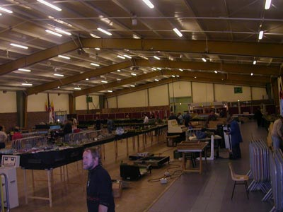

**le ’’Hall de Prestige’’**

La taille du "Hall de Prestige" où nous somme placés confirme l’impression générale : il va falloir assurer ! Pourtant ce hall ne représente que le tiers de la surface allouée à l’exposition ([voir plan, stand numéro 69, en bas à droite](http://www.brickshelf.com/gallery/frogleap/Module-Orleans2004/AMFC-Orleans-2004/planamfc.jpg)). Les camions de location qui se succèdent pour livrer les modules, parfois énormes, laissent rêveurs sur les moyens dont disposent certaines associations d’amateurs de trains. Nous allons chercher notre matériel dans nos petites voitures surchargées. Sauf pour Eric qui est arrivé en train avec deux sacs de voyages pleins à craquer.

Surprise gênante. Les tables mises à notre disposition ne sont pas de la dimension annoncée par les organisateurs un an auparavant. Il faut repenser en catastrophe la disposition des tables pour faire tenir le stand selon le plan prévu.

De 14h30 à 23h30 environ nous allons déballer, monter, déplacer, replacer, encore déplacer... Bouger les Lego montés par paquets de 50kg pour gagner 6 millimères (ou moins) et permettre la jonction des rails, voilà notre principale occupation de la soirée. Ah oui, dans la première disposition des tables, Philippe avait oublié de laisser l’espacement pour la vallée de Gilles ! Nous commencions à avoir l’habitude et les muscles étant chauds, déplacer les Lego avec les tables était finalement une broutille :)

Tous ces efforts vaudront bien le plaisir des deux jours suivants. Patience. Voici le résultat presque final du vendredi soir. Il reste encore 2 heures de travail pour le lendemain et le suivant. Après avoir douté tout le samedi, nous avons décidé dimanche matin de monter tous les caténaires sur les réseaux 12V et 9V. Comme dirait Jérôme : "ça le fait !". Le résultat visuel est remarquable, en revanche attention au gabarit et aux accrochages, car les dégâts s’aggravent vite si une rame embarque quelques pylônes reliés ensemble par le fil (élastique heureusement).

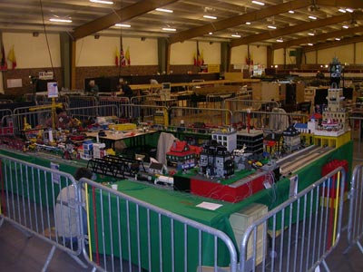

**Le stand en cours de montage**

Samedi matin 8h30, nous terminons le montage. Ouverture au public à 10h00. Dépêchons-nous.

Jérôme avait préparé la gare de Fay-aux-Loges (Loiret), une magnifique maison de maître et une superbe BB 67000 qui donnera quelques soucis pour se frayer un chemin tout autour du réseau :) Mais ELTEP ! alors il a suffit de déplacer quelques briques et ça tourne. Regardez bien aussi ses panneaux de signalisation, un modèle de réalisme détaillé et fonctionnel !

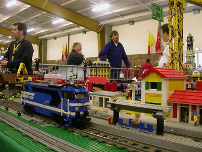

**Le module de Jérôme**

Alban proposait une scierie avec les équipements qui vont bien avec, avez-vous vu sa grue pour le tri des bois ? Et les planches sortaient en continu de la scie à ruban. Mais aussi un pont routier enjambant la vallée de Gilles.

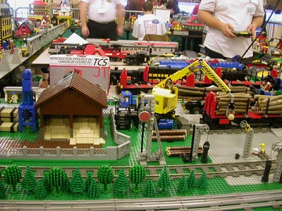

**Le module d’Alban**

Eric avait réalisé un entrepôt pour locomotive et un bâtiment commercial remarquablement détaillé. Remarquez aussi les pylônes type sncf. On s’y croirait non ? Le tout entièrement monté brique à brique sur place (transport par sac oblige).

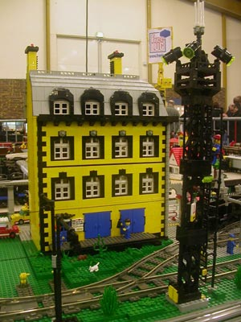

**Le module d’Eric**

Quant à Didier, son entrepot et son quai de chargement était animé par un camion semi-remorque équipé de la cabine tracteur dernière (re)sortie par Lego. Et aussi des caisses de brosses à cheveux qui laissent rêveuse cette visiteuse.

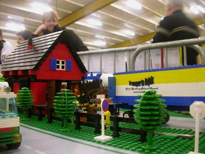

**Le module de Didier**

Erik a sortit ses vaches au pré. Elles sont toujours aussi obnubilées par les trains qui passent et assurent les remarques amusées des visiteurs attentifs. De magnifiques voitures SNCF type Z6300 accompagnaient la reproduction d’une gare de campagne et sa passerelle en taupe-laisse (ou quelque chose de phonétiquement proche).

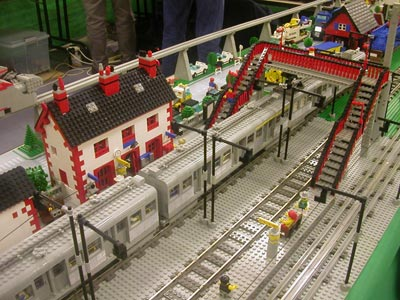

**Le module de Erik**

Nicolas était arrivé à bout de sa tour imposante, répondant parfaitement à l’objectif d’attirer l’oeil du visiteur par dessus la foule. Elle était même plus grande que Loys, grâce à la table... d’accord. La petite cité ouvrière réalisée en dépannage à la place de Gilles est également un joli tour de force.

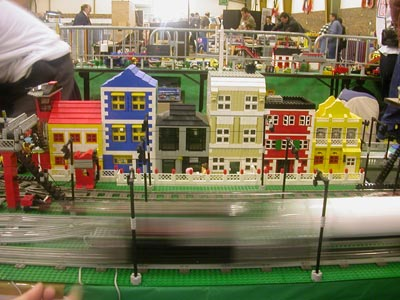

**La cité de Nicolas**

Médérick s’est encore surpassé en réalisant une ville tout en détails et grands bâtiments. Essayez de voir la petite boulangerie coincée entre deux immeuble, tout un charme. Prenez aussi le temps de lire les enseignes des magasins.

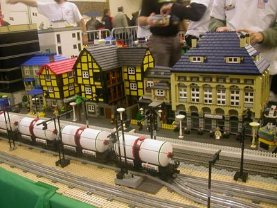

**Le module de Médérick**

Pascal avait monté de grands immeubles avec beaucoup de détails extérieurs et intérieurs. Il y avait aussi une montagnette. Il paraît que c’est l’érosion naturelle qui a diminué sa hauteur au fil du temps de la préparation :) Regardez aussi sa BB63000 qui a fait merveille en 12V pour tracter une rame de wagons citernes digne de ce nom. Ne ratez pas non plus la maison hantée. Comme si cela ne suffisait pas, il a aussi réalisé le pont ferroviaire à voie double.

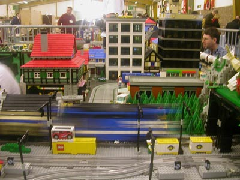

**Le module de Pascal**

Gilles a planché sur au moins deux version de sa vallée (une chute dans l’atelier l’y a obligé...). Le résultat est pittoresque. Ne perdez aucun détail, il y en a partout sous le pont y compris sous l’eau.

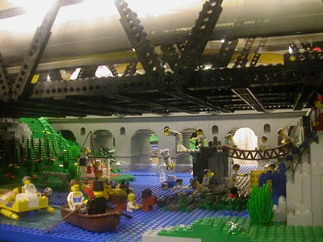

**Le module de Gilles**

Philippe a proposé la grue, qui commence à être connue, et un pont transbordeur fonctionnel permettant grâce à un tapis roulant de jouer au docker pour déplacer les conteneurs entre train, camion et grue. Des heures d’occupation rien que pour y jouer. Demandez donc à Médérick...

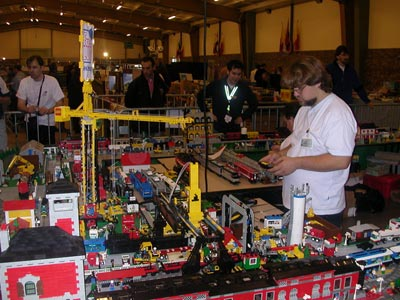

**Le module de Philippe**

Daniel et Béatrice Goberville avaient amené dimanche une caméra embarquée sur une locomotive afin d’installer une réception en direct du réseau sur un petit écran orienté vers les visiteurs. Effet amusant garanti. Merci à eux pour ce premier contact si sympathique.

Enfin "last but not least", le ["Cercle Ferroviaire Américain"](http://www.chez.com/lecercleferroviaireamericain/) présent sur cette exposition, nous a décerné le [prix de la créativité](http://www.brickshelf.com/cgi-bin/gallery.cgi?i=986162) pour cette 9ème edition à Orléans. C’est une démarche amicale qui nous a particulièrement touchés. Nous les en remercions et tout particulièrement Christian Sardin qui s’est déplacé pour nous le remettre.

Voilà le terme de la visite. Si vous avez eu envie d’en voir plus à cette lecture, allez voir les galleries de photos des différents participants et visiteurs. Il y a aussi des films dans certains cas.

|  |  |  |
| --- | --- | --- |
| Jérôme Teyssier | [photos](http://www.brickshelf.com/cgi-bin/gallery.cgi?f=104768) |  |
| Alban Nanty | [photos](http://www.brickshelf.com/cgi-bin/gallery.cgi?f=104824) |  |
| Eric Létang | [photos](http://www.brickshelf.com/cgi-bin/gallery.cgi?f=104443) |  |
| Erik Amzallag | [photos et films](http://www.brickshelf.com/cgi-bin/gallery.cgi?f=104678) |  |
| Nicolas Huyard | [photos](http://www.brickshelf.com/cgi-bin/gallery.cgi?f=104469) |  |
| Philippe Label | [photos](http://www.brickshelf.com/cgi-bin/gallery.cgi?f=104429) | [films](http://gallery.freelug.org/Orleans_2004) |
| Didier Enjary | [photos](http://www.brickshelf.com/cgi-bin/gallery.cgi?f=104261) |  |
| Rodolphe Hirel | [photos](http://www.brickshelf.com/cgi-bin/gallery.cgi?f=104217) |  |
| Rémi Lancien | [photos](http://www.brickshelf.com/cgi-bin/gallery.cgi?f=104814) |  |
| Daniel & Béatrice Goberville | [photos](http://www.brickshelf.com/cgi-bin/gallery.cgi?f=105130) |  |

Il nous restera un souvenir concret de cette participation, une [plaque de locomotive gravée](http://www.brickshelf.com/cgi-bin/gallery.cgi?i=986164), remise par le président de l’AMFC à chaque association participante. A bientôt peut-être en 2006 pour la prochaine exposition à Orléans. En tous cas merci à tous nos visiteurs et particulièrement à ceux qui se sont fait (re)connaître lors de leur passage.

Philippe Label

* * *

Bonjour à tous ,  
Tout d’abord un grand MERCI à tout ceux qui ont permis que cette exposition se fassent dans d’excellentes conditions.  
J’ai enfin pu mettre des visages sur les noms de la plupart des participants avec qui nous échangions des messages depuis une année !  
Pendant ces 2 jours les visiteurs vont défiler sur le stand, ils s’attardent tous, discutent, regardent et regardent encore, font le tour du stand plusieurs fois.  
L’affluence sur le stand oblige tous les participants à la vigilance, même si les questions pleuvent il faut être prudent..  
Philippe veille au grain et tous ensemble nous arrivons à assurer une coordination parfaite (j’en reste encore étonné !). Il est vrai que là, il n’y a pas de magasin Intertoys (comme au legoworld) pour nous distraire ! Les seuls LEGO visibles sont sur le stand ! :))  
Le dimanche soir nous avons reçu une récompense pour le stand (voir commentaires de Philippe).  
J’ai adoré une phrase que philippe a dit à un responsable de l’organisation : Nous avons jeté un tas de briques sur le stand, elles ne sont pas trop mal tombées.

Je garderai un merveilleux souvenir de ce week-end à Orléans ! Et comme dirait un grand baraqué américain : I COME BACK !

Eric Létang

* * *

Ce week-end fut un grand moment de plaisir, autour de nombreux professionnels nous avons trouvé notre place et avons étonné bon nombre de visiteurs, notre stand tout en couleur et les dimensions hors normes ont eu l’effet attendu, épater les enfants et les adultes aussi.  
Ce week-end fut également riche en rencontres.  
Un grand merci à tout mes camarades de freelug qui ont apporté un peu de magie dans ce temple du train et merci au public qui était si nombreux.

Nicolas HUYARD
