Le weekend des 29 et 30 octobre se déroulait sur le circuit de Spa-Francorchamps la deuxième édition de l’exposition Lego organisée par Walug, un Lug belge.  
Cette exposition a la particularité de se dérouler pendant une course, les 24 Heures 2CV, sur un des plus beaux circuits de la planète.

Nous étions installés dans les paddocks, au dessus des stands, au niveau du virage de la source, et donc devant la ligne d’arrivée. Nous occupions quatre salles cette année, pour trois l’an passé. Une très grande surface où beaucoup de créations ont pu être exposées, et où on pouvait dépenser à souhait chez bon nombre de vendeurs. A mes yeux, il manquait juste une animation où les minots pouvaient tripoter de la brique, comme les briques rouges quoi. Plusieurs associations étaient présentes, dont une de cosplay Star Wars qui défilait dans les allées.  
Il y avait de tout. Des créations sur d’anciens thèmes (pirates, Mtron, train à rails bleus…), de nouveaux thèmes (Nintendo, Star Wars…), pas mal de voitures dans tous les formats (normal vu le lieu, j’étais moi-même monté avec tous les vainqueurs des 24 Heures du Mans), le grand château Poudlard qui est en construction depuis huit ans, et qui était déjà présent l’an passé, une mega-maxifig Songoku, un énorme diorama Star Wars collaboratif, un diorama de bateaux qui flottaient dans un vrai bassin, un bidule à balle… Mais ce qui m’a personnellement le plus impressionné, c’était le stand dans la même salle que moi où on pouvait voir de vieux jouets Lego, d’avant les briques, comme les voiture 1/87 ou le canard en bois. Jamais je n’avais vu ça en expo.  
L’ambiance était comme l’an passé sympathique, les visiteurs étaient comme d’habitude essentiellement des familles, mais aussi des fans de courses de voitures, et des pilotes et mécaniciens qui participaient à la course. Personnellement, j’ai eu pas mal de discussions intéressantes, j’étais dans mon élément avec mes voitures du Mans. Nous avons pris le repas du samedi soir au restaurant du circuit, et pour charger ou décharger les voitures pour l’expo, nous étions au milieu des camions des écuries de course, au cul des stands. Un joyeux bordel for sympathique.

Ca m’a fait des bornes pour monter là-haut, mais je ne regrette pas.

[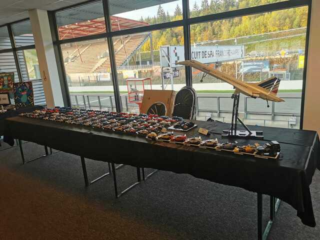](https://www.freelug.org/IMG/jpg/francorchamps2022a.jpg)

[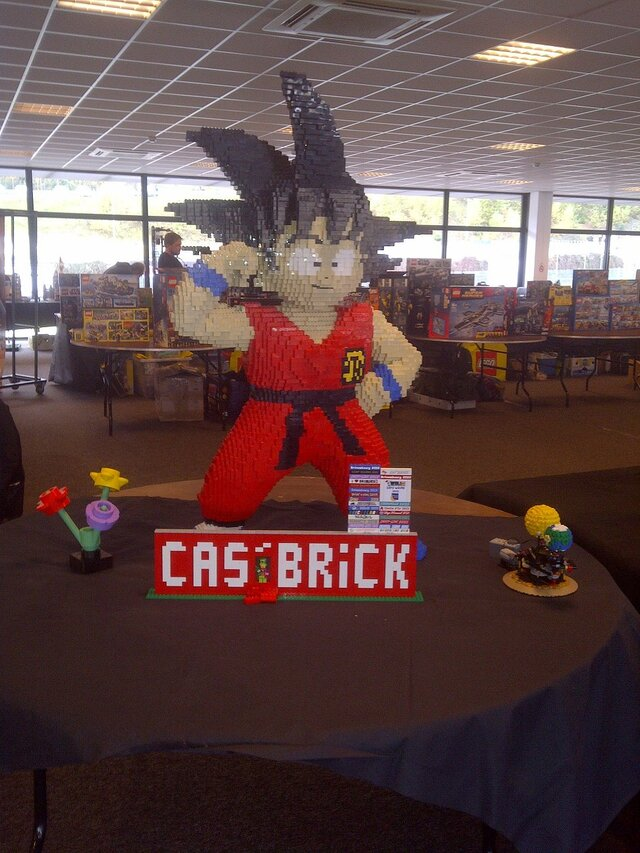](https://www.freelug.org/IMG/jpg/francorchamps2022b.jpg)

[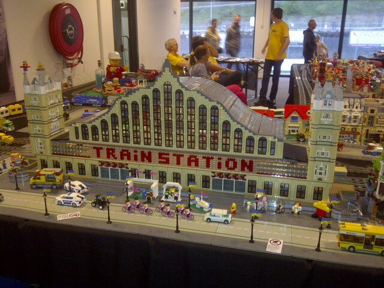](https://www.freelug.org/IMG/jpg/francorchamps2022c.jpg)

[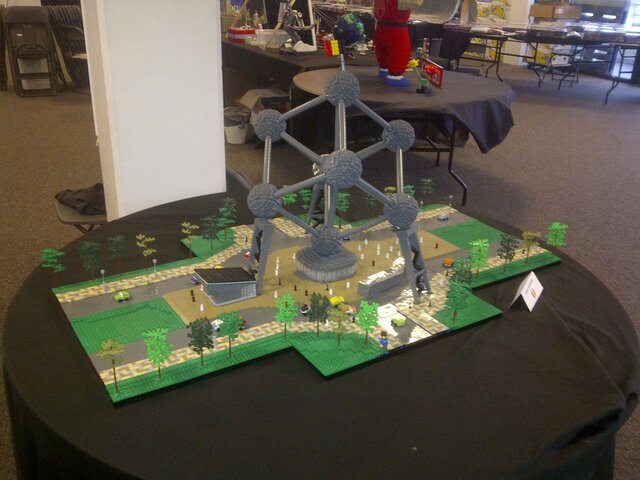](https://www.freelug.org/IMG/jpg/francorchamps2022f.jpg)

[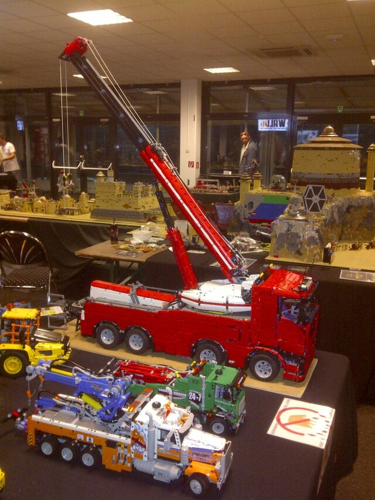](https://www.freelug.org/IMG/jpg/francorchamps2022g.jpg)

[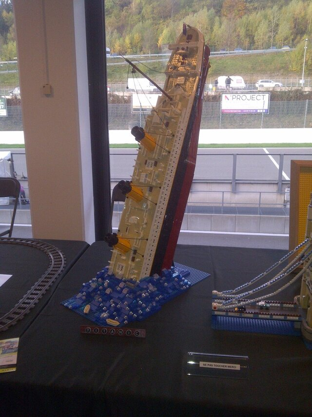](https://www.freelug.org/IMG/jpg/francorchamps2022h.jpg)

[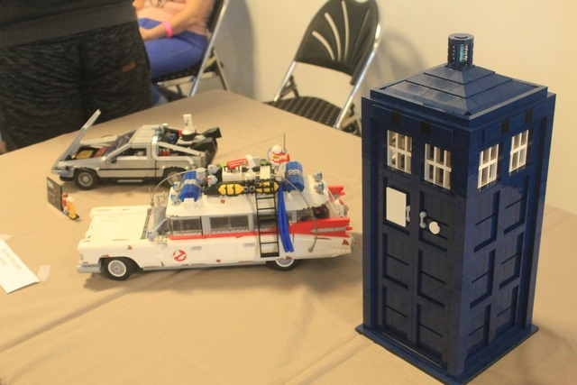](https://www.freelug.org/IMG/jpg/francorchamps2022l.jpg)

[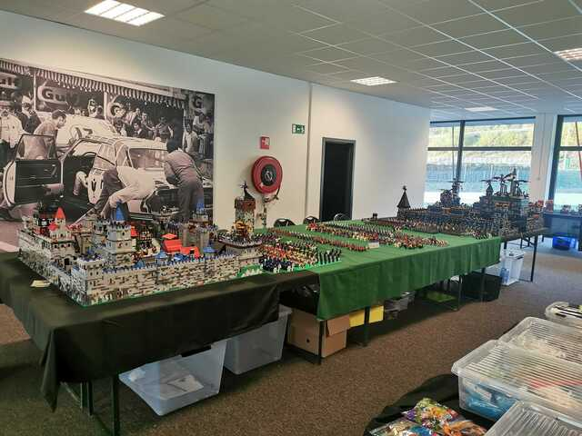](https://www.freelug.org/IMG/jpg/francorchamps2022m.jpg)

[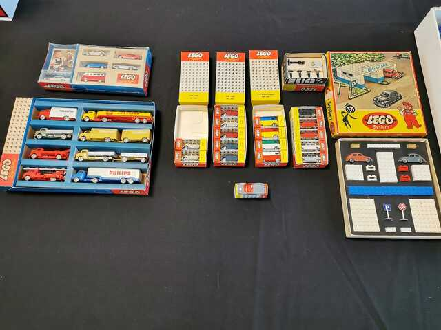](https://www.freelug.org/IMG/jpg/francorchamps2022n.jpg)

[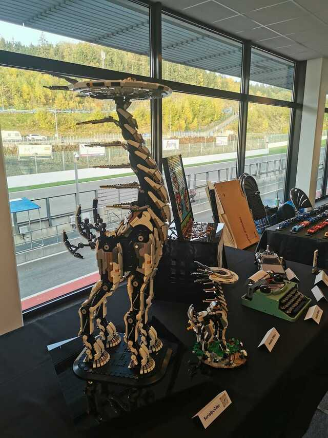](https://www.freelug.org/IMG/jpg/francorchamps2022o.jpg)

[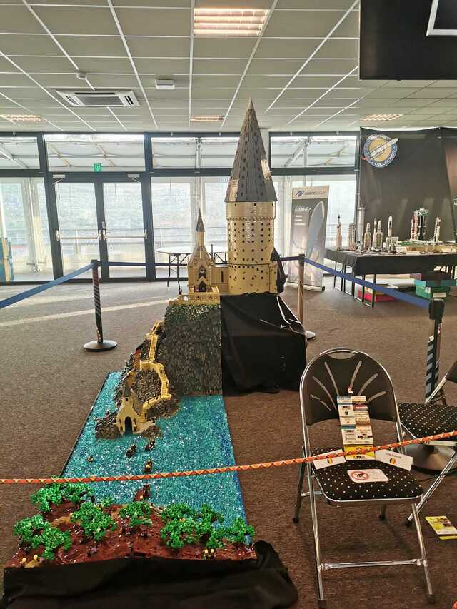](https://www.freelug.org/IMG/jpg/francorchamps2022p.jpg)

[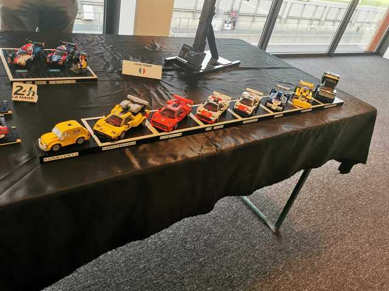](https://www.freelug.org/IMG/jpg/francorchamps2022q.jpg)

[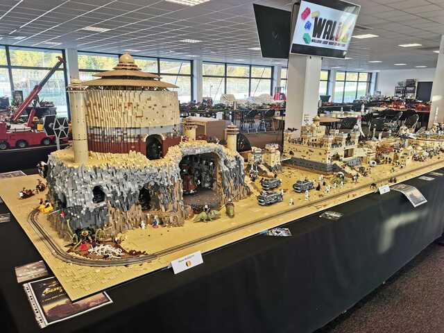](https://www.freelug.org/IMG/jpg/francorchamps2022r.jpg)

[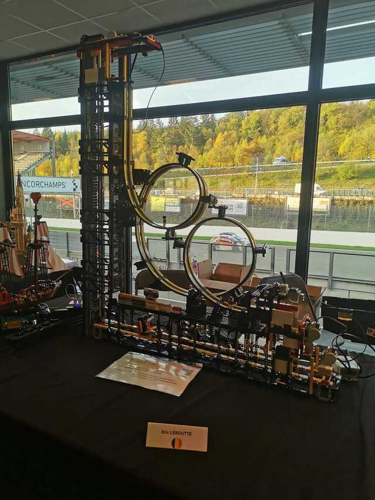](https://www.freelug.org/IMG/jpg/francorchamps2022s.jpg)

[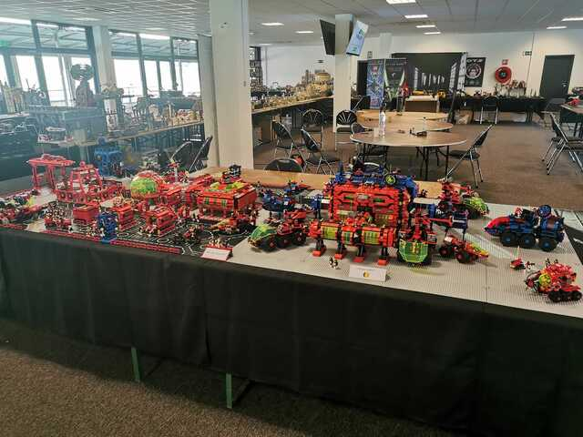](https://www.freelug.org/IMG/jpg/francorchamps2022t.jpg)

[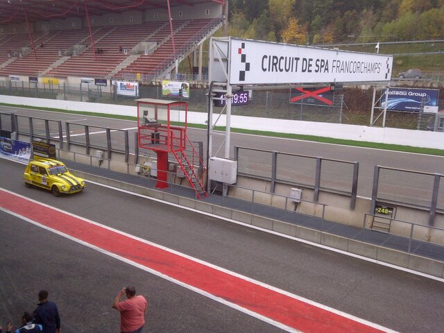](https://www.freelug.org/IMG/jpg/francorchamps2022j.jpg)

[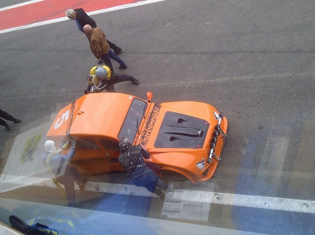](https://www.freelug.org/IMG/jpg/francorchamps2022k.jpg)

Lionel
