Lors des vacances estivales, la visite en famille du château de Lichtenberg m’a permis de découvrir une exposition réalisée avec nos briques préférées par l’association Fanabriques !

[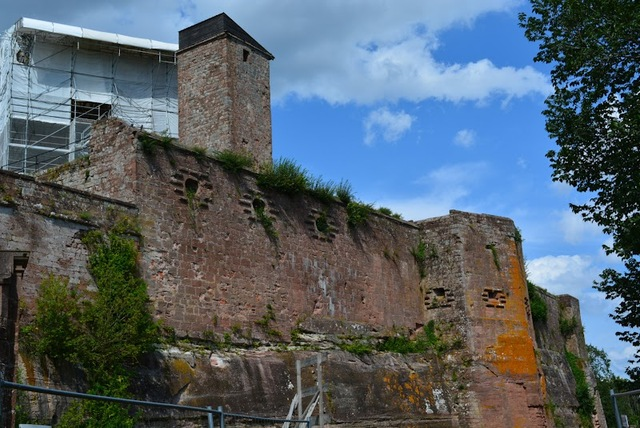](https://lh3.googleusercontent.com/C1h80hnjfLi8neh8h5_lDvdGVvdXiXEKoQ3TeuKQCF9sRVmZfafy7v5Ly1ZjPnt0JgWeeuvNJER_0so2au06pDpIURUknc29XemTO7O9c3M4ljPgD_iTndgaVHfWUDQFZvjo6P-J=w800)

**Pitch de l’exposition :**

Pour la saison 2021, les célèbres briques Lego® investissent [le château de Lichtenberg](https://www.chateaudelichtenberg.alsace/) !

Une exposition temporaire, originale et intergénérationnelle, qui plaira à toute la famille. Petits et grands pourront découvrir les créations uniques, réalisées par [l’association Fanabriques de Rosheim](http://www.fanabriques.fr/), sur le thème de l’architecture, des chevaliers et des châteaux forts. Les petites mains de l’association ont donné vie à de magnifiques réalisations et mises en scènes avec les célèbres briques. Découvrez leurs créations dans le cadre exceptionnel du château de Lichtenberg !

L’histoire médiévale expliquée de façon ludique à travers l’univers des lego®

Les différentes saynètes sont accompagnées d’informations pour amener les visiteurs à comprendre et à se projeter dans l’histoire médiévale de manière ludique à travers l’univers Lego®. On y retrouve notamment une oeuvre exclusive : la reconstitution en briques Lego® du château de Lichtenberg. Une création imaginée et réalisée par Thierry Meyer, membre de l’association Fanabriques, qui aura nécessité plus de 500 heures de travail.

[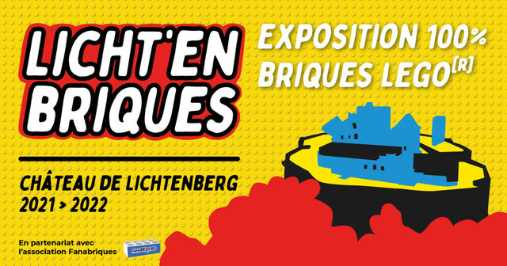](https://www.chateaudelichtenberg.alsace/wp-content/uploads/sites/4/2021/03/LEGO-SITE-WEB-1200x630-px-1200x630.jpg)

**Visite de l’exposition :**

Dès l’entrée dans la 1e salle, les briques sont présentes avec une belle mosaïque 1×1 et plusieurs tas de briques accompagnées par des jeux en bois

[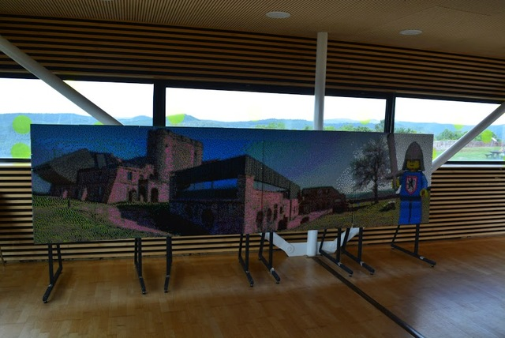](https://lh3.googleusercontent.com/XsweC-px2gpCg49_4km20tMy65XIpA3vTj6BpXOGRl9YPYzZboCCVDQI7iuazrBoJH5KJD0K_jNhoqvzJbWnBluJvyOxJ2IPDxLz6ApgYYxpGcimPSMrpi4bgsFQ7aPdEfYhvMuT=w864)

la visite se poursuit avec la découverte de la géologie et des fossiles locaux, puis dans une autre salle avec une reproduction grandeur nature d’une maison typiquement Alsacienne

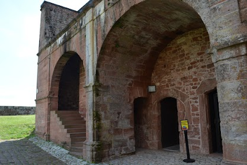

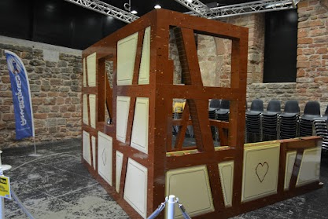

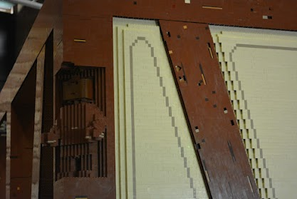

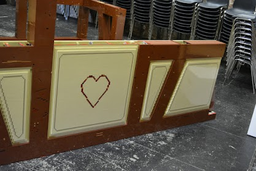

Après cette salle, la suite de la visite concerne le château et son histoire, jusqu’à la salle d’exposition du site où l’exposition principale se tient. Elle est dans le thème des chevaliers avec une partie d’ancien sets castel, puis avec plusieurs diorama dont certain issu de concours (reproduction sur château de Lichtenberg et de châteaux imaginaires)

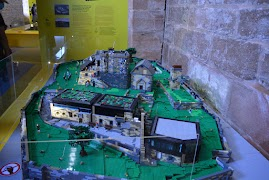

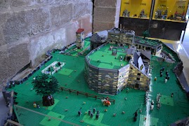

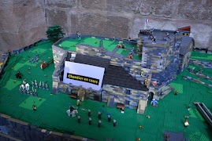

_reproduction du château de Lichtenberg / l’expo principal est dans la partie « Chantier en cours »_

Exposition des anciens sets :

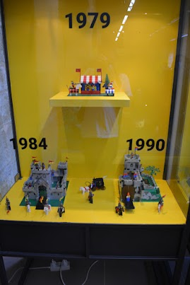

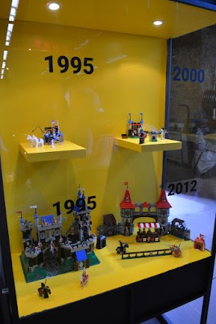

**Diorama principal**

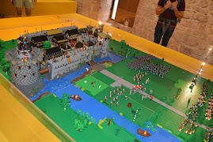

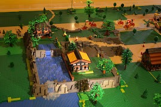

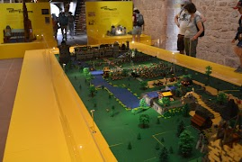

La cathédrale de Strasbourg en 2 échelles (x6 entre les 2)

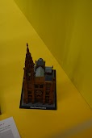

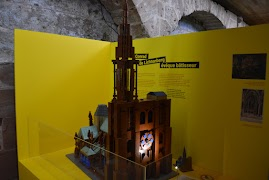

Autres dioramas :

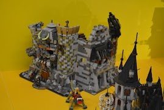

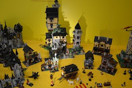

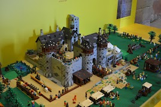

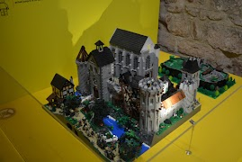

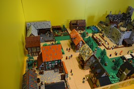

La visite se termine sur d’autres salles du château, dont une belle exposition photos / récit sur la libération de la région.

Retrouvez toutes [mes photos Lego ici](https://photos.app.goo.gl/1n56x2tgZeGQAEHk9)

Présentation [vidéo par Pokaa .fr](https://youtu.be/EVYag6dEWLU)
