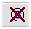
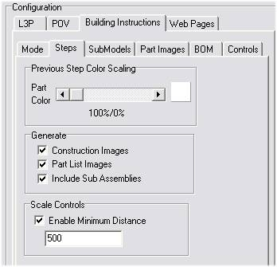

Réaliser de belles notices de montages devient facile avec l’aide du logiciel Lpub créé par Kevin Clague.

Tous les logiciel requis se trouvent dans l’installateur complet des outils Ldraw. Le fichier à télécharger se trouve [ICI](http://www.ldraw.org/modules.php?op=modload&name=News&file=article&sid=104).  
Attention le fichier est assez gros, environ 45 Mo.

## Modélisation du modèle

Tout d’abord, il vous faut modéliser votre créations avec [Mlcad](http://www.lm-software.com/mlcad/) [^1], sans oublier d’inclure les étapes de constructions. Pour se faire, 3 boutons à connaitre :  
**–** Bouton Etape, Permet de séparer les étapes de constructions.

**–** Bouton Rotation, pour tourner la vue pendant la construction afin de pouvoir positionner les piéces plus facilement.

**–** Bouton Fin de rotation, pour revenir à la position de départ.

## Création d’un fichier de configuration

-   Note : Pour ce tutorial, vous pouvez utiliser le fichier exemple, comprenant un modèle MLcad avec les étapes de constructions et de rotations.
    
    
    
    **Fichier Exemple**
    

Démarrez Lpub, puis ouvrez le fichier Mlcad créé. ("File —> Open Ldraw File").  
Choisissez ensuite les paramètres suivants :  
**–** Sur l’onglet L3p, Sélectionnez "Model —> Render quality" et choisissez "High".  
**–** Sur l’onglet POV, allez sur "Rendering —> Quality" et sélectionnez "Media and Radiosity (medium)". Si votre plan est long, laissez le paramètre "Media and Radiosity (low)".  
**–** Sur l’onglet "Building Instructions —> Steps" rentrez les valeurs ci-dessous :

**Réglages**

Vous pouvez enregistrer vos options choisies pour éviter de les redéfinir à chaque notice. Utilisez la commande : "File —> Save Config As ..."

## Création de la notice

Lancez ensuite la procédure de rendu avec "Generate -> Instruction Images". Patientez quelques minutes et vos étapes de constructions sont créées.

Réassemblez les images et les BOM (Piéces nécessaires à la construction de l’étape) à l’aide de la commande "Generate —> Layout". Rajouter ensuite les légendes, commentaires et titres avec le logiciel de retouche d’images de votre choix.

Vous pouvez aussi exporter votre modèle sous forme de page web en cliquant sur "Generate —> Screen Web Pages".

Et surtout, n’oubliez pas de faire partager vos créations en les mettant en ligne sur [BrickShelf](http://www.brickshelf.com/) ou un site perso.

Bonnes constructions !

[^1]: Logiciel de modélisation 3D Lego
