Ce premier article présente les différents éléments qui constituent l’écosystème PowerUp.

Un deuxième article détaille [les fonctionnalités de la programmation via l’application avec les anciens blocs](/articles/3241/).

Un troisième article détaille [les fonctionnalités de la programmation via l’application avec les nouveaux blocs](/articles/3270/).

Un quatrième donne l’[équivalence entre les bloc actuels et les anciens blocs](/articles/3259/).

## Introduction : l’écosystème Powered Up

L’écosystème Powered Up est présent sur les gammes City (train), Creator expert, Batman, Boost, Technic… Le principe reste le même sur toutes les gammes, même si la brique programmable (le hub) est différente : pouvoir mettre en mouvement des sets via des moteurs et des capteurs et via un panel de contrôle (smartphone ou tablette) ou via la télécommande. Le sujet de la télécommande ne sera pas traité ici.

La liaison entre le hub et le panel de contrôle se fait via une liaison Bluetooth 4.0.

La liaison entre les hub et les autres composants est de type filaire sur 6 fils. Pour plus d’information, je vous conseille [le site de Philohome](https://www.philohome.com/wedo2reverse/wedo2.htm).

## Les hubs

Le Hub n’est pas réellement une brique programmable au sens premier du terme : le programme est contenu dans le panel de contrôle qui envoie les directives. Le hub est juste l’interface qui contient une alimentation, le récepteur Bluetooth, un nombre de ports et éventuellement des moteurs.

Il existe à ce jour trois types de hub :

-   Le hub LEGO® train : alimenté par 6 piles AAA, ce hub possède 2 ports. C’est le plus compact. ([88009](https://www.bricklink.com/v2/catalog/catalogitem.page?S=88009-1#T=S&O={{ '{%' }}22iconly%22:0}))
-   Le hub LEGO® boost : alimenté par 6 piles AAA, ce hub possède 2 ports extérieurs, 2 port internes reliés à 2 moteurs sur le même axe (droit/gauche) et un capteur de mouvement interne. ([88006](https://www.bricklink.com/v2/catalog/catalogitem.page?S=88006-1#T=S&O={{ '{%' }}22iconly%22:0}))
-   Le hub LEGO® Technic : alimenté par 6 piles AA, ce hub possède 4 ports et un capteur de mouvement interne(existe en 2 versions de boitier piles). ([88012](https://www.bricklink.com/v2/catalog/catalogitem.page?S=88012-1#T=S&O={{ '{%' }}22iconly%22:0}))

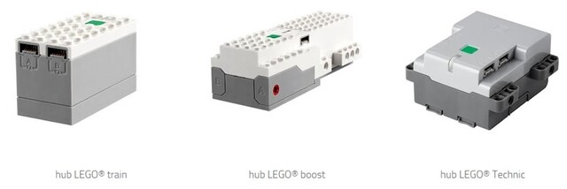

Ces 3 hub peuvent être connectés à des moteurs, des capteurs, des leds…

## Les autres composants de l’écosystème

**Les moteurs**

L’écosystème Powered Up utilise 4 types de moteurs :

-   les moteurs simples : sur les moteurs simples, la vitesse de rotation est contrôlée par une fréquence envoyée par le hub. il n’y a pas de contrôle interne de vitesse ou position – exemple le [moteur M 45303](https://www.bricklink.com/v2/catalog/catalogitem.page?S=45303-1&name=WeDo%202.0%20Medium%20Motor&category=%5BEducational%20&%20Dacta%5D%5BWeDo%5D#T=S&O={{ '{%' }}22iconly%22:0})
-   les moteurs tachymétriques : sur le moteur tachymétrique, un encodeur et des capteurs de positions internes permettent de piloter finement la rotation du moteur (en vitesse angulaire ou en degré) – exemple les [moteurs L](https://www.bricklink.com/v2/catalog/catalogitem.page?S=88013-1#T=S&O={{ '{%' }}22iconly%22:0})/[moteurs XL](https://www.bricklink.com/v2/catalog/catalogitem.page?S=88014-1#T=S&O={{ '{%' }}22iconly%22:0}) et le [moteur 88008](https://www.bricklink.com/v2/catalog/catalogitem.page?S=88008-1&name=Medium%20Linear%20Motor&category=%5BPower%20Functions%5D%5BPowered%20Up%5D#T=S&O={{ '{%' }}22iconly%22:0})

[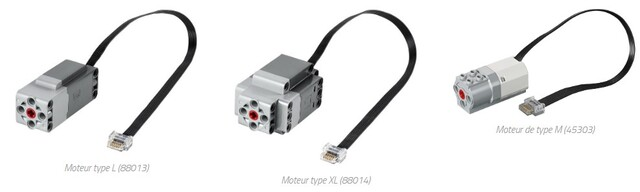](https://www.freelug.org/IMG/jpg/moteur.jpg)

-   les moteurs angulaires : sur le moteur angulaire, un encodeur et des capteurs de positions interne permettent de piloter finement la rotation du moteur (en vitesse angulaire ou en degré) et de pouvoir l’utiliser en capteur d’angle – exemple les moteur M/L ([88018](https://www.bricklink.com/v2/catalog/catalogitem.page?S=88018-1&name=Medium%20Angular%20Motor&category=%5BPower%20Functions%5D%5BPowered%20Up%5D#T=S&O={{ '{%' }}22iconly%22:0}) et [88017](https://www.bricklink.com/v2/catalog/catalogitem.page?S=88017-1&name=Large%20Angular%20Motor&category=%5BPower%20Functions%5D%5BPowered%20Up%5D#T=S&O={{ '{%' }}22iconly%22:0})

[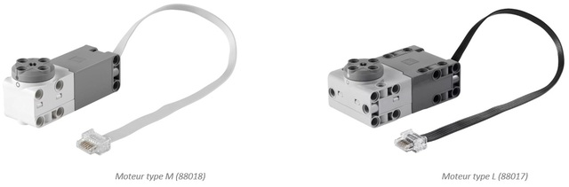](https://www.freelug.org/IMG/jpg/moteur-2.jpg)

Il existe également un moteur spécifique pour les trains ([88011](https://www.bricklink.com/v2/catalog/catalogitem.page?S=88011-1#T=S&O={{ '{%' }}22iconly%22:0}))

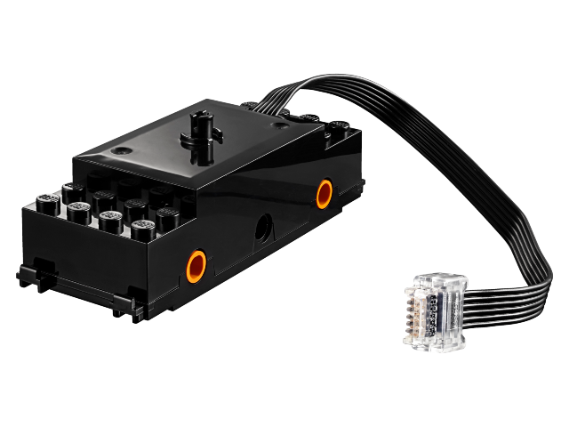

**Les capteurs**

Il existe une multitude de capteurs (position, mouvement, proximité, couleur, luminosité…). La plupart des capteurs est dans la gamme WeDo. Il existe un capteur dans la gamme Power Up, le capteur couleur et distance (LEGO Boost [88007](https://www.bricklink.com/v2/catalog/catalogitem.page?S=88007-1)). Il est également possible d’utiliser des capteurs non officiel LEGO ou des adaptateurs pour le PowerFonction ou autre, la toile en dispose

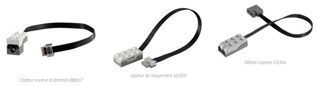

**L’actionneur**

Il n’existe qu’un actionneur en dehors du panel de contrôle : la télécommande de train [88010](https://www.freelug.org/\(https://www.bricklink.com/v2/catalog/catalogitem.page?S=88010-1&name=Remote%20Control&category=%5BPower%20Functions%5D%5BPowered%20Up%5D#T=S&O={{ '{%' }}22iconly%22:0}). Elle peut être inclue comme actionneur dans un programme. Cela peut permettre de limiter la vitesse d’un train ou de lancer / intervenir sur un programme sans toucher au panel de contrôle.

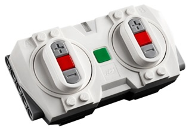

**Les LED**

Un système d’éclairage via des LED peut être connectés à un hub. Il est composé de 2 LED (ref : [88005](https://www.bricklink.com/v2/catalog/catalogitem.page?S=88005-1&name=Light&category=%5BPower%20Functions%5D%5BPowered%20Up%5D#T=S&O={{ '{%' }}22iconly%22:0}))

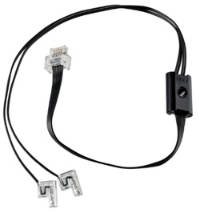

## L’application Powered Up

L’application lancée en 2019 a fortement évoluée avec la version 4 lancée le 29 juin 2023

**Installation/lancement**

L’application est disponible dans tous les bons stores pour tablettes et smartphones. Une fois l’application téléchargée et installée, il n’y a plus qu’à la lancer.

Avant de lancer l’application, veillez à bien activer le Bluetooth et la géolocalisation de votre panel de contrôle.

Lord du lancement de l’application, vous arrivez par défaut sur la partie « jouer ».

Quelle que soit la partie (jouer ou créer), l’application va vous demander d’allumer le hub pour initialiser le dialogue. La première chose que va faire l’application, c’est de contrôler la version du hub et le mettre à jour s’il n’est pas à la dernière version. Tout se passe automatiquement !

Ensuite l’application va afficher le menu choisi.

**Première partie**

Cette partie est destinée à paramétrer l’application.

[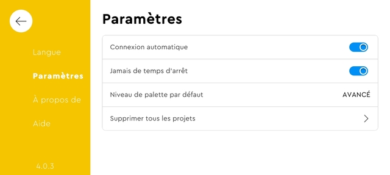](https://www.freelug.org/IMG/jpg/1690186797447.jpg)

On y retrouve la version de l’application et les menus / sous-menus suivants :

[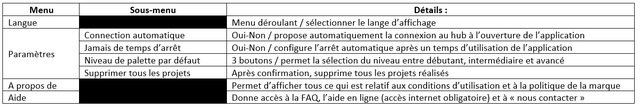](https://www.freelug.org/IMG/jpg/parametre.jpg)

**Partie _Jouer_**

Cette partie est destinée à faire fonctionner les sets du commerce. Il n’y a pas de paramétrage, l’interface est figée selon le set sélectionné. Elle permet également au panel de contrôle d’émettre certains sons pour augmenter l’immersion.

[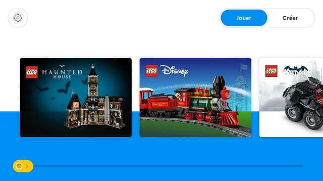](https://lh3.googleusercontent.com/Wb5MbmqQcu-Eml1AEe_nunkNM4bKAWZMtjGojT9M3mHTpmxbA6nlkef1otoXmlYMsVtq8AJ5mVi21n0j4hAWUsDCqz0oRuXJ-Q3oyuzMbYY4YpslRQWU8C202TosVjGbE6SD_ITUXg=w800)

**Partie _Créer_**

Cette partie permet de créer des programmes et des interfaces de contrôle pour les différents hubs.

Plusieurs hubs peuvent être contrôlés en même temps et avoir des interactions entre eux ou via une télécommande.

Exemple : un capteur branché sur un hub Technic peut lancer un moteur sur un hub train puis sur un hub Boost...

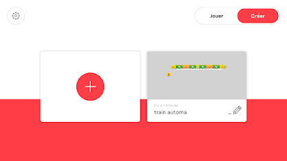

Voici un exemple de programme :

[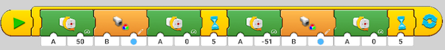](https://lh3.googleusercontent.com/GwcasWZwNNzj7kwP1mWtU5uFd1Cs6jAV6tsBa7tHK_LShT0he-d5smWQAVWHXMinetLMu5Fl0SPsxXUUuLyqPZzit5fnFUvryc2wZbU7xnUZBJ2p7It1wX90QeDsGT1D47rtlTey4Q=w800)

Ce programme analyse des couleurs via le capteur de proximité/couleur et agit sur le sens de rotation du moteur selon la couleur visualisée.

[Pour plus d’information sur les actions des différentes briques, consultez le second article](/articles/3241/).

Voir en ligne : [Documentation en anglais](https://racingbrick.com/powered-up-code-block-guide/)
