LEGO nous offre la possibilité d’assembler une nouvelle Lamborghini. Impossible pour moi de passer à côté.

Les Lamborghini dans la gamme LEGO, ça commence à en faire quelques unes. Je ne passe pas à côté de cette marque et de ce fait je ne pouvais pas rater la très belle Countach.

Notre firme de briques de construction danoise nous propose un modèle entièrement blanc. Ce n’est pas pour me déplaire, en sachant que la marque italienne au taureau cabré aime à éviter le plus souvent les teintes habituellement rouge de son concurrent.

La Lamborghini Countach est je pense un des modèles le plus connu de la marque. Sa coupe anguleuse et douce à la fois a marqué son temps. On la reconnait même après quelques lifting.

Les informations principales :  
**–** Année de sortie 2022 ;  
**–** Prix 19,99 €, sur le Shop, à l’heure où j’écris cet article ;  
**–** 2 sachets numérotés ;  
**–** 257 pièces et une minifig ;  
**–** Temps de montage environ 1h.

**La boite et son contenu**

Sur le devant de la boite, superbe présentation de la Countach sûrement sur les bords du "Reno" à Bologne (Italie). Le logo Lamborghini permet de ne pas avoir de doute !

[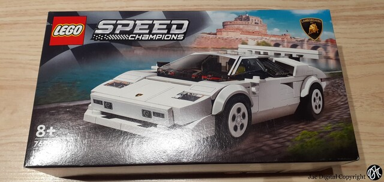](https://www.freelug.org/IMG/jpg/20230118_181425.jpg)

Au dos de la boite, une belle vue de l’arrière et sur l’avant plongeant caractéristique.

[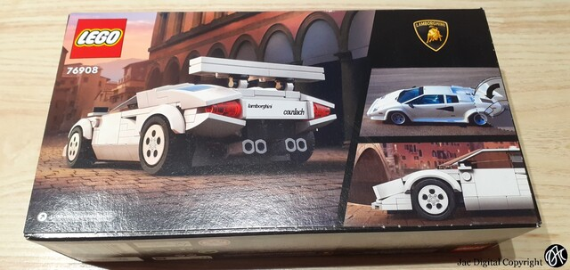](https://www.freelug.org/IMG/jpg/20230118_181443.jpg)

Il n’y a pas d’erreur, cette photo nous prouve que la Countach a bien existé en blanc et elle est magnifique.

[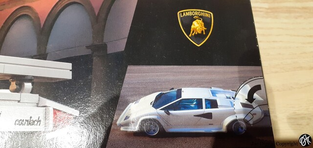](https://www.freelug.org/IMG/jpg/20230118_181706.jpg)

Dans la boite, en plus des 2 sachets on découvre en vrac, le châssis, la notice et une belle planche d’autocollants. Sans ces derniers, la voiture n’est pas la même. Heureusement les enjoliveurs sont tampographiés. Malheureusement, ils ne sont pas forcément bien centrés.

[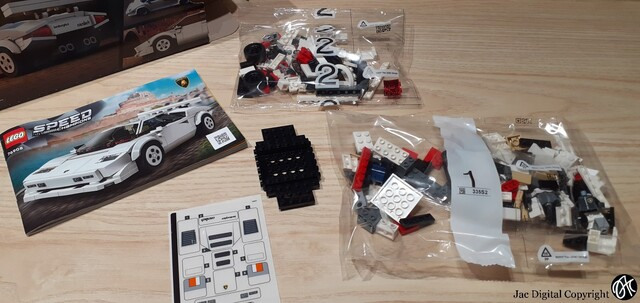](https://www.freelug.org/IMG/jpg/20230118_181818.jpg)

**Le montage**

On commence par assembler le pilote, habillé aux couleur Lamborghini. La tête et les pieds sont assez commun. Mais le torse est exclusif à cette boite. Il est cette fois mal rasé. C’est à croire que les conducteurs de Lamborghini ne prennent pas soin de leur présentation. Mais en fait, ça me va très bien.

On a toujours besoin d’une clef sur soi au cas où les roues ne vont plus...

[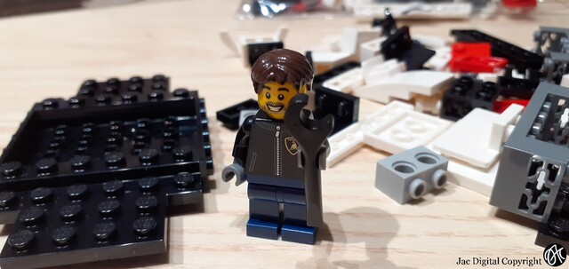](https://www.freelug.org/IMG/jpg/20230118_182102.jpg)

L’assemblage de l’arrière est terminé. C’est un montage très réussi et qui reproduit bien les lignes anguleuse de l’arrière. On reconnait de suite. Pose du premier autocollant.

[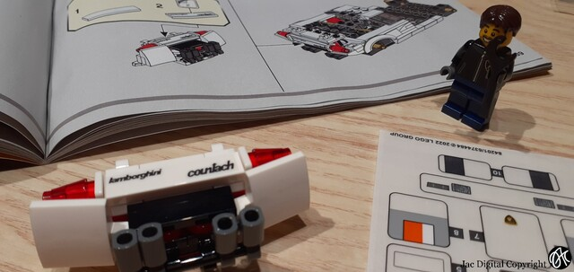](https://www.freelug.org/IMG/jpg/20230118_184057.jpg)

Fin de la construction à faire avec le premier sachet. On a déjà une belle approche de ce que sera la partie arrière. Il reste quelques petites pièces.

[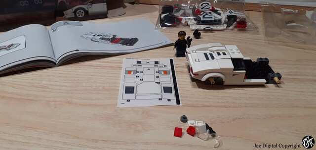](https://www.freelug.org/IMG/jpg/20230118_184745.jpg)

La partie arrière est vraiment très réussie. L’avant se doit d’être de la même veine, mais je n’en doute pas.

[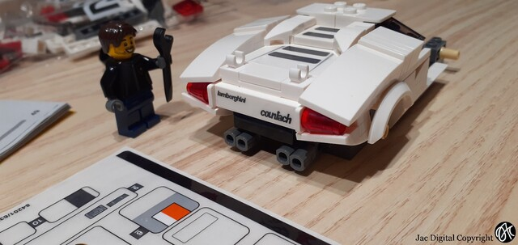](https://www.freelug.org/IMG/jpg/20230118_184800.jpg)

Contenu du second sachet avec ses nouvelles pièces. Le support pour les roues et la pièce lisse ronde 2X2 imprimée.

[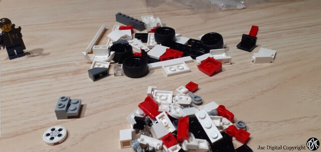](https://www.freelug.org/IMG/jpg/20230118_184915.jpg)

Voilà la voiture terminée. L’avant ne démérite pas et les ligne de la Countach sont bien là. On la reconnait avec son fameux aileron. Il reste quelques pièces dont les cheveux du pilote. Impossible de conduire les bolides "Speed Champions" sans son casque !

[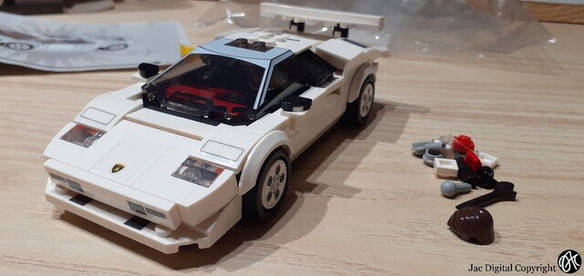](https://www.freelug.org/IMG/jpg/20230118_224113.jpg)

**La conclusion**

La voiture est simplement magnifique. Mais est-ce que je suis vraiment objectif, j’en suis fan !

Elle va trôner longtemps sur mes étagères et sera sûrement accompagnée de versions différentes. La quantité de couleurs de briques disponible doit nous le permettre.

[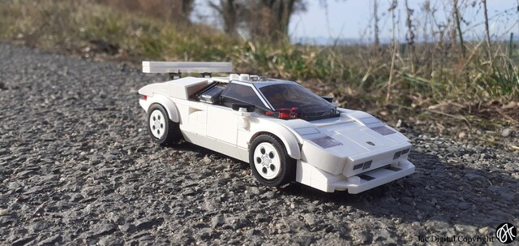](https://www.freelug.org/IMG/jpg/20240130_113615.jpg)
