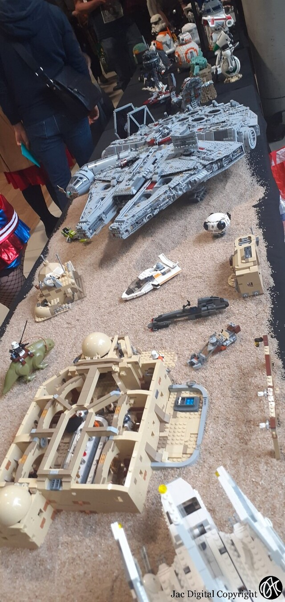
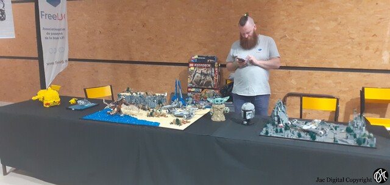
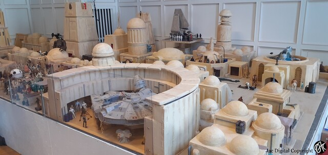
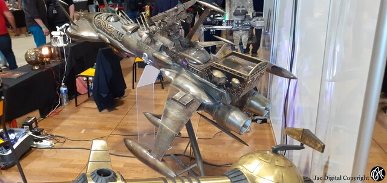
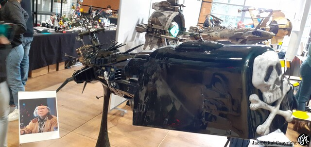
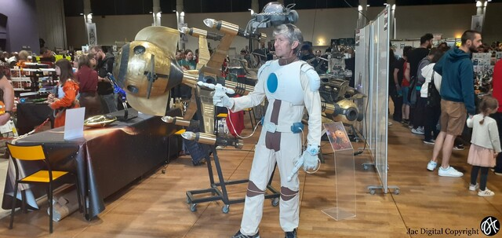
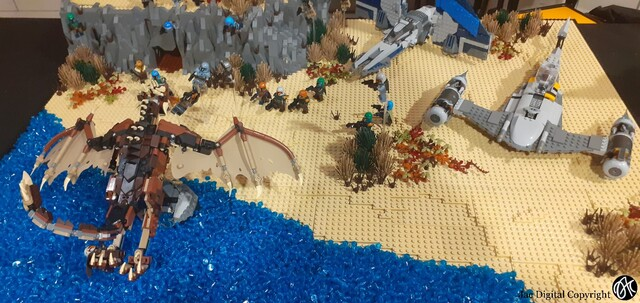
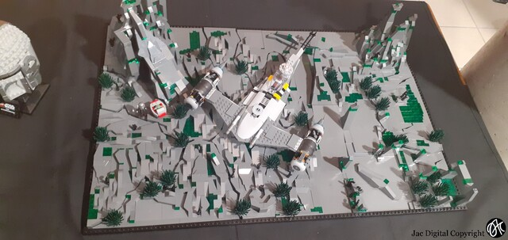
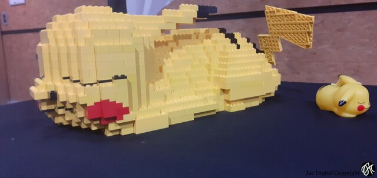
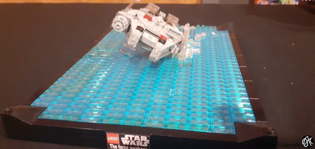

Pour cette 24e édition nous avions partagé notre stand avec Auver’Briques et il y avait encore beaucoup de choses de présentes sur tout le salon.

Pour la convention de cette année "Les héritiers de la force " de la ville de Cusset (03), nous ont mis à disposition un stand de près de 7m de long. Il était partagé comme convenue avec l’association locale "Auver’Briques" et cela nous a permis de pouvoir présenter beaucoup de choses.

Du coté auvergnat le Millénium UCS en situation dans Mos Espa, des mosaïque et une belle collection de masque.

Du côté FreeLUGuien, deux magnifiques diorama Mandalorian et un Pikashu.

L’exposition révélait encore énormément de choses, avec des dessinateurs, des acteurs des cosplay de très belles maquettes, des combats aux sabre laser et des sculptures en laiton que j’ai énormément apprécié.

Une belle représentation de la ville de Mos Esta...

Je me suis longtemps arrêté sur une des présentations phare, à mon gout, de la convention. Les sculptures en laiton de vaisseaux connu d’Olivier DUHEC. Sur son stand, il présentait le CyberLab de Capitaine Flamme, l’Odysseus de Ulysse31 et surtout de magnifiques reproductions des vaisseaux d’Albator. Ce qui m’a accrocher tout d’abord c’est le réalisme des formes avec de très bonnes proportions des maquettes. Ensuite, c’est la reproduction de la première version de l’Arcadia. C’est rare de le voir. Evidement, la version la plus récente de l’Arcadia était aussi présentée. Justement, en discutant avec une des personnes sur le stand que j’ai appris qu’une des ailes du vaisseau avait été dédicacée par [Leiji Matsumoto](https://fr.wikipedia.org/wiki/Leiji_Matsumoto). Ca a été en fait sa manière de reconnaitre le vaisseau. J’ai pu aussi discuter directement avec Olivier, c’était très intéressant. Il prépare Goldorak et je suis un peu impatient de voir le résultat.

Un petit plus avec le Capitaine Flamme en personne.....

Pierre nous a concocté pour cette année deux diorama Mandalorian que je ne pourrait pas vous commenter. Je n’ai vue aucun épisode. Mais je peu quand même juger. Ils étaient superbe. Beaucoup de visiteurs ont plonger les doigts dans l’eau et pas que des enfants...

Pour ma petite contribution de cette année, j’avais reproduit en plus gros une veilleuse Pikashu que ma fille a reçu à Noël. Sa position calme et endormi à beaucoup plus. C’était un régal de voir les visiteurs le reconnaitre de loin.

Le vol du micro Millenium a eu du succés lui aussi...

Encore une belle édition que cette convention. L’ambiance est toujours agréable, les visiteurs respectueux et il y a beaucoup de choses à voir.

Nous sommes attendue pour la 25e édition en 2024 et la 21e pour ma part.
