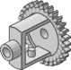
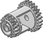
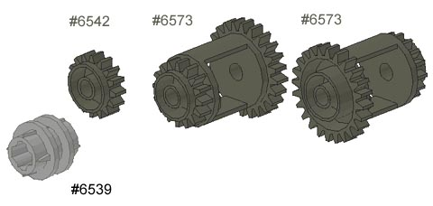
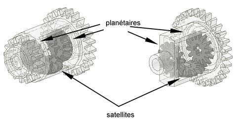
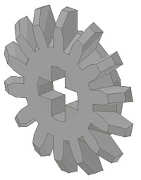
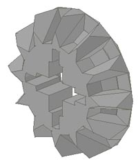
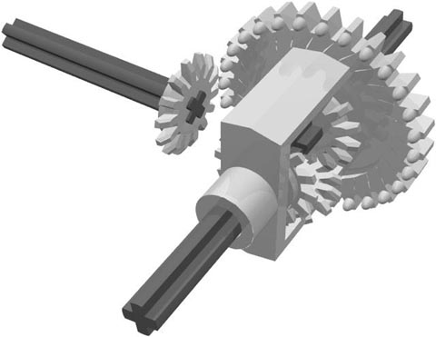
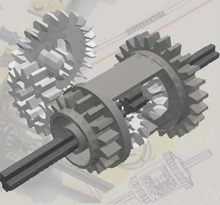

Le différentiel : les fans de Technic™ pensent bien connaitre ce montage mécanique mais qu’en est-il réellement ?

Revenons d’abord aux pièces qui le composent :

Un différentiel est composé

1) **d’une cage ou porte-satellite :**

**–** la [73071](http://www.peeron.com/inv/parts/73071) existe depuis 1980 [^1] et a disparu en 1993.

**–** la [6573](http://www.peeron.com/inv/parts/6573) existe depuis 1994 [^2] (elle remplace en fait purement et simplement la 73071)

La 6573 est plus compacte et dispose de deux couronnes d’entraînement (de taille différente - 16 et 24 dents) alors que la 73071 présentait une seule couronne (28 dents). Cette seconde cage possède aussi une gorge circulaire latérale crantée identique à celle présente sur la roue dentée folle (pièce #6542), utilisable avec le manchon de sélection (#6539) que nous avions présenté dans l’[article](http://www.freelug.org/article.php3?id_article=340) sur les boite à vitesse.

Toutefois cette possibilité n’a pas été employée, à notre connaissance, dans un modèle LEGO® officiel. Elle permettrait toutefois de créer un système de blocage de différentiel comme nous le montre David Wegmuller [ici](http://www.wegmuller.org/lego/technic/ideas/index.html).

Les deux cages comportent un ergot sur lequel on peut placer un pignon qu’on appelle un satellite, d’où le second nom de "porte-satellite" que l’on donne à la cage.

Les porte-satellites sont gris (73071) et gris foncé (6573), couleurs logiques étant donné leur emploi mécanique à l’exclusion d’usages décoratifs.

2) et de **pignons**

Ces pignons sont dits planétaires ou satellites en fonction de leur emplacement.

Les pignons satellites (en fait un seul en ce qui concerne les différentiels LEGO®), portés par la cage, sont entraînés dans son mouvement de rotation.

En LEGO® c’est le même type de pignon qui remplit les deux fonctions planétaires ou satellites :

**–** le [4143](http://www.peeron.com/inv/parts/4143) fragile (16 dents)

a été remplacé en même temps que la cage du différentiel par

**–** le [6589](http://www.peeron.com/inv/parts/6589) (12 dents), plus solide.

Logiquement les fans adultes de LEGO© plébiscitent ces améliorations techniques.

Tout le monde connait le différentiel des voitures, au moins de nom, mais je pense que l’on peut faire un rappel sur le principe. Nous devrions d’ailleurs l’appeler "cellule différentielle", d’une part parce que c’est son vrai nom technique, et d’autre part parce que cela reflète bien sa particularité.

**Comment fonctionne la cellule différentielle ?**

Cela sert à rompre sous certaines conditions une chaîne cinématique...voilà une définition un tant soit peu obscure...que nous allons éclaircir :

Une chaîne cinématique est l’ensemble des organes d’une construction qui transmet le mouvement de l’émetteur (le moteur) au récepteur (qui utilise le mouvement pour fournir le travail, par exemple les roues). En principe une chaîne cinématique est un ensemble rigide mécaniquement : le moteur et le récepteur sont liés mécaniquement, le rapport entre les déplacements angulaires de l’un et de l’autre est fixe, même si un organe permet de modifier ce rapport (boite à vitesse, variateur). Autrement dit, le rapport entre les deux organes, le menant et le mené, est fixe.

Dans le cas d’une chaîne cinématique où le moteur entraîne plusieurs récepteurs, tous les récepteurs sont liés mécaniquement entre eux et leur mouvement angulaire est donc défini. Si un récepteur se trouve bloqué toute la chaîne est bloquée, si un récepteur est freiné toute la chaîne est freinée. Dans certaines conditions cela est inacceptable et la cellule différentielle y apporte une solution :

La cellule différentielle a la propriété d’autoriser une différence de déplacement angulaire entre l’émetteur et le récepteur, c’est un calculateur mécanique. Il répartit la puissance [^3] entre l’émetteur et les récepteurs.

La cellule différentielle équilibre les forces entre deux récepteurs. Le récepteur le moins chargé utilisera plus de puissance jusqu’à ce que sa charge soit égale au récepteur le plus chargé et ce en augmentant sa vitesse. Si l’équilibre ne peut être rétabli, le récepteur le moins chargé absorbe toute la puissance disponible.

**A quoi sert la cellule différentielle ?**

L’usage le plus connu du différentiel est son usage au coeur des essieux des véhicules entre les roues pour permettre, dans les virages, de compenser les différences de parcours. C’est à cela que le montage différentiel sert à 99% dans les modèles officiels LEGO®

Si l’une des roues est bloquées, la cage par l’intermédiaire du satellite transmet tout le couple à l’autre roue. Elle tourne à une vitesse double.

L’inconvénient du différentiel est que si l’une des deux roues perd de l’adhérence (verglas, neige, ensablement, etc.), le différentiel fournit alors l’ensemble du couple à celle-ci : le véhicule ne peut plus avancer.

Pour remédier à cet effet on peut bloquer le différentiel (ceci existe sur les véhicules dit 4x4 notamment) ou utiliser des différentiels à glissement limité comme le différentiel Torsen (TORque SENsitive - sensible au couple).

La société LEGO® ne propose pas un tel mécanisme mais on peut le créer avec des pièces existantes :

[Torsen par laf](http://www.brickshelf.com/cgi-bin/gallery.cgi?f=34106)

D’ailleurs il est possible de créer un différentiel classique sans les pièces spécifiques LEGO® mais avec les pièces plus courantes comme nous le montre [Brian Alano](http://www.brickshelf.com/cgi-bin/gallery.cgi?f=27110)

On peut aussi utiliser un différentiel inter-ponts, notamment dans les véhicules dit 4x4, afin de répartir la puissance du moteur entre les essieux avant et arrière. C’est le cas par exemple dans deux modèles officiels :

**–** 4x4 Off roader [8466](http://guide.lugnet.com/set/8466)  
**–** Super Car [8880](http://guide.lugnet.com/set/8880)

[^1]: Dans ["auto chassis"](http://guide.lugnet.com/set/8860)

[^2]: elle fait son apparition notamment dans la ["super car"](http://guide.lugnet.com/set/8880)

[^3]: je devrais dire l’effort ou la vitesse de déplacement angulaire.
