Ce troisième article fait suite à un premier article de [présentation de l’écosystème PowerUp](/articles/3240/) et à un deuxième article qui détaille [les fonctionnalités de la programmation via l’application avec les anciens blocs](/articles/3241/).

Cet article détaille les fonctionnalités de la programmation via l’application. Pour l’installation de l’application, veuillez consulter le premier article.

Un quatrième donne l’[équivalence entre les bloc actuels et les anciens blocs](/articles/3259/).

## Modification du projet

[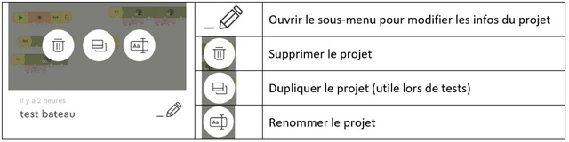](https://www.freelug.org/IMG/jpg/20240111_092455-1.jpg)

## Présentation de la page

[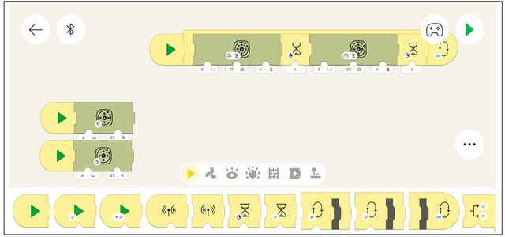](https://www.freelug.org/IMG/jpg/20240111_092455.jpg)

Sur le haut de l’écran :

-   La flèche vers la gauche (en haut à gauche) permet de sortir de ce mode
-   L’icône Bluetooth (en haut à gauche) permet de paramétrer la connexion, lancer le dialogue et de connecter plusieurs hubs (jusqu’à 4)
-   L’icône « Joy pad » (en haut à droite) permet de basculer en mode création d’interface
-   L’icône « play » (triangle vert en haut à droite) permet de lancer le programme
-   L’icône « stop » (carré rouge an haut à la droite) affiché quand un programme tourne. Il permet d’arrêter le programme  
    Sur le bas de l’écran :
-   7 palettes détaillées par la suite qui contiennent plusieurs blocs
-   Le rond blanc avec 3 points permet d’accéder à des raccourcis

## Connexion de plusieurs Hubs

Pour connecter plusieurs hubs / télécommandes, il faut d’abord connecter 1 par 1 les éléments puis les sélectionner :

[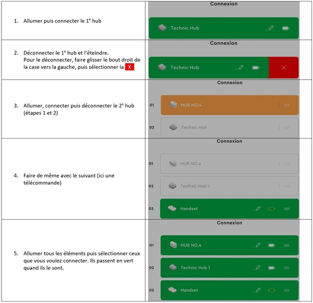](https://www.freelug.org/IMG/jpg/20240111_092517.jpg)

Nota : l’icône « crayon » permet de renommer le hub

## Raccourcis

En appuyant sur les 3 points sur la droite de l’écran, un menu supplémentaire apparait. Il permet d’accéder à certaines fonctions :

[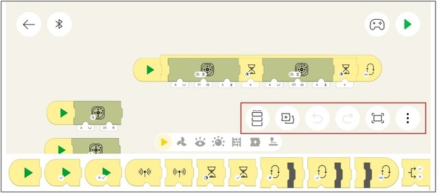](https://www.freelug.org/IMG/jpg/20240111_092525.jpg)

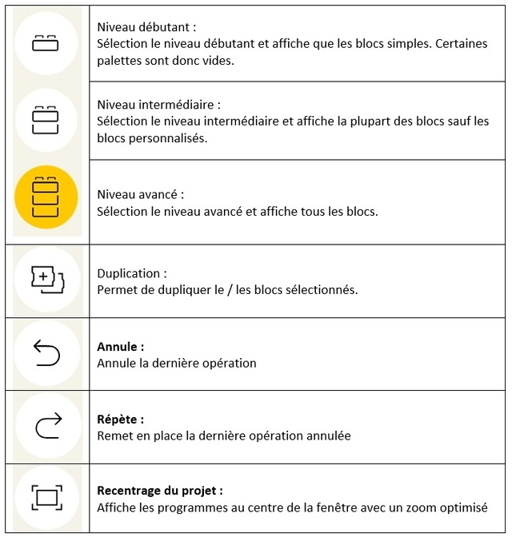

## Liste des palettes

Sur le bas de l’écran, se présente 7 palettes. Chaque palette contient un type de commande

[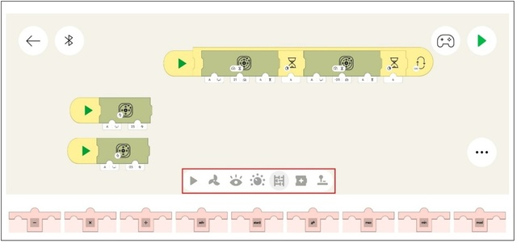](https://www.freelug.org/IMG/jpg/20240111_092540.jpg)

[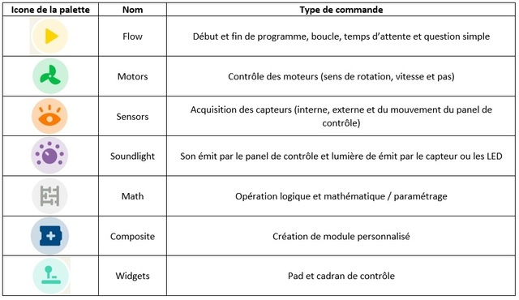](https://www.freelug.org/IMG/jpg/20240111_093932.jpg)

**La palette jaune / bloc d’écoulement**

[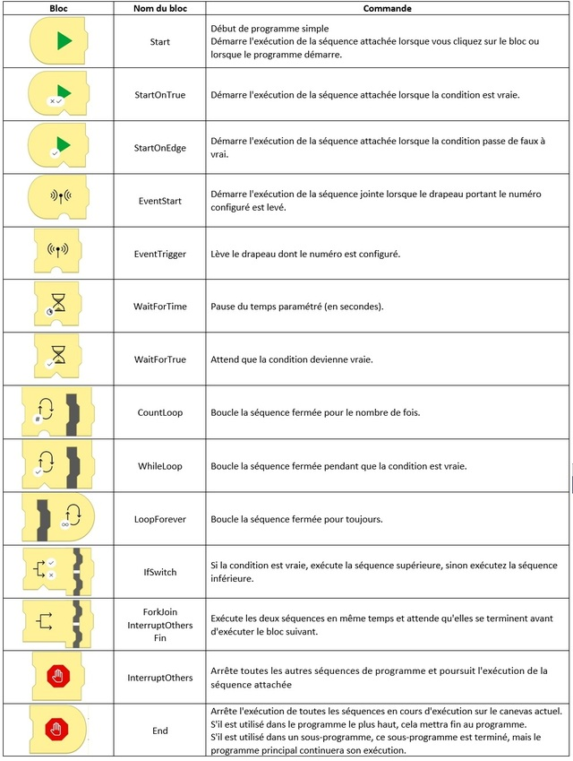](https://www.freelug.org/IMG/jpg/20240111_093946.jpg)

**La palette orange / bloc capteur**

[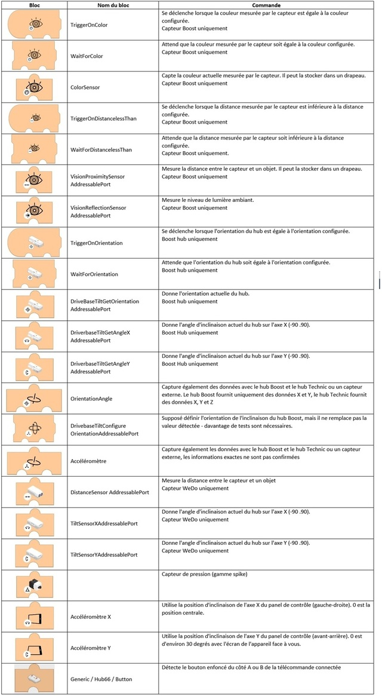](https://www.freelug.org/IMG/jpg/20240111_093955.jpg)

**La palette verte / bloc moteur**  
_Boucle ouverte ou fermée ?_

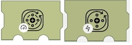

Les deux icônes ci-dessus sont semblables : ils actionnent un moteur à une vitesse donnée.

-   Boucle ouverte : le système en boucle ouverte envoie sa commande mais ne contrôle pas son exécution, ni ne corrige
-   Boucle fermée : le système en boucle fermée envoie sa commande contrôle son exécution puis corrige si nécessaire.

Le système en boucle fermée nécessite un capteur en sortie. Ce capteur est intégré dans les moteurs tachymétriques et angulaires.

L’icône qui accompagne le bloc défini son fonctionnement :

[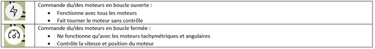](https://www.freelug.org/IMG/jpg/20240111_094007.jpg)

_Liste des blocs « moteur »_

[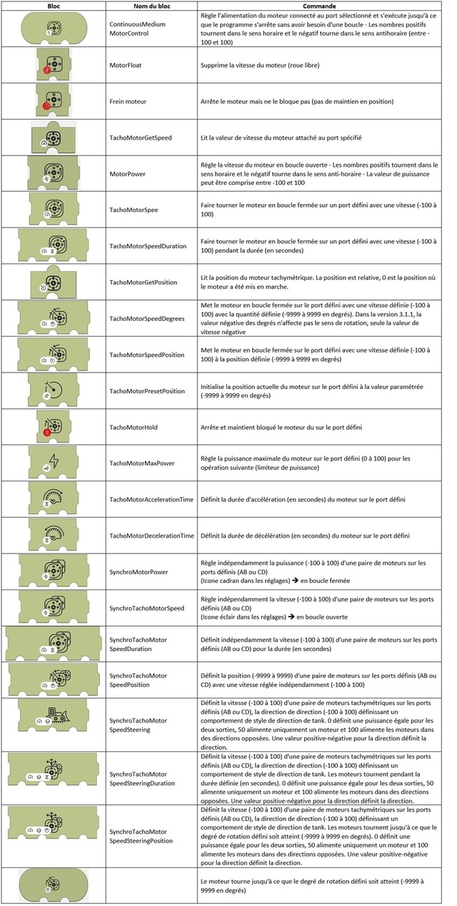](https://www.freelug.org/IMG/jpg/20240111_094011.jpg)

**La palette violette / bloc son et lumière**

[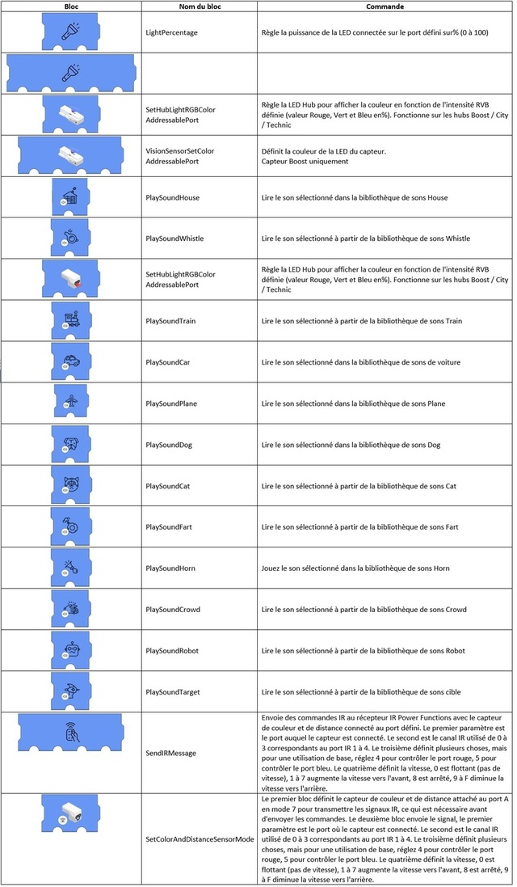](https://www.freelug.org/IMG/jpg/20240111_094031.jpg)

**La palette grise / bloc opération sur les données**

Variable locale ou globale ?

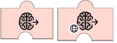

Les deux icônes ci-dessus sont semblable : ils affichent la variable enregistrée.

-   Variable locale : la variable locale est comme son nom l’indique spécifique au programme ou au bloc composite dans lequel est enregistrée. Elle ne peut être lue qu’au même endroit (bloc ou programme) où elle a été créée ou modifiée.
-   Variable globale : la variable globale est quant à elle globale à tous les programmes/ blocs composites dans lesquels elle est enregistrée. Elle peut donc être modifiée / lue à n’importe quel endroit.

La variable globale est identifiée par la sphère sur l’icône.

Les variables sont stockées dans une lettre. Un choix d’alphabet Grec ou Latin est proposé. Il y a donc 50 lettres possible.

_Liste des blocs « opération sur les données »_

[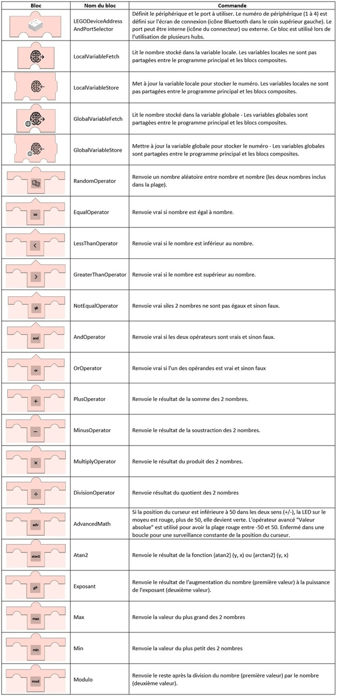](https://www.freelug.org/IMG/jpg/20240111_094042.jpg)

**La palette bleu / bloc personnalisation**

[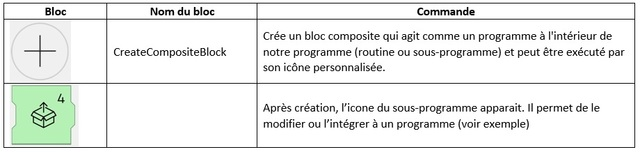](https://www.freelug.org/IMG/jpg/20240111_094052-1.jpg)

_Paramétrage du sous-programme_  
La forme du sous-programme est spécifiée dans le haut de l’écran. Exemple :  
Instruction de couleur verte. Le crayon sur la droite donne accès à la fenêtre de paramétrage.

[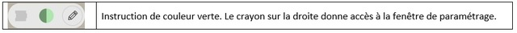](https://www.freelug.org/IMG/jpg/20240111_094052-2.jpg)

Le sous-programme peut prendre 3 formes :

[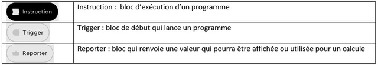](https://www.freelug.org/IMG/jpg/20240111_094052.jpg)

Une fois sélectionné, il n’est pas possible de changer la forme du sous-programme. Seule la couleur peut être modifiée.  
Pour plus d’information, consulter les exemples.

**La palette turquoise / bloc widget**

[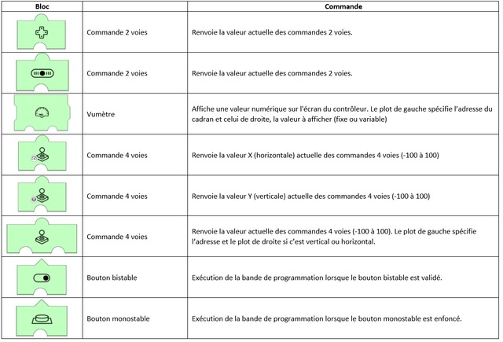](https://www.freelug.org/IMG/jpg/20240111_094057.jpg)

_Mode pads_  
Ce mode permet de créer une télécommande à partir de 3 types de boutons et des arrière-plans :

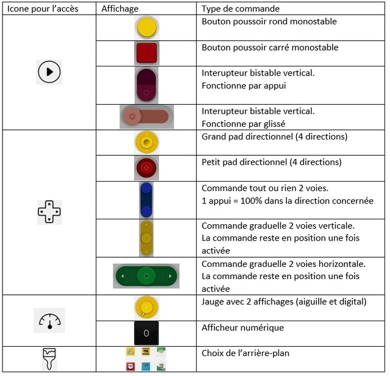

[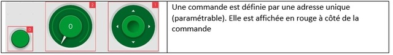](https://www.freelug.org/IMG/jpg/20240111_094107-1.jpg)

[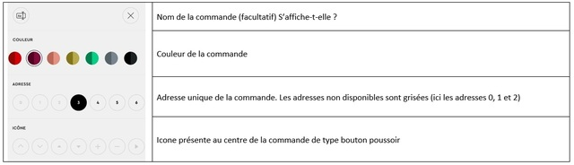](https://www.freelug.org/IMG/jpg/20240111_094107.jpg)

**Exemple 1**  
Le programme suivant lance le moteur dans un sens pour un temps donné puis fait une pause et retourne à sa position de départ  
Ce type de programme a été réalisé pour un train qui fait des aller-retours sur une voie unique et patiente en gare quelques secondes avant de repartir dans l’autre sens.

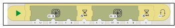

_Décryptage :_

[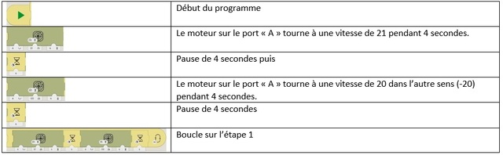](https://www.freelug.org/IMG/jpg/20240111_094113.jpg)

**Exemple 2**  
Le programme suivant se lance à l’appuie sur le bouton vert. Ensuite, le moteur est commandé par un variateur si le bouton rouge n’est pas actif.  
Ce type de programme a été réalisé pour commander un train via un tableau de bord

[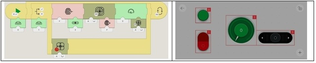](https://www.freelug.org/IMG/jpg/20240111_094115-1.jpg)

_Décryptage :_

[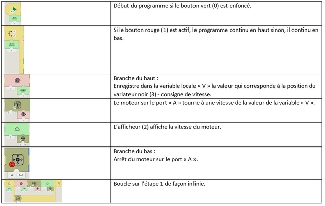](https://www.freelug.org/IMG/jpg/20240111_094115.jpg)

**Exemple 3**  
Ce programme a été réalisé pour un [GBB](/articles/362/) qui contient un train qui fait des aller-retours sur une voie unique et patiente en gare pour le chargement avant de repartir dans l’autre sens. Il utilise le capteur de couleur / distance pour localiser le train sur la voie.

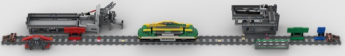

Le programme contient 2 autres « Contrôle programme principal » pour les couleurs rouge et bleu. Ils ne sont pas détaillés ici, ils sont sur le même principe que le vert.

[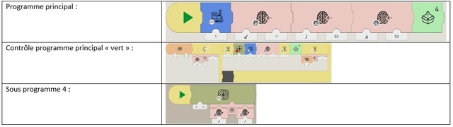](https://www.freelug.org/IMG/jpg/20240111_094123-1.jpg)

_Décryptage sous-programme 4 :_

[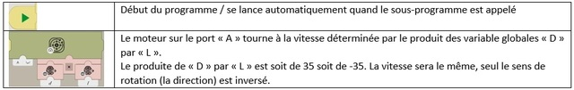](https://www.freelug.org/IMG/jpg/20240111_094123-2.jpg)

_Décryptage programme principal :_

[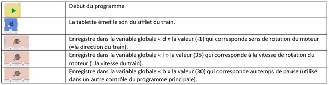](https://www.freelug.org/IMG/jpg/20240111_100432.jpg)

L’avantage de mettre la vitesse dans une variable est qu’elle est facile et rapide à changer et sur tout le programme.

_Décryptage Contrôle programme principal « vert » :_

