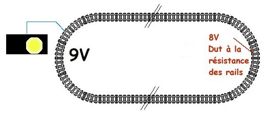
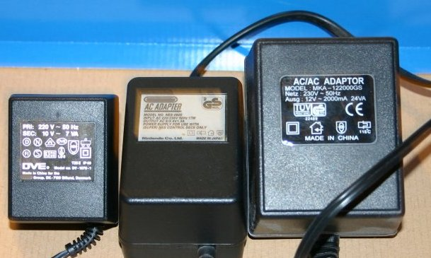
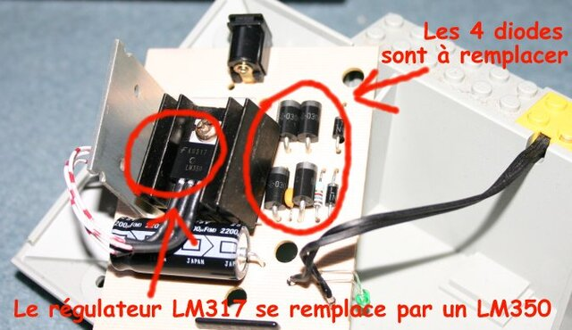
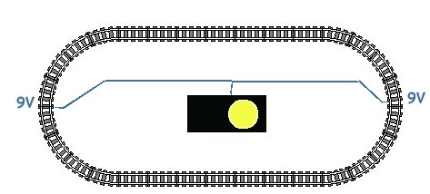

Un deux trois.....quatre cinq six...trains sur un même réseau

Vous l’avez déjà peut-être remarqué quand un circuit de trains est long (supérieur à 20 mètres) ou que l’on décide de faire rouler 5 ou 6 convois, on s’aperçoit que la vitesse des trains diminue.  
Cet article va vous permettre de comprendre pourquoi les trains ralentissent et va vous apporter la solution pour modifier l’électronique du régulateur.

**Exemple1**

Le régulateur mis à un endroit du circuit n’assure pas une continuité parfaite

Le système d’alimentation qui permet de faire circuler les trains sur un réseau est constitué de 3 éléments.  
**–** Un transformateur moulé 220V AC en entrée 10V AC en sortie.  
**–** Le bloc régulation avec sa grosse commande jaune.  
**–** Le câble au format électrique Lego qui vient se fixer sur les rails.

La première modification que l’on peut faire c’est de remplacer le transformateur moulé par un modèle plus gros. Il faut bien regarder l’étiquette imprimée sur le transformateur, la tension doit être d’au moins 12V en continue (DC) ou 10V en alternatif (AC) une autre caractéristique est le courant de sortie, préférer un modèle d’au moins 15VA ou 1300mA, plus c’est bien, mais là il va falloir faire un peu de chirurgie,

**transformateurs**

Plusieurs exemples de transormateurs qui peuvent être utilisés

La deuxième modification est cette fois-ci un peu plus complexe, elle consiste à ouvrir dans un premier temps le bloc à l’aide des 4 vis. Une fois le bloc ouvert on y trouve la carte électronique et le gros commutateur jaune,les 4 diodes qui forment le pont de diodes doivent être remplacées, elles sont en quelque sorte une retenue de courant.

**Modification**

Voila l’emplacement des composants à échanger pour avoir un courant plus élecvé en sortie

Le régulateur utilisé ici est un peu particulier car il est protégé en cas de surchauffe, ce qui donne l’impression au bout d’un certain temps d’utilisation que les moteurs de train fatiguent, on peut s’en apercevoir à l’intensité de la LED qui diminue quand on tourne le commutateur à fond. Donc le régulateur LM317 doit être remplacé par un régulateur LM350. Le condensateur peut lui être aussi remplacé par un plus gros mais dans l’utilisation que nous en faisons ça ne change pas grand chose.

Enfin la troisième modification et sans doute la plus simple est de doubler les câbles ou alors de câbler à l’autre point du circuit le connecteur électrique. **Attention à la polarité**. En effet les rails n’étant pas de la meilleure matière qui soit, les chutes de tension sont très fréquentes.

**modification3**

Utilisez deux cables pour rails afin de bien distribuer le courant. DANS LE DOUTE UTILISEZ UN MULTIMETRE pour vérifier la pôlarité

Les modifications citées ici ne sont pas les seules solutions mais sont des solutions à faibles coûts. L’achat des diodes ne devrait pas dépasser 1€ et le régulateur coûte environ 2.5€. Le reste étant pour moi de la récupération de matériel non utilisé.

Pour conclure sachez que **toutes les précautions d’usage doivent être prisent lorsque l’on travaille avec l’électricité, dans le cas présent ne faire aucune opération de démontage en présence de tension**.

**Post-Scriptum :**  
Ici vous trouverez les documentations techniques des constructeurs des régulateurs et diodes :

LM317 :  
[http://www.fairchildsemi.com/ds/LM/LM317.pdf](http://www.fairchildsemi.com/ds/LM/LM317.pdf)

LM350 :  
[http://www.fairchildsemi.com/ds/LM/LM350.pdf](http://www.fairchildsemi.com/ds/LM/LM350.pdf)

Diodes :  
[http://www.bytesonic.com.tw/cddata/databook-1/124.pdf](http://www.bytesonic.com.tw/cddata/databook-1/124.pdf)

**N.B :  
Je décline toute responsabilité en cas d’incidents, l’opération se fait sous la propre responsabilité de l’utilisateur et bien entendu toute modification annule la garantie LEGO(r)**

**

A nos jeunes lecteurs, demandez à un adulte d’effectuer ces transformations, ne le faites pas vous même.

**

**Je reste bien entendu à la disposition de tous pour toutes explications complémentaires.**
